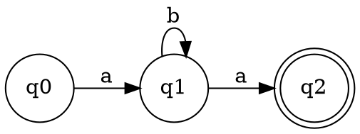

<!-- Собрано из packages/render/src/blocks/dot/docs.md основного репозитория Spiridus (scripts/build-public-docs.mjs) — правьте там. -->

# `dot` — графы Graphviz

Граф на языке DOT ([Graphviz](https://graphviz.org/doc/info/lang.html)): деревья, конечные
автоматы, зависимости, сети. Можно писать и `graphviz` вместо `dot`.

Раскладка — первой строкой комментария: `// engine: neato` (ещё `fdp`, `sfdp`, `circo`,
`twopi`, `osage`, `patchwork`), по умолчанию `dot`.

Граф рисуется вживую во фрейме-песочнице запускателя (volkodlak.ru); на странице проверки
— картинкой. Ссылки (`URL`, `href`) и картинки в узлах (`image`) не работают:
у блока нет ни сети, ни файлов. Шрифт — Arial. Не больше 32 КБ.

## Как чинить замечания `render_check`

`render_check` смотрит внутрь рисунка: `label-crossed` — линия через подпись, `label-tight` — линия касается подписи, `label-overlap` — подписи налезают, `label-outside` — подпись шире своей фигуры, `label-small` — после ужатия под колонку мельче 9 точек. В замечании — текст подписи, а в ответе — вырез места (`label-<строка>-<n>.png`).

- `label-crossed` у подписи ребра — `xlabel` вместо `label` (ставится сбоку от ребра), `labeldistance`, `labelangle`; при `rankdir=LR` подписи рёбер — сверху.
- `label-crossed` или `label-overlap` между узлами — больше `nodesep` и `ranksep` (`graph [nodesep=0.6, ranksep=0.8]`), `splines=ortho` или `polyline`.
- `label-tight` у петли (`a -> a [label="0"]`) — `headport`/`tailport` (`:n`, `:s`) и `labeldistance`.
