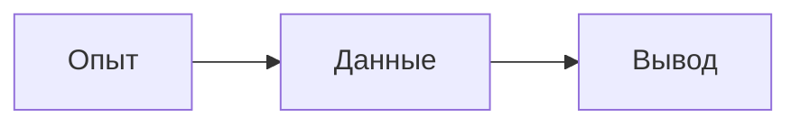

<!-- Собрано автоматически из справки render_block_docs — правки в основном репозитории Spiridus. -->

Обзор — [Формат документа Spiridus](../markdown.md).

# Формат документа Spiridus

## Документ одним взглядом

Документ — Markdown (CommonMark и GFM: таблицы, списки задач, зачёркивание) с формулами KaTeX
и наглядными блоками. Один исходник читают человек и модель; `render_check` рисует его, как
у читателя, и возвращает замечания со строками. Та же справка — `render_block_docs({lang:"markdown"})`.

````markdown
# План опыта

Проверим, как меняется величина $E=mc^2$.

- [x] Подготовить данные
- [ ] Обсудить результат



| Шаг | Статус |
|---|---|
| Опыт | Готов |
````

## Наглядные блоки

Блок — fenced-код с языком: например, `mermaid`, `tikz`, `echarts`. Список языков —
`render_blocks`, синтаксис конкретного — `render_block_docs({lang:"mermaid"})` и
[справка по блокам](../blocks/README.md).
Часть блоков рисуется у читателя, часть требует предварительного серверного расчёта:
вне проекта вставьте готовый `block` из ответа инструмента, включая ссылку `result: artifact:…` и сборку.
**В статьях проектов `artifact:` и `blob:` запрещены, в том числе внутри кода и блоков.**
Серверные блоки с `result: artifact:…` там пока не работают; рассчитанную картинку положите
ресурсом и вставьте по относительному пути. Пересчёта у читателя `/p` пока нет.
[Ресурсы и нынешние ограничения](../projects.md#ресурсы-и-серверные-блоки).
Не выдумывайте id результата. [Сборки и серверные блоки](../blocks/sandbox.md).

## Атрибуты строки забора

**Атрибуты блока** — пары `ключ=значение` после языка в строке забора: они говорят, **как**
рисовать блок, и не трогают его исходник (код TikZ, Mermaid, QASM остаётся чистым и переносится
в другие программы как есть; GitHub и другие просмотрщики эти слова не видят).

````markdown
```tikz build=tex-2025
```stl touch=views gyro=on
```plantuml build=plantuml-1.2026.9-asl
```csv file=оценки.csv
````

| Ключ | У каких блоков | Что |
|---|---|---|
| `file=` | любой блок данных (`csv`, `tsv`, `json`) | имя файла данных документа ([данные документа](#данные-документа)) |
| `build=` | `tikz`, `stl`, блоки песочниц (`plantuml`, `structurizr`, `modelica`, `qet`, `hdl`, `digitaljs`, `qiskit`) | сборка: каким комплектом или версией программы нарисован блок; то же, что строка `build:` внутри блока |
| `touch=` | `stl`, `openscad`, `modelica` (3D) | сенсорный экран: `rotate` — вращать пальцем (по умолчанию), `views` — кнопки видов, палец остаётся странице, `turntable` — модель сразу вращается на столе |
| `gyro=` | `stl`, `openscad`, `modelica` | `on` — на телефоне кнопка «наклоном»: модель поворачивается наклоном устройства |
| `view=` | `modelica` | слои через запятую: `scene` (2D-анимация), `3d` (MultiBody), `plots` (графики); по умолчанию все, а на узком экране графики под анимацией свёрнуты |
| `debug=` | любой блок | `on` — служебная строка под рисунком: чем и какой сборкой нарисован, атрибуты, время отрисовки; без неё сведения о сборке не показываются (расхождения сборки и исходника — всегда) |
| `lint=` | любой блок | линтеры `render_check`: `off` — блок не проверять (например, нарочно неверный пример), имя линтера (`ruff`, `shellcheck`…) — только он |
| `lint-ignore=` | любой блок | правила линтера, которые не показывать: `lint-ignore=E501,SC2086` |

Значения — без пробелов. Неизвестный ключ или значение — замечание под блоком (`render_check`:
warning). Правило: в строку забора — **как** рисовать (сборка, устройство, файл), внутрь блока —
**что** рисовать (`signals:` у осциллограмм, `сечение:` у модели).

## Формулы

`$…$` — формула в строке, `$$…$$` — отдельным блоком. Используется KaTeX с расширением
mhchem: `$\ce{2H2 + O2 -> 2H2O}$`, `$\pu{1 mol}$`. Длинная выключенная формула сама не
переносится: разбейте её строками `\\` внутри `gathered` или `aligned`.

## Данные документа

**Файл данных** — блок кода с именем файла в строке забора: ` ```csv file=оценки.csv `
(также `tsv`, `json`). У читателя он свёрнут — «Данные: оценки.csv — 30 строк, 4 столбца» с
таблицей. Блоки, которые читают данные, ссылаются на него по имени: в `vega` и `vega-lite` —
`"url": "file:оценки.csv"`. Имя — буквы, цифры, `_`, `.`, `-`; в документе оно одно. Внешних
файлов и адресов в интернете блоки не загружают: данные — в самом документе.

## Картинки и файлы

Готовые картинки с указанием автора и лицензии — `render_media`: используйте строку из ответа.
Для Викисклада допустимы страницы файлов из пакета `media`, а не произвольные внешние картинки
([справка о картинках](../blocks/media.md)).
Свой файл вне проекта сначала загрузите, затем опубликуйте через `files_publish`: он вернёт
`artifact:<id>/<имя>` и готовую Markdown-строку. Публикуются собственные `upload:`/`private:`
до 10 МиБ; `upload:` — картинки и шрифты, `private:` — файл. Ссылки `upload:` и `private:`
в документ не вставляйте: читатель их не видит.

В проекте положите ресурс через `project_write` и ссылайтесь относительным путём:
``. Ресурс доступен участникам проекта; публикация результата
с меткой проекта через `files_publish` запрещена. [Файлы и права](../tools.md#свои-файлы).

## Ссылки и навигация в проекте

На раздел той же статьи: `[выше](#Проба)`; пробел в адресе кодируйте `%20`,
например `[раздел](#Глава%20Б)`. Обзор инструментов навигации —
[«Проекты»](../projects.md#навигация).

Статья открывается на `/p/<slug>/<путь>.md` после входа участника. Внутри проекта используйте
относительные Markdown-ссылки: `[Далее](Главы/Опыт.md)`, `[Назад](../Начало.md)`.
Код, формулы и YAML не создают ссылок навигации.

Раздел — текст заголовка, как в Obsidian: `[Детали](Статья.md#Глава%20Б#Детали)`.
Цепочка через `#` различает одинаковые заголовки; необязательно перечислять всех предков,
но их порядок должен совпадать. Разрешение берёт первый непустой набор совпадений:
точный текст → без учёта регистра → без выделения жирным, курсивом и зачёркиванием,
без учёта регистра. При нескольких кандидатах выбирается первый по исходнику с предупреждением.
Лишь затем принимается старый слаг (`#глава-б`) с предупреждением о совместимости с Obsidian.
Текст имеет приоритет над слагом; конкурирующие адреса также дают предупреждение.
URL-кодирование фрагмента декодируется один раз.

Блок — `[К расчёту](Статья.md#^block-1)`. Для абзаца, пункта списка или цитаты маркер
`^block-1` ставят в конце текста; для целого списка, таблицы, огороженного кода или блока формулы —
отдельным абзацем после блока, через пустую строку:

```markdown
| Величина | Значение |
|---|---|
| Масса | 10 |

^mass-table
```

В id — латинские буквы, цифры и дефис, до 64 знаков, регистр значим. У блока действует
первый допустимый маркер; повтор id адресует только первое вхождение в статье.
Раздел читается с подразделами, блок — целиком. `project_read` принимает `fragment` с тем же
адресом: `"Глава%20Б#Детали"` или `"^block-1"`; `op:"links"` возвращает ссылки и обратные ссылки.

### Вики-ссылки при записи

`[[Цель]]`, `[[Цель#Раздел|подпись]]` — допустимый ввод. При записи статьи `project_write`
разрешённые вики-ссылки превращаются в относительные Markdown-ссылки:
`[[Цель|план]]` → `[план](Цель.md)`, простое `![[media/x.png]]` → ``.
Сначала ищется точный путь **от корня проекта** (включая файл в корне), затем уникальное имя
файла, затем уникальное совпадение без регистра. Расширение `.md` можно опустить.
YAML `aliases` пока не участвуют в поиске; `|подпись` — только текст ссылки, не имя цели.
В таблице разделитель подписи экранируют: `[[Цель\|подпись]]`.

Новая неоднозначная цель отклоняет запись с кандидатами: укажите полный путь от корня.
Отсутствующая цель остаётся дословно с предупреждением. Прежняя неоднозначная ссылка и
неоднозначность при импорте тоже остаются с предупреждением; восстановление версии сохраняет
исходник дословно и возвращает диагностику. Встраивание статьи, раздела или блока и картинка
с размером/подписью (`![[x.png|300]]`) пока не поддерживаются: остаются как ввод с предупреждением.

Однозначный фрагмент Markdown- или вики-ссылки записывается текстовым адресом заголовка,
при необходимости с цепочкой; при конкурирующих кандидатах фрагмент сохраняется с предупреждением.
Код, формулы, YAML и `%%` при этой нормализации не меняются. Настоящие назначения CommonMark
имеют приоритет: например, `[[x]](url)` остаётся Markdown-ссылкой на `url`.
Вики-ссылка внутри подписи Markdown-ссылки не преобразуется и даёт предупреждение.
Перенос статьи или ресурса сохраняет целостность прежних ссылок, включая ссылки внутри `%%`.

Проверьте ответ записи: `url`/`urls` — адреса для человека, `transformations` — «было → стало»,
`warnings` — оставшийся ввод и проблемы навигации. Есть полные счётчики `transformationCount` и
`warningCount`; отчёт нормализации ограничен 100 записями каждого вида и 64 КиБ суммарно,
кандидаты — 20. К `warnings` могут добавляться замечания навигации.
Это нормализация **записи проекта**: простой показ Markdown и обновление прежнего `/d`
не заменяют её. [Работа с проектом](../mcp.md#проекты).

## Свойства и комментарии

**Свойства и комментарии Obsidian.** YAML между `---` в первой строке документа и
закрывающей строкой `---` показывается свёрнутым блоком «Свойства» с исходником. Ключи
сохраняются как есть; `title` не заменяет название, `cssclasses` не меняет оформление.
В другом месте `---` остаётся обычным Markdown.

`Текст %%заметка себе%% дальше` скрывает комментарий при чтении. Блочный комментарий
начинается строкой `%%` и заканчивается следующим `%%`; внутри не появляются заголовки,
адреса блоков и рисунки. Незакрытый `%%` скрывает остаток документа, а `render_check`
выдаёт замечание на строке открытия. В коде и формулах `%%` сохраняется.
У сложного чередования многострочных строчных комментариев и незакрытых заборов
ограничен бюджет повторного разбора: 1 МиБ плюс восемь длин исходника в знаках.
При отказе разбейте документ или поставьте открывающие `%%` на отдельные строки.

Комментарии и свойства не участвуют в отображаемой навигации. Для целостности проекта
Markdown-ссылки внутри `%%` учитываются: удерживают ресурсы и правятся при переносе.
Ссылки в свойствах YAML пока не считаются ссылками проекта и не переписываются;
`render_check` предупреждает об этом ограничении, если свойства похожи на ссылки.
Исходник YAML сохраняется побайтно. Скрытый комментарий **не является секретом**:
его видят читатели исходника, `project_read`, выгрузка и история.

Управление проверкой текста — HTML-комментариями, например:

```markdown
<!-- text-words: слайсер, кубит -->
<!-- text-ignore: Spiridus.Fillers, WORD_REPEAT_RULE -->
```

Они тоже не являются секретом. [Настройка проверки русского текста](../russian.md).

## Сворачивающийся раздел

**Сворачивающийся раздел** — единственный HTML, который понимает документ, как на GitHub:

```markdown
<details>
<summary>spine1 — полная конфигурация</summary>

обычный Markdown: текст, таблицы, блоки кода, схемы

</details>
```

`<details open>` — раздел открыт сразу. Пустые строки после `</summary>` и перед `</details>`
обязательны: без них Markdown считает содержимое продолжением HTML и выбросит его. Разделы можно
вкладывать. Атрибутов, кроме `open`, нет; прочий HTML по-прежнему отбрасывается.

## Как видит читатель

**Длинный код** (больше 25 строк) у читателя свёрнут до 12 строк с кнопкой «показать всё»;
в печати и в `render_check` — целиком. У каждого блока кода — значок копирования (на
компьютере — при наведении).

**Копирование фрагмента**: инлайн-код в обратных апострофах — `show bgp evpn summary` —
копируется щелчком, при наведении рядом появляется значок. Команды, адреса, имена файлов,
которые читатель будет вставлять, пишите так.

## Ловушки

- Стихи и строки диалога: в Markdown перевод строки внутри абзаца — пробел, строки сольются.
  В конце строки — `\` (или два пробела), строфы — пустой строкой; в цитате `>` — так же.
- Ударение — знак U+0301 после гласной: «мука́».
- Длинная выключенная формула не переносится сама: `\begin{gathered} … \\ … \end{gathered}`
  или `aligned`.
- Таблица шире колонки на телефоне прокручивается вбок; столбцов — до 5–6, подписи короче.
- Вне проекта картинки — из `render_media` или опубликованных результатов; в проекте — свои
  ресурсы по относительному пути. Проверяйте их с `project` и `path`, иначе ресурс не разрешится.
  [Справка о картинках](../blocks/media.md).
- Не вставляйте действующий ключ `sp_…` в текст: публичная запись отклоняется, чтобы ключ не
  увидел читатель. В примерах используйте `$SPIRIDUS_KEY`.

## Пределы

Документ для `render_check` — до 512 К знаков; статья проекта — до 512 КиБ. Основные пределы разбора — 64 уровня вложенности,
4096 вложенных маркеров и 3 секунды. Детали — также в [справке разметки](../blocks/markdown.md).

Перед разбором проверяются префиксы строк: не больше 64 уровней списков и цитат
(`maxMarkdownNesting`, с консервативным учётом отступов) и 4096 маркеров во вложенных
префиксах за весь документ (`maxMarkdownNestedMarkers`). Повторяющиеся вложенные списки
могут надолго остановить браузер даже при небольшой глубине. При превышении появится
ошибка с именем предела и номером строки: уменьшите вложенность или число таких пунктов.
Соседние пункты без вложенности бюджет не расходуют: 1–4 пробела после маркера списка
входят в его ширину, поэтому плоский список вида `-   пункт` тоже допустим.
Содержимое огороженного кода верхнего уровня (заборы из трёх и более обратных апострофов
или тильд) бюджет не расходует. Забор закрывается тем же знаком, повторённым не меньше
раз, чем в начале; незакрытый блок продолжается до конца документа. HTML-блоки (включая
`pre`) и блоки формул `$$` расходуют бюджет: заборы внутри них не отключают проверку. Код с отступом,
заборы в списках и цитатах и неоднозначные случаи проверяются консервативно: в частности,
забор с отступом в 2–3 пробела после списка может быть его продолжением.
При неоднозначном переходе между контейнером, HTML, формулой и кодом маркеры считаются
до конца документа, включая последующий код. Уберите неоднозначную разметку или сократите
число вложенных префиксов.
Число возможных HTML-сущностей (`&amp;`, `&#32;`, включая неизвестные имена) вне
достоверного кода, YAML и блочных `%%` — не больше 4096 между пустыми строками
(`maxMarkdownEntities`).
Сущности рядом с неудачными email-автоссылками GFM могут вызвать квадратичную склейку текста.
При превышении сократите число сущностей или разделите документ. В сомнительной разметке
проверка консервативна, как для вложенности.
Это не гарантия быстрого разбора любой разметки.

Разбор у читателя (редактор, `/d`, `/p`) и в `render_check` идёт в отдельном потоке браузера со
сроком 3 с: страница при этом не замирает. Не уложился — вместо документа заглушка «Документ
слишком сложный для показа», `render_check` возвращает ту же ошибку (`markdownTimeoutMs 3000`).
Так бывает с большим документом (сотни КиБ) из тысяч отдельных списков или цитат, с тысячами
строк-подчёркиваний `===` под текстом, ленивых продолжений цитат или незакрытых `*`, `~~`, `[…](`.
Разделите документ на части или упростите разметку. Тот же срок — у Markdown внутри блоков
(ячейки ```` ```table ````).
Если браузер не дал запустить этот поток (расширение, политика безопасности), документ не
разбирается совсем: вместо него заглушка «Документ не показан» — разбора без срока у читателя нет.

## Проверка

| `issues[].kind` | Категория `strict` / `totals` | Влияет на `built` |
|---|---|---|
| `error` | `error`, всегда ошибка | Да |
| `warning` | `warning` | Нет |
| `text` | `text` | Нет |
| `lint` | `lint` | Нет |
| `layout`, `media` и другие виды | `layout` | Нет |
| `check-off` | Информация, в totals/strict не входит | Нет |

`project-link` — правило (`rule`) замечания, а не отдельная категория strict; учитывайте его `kind`.
Сценарии `interact` дополнительно влияют на `clean`. [Сценарии](../check.md).

`render_check` возвращает `built`, `clean`, `issues` и `verdict`. `built` — блоки собраны;
`clean` — они собраны и сценарии `interact` прошли. По умолчанию warning/layout/text/lint
не меняют `clean`; `strict: ["warning","layout"]` включает выбранные виды в приёмку.
Не сравнивайте `verdict` с фиксированной строкой: это пояснение для человека.
[Живые блоки и статьи проекта](../check.md), [русский текст](../russian.md).

**Линтеры.** `render_check` вместе с отрисовкой прогоняет блоки через линтеры их языка: Python — ruff, JS/TS — Biome, sh/bash — ShellCheck, Dockerfile — hadolint, YAML —
yamllint, SQL — sqlfluff, JSON, TikZ — chktex, Graphviz, D2, Vega и Vega-Lite — по схеме, BPMN —
bpmnlint, текст — markdownlint (таблицы) и правила Spiridus: «законно, но не то» — имя с пробелом без
кавычек в Graphviz (два узла), двоеточие и точка в именах D2, `\\` без `align` в TikZ, `$` у цен.
Замечания — с `kind: lint`, строкой документа и подсказкой; по умолчанию они не меняют `clean`; `strict: ["lint"]` включает их в приёмку. Блоки внутри
примеров ````markdown проверяются тоже (с пометкой `example`). Отключить — `lint=off` у блока.

`render_check` выдаёт `kind: warning` для отсутствующих фрагментов своей статьи,
конкурирующих заголовков и коллизий текста со слагом, недопустимых и повторных `^id`,
ненадёжных заголовков со ссылками/сущностями и зарезервированных id сносок.
Слаг вместо текста раздела и адрес `/p/…` зависят от Spiridus и получают предупреждение
о переносимости в Obsidian. Цели других статей проверяет индекс проекта.
Свойства YAML и `%%` не считаются лишним текстом; ссылки в YAML и незакрытый `%%`
получают отдельные предупреждения. Замечания берутся из того же разбора, что и показ, под тем же сроком.

Однотипные замечания сгруппированы по `code` и набору конкурентов: `count` — число замечаний в группе,
`lines` и `examples` — до 20 примеров. У конкурентов `candidateCount` — полное число
кандидатов, `candidates` — первые 20 (строка и текст). Отчёт содержит не больше 100 групп
и итог пропущенного остатка; карта якорей дополнительно ограничивает исходные замечания
1000 записями и сообщает число остальных. `warning` не мешает `built`; при
`strict: ["warning"]` предупреждения делают `clean: false`.
