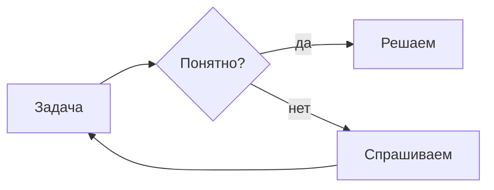
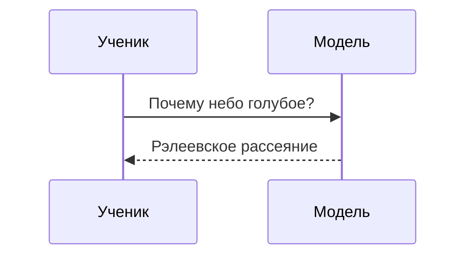

<!-- Собрано из packages/render/src/blocks/mermaid/docs.md основного репозитория Spiridus (scripts/build-public-docs.mjs) — правьте там. -->

# `mermaid` — схемы Mermaid

Текстовое описание схемы на языке [Mermaid](https://mermaid.js.org/): блок-схемы, диаграммы
последовательности, классов, состояний, ER, Ганта, круговые, mindmap, временные шкалы.
Первая строка — тип схемы.

Схема рисуется вживую настоящим Mermaid — во фрейме-песочнице на отдельном домене
(volkodlak.ru), без доступа к странице и данным. Поэтому работает всё: HTML и переносы ` ` в
подписях, `click` с подсказками, темы и директива `%%{init: …}%%`. Ссылки из `click … href` во
фрейме не открываются. Заметки и сообщения диаграмм последовательности переносятся по ширине сами.
Кнопка «⤢» — на весь экран. Не больше 32 КБ.

Иконки — из наших наборов (список — `render_icons`): `affinity` (сетевые, цветные), `mdi`
(значки устройств и ИТ), `logos` (логотипы продуктов). Схема архитектуры:

```mermaid
architecture-beta
  group lan(affinity:office)[Офис]
  service inet(affinity:globe)[Интернет]
  service fw(affinity:firewall)[Межсетевой экран] in lan
  service sw(affinity:switch)[Коммутатор] in lan
  service srv(logos:nginx)[Веб-сервер] in lan
  inet:R -- L:fw
  fw:R -- L:sw
  sw:R -- L:srv
```

В flowchart иконка — у узла: `A@{ icon: "mdi:router", form: "square", label: "Шлюз" }`
(`form`: `square`, `circle`, `rounded`; `pos: "t"` — подпись сверху). Наборы грузятся с нашего
домена при первом упоминании, в сеть никто не ходит.

Ловушки:
- Знак `>` или `<` в подписи узла пропадает (`D{a > b?}` выйдет «a b?»): пишите `#gt;` и `#lt;` —
  `D{"a #gt; b?"}`.
- Широкие виды: `timeline`, `gantt`, `mindmap` и `flowchart LR` с длинными подписями не
  помещаются в колонку (а на телефоне — тем более). Для узкой колонки — `flowchart TD`, короткие
  подписи с переносами ` `; ленту времени — таблицей или TikZ.

## Как чинить замечания `render_check`

`render_check` смотрит внутрь рисунка: `label-crossed` — линия через подпись, `label-tight` — линия касается подписи, `label-overlap` — подписи налезают, `label-outside` — подпись шире своей фигуры, `label-small` — после ужатия под колонку мельче 9 точек. В замечании — текст подписи, а в ответе — вырез места (`label-<строка>-<n>.png`).

- `label-crossed` в `architecture-beta` — подпись стоит под значком, вертикальная связь (`:B -- T:`) проходит через неё: соединяйте по горизонтали (`:R -- L:`), ветвления рисуйте в D2.
- `label-crossed` у подписи ребра в flowchart — короче текст на стрелке, перенос ` `, или смените направление (`flowchart TD` ↔ `LR`); у узлов с иконкой (`A@{ icon }`) связь подходит к рамке с подписью — такое не пересекает.
- `label-crossed` в sequence — заметка `Note over A,B` поперёк сообщений: перенесите её выше/ниже или укоротите.
- `label-small` — схема шире колонки: `flowchart TD`, короче подписи; `timeline`, `gantt`, широкие `mindmap` — таблицей или отдельными схемами.
