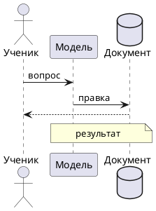
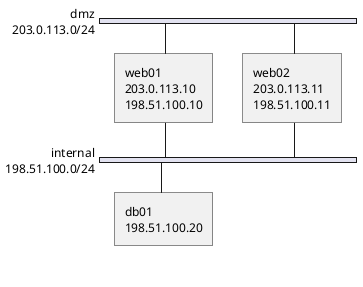
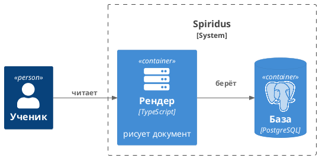

<!-- Собрано из notations/plantuml/docs.md основного репозитория Spiridus (scripts/build-public-docs.mjs) — правьте там. -->

# `plantuml` — схемы PlantUML

Схема на языке [PlantUML](https://plantuml.com/ru/): последовательности, классы, компоненты,
состояния, активности, ER, развёртывание, сетевые схемы `nwdiag`, C4, mindmap, WBS, Ганта, JSON
и YAML. Рисует не страница, а MCP-инструмент `plantuml_run`: PlantUML (сборка под Apache-2.0) и
Graphviz в песочнице без сети. Он возвращает `artifact:<id>/diagram.svg` — эту строку пишут
первой в блоке, комментарием PlantUML (апостроф):

Без строки `result` блок показывает исходник и замечание «схема не нарисована»; `render_check`
считает это ошибкой. После правки исходника вызывайте `plantuml_run` снова: в результате хранится
хеш исходника, и расхождение показывается под схемой.

**Сетевые схемы** — `nwdiag` в своём ограждении `@startnwdiag … @endnwdiag` (внутри `@startuml`
PlantUML его больше не принимает; если написать `@startuml`, инструмент поправит сам): подсети
полосами, узлы. Адреса узлов пишите в `description`, а не полем `address`: его nwdiag кладёт поверх линии подключения, и `render_check` скажет «линия через подпись».

**Иконки и библиотеки** — только стандартная библиотека из самого PlantUML, `!include <…>`:
`<C4/C4_Context>`, `<C4/C4_Container>`, `<C4/C4_Component>` (C4-PlantUML),
`<aws/Compute/AmazonEC2/AmazonEC2>`, `<awslib14/AWSCommon>` + `<awslib14/Compute/EC2>`,
`<azure/AzureCommon>`, `<gcp/GCPCommon>`, `<kubernetes/k8s-sprites-unlabeled-25pct>`,
`<elastic/elasticsearch/elasticsearch>`, `<office/Servers/database_server>`,
`<osa/desktop/desktop>` (значки безопасности), `<material/lan>`, `<tupadr3/font-awesome-5/server>`,
`<tupadr3/devicons/…>`, `<logos/nginx>`, `<logos/postgresql>`. Путь — как в документации PlantUML
(Standard Library): неверный путь даёт ошибку «cannot include» с номером строки. `!include` по адресу в интернете не принимается: известные адреса
C4-PlantUML с GitHub шлюз сам подменяет на `<C4/…>` и говорит об этом; остальные — отказ с
объяснением (в песочнице нет сети, иначе схема зависела бы от чужого сервера и утекал бы текст).
Файлов тоже нет: `!include file.puml` не работает, пишите всё в одном блоке.

Темы — `!theme plain`, `!theme cerulean`, … (встроенные). Несколько страниц — `newpage`: все
страницы показываются подряд. Кириллица — в любых подписях. Не больше 256 КБ; схема шире 8192
точек не рисуется.

Ловушки:
- Математика `<latex>` и `<math>` в этой сборке недоступна (части под GPL исключены); формулы —
  блоком `tikz` или `$…$` в тексте документа.
- Широкие последовательности с десятком участников на телефоне ужимаются; `render_check` скажет.
  Делите на страницы `newpage` или на несколько блоков.
- `skinparam` и `!pragma layout smetana` работают; `teoz` — тоже. Внешние шрифты не подключить:
  есть Liberation и DejaVu.

## Графики `@startchart`

Столбцы, линии, области и точки — в своём ограждении `@startchart … @endchart` (проверено на
PlantUML 1.2026.9):

- `h-axis [A, B, …]` — категории по горизонтали; `v-axis "подпись" 0 --> 100 spacing 20` — шкала
  значений и шаг делений.
- Ряды: `bar`, `line`, `area`, `scatter` — `"имя" [значения]`, значений столько же, сколько
  категорий; цвет — `#RRGGBB` после списка (без цвета все ряды одинаково серые). Несколько `bar` —
  рядом; `stackMode stacked` — друг на друге.
- `legend bottom` — легенда под графиком. `legend right` расширяет рисунок, и на телефоне подписи
  становятся мельче 9 точек.
- `labels` после ряда — значения над столбцами. PlantUML пишет их 10 точками, стили на них не
  действуют: на телефоне это мельче 9 точек (`label-small`). Значения и так видны по шкале — лучше
  без `labels`.
- Подписи категорий короткие: на столбец около 60 точек, при шрифте 14 это 6–8 знаков. Длиннее —
  они слипаются (`plantuml_run` предупредит). Полное название — в тексте или таблице под графиком.
- `orientation horizontal` — столбцы лёжа, и **оси меняются ролями**: категории пишут в
  `v-axis [A, B, …]`, шкалу — в `h-axis "подпись" 0 --> 300`. С категориями в `h-axis` график
  выходит пустым — без ошибки; `plantuml_run` об этом предупредит. У горизонтального графика
  подписи категорий 10 точек при любом стиле, а слева под них места около 11 знаков. Для телефона
  вертикальный график лучше.

## Как чинить замечания `render_check`

`render_check` смотрит внутрь рисунка: `label-crossed` — линия через подпись, `label-tight` — линия касается подписи, `label-overlap` — подписи налезают, `label-outside` — подпись шире своей фигуры, `label-small` — после ужатия под колонку мельче 9 точек. В замечании — текст подписи, а в ответе — вырез места (`label-<строка>-<n>.png`).

- `label-crossed` в nwdiag — адреса узлов полем `address` nwdiag кладёт поверх линии подключения: пишите их в `description = "имя\nадрес1\nадрес2"`.
- `label-tight` у подписи связи — `skinparam nodesep 60` и `skinparam ranksep 60`, короче подпись, перенос `\n`; в C4 — `Rel_R`, `Rel_D` вместо `Rel`, чтобы связь шла не вдоль подписи.
- `label-tight` у подписи ветки в диаграмме активности (`repeat while (clean?) is (нет)`) — перенесите
  условие в подпись обратной стрелки: `backward:нет — чиним;` и `repeat while (clean?) not (да)`; или
  отступ знаком нулевой ширины и пробелами: `is (​   нет)`. Перевод строки `\n` не помогает.
- `label-tight` в легенде C4 (`LAYOUT_WITH_LEGEND()`) — свойство самой легенды: уберите её (`SHOW_LEGEND()` не нужен в учебнике) или оставьте.
- `label-small`, `too-small` — широкая схема: `left to right direction` ↔ `top to bottom direction`, `newpage`, отдельные схемы.
