<!-- Собрано автоматически из документов-примеров Spiridus — правки в основном репозитории Spiridus. -->

<!-- раздел: Схемы | теги: mermaid, схема, блок-схема, flowchart, sequence, последовательность, классы, состояния, er, гант, gantt, mindmap, timeline, pie -->
# Схемы Mermaid

Схема описывается текстом и рисуется в браузере. Нажмите на схему — откроется на весь экран.

## Блок-схема алгоритма

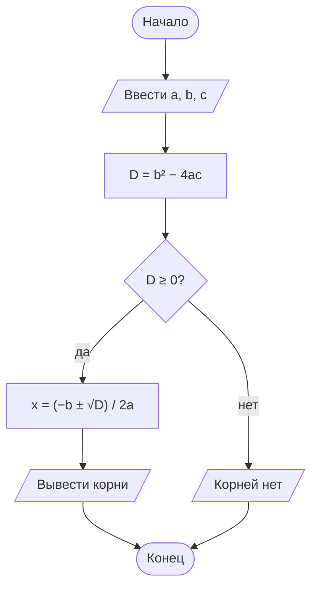

## Последовательность: проверка домашнего задания

Проверка и утверждение — двумя схемами: модель готовит черновик, учитель утверждает оценку и отправляет отзыв ученику.

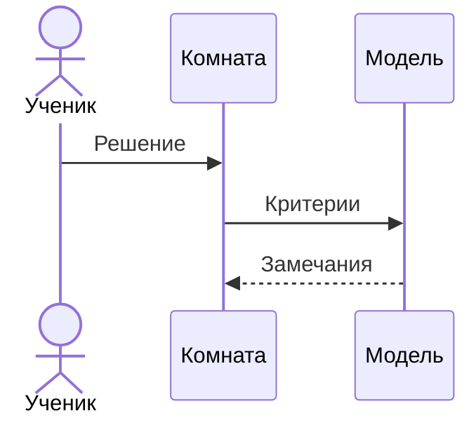

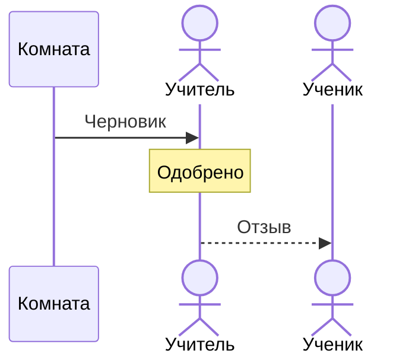

## Последовательность с ветвлением: вход по ключу

Ветки «если — иначе» — `alt … else … end`, необязательный шаг — `opt`, повтор — `loop`. Подпись ветки стоит по
центру рамки: если внутри ветки сообщения идут через участника посередине, его линия жизни пройдёт по подписи —
держите сообщения ветки между двумя соседними участниками.

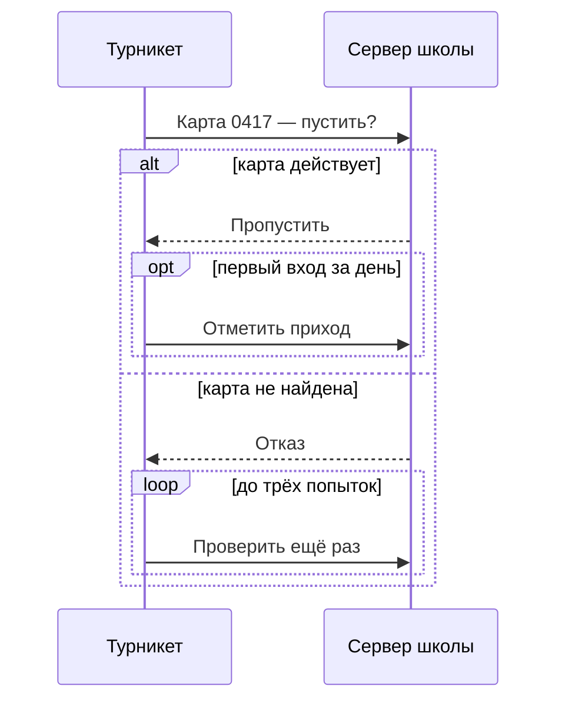

## Классы

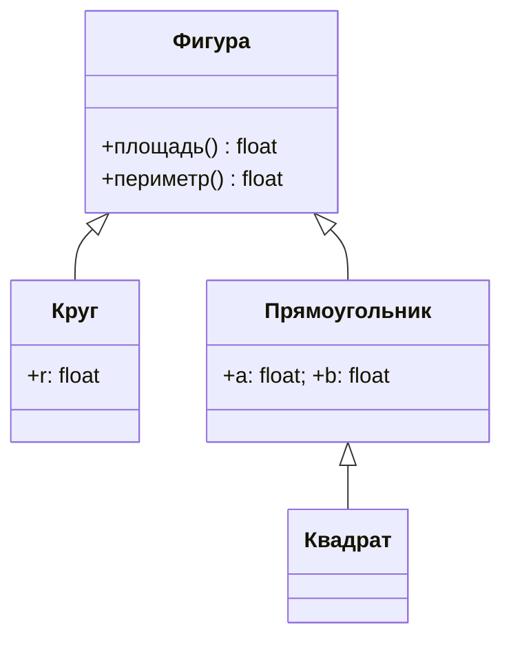

## Состояния воды

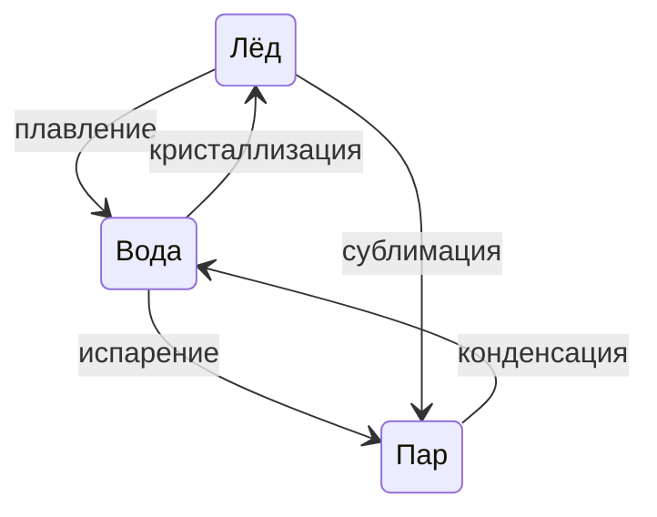

## ER: школьное расписание

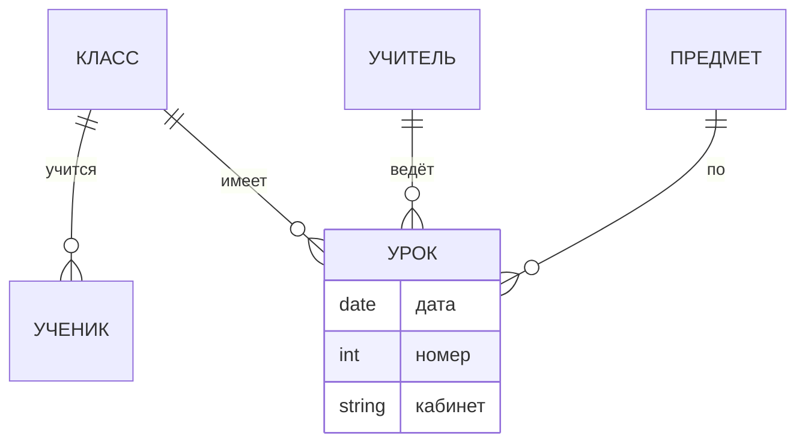

## План проекта

Полный план — таблицей для телефона. `done` — завершено, `active` — выполняется, без тега — запланировано. `after` задаёт зависимость от идентификатора задачи, а не фиксированную дату.

```table
| ID | Задача | Статус | Зависимость | Начало | Дней |
|---|---|---|---|---|---:|
| r1 | Рендер: блоки и стенд | done | — | 19.10.2026 | 3 |
| r2 | Рендер: Mermaid | active | after r1 | 22.10.2026 | 1 |
| m1 | Сервер: MCP-шлюз | done | — | 19.10.2026 | 2 |
| c1 | Сервер: комнаты | запланировано | after r2 | 23.10.2026 | 7 |
| — | Сервер: модели | запланировано | after c1 | 30.10.2026 | 5 |
```

Исполняемый образец `gantt` — первая цепочка полного плана; остальные зависимости и сроки сохранены в таблице.

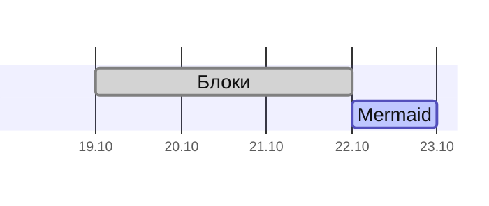

## Mindmap

Три ветви общей темы — отдельными небольшими картами.

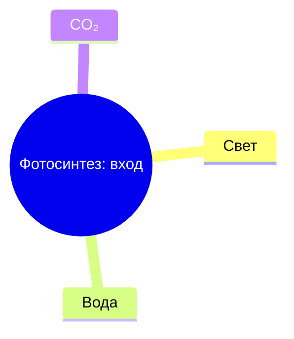

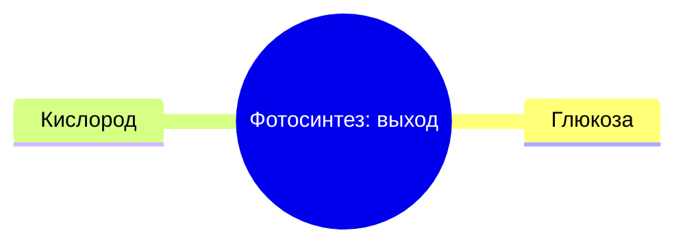

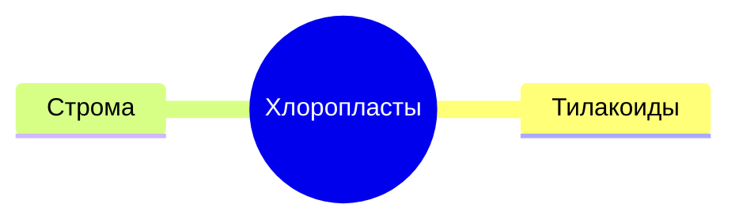

## Временная шкала и круговая

Освоение космоса — вертикальная шкала событий:

| Год | Событие |
|---|---|
| 1957 | Первый спутник |
| 1961 | Гагарин |
| 1969 | Человек на Луне |
| 1998 | МКС |

Исполняемый компактный `timeline` — первое событие этой шкалы; полный ряд событий сохранён выше.

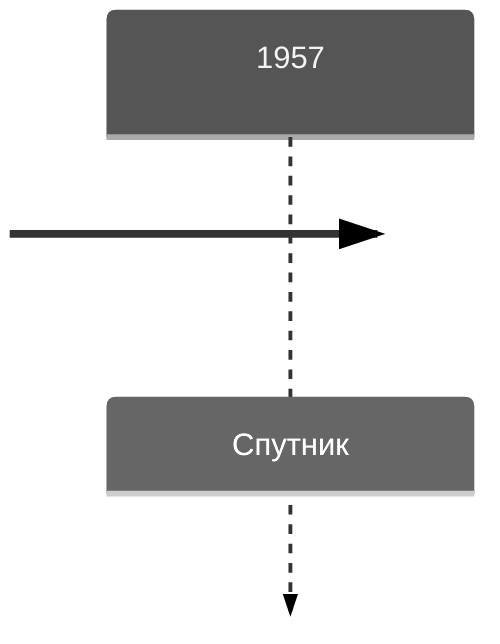

Состав воздуха, %. Подписи вынесены за круг (`textPosition` больше 1): долю в 1 % иначе
пересекают её же границы; заголовок — текстом над схемой, внутри он лёг бы на верхнюю подпись.
Окно узкое — около 1,14: при 1,12 подпись «78%» касается окружности, при 1,16 подпись доли
наверху круга уходит за край рисунка. Если долей больше или они мельче, надёжнее ECharts ниже.

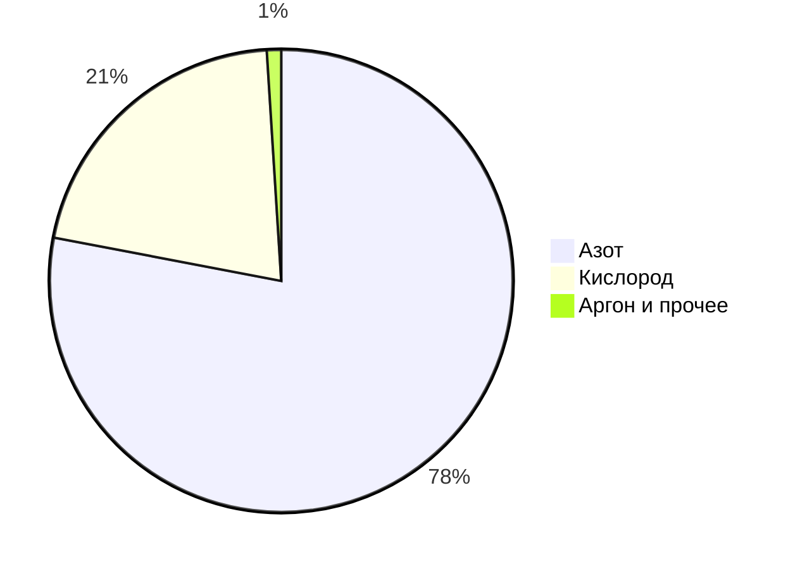

Та же диаграмма на ECharts: подписи с названием и долей — снаружи на выносках, тонкую долю
выноска уводит в сторону; наведение показывает подсказку.

```echarts
{"width":380,"height":300,
 "title":{"text":"Состав воздуха, %","left":"center","textStyle":{"fontSize":14}},
 "tooltip":{"trigger":"item","formatter":"{b}: {c} %"},
 "series":[{"type":"pie","radius":["0%","62%"],"center":["50%","56%"],
   "label":{"formatter":"{b}\n{c} %","fontSize":14,"lineHeight":18},
   "labelLine":{"length":14,"length2":18},
   "avoidLabelOverlap":true,
   "data":[{"name":"Азот","value":78},{"name":"Кислород","value":21},{"name":"Аргон и прочее","value":1}]}]}
```
