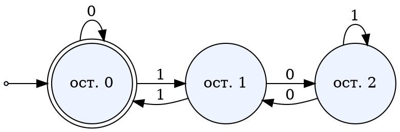
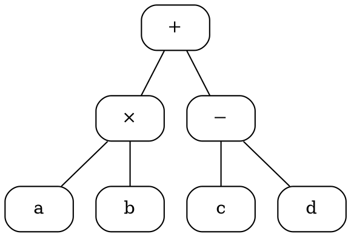
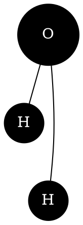
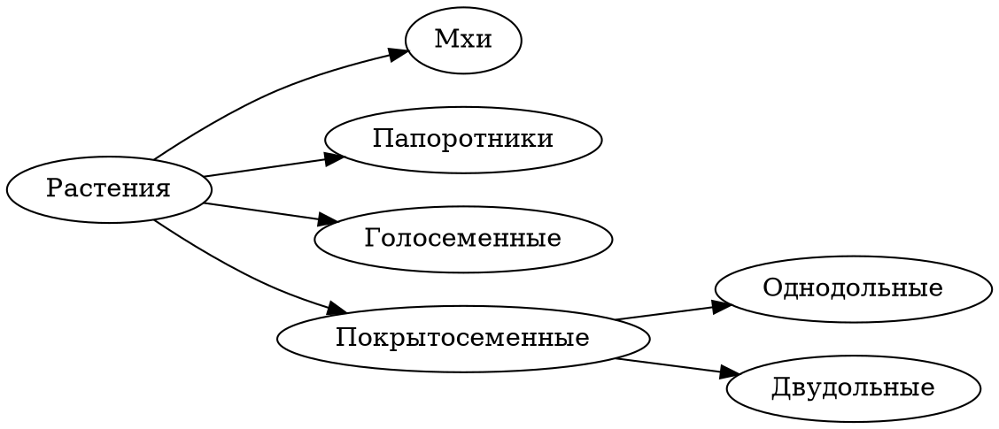

<!-- Собрано автоматически из документов-примеров Spiridus — правки в основном репозитории Spiridus. -->

<!-- раздел: Схемы | теги: graphviz, dot, d2, граф, дерево, автомат, архитектура, схема, сеть, таблицы, er -->
# Графы: Graphviz и D2

## Graphviz: конечный автомат

Автомат принимает двоичные числа, кратные трём.



## Graphviz: дерево разбора выражения



## Graphviz: молекула воды раскладкой neato



## Graphviz: систематика растений



## D2: архитектура проекта

```d2
vars: { d2-config: { layout-engine: elk } }
Браузер: {
  Рендер: {shape: hexagon}
  Документ: {shape: page}
}
Сервер: {
  label.near: top-left
  Сайт
  Шлюз MCP
  Песочницы: {
    FreeCAD: {shape: cylinder}
  }
  Сайт -> Шлюз MCP: /mcp
  Шлюз MCP -> Песочницы: задание
}
LLM: {shape: cloud}
Браузер.Рендер -> Сервер.Сайт: статика
LLM -> Сервер.Шлюз MCP: {source-arrowhead.label: инструменты}
```

## D2: таблицы базы данных

```d2
Ученик: {
  shape: sql_table
  id: int {constraint: primary_key}
  имя: text
  класс_id: int {constraint: foreign_key}
}
Класс: {
  shape: sql_table
  id: int {constraint: primary_key}
  номер: text
}
Ученик.класс_id -> Класс.id
```

## D2: последовательность и Markdown

```d2
Проверка: {
  shape: sequence_diagram
  Ученик -> Модель: решение
  Модель -> Учитель: черновик оценки
  Учитель -> Ученик: отзыв
}
Пояснение: |md
  ## Правило
  Оценку **всегда** утверждает учитель.
|
```

## D2: эскиз и ELK

```d2
vars: {
  d2-config: {
    layout-engine: elk
    sketch: true
  }
}
Идея -> Черновик -> Обсуждение -> Документ
Обсуждение -> Черновик: правки
```
