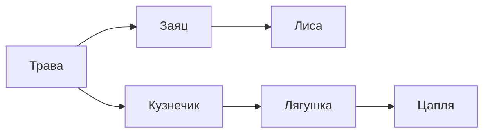

<!-- Собрано из apps/playground/examples/18-primary-school.md основного репозитория Spiridus (scripts/build-public-docs.mjs) — правьте там. -->

<!-- раздел: Школа | теги: начальная школа, 1 класс, 2 класс, 3 класс, 4 класс, математика, русский язык, окружающий мир, музыка, проверка -->
# Начальная школа: 1–4 класс

Типичные материалы начальной школы по предметам: математика, русский язык, окружающий мир, музыка, технология. Всё собрано из блоков рендера — TikZ, формул, таблиц, диаграмм, разбора слова, схем и нот.

## Математика

### Числовой луч

```tikz
\begin{tikzpicture}[x=0.9cm]
  \draw[->, thick] (0,0) -- (11,0);
  \foreach \i in {0,...,10} { \draw (\i,0.15) -- (\i,-0.15) node[below] {\i}; }
  \draw[->, very thick, red] (2,0.3) to[bend left=50] node[above] {+3} (5,0.3);
  \draw[->, very thick, blue] (5,0.3) to[bend left=50] node[above] {+4} (9,0.3);
\end{tikzpicture}
```

### Состав числа

| 7 | |
|:-:|:-:|
| 1 | 6 |
| 2 | 5 |
| 3 | 4 |

### Сложение и вычитание в столбик

$$
\begin{array}{r}
\phantom{+}\overset{1}{4}\,7\,8 \\
+\;2\,5\,6 \\ \hline
7\,3\,4
\end{array}
\qquad
\begin{array}{r}
\phantom{-}\overset{\cdot}{5}\,0\,3 \\
-\;1\,2\,7 \\ \hline
3\,7\,6
\end{array}
$$

### Деление уголком

```tikz
\begin{tikzpicture}[x=0.3cm, y=0.55cm, every node/.style={font=\large, inner sep=1pt}]
  \node[anchor=east] at (3,0) {756};
  \node[anchor=west] at (3.5,0) {4};
  \draw (3.3,0.45) -- (3.3,-1.45);
  \draw (3.3,-0.45) -- (7,-0.45);
  \node[anchor=west] at (3.5,-1) {189};
  \node at (-0.4,-0.5) {$-$};
  \node[anchor=east] at (1,-1) {4};
  \draw (0,-1.45) -- (1,-1.45);
  \node[anchor=east] at (2,-2) {35};
  \node at (0.6,-2.5) {$-$};
  \node[anchor=east] at (2,-3) {32};
  \draw (0.9,-3.45) -- (2,-3.45);
  \node[anchor=east] at (3,-4) {36};
  \node at (1.6,-4.5) {$-$};
  \node[anchor=east] at (3,-5) {36};
  \draw (1.9,-5.45) -- (3,-5.45);
  \node[anchor=east] at (3,-6) {0};
\end{tikzpicture}
```

### Доли

```tikz
\begin{tikzpicture}
  \foreach \n/\x in {2/0, 3/2.6, 4/5.2, 8/7.8} {
    \begin{scope}[shift={(\x,0)}]
      \fill[orange!60] (0,0) -- (90:1) arc (90:90-360/\n:1) -- cycle;
      \draw (0,0) circle (1);
      \foreach \k in {1,...,\n} \draw (0,0) -- (90-\k*360/\n:1);
      \node at (0,-1.4) {$\frac{1}{\n}$};
    \end{scope}
  }
\end{tikzpicture}
```

### Часы: который час?

```tikz
\begin{tikzpicture}
  \draw[thick] (0,0) circle (1.6);
  \foreach \h in {1,...,12} {
    \draw (90-\h*30:1.45) -- (90-\h*30:1.6);
    \node[font=\small] at (90-\h*30:1.2) {\h};
  }
  \draw[line width=2.2pt, line cap=round] (0,0) -- (90-4.5*30:0.75);
  \draw[line width=1.2pt, line cap=round] (0,0) -- (90-6*30:1.15);
  \fill (0,0) circle (0.06);
\end{tikzpicture}
```

### Фигуры на клетчатой бумаге: найди периметр

```tikz
\begin{tikzpicture}[scale=0.5]
  \draw[step=1, help lines, blue!25] (0,0) grid (14,7);
  \draw[very thick] (1,1) rectangle (6,4);
  \draw[very thick] (8,1) -- (12,1) -- (12,3) -- (10,3) -- (10,5) -- (8,5) -- cycle;
  \node at (3.5,4.6) {5 см};
  \node[rotate=90] at (0.4,2.5) {3 см};
\end{tikzpicture}
```

### Схема к задаче

Маша собрала 12 грибов, а Петя — на 5 больше. Сколько грибов у Пети?

```tikz
\begin{tikzpicture}
  \draw[thick, |-|] (0,1) -- node[above] {12} (4,1);
  \node[left] at (0,1) {Маша};
  \draw[thick, |-|] (0,0) -- (4,0);
  \draw[thick, -|] (4,0) -- node[below] {на 5 б.} (5.7,0);
  \node[left] at (0,0) {Петя};
  \draw[decorate, decoration={brace, mirror, amplitude=6pt}] (0,-0.5) -- node[below=6pt] {?} (5.7,-0.5);
\end{tikzpicture}
```

### Диаграмма: сколько книг прочитали

```echarts
{
  "width": 520, "height": 260,
  "xAxis": { "type": "category", "data": ["Аня", "Боря", "Вика", "Гриша", "Даша"] },
  "yAxis": { "type": "value", "name": "книг" },
  "series": [{ "type": "bar", "data": [4, 7, 3, 5, 6], "label": { "show": true, "position": "top" } }]
}
```

### Таблица умножения на 7

| × | 1 | 2 | 3 | 4 | 5 | 6 | 7 | 8 | 9 |
|:-:|:-:|:-:|:-:|:-:|:-:|:-:|:-:|:-:|:-:|
| **7** | 7 | 14 | 21 | 28 | 35 | 42 | 49 | 56 | 63 |

## Русский язык

### Разбор слова по составу

```razbor
под/п снеж/к ник/с 0/0
при/п школь/к н/с ый/о
```

### Схема предложения

```razbor
Весёлые/~ ребята/1 катались/2 на/-- санках/--
```

### Звуковая схема слова «лиса»

Гласный — красный, согласный мягкий — зелёный, твёрдый — синий; ударение — сверху.

```tikz
\begin{tikzpicture}[x=0.9cm]
  \foreach \c/\l [count=\i] in {green!60!black/л', red/и, blue/с, red/а} {
    \fill[\c] (\i,0) rectangle +(0.8,0.8);
    \node[below] at (\i+0.4,0) {[\l]};
  }
  \draw[thick] (4.1,1.0) -- (4.5,1.25);
  \draw[thick] (1,-0.8) -- (2.8,-0.8) (3,-0.8) -- (4.8,-0.8);
\end{tikzpicture}
```

### Пропись

```propis
Аа Бб Вв Гг Дд
Мама мыла раму.
```

Печатные буквы для обводки и пустая строка после каждой:

```propis
шрифт: печатный
обводка: да
пустые: 1
Кот. Дом. Сок.
```

## Окружающий мир

### Строение цветка


### Цепь питания



### Круговорот воды

```d2
Океан -> Облака: испарение
Облака -> Горы: осадки
Горы -> Река: таяние снега
Река -> Океан: течение
```

### Стороны горизонта

```tikz
\begin{tikzpicture}
  \draw[thick] (0,0) circle (1.3);
  \draw[very thick, red, -latex] (0,0) -- (0,1.1) node[above=4pt] {С};
  \draw[very thick, -latex] (0,0) -- (0,-1.1) node[below=4pt] {Ю};
  \draw[very thick, -latex] (0,0) -- (1.1,0) node[right=4pt] {В};
  \draw[very thick, -latex] (0,0) -- (-1.1,0) node[left=4pt] {З};
\end{tikzpicture}
```

## Музыка

```abc
X:1
T:В лесу родилась ёлочка
M:2/4
L:1/8
K:C
C A A G | A F C C | C A A B | g4 |
```

## Технология: развёртка куба

```tikz
\begin{tikzpicture}
  \foreach \x/\y in {1/0, 0/1, 1/1, 2/1, 3/1, 1/2} \draw[thick, fill=yellow!20] (\x,\y) rectangle +(1,1);
\end{tikzpicture}
```
