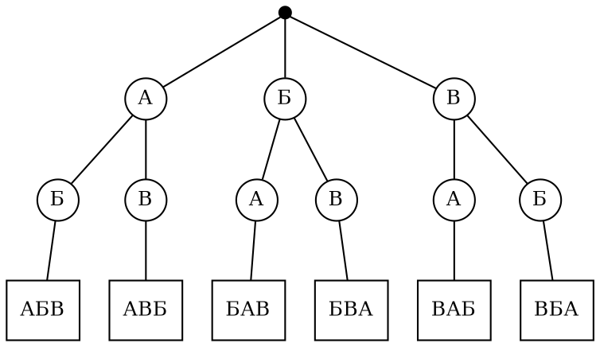

<!-- Собрано автоматически из документов-примеров Spiridus — правки в основном репозитории Spiridus. -->

<!-- раздел: Школа | теги: математика, алгебра, геометрия, стереометрия, вероятность, статистика, начала анализа, 5 класс, 6 класс, 7 класс, 8 класс, 9 класс, 10 класс, 11 класс, проверка -->
# Математика: 5–11 класс

Типичные материалы учебника и задачника: математика 5–6, алгебра и начала анализа 7–11, геометрия 7–11, вероятность и статистика 7–9. Рисунки — TikZ (pgfplots, tkz-euclide, venndiagram), диаграммы — ECharts, тела — OpenSCAD, формулы — KaTeX.

## Математика 5–6

### Координатная прямая

Отметим числа $-2\tfrac{1}{2}$, $-1$, $\tfrac{3}{4}$, $2{,}5$. Модуль числа — расстояние от нуля: $|-2{,}5| = 2{,}5$.

```tikz
\begin{tikzpicture}[x=1.4cm]
  \draw[->, thick] (-3.5,0) -- (3.6,0) node[right] {$x$};
  \foreach \i in {-3,...,3} \draw (\i,0.12) -- (\i,-0.12) node[below] {$\i$};
  \foreach \i in {-3,-2.5,...,3} \draw (\i,0.06) -- (\i,-0.06);
  \foreach \x/\l in {-2.5/A, -1/B, 0.75/C, 2.5/D} {
    \fill[red] (\x,0) circle (2.2pt);
    \node[above, red] at (\x,0.12) {$\l$};
  }
  \node[above=12pt, font=\small] at (-2.5,0) {$-2\frac12$};
  \node[above=12pt, font=\small] at (0.75,0) {$\frac34$};
  \draw[<->, blue] (-2.5,-0.7) -- node[below, font=\small] {$|-2{,}5| = 2{,}5$} (0,-0.7);
  \draw[<->, blue] (0,-0.7) -- node[below, font=\small] {$|2{,}5| = 2{,}5$} (2.5,-0.7);
\end{tikzpicture}
```

### Дроби и проценты

```tikz
\begin{tikzpicture}
  % дробь 3/8 полоской
  \fill[orange!60] (0,0) rectangle (2.4,0.6);
  \foreach \i in {0,...,7} \draw (\i*0.8,0) rectangle ++(0.8,0.6);
  \node[right] at (6.6,0.3) {$\displaystyle\frac{3}{8} = 0{,}375 = 37{,}5\,\%$};
  % равные дроби
  \fill[teal!50] (0,-1.2) rectangle (3.2,-0.6);
  \fill[teal!50] (0,-2.1) rectangle (3.2,-1.5);
  \foreach \i in {0,1} \draw (\i*3.2,-1.2) rectangle ++(3.2,0.6);
  \foreach \i in {0,...,3} \draw (\i*1.6,-2.1) rectangle ++(1.6,0.6);
  \node[right] at (6.6,-1.35) {$\displaystyle\frac12 = \displaystyle\frac24 = 50\,\%$};
  % проценты: сотенная сетка
  \begin{scope}[shift={(0,-6.6)}, scale=0.4]
    \fill[blue!40] (0,0) rectangle (10,2);
    \fill[blue!40] (0,2) rectangle (5,3);
    \draw[step=1, gray] (0,0) grid (10,10);
    \draw[thick] (0,0) rectangle (10,10);
  \end{scope}
  \node[right, align=left] at (4.6,-4.6) {закрашено $25$ клеток из $100$:\\[2pt] $25\,\% = \displaystyle\frac{25}{100} = \displaystyle\frac14$};
\end{tikzpicture}
```

Основные действия с дробями:

$$
\frac{a}{b} + \frac{c}{d} = \frac{ad + bc}{bd}, \qquad
\frac{a}{b} \cdot \frac{c}{d} = \frac{ac}{bd}, \qquad
\frac{a}{b} : \frac{c}{d} = \frac{ad}{bc}, \qquad
p\,\% \text{ от } A = \frac{A \cdot p}{100}.
$$

## Алгебра 7–9

### Линейная функция и обратная пропорциональность

```tikz
\begin{tikzpicture}
  \begin{axis}[axis lines=middle, xlabel={$x$}, ylabel={$y$}, grid=major, grid style={gray!25},
               xmin=-5, xmax=5, ymin=-5, ymax=5, xtick={-4,...,4}, ytick={-4,...,4},
               width=8.5cm, height=8.5cm, legend pos=south east, legend style={font=\small}]
    \addplot[blue, very thick, domain=-5:5] {2*x - 1};
    \addlegendentry{$y = 2x - 1$}
    \addplot[red, very thick, domain=0.6:5, samples=80] {3/x};
    \addlegendentry{$y = \frac{3}{x}$}
    \addplot[red, very thick, domain=-5:-0.6, samples=80, forget plot] {3/x};
    \addplot[only marks, mark=*, blue] coordinates {(0,-1) (0.5,0)};
  \end{axis}
\end{tikzpicture}
```

### Квадратичная функция

$y = x^2 - 2x - 3 = (x-1)^2 - 4$: вершина $(1;\,-4)$, нули $x_1 = -1$, $x_2 = 3$, ось симметрии $x = 1$.

```tikz
\begin{tikzpicture}
  \begin{axis}[axis lines=middle, xlabel={$x$}, ylabel={$y$}, grid=major, grid style={gray!25},
               xmin=-3, xmax=5, ymin=-5, ymax=6, xtick={-2,...,4}, ytick={-4,-2,...,6},
               width=8.5cm, height=8.5cm]
    \addplot[blue, very thick, domain=-2.2:4.2, samples=100] {x^2 - 2*x - 3};
    \draw[dashed, gray] (axis cs:1,-5) -- (axis cs:1,6);
    \addplot[only marks, mark=*, red] coordinates {(-1,0) (3,0) (1,-4) (0,-3)};
    \node[right, font=\small] at (axis cs:1,-4) {$(1;\,-4)$};
    \node[above left, font=\small] at (axis cs:-1,0) {$-1$};
    \node[above right, font=\small] at (axis cs:3,0) {$3$};
  \end{axis}
\end{tikzpicture}
```

$$
ax^2 + bx + c = 0,\quad D = b^2 - 4ac,\quad x_{1,2} = \frac{-b \pm \sqrt{D}}{2a};
\qquad x_1 + x_2 = -\frac{b}{a},\quad x_1 x_2 = \frac{c}{a}.
$$

### Корень и модуль

```tikz
\begin{tikzpicture}
  \begin{axis}[axis lines=middle, xlabel={$x$}, ylabel={$y$}, grid=major, grid style={gray!25},
               xmin=-3, xmax=9, ymin=-1, ymax=5, width=10cm, height=6cm,
               legend pos=north west, legend style={font=\small}]
    \addplot[blue, very thick, domain=0:9, samples=120] {sqrt(x)};
    \addlegendentry{$y = \sqrt{x}$}
    \addplot[red, very thick, domain=-3:5, samples=3] {abs(x - 1)};
    \addlegendentry{$y = |x - 1|$}
  \end{axis}
\end{tikzpicture}
```

Таблица значений $y = \sqrt{x}$:

| $x$ | 0 | 1 | 4 | 9 | 16 | 25 |
|:---:|:-:|:-:|:-:|:-:|:--:|:--:|
| $y$ | 0 | 1 | 2 | 3 | 4  | 5  |

### Система уравнений графически

$$
\begin{cases} y = 2x - 1, \\ x + y = 5 \end{cases}
\quad\Longrightarrow\quad (2;\,3).
$$

```tikz
\begin{tikzpicture}
  \begin{axis}[axis lines=middle, xlabel={$x$}, ylabel={$y$}, grid=major, grid style={gray!25},
               xmin=-2, xmax=6, ymin=-3, ymax=7, width=8cm, height=8cm]
    \addplot[blue, very thick, domain=-1:4] {2*x - 1} node[pos=0.95, right] {$y = 2x-1$};
    \addplot[red, very thick, domain=-1:6] {5 - x} node[pos=0.9, above right] {$x+y=5$};
    \addplot[only marks, mark=*, mark size=3pt] coordinates {(2,3)};
    \draw[dashed] (axis cs:2,0) -- (axis cs:2,3) -- (axis cs:0,3);
    \node[above left] at (axis cs:2,3) {$(2;3)$};
  \end{axis}
\end{tikzpicture}
```

### Неравенства: метод интервалов

$$\frac{(x+2)(x-1)}{x-3} \ge 0$$

```tikz
\usetikzlibrary{patterns}
\begin{tikzpicture}[x=1.6cm]
  \draw[->, thick] (-4,0) -- (5,0) node[right] {$x$};
  \fill[pattern=north east lines, pattern color=blue] (-2,0) rectangle (1,0.35);
  \fill[pattern=north east lines, pattern color=blue] (3,0) rectangle (4.9,0.35);
  \foreach \x in {-2,1} { \fill (\x,0) circle (3pt); \node[below=3pt] at (\x,0) {$\x$}; }
  \filldraw[fill=white, draw=black, thick] (3,0) circle (3pt); \node[below=3pt] at (3,0) {$3$};
  \draw[blue, thick] (-4,0.5) .. controls (-3,-0.6) .. (-2,0)  .. controls (-0.5,1) .. (1,0)
                    .. controls (2,-1) .. (3,0) .. controls (4,1) .. (5,0.6);
  \foreach \x/\s in {-3/-, -0.5/+, 2/-, 4/+} \node[font=\Large] at (\x,-0.6) {$\s$};
\end{tikzpicture}
```

Ответ: $x \in [-2;\,1] \cup (3;\,+\infty)$.

## Алгебра и начала анализа 10–11

### Тригонометрическая окружность

```tikz
\begin{tikzpicture}[scale=2.6]
  \draw[->] (-1.3,0) -- (1.35,0) node[right] {$x$};
  \draw[->] (0,-1.3) -- (0,1.35) node[above] {$y$};
  \draw[thick] (0,0) circle (1);
  \foreach \a/\l in {30/\frac{\pi}{6}, 45/\frac{\pi}{4}, 60/\frac{\pi}{3}, 90/\frac{\pi}{2},
                     120/\frac{2\pi}{3}, 150/\frac{5\pi}{6}, 180/\pi, 270/\frac{3\pi}{2}} {
    \fill (\a:1) circle (0.6pt);
    \node[font=\footnotesize] at (\a:1.17) {$\l$};
  }
  \node[font=\footnotesize, below right] at (1,0) {$0$};
  \draw[very thick, red] (0,0) -- (35:1);
  \fill[red] (35:1) circle (0.8pt) node[above right] {$P_\alpha$};
  \draw[dashed] (35:1) -- ({cos(35)},0);
  \draw[dashed] (35:1) -- (0,{sin(35)});
  \draw[ultra thick, blue] (0,0) -- ({cos(35)},0) node[midway, below, font=\small] {$\cos\alpha$};
  \draw[ultra thick, teal] (0,0) -- (0,{sin(35)}) node[midway, left, font=\small] {$\sin\alpha$};
  \draw[->] (0.25,0) arc (0:35:0.25) node[midway, right, font=\small] {$\alpha$};
\end{tikzpicture}
```

### Синус и косинус

```tikz
\begin{tikzpicture}
  \begin{axis}[axis lines=middle, xlabel={$x$}, ylabel={$y$}, width=13cm, height=5.5cm,
               xmin=-3.8, xmax=7.2, ymin=-1.5, ymax=1.5, trig format plots=rad,
               xtick={-3.14159,-1.5708,1.5708,3.14159,4.71239,6.28318},
               xticklabels={$-\pi$,$-\frac{\pi}{2}$,$\frac{\pi}{2}$,$\pi$,$\frac{3\pi}{2}$,$2\pi$},
               ytick={-1,1}, grid=major, grid style={gray!25},
               legend style={at={(0.02,0.98)}, anchor=north west, font=\small}]
    \addplot[blue, very thick, domain=-3.6:7, samples=200] {sin(x)};
    \addlegendentry{$y = \sin x$}
    \addplot[red, very thick, domain=-3.6:7, samples=200] {cos(x)};
    \addlegendentry{$y = \cos x$}
  \end{axis}
\end{tikzpicture}
```

### Показательная и логарифмическая функции

```tikz
\begin{tikzpicture}
  \begin{axis}[axis lines=middle, xlabel={$x$}, ylabel={$y$}, grid=major, grid style={gray!25},
               xmin=-3, xmax=6, ymin=-3, ymax=6, width=8.5cm, height=8.5cm,
               legend pos=south east, legend style={font=\small}]
    \addplot[blue, very thick, domain=-3:2.58, samples=100] {2^x};
    \addlegendentry{$y = 2^x$}
    \addplot[red, very thick, domain=0.125:6, samples=150] {ln(x)/ln(2)};
    \addlegendentry{$y = \log_2 x$}
    \addplot[gray, dashed, domain=-3:6] {x};
    \addlegendentry{$y = x$}
    \addplot[only marks, mark=*] coordinates {(0,1) (1,0)};
  \end{axis}
\end{tikzpicture}
```

### Производная и касательная

$f(x) = \tfrac14 x^3 - x + 1$, $x_0 = 1{,}5$: $f'(x) = \tfrac34 x^2 - 1$, касательная $y = f(x_0) + f'(x_0)(x - x_0)$.

```tikz
\begin{tikzpicture}
  \begin{axis}[axis lines=middle, xlabel={$x$}, ylabel={$y$}, grid=major, grid style={gray!25},
               xmin=-3, xmax=3.5, ymin=-1.5, ymax=4, width=9cm, height=7cm]
    \addplot[blue, very thick, domain=-2.9:3, samples=120] {0.25*x^3 - x + 1}
      node[pos=0.97, left] {$y=f(x)$};
    \addplot[red, thick, domain=-0.5:3.5] {0.34375 + 0.6875*(x - 1.5)};
    \addplot[only marks, mark=*, red] coordinates {(1.5,0.34375)};
    \draw[dashed] (axis cs:1.5,0) -- (axis cs:1.5,0.34375);
    \node[below, font=\small] at (axis cs:1.5,0) {$x_0$};
    \node[red, font=\small, anchor=west] at (axis cs:1.9,0.2) {касательная};
  \end{axis}
\end{tikzpicture}
```

### Площадь под кривой

$$S = \int_1^3 \left(4 - (x-2)^2\right)dx = \left.\left(4x - \frac{(x-2)^3}{3}\right)\right|_1^3 = \frac{22}{3}.$$

```tikz
\begin{tikzpicture}
  \begin{axis}[axis lines=middle, xlabel={$x$}, ylabel={$y$}, xmin=-0.5, xmax=4.5, ymin=-0.5, ymax=4.8,
               width=8cm, height=6.5cm, xtick={1,2,3}, ytick={1,2,3,4}]
    \addplot[fill=blue!20, draw=none, domain=1:3, samples=60] {4 - (x-2)^2} \closedcycle;
    \addplot[blue, very thick, domain=0:4, samples=80] {4 - (x-2)^2};
    \node at (axis cs:2,1.6) {$S$};
  \end{axis}
\end{tikzpicture}
```

## Геометрия 7–9

### Построение циркулем и линейкой: серединный перпендикуляр

```tikz
\begin{tikzpicture}
  \tkzDefPoints{0/0/A, 4/0/B}
  \tkzInterCC(A,B)(B,A) \tkzGetPoints{P}{Q}
  \tkzInterLL(P,Q)(A,B) \tkzGetPoint{M}
  \tkzCompass[gray, delta=10](A,P)
  \tkzCompass[gray, delta=10](A,Q)
  \tkzCompass[gray, delta=10](B,P)
  \tkzCompass[gray, delta=10](B,Q)
  \tkzDrawSegment[thick](A,B)
  \tkzDrawLine[red, thick, add=0.1 and 0.1](P,Q)
  \tkzMarkRightAngle(B,M,P) \tkzMarkSegments[mark=|](A,M M,B)
  \tkzDrawPoints(A,B,P,Q) \tkzDrawPoints[red](M)
  \tkzLabelPoints[below left](A)
  \tkzLabelPoints[below right](B,M)
  \tkzLabelPoints[above left](P)
  \tkzLabelPoints[below left](Q)
\end{tikzpicture}
```

Шаги: 1) окружность с центром $A$ радиусом $AB$; 2) окружность с центром $B$ тем же радиусом; 3) прямая $PQ$ через точки пересечения — серединный перпендикуляр, $M$ — середина $AB$.

### Высота, медиана, биссектриса

```tikz
\begin{tikzpicture}[scale=1.1]
  \tkzDefPoints{0/0/A, 7/0/B, 2/4.5/C}
  \tkzDefPointBy[projection=onto A--B](C) \tkzGetPoint{H}
  \tkzDefMidPoint(A,B) \tkzGetPoint{M}
  \tkzDefLine[bisector](A,C,B) \tkzGetPoint{c}
  \tkzInterLL(C,c)(A,B) \tkzGetPoint{L}
  \tkzDrawPolygon[thick](A,B,C)
  \tkzDrawSegment[blue, thick](C,H)
  \tkzDrawSegment[red, thick](C,M)
  \tkzDrawSegment[teal, thick](C,L)
  \tkzMarkRightAngle(C,H,B)
  \tkzMarkSegments[mark=|](A,M M,B)
  \tkzMarkAngles[size=0.7, mark=|](A,C,L L,C,B)
  \tkzDrawPoints(A,B,C,H,M,L)
  \tkzLabelPoints[below](A,B,H,M,L)
  \tkzLabelPoints[above](C)
\end{tikzpicture}
```

$CH$ — высота (синяя), $CM$ — медиана (красная), $CL$ — биссектриса (зелёная).

### Вписанная и описанная окружности

```tikz
\begin{tikzpicture}[scale=0.9]
  \tkzDefPoints{0/0/A, 6/0/B, 1.5/4/C}
  \tkzDefTriangleCenter[circum](A,B,C) \tkzGetPoint{O}
  \tkzDefTriangleCenter[in](A,B,C) \tkzGetPoint{I}
  \tkzDefPointBy[projection=onto A--B](I) \tkzGetPoint{T}
  \tkzDrawCircle[red, thick](O,A)
  \tkzDrawCircle[blue, thick](I,T)
  \tkzDrawPolygon[thick](A,B,C)
  \tkzDrawSegments[red, dashed](O,A O,B O,C)
  \tkzDrawSegment[blue, dashed](I,T)
  \tkzDrawPoints(A,B,C,O,I,T)
  \tkzLabelPoints[below left](A)
  \tkzLabelPoints[below right](B)
  \tkzLabelPoints[above](C)
  \tkzLabelPoints[right](O,I)
  \tkzLabelPoints[below](T)
\end{tikzpicture}
```

$O$ — центр описанной окружности (пересечение серединных перпендикуляров), $R = \dfrac{abc}{4S}$; $I$ — центр вписанной (пересечение биссектрис), $r = \dfrac{S}{p}$.

### Подобие треугольников

```tikz
\usetikzlibrary{angles}
\begin{tikzpicture}
  \draw[thick] (0,0) coordinate (A) -- (3,0) coordinate (B) -- (0.8,2) coordinate (C) -- cycle;
  \node[below left] at (A) {$A$}; \node[below right] at (B) {$B$}; \node[above] at (C) {$C$};
  \node[below, font=\small] at (1.5,0) {$4$};
  \node[left, font=\small] at (0.4,1) {$3$};
  \begin{scope}[shift={(4.5,0)}, scale=1.5]
    \draw[thick] (0,0) coordinate (A1) -- (3,0) coordinate (B1) -- (0.8,2) coordinate (C1) -- cycle;
    \node[below left] at (A1) {$A_1$}; \node[below right] at (B1) {$B_1$}; \node[above] at (C1) {$C_1$};
    \node[below, font=\small] at (1.5,0) {$6$};
    \node[left, font=\small] at (0.4,1) {$4{,}5$};
  \end{scope}
  \foreach \P/\Q/\R in {B/A/C, B1/A1/C1} \draw pic[draw, angle radius=0.4cm] {angle=\P--\Q--\R};
  \foreach \P/\Q/\R in {C/B/A, C1/B1/A1} \draw pic[draw, angle radius=0.4cm, double] {angle=\P--\Q--\R};
\end{tikzpicture}
```

$\triangle ABC \sim \triangle A_1B_1C_1$, $k = \dfrac{A_1B_1}{AB} = 1{,}5$, $\dfrac{S_1}{S} = k^2 = 2{,}25$.

### Теорема Пифагора

```tikz
\begin{tikzpicture}[scale=0.55]
  \coordinate (A) at (0,0); \coordinate (B) at (4,0); \coordinate (C) at (0,3);
  \fill[blue!20, draw=blue] (A) -- (B) -- (4,-4) -- (0,-4) -- cycle;
  \fill[red!20, draw=red] (A) -- (C) -- (-3,3) -- (-3,0) -- cycle;
  \fill[green!20, draw=teal] (B) -- (C) -- (3,7) -- (7,4) -- cycle;
  \draw[very thick] (A) -- (B) -- (C) -- cycle;
  \draw (0,0.5) -- (0.5,0.5) -- (0.5,0);
  \node at (2,-2) {$a^2 = 16$};
  \node at (-1.5,1.5) {$b^2 = 9$};
  \node at (3.5,3.5) {$c^2 = 25$};
\end{tikzpicture}
```

$$a^2 + b^2 = c^2: \quad 4^2 + 3^2 = 5^2.$$

### Векторы на координатной плоскости

```tikz
\begin{tikzpicture}[scale=0.8]
  \draw[step=1, gray!30] (-1,-1) grid (8,6);
  \draw[->] (-1,0) -- (8.3,0) node[right] {$x$};
  \draw[->] (0,-1) -- (0,6.3) node[above] {$y$};
  \foreach \i in {1,...,7} \node[below, font=\scriptsize] at (\i,0) {\i};
  \foreach \i in {1,...,5} \node[left, font=\scriptsize] at (0,\i) {\i};
  \coordinate (O) at (1,1);
  \draw[->, very thick, blue] (O) -- ++(4,1) coordinate (A) node[midway, below right] {$\vec a$};
  \draw[->, very thick, red] (O) -- ++(1,3) coordinate (B) node[midway, left] {$\vec b$};
  \draw[dashed, blue] (B) -- ++(4,1);
  \draw[dashed, red] (A) -- ++(1,3);
  \draw[->, very thick, teal] (O) -- (6,5) node[above right] {$\vec a + \vec b$};
  \fill (O) circle (2pt);
\end{tikzpicture}
```

$\vec a = (4;\,1)$, $\vec b = (1;\,3)$, $\vec a + \vec b = (5;\,4)$, $\vec a \cdot \vec b = 4 \cdot 1 + 1 \cdot 3 = 7$, $|\vec a| = \sqrt{17}$.

## Стереометрия 10–11

### Куб и его сечение

Сечение куба плоскостью через середины шести рёбер — правильный шестиугольник.

```tikz
\begin{tikzpicture}[x={(1.6cm,0)}, y={(0.7cm,0.55cm)}, z={(0,1.6cm)}, line join=round]
  \coordinate (A) at (0,0,0); \coordinate (B) at (2,0,0); \coordinate (C) at (2,2,0); \coordinate (D) at (0,2,0);
  \coordinate (A1) at (0,0,2); \coordinate (B1) at (2,0,2); \coordinate (C1) at (2,2,2); \coordinate (D1) at (0,2,2);
  \draw[dashed] (A) -- (D) -- (C) (D) -- (D1);
  \fill[orange!50, opacity=0.7] (1,0,0) -- (2,1,0) -- (2,2,1) -- (1,2,2) -- (0,1,2) -- (0,0,1) -- cycle;
  \draw[orange!80!black, thick] (1,0,0) -- (2,1,0) -- (2,2,1) -- (1,2,2) -- (0,1,2) -- (0,0,1) -- cycle;
  \draw[thick] (A) -- (B) -- (C) -- (C1) -- (D1) -- (A1) -- cycle (A1) -- (B1) -- (C1) (B) -- (B1);
  \foreach \p/\pos in {A/below left, B/below right, C/right, D/above left, A1/left, B1/above left, C1/above right, D1/above}
    \node[\pos] at (\p) {$\p$};
\end{tikzpicture}
```

### Правильная четырёхугольная пирамида

```tikz
\begin{tikzpicture}[x={(1.6cm,0)}, y={(0.7cm,0.55cm)}, z={(0,1.6cm)}, line join=round]
  \coordinate (A) at (0,0,0); \coordinate (B) at (2,0,0); \coordinate (C) at (2,2,0); \coordinate (D) at (0,2,0);
  \coordinate (O) at (1,1,0); \coordinate (S) at (1,1,2.4); \coordinate (K) at (1,0,0);
  \draw[dashed] (A) -- (D) -- (C) (D) -- (S) (A) -- (C) (B) -- (D) (S) -- (O) -- (K);
  \draw[thick] (A) -- (B) -- (C) -- (S) -- cycle (S) -- (B);
  \draw[red, thick] (S) -- (K);
  \fill (O) circle (1.2pt);
  \node[below left] at (A) {$A$}; \node[below right] at (B) {$B$}; \node[right] at (C) {$C$};
  \node[above left] at (D) {$D$}; \node[above] at (S) {$S$}; \node[right] at (O) {$O$};
  \node[below] at (K) {$K$};
\end{tikzpicture}
```

$SO$ — высота, $SK$ — апофема, $V = \tfrac13 S_{\text{осн}} \cdot h$.

### Тела вращения: цилиндр, конус, шар

Осевое сечение показано под моделью.

```openscad
// section А-А: y = 0
$fn = 72;
translate([-30, 0, 0]) cylinder(h = 20, r = 8);
cylinder(h = 20, r1 = 9, r2 = 0);
translate([28, 0, 9]) sphere(r = 9);
```

$$V_{\text{цил}} = \pi r^2 h, \qquad V_{\text{кон}} = \tfrac13 \pi r^2 h, \qquad V_{\text{шара}} = \tfrac43 \pi R^3, \qquad S_{\text{сферы}} = 4\pi R^2.$$

## Вероятность и статистика 7–9

### Дерево вероятностей

В урне 3 красных и 2 синих шара, вынимают два без возвращения.

```tikz
\begin{tikzpicture}[grow=right, level distance=3cm, sibling distance=2.6cm,
                    level 2/.style={sibling distance=1.3cm},
                    every node/.style={font=\small}, edge from parent/.style={draw, thick}]
  \node[circle, draw] {}
    child { node[fill=blue!20, rounded corners] {С}
      child { node[right] {С: $\frac25\cdot\frac14 = \frac{1}{10}$} edge from parent node[below] {$\frac14$} }
      child { node[right] {К: $\frac25\cdot\frac34 = \frac{3}{10}$} edge from parent node[above] {$\frac34$} }
      edge from parent node[below left] {$\frac25$} }
    child { node[fill=red!20, rounded corners] {К}
      child { node[right] {С: $\frac35\cdot\frac24 = \frac{3}{10}$} edge from parent node[below] {$\frac24$} }
      child { node[right] {К: $\frac35\cdot\frac24 = \frac{3}{10}$} edge from parent node[above] {$\frac24$} }
      edge from parent node[above left] {$\frac35$} };
\end{tikzpicture}
```

$P(\text{оба красные}) = \tfrac{3}{10}$, $P(\text{разного цвета}) = \tfrac{3}{10} + \tfrac{3}{10} = \tfrac35$.

### Диаграмма Эйлера–Венна

```tikz
\begin{venndiagram2sets}[labelA={$A$}, labelB={$B$}, shade=orange!50, tikzoptions={thick}]
  \fillACapB
\end{venndiagram2sets}
```

$$P(A \cup B) = P(A) + P(B) - P(A \cap B).$$

### Гистограмма и ящик с усами

Рост учеников класса (см), 30 человек.

```echarts
{"width":620,"height":300,
 "title":[{"text":"Гистограмма","left":"22%","textAlign":"center","textStyle":{"fontSize":14}},
          {"text":"Ящик с усами","left":"78%","textAlign":"center","textStyle":{"fontSize":14}}],
 "dataset":[{"source":[[148,152,155,156,158,159,160,161,161,162,163,163,164,165,165,166,166,167,168,168,169,170,171,172,173,175,176,178,181,186]]},
            {"transform":{"type":"boxplot","config":{"itemNameFormatter":"рост"}},"fromDatasetIndex":0}],
 "grid":[{"left":40,"right":"52%","top":55,"bottom":50},{"left":"60%","right":20,"top":55,"bottom":50}],
 "xAxis":[{"gridIndex":0,"type":"category","name":"рост, см (начало интервала по 5 см)","nameLocation":"center","nameGap":30,
           "data":["145","150","155","160","165","170","175","180","185"]},
          {"gridIndex":1,"type":"category"}],
 "yAxis":[{"gridIndex":0,"name":"чел."},{"gridIndex":1,"min":140,"max":190}],
 "series":[{"type":"bar","xAxisIndex":0,"yAxisIndex":0,"barCategoryGap":"0%",
            "itemStyle":{"borderColor":"#fff","borderWidth":1},"label":{"show":true,"position":"top"},
            "data":[1,1,4,7,8,4,3,1,1]},
           {"type":"boxplot","xAxisIndex":1,"yAxisIndex":1,"datasetIndex":1}]}
```

Среднее $\bar x = \dfrac{x_1 + \dots + x_n}{n}$, медиана — середина упорядоченного ряда, размах $= x_{\max} - x_{\min} = 38$.

### Комбинаторика: дерево перестановок

Сколькими способами можно расставить буквы А, Б, В? $P_3 = 3! = 6$.



$$P_n = n!, \qquad A_n^k = \frac{n!}{(n-k)!}, \qquad C_n^k = \frac{n!}{k!\,(n-k)!}.$$

Треугольник Паскаля:

$$
\begin{array}{ccccccccccccc}
 &&&&&& 1 &&&&&& \\
 &&&&& 1 && 1 &&&&& \\
 &&&& 1 && 2 && 1 &&&& \\
 &&& 1 && 3 && 3 && 1 &&& \\
 && 1 && 4 && 6 && 4 && 1 && \\
 & 1 && 5 && 10 && 10 && 5 && 1 &
\end{array}
$$
