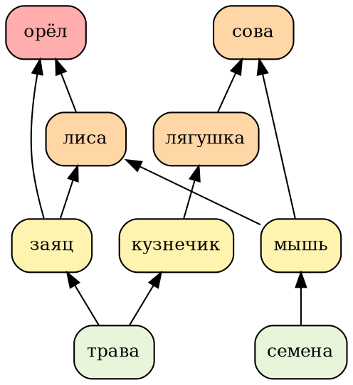
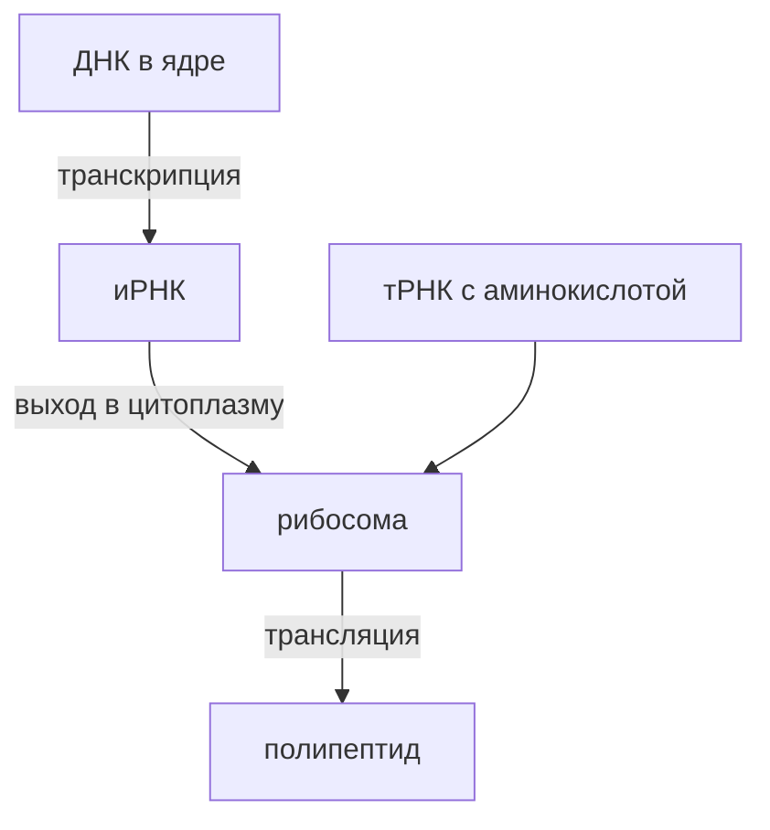

<!-- Собрано из apps/playground/examples/21-chem-bio.md основного репозитория Spiridus (scripts/build-public-docs.mjs) — правьте там. -->

<!-- раздел: Школа | теги: химия, биология, 8 класс, 9 класс, 10 класс, 11 класс, 5 класс, 6 класс, 7 класс, ОВР, органика, генетика, клетка, экология, анатомия, ботаника, проверка -->
# Химия и биология: 5–11 класс

Типичные материалы учебника и задачника по химии (8–11) и биологии (5–11): строение атома, связи, уравнения и ОВР, органика, графики; клетка, генетика, экология, систематика, анатомия, синтез белка. Всё собрано из блоков рендера — TeX (chemfig, pgfplots, bohr, forest), SMILES, mhchem, контуров ECharts, Graphviz и Mermaid.

## Химия

### Строение атома

Модель Бора: натрий и хлор. Электронная формула натрия: $\mathrm{1s^2\,2s^2\,2p^6\,3s^1}$, хлора: $\mathrm{1s^2\,2s^2\,2p^6\,3s^2\,3p^5}$.

```tikz
\bohr{11}{Na}\qquad\bohr{17}{Cl}
```

Электронно-графическая формула серы, $\mathrm{1s^2\,2s^2\,2p^6\,3s^2\,3p^4}$: подуровни выше — энергия больше.

```tikz
\begin{tikzpicture}[b/.style={draw, minimum size=6mm, inner sep=0pt}]
  \node[b] at (0,0) {$\uparrow\downarrow$};   \node[left=3mm] at (0,0) {1s};
  \node[b] at (0,1) {$\uparrow\downarrow$};   \node[left=3mm] at (0,1) {2s};
  \node[b] at (1.2,1.5) {$\uparrow\downarrow$};
  \node[b] at (1.8,1.5) {$\uparrow\downarrow$};
  \node[b] at (2.4,1.5) {$\uparrow\downarrow$}; \node[right=3mm] at (2.4,1.5) {2p};
  \node[b] at (0,2.6) {$\uparrow\downarrow$}; \node[left=3mm] at (0,2.6) {3s};
  \node[b] at (1.2,3.1) {$\uparrow\downarrow$};
  \node[b] at (1.8,3.1) {$\uparrow$};
  \node[b] at (2.4,3.1) {$\uparrow$};          \node[right=3mm] at (2.4,3.1) {3p};
  \draw[->] (-1.4,-0.4) -- (-1.4,3.6) node[above] {$E$};
\end{tikzpicture}
```

### Периодическая система

Семейства элементов главных подгрупп; остальные клетки — серые.

```echarts
{"width":700,"height":420,"title":{"text":"Семейства элементов","left":"center","textStyle":{"fontSize":14}},
 "visualMap":{"type":"piecewise","orient":"horizontal","left":"center","bottom":0,
  "pieces":[{"value":1,"label":"щелочные","color":"#e76f51"},{"value":2,"label":"щёлочноземельные","color":"#f4a261"},
            {"value":3,"label":"галогены","color":"#2a9d8f"},{"value":4,"label":"благородные газы","color":"#8e7dbe"},
            {"value":5,"label":"неметаллы","color":"#90be6d"},{"value":6,"label":"амфотерные","color":"#f9c74f"}]},
 "series":[{"type":"map","map":"таблица Менделеева","top":40,"bottom":56,"label":{"color":"#111","textBorderColor":"#fff","textBorderWidth":3,"show":true,"fontSize":9},
  "data":[{"name":"Li","value":1},{"name":"Na","value":1},{"name":"K","value":1},{"name":"Rb","value":1},{"name":"Cs","value":1},{"name":"Fr","value":1},
          {"name":"Be","value":2},{"name":"Mg","value":2},{"name":"Ca","value":2},{"name":"Sr","value":2},{"name":"Ba","value":2},{"name":"Ra","value":2},
          {"name":"F","value":3},{"name":"Cl","value":3},{"name":"Br","value":3},{"name":"I","value":3},{"name":"At","value":3},
          {"name":"He","value":4},{"name":"Ne","value":4},{"name":"Ar","value":4},{"name":"Kr","value":4},{"name":"Xe","value":4},{"name":"Rn","value":4},
          {"name":"H","value":5},{"name":"C","value":5},{"name":"N","value":5},{"name":"O","value":5},{"name":"P","value":5},{"name":"S","value":5},{"name":"Se","value":5},{"name":"B","value":5},{"name":"Si","value":5},
          {"name":"Al","value":6},{"name":"Zn","value":6}]}]}
```

### Химическая связь

Ковалентная связь: электронные пары по Льюису — вода, аммиак, хлор.

```tikz
\chemfig{H-\charge{90=\:,270=\:}{O}-H}\qquad\chemfig{H-\charge{90=\:}{N}(-[6]H)-H}\qquad\chemfig{\charge{90=\:,180=\:,270=\:}{Cl}-\charge{0=\:,90=\:,270=\:}{Cl}}
```

Ионная связь: $\ce{Na^0 - e- -> Na+}$, $\ce{Cl^0 + e- -> Cl-}$, $\ce{Na+ + Cl- -> NaCl}$.

| Связь | Между чем | Примеры |
|---|---|---|
| ковалентная неполярная | атомы одного неметалла | $\ce{H2}$, $\ce{Cl2}$, $\ce{O2}$ |
| ковалентная полярная | атомы разных неметаллов | $\ce{H2O}$, $\ce{HCl}$, $\ce{NH3}$ |
| ионная | металл и неметалл | $\ce{NaCl}$, $\ce{CaF2}$ |
| металлическая | атомы металла | $\ce{Fe}$, $\ce{Cu}$ |

### Уравнения реакций

Типы реакций: соединение $\ce{2Mg + O2 -> 2MgO}$, разложение $\ce{CaCO3 ->[t] CaO + CO2 ^}$, замещение $\ce{Zn + 2HCl -> ZnCl2 + H2 ^}$, обмен $\ce{BaCl2 + Na2SO4 -> BaSO4 v + 2NaCl}$.

Ионное уравнение: $\ce{Ba^{2+} + SO4^{2-} -> BaSO4 v}$.

### ОВР: электронный баланс

$$
\overset{0}{\ce{Cu}} + \ce{H}\overset{+5}{\ce{N}}\ce{O3}_{\text{(конц.)}} \ce{->} \overset{+2}{\ce{Cu}}\ce{(NO3)2} + \overset{+4}{\ce{N}}\ce{O2} + \ce{H2O}
$$

$$
\begin{array}{l|c|c}
\ce{Cu^0 - 2e- -> Cu^{+2}} & & 1 \\
 & 2 & \\
\ce{N^{+5} + 1e- -> N^{+4}} & & 2
\end{array}
$$

Медь — восстановитель (окисляется), азот $+5$ — окислитель (восстанавливается). Итог: $\ce{Cu + 4HNO3 -> Cu(NO3)2 + 2NO2 ^ + 2H2O}$.

### Органические вещества: структурные формулы

Развёрнутая структурная формула этанола:

```tikz
\chemfig{H-C(-[2]H)(-[6]H)-C(-[2]H)(-[6]H)-O-H}
```

Изомеры $\ce{C4H8}$: бутен-1, *цис*- и *транс*-бутен-2, метилпропен, циклобутан.

```tikz
\chemname{\chemfig{=[:30]-[:-30]-[:30]}}{бутен-1}\qquad
\chemname{\chemfig{-[:60]=[:0]-[:-60]}}{\textit{цис}-бутен-2}\qquad
\chemname{\chemfig{-[:30]=[:-30]-[:30]}}{\textit{транс}-бутен-2}\qquad
\chemname{\chemfig{=[:90](-[:210])-[:330]}}{метилпропен}\qquad\quad
\chemname{\chemfig{*4(----)}}{циклобутан}
```

Нитрование бензола:

```smiles
c1ccccc1.O=[N+]([O-])O>OS(=O)(=O)O>[O-][N+](=O)c1ccccc1.O
```

Тетраэдр метана, угол $109^\circ 28'$ — потяните, чтобы повернуть:

```mol3d
C
```

### Механизм реакции

Электрофильное присоединение $\ce{HBr}$ к этилену: π-связь атакует протон, затем бромид-ион — карбокатион.

```tikz
\schemestart
\chemfig{H_2C=CH_2}\+\chemfig{H-Br}
\arrow{->[медленно]}
\chemfig{H_3C-\chemabove{C}{\scriptstyle\oplus}H_2}\+\chemfig{Br^{\ominus}}
\arrow{->[быстро]}
\chemfig{H_3C-CH_2-Br}
\schemestop
```

### Генетическая цепочка

$$
\ce{CH4 ->[1] C2H2 ->[2] CH3CHO ->[3] CH3COOH ->[4] CH3COOC2H5}
$$

1. $\ce{2CH4 ->[1500^\circ C] C2H2 + 3H2}$
2. $\ce{C2H2 + H2O ->[Hg^{2+}] CH3CHO}$ (реакция Кучерова)
3. $\ce{CH3CHO + Ag2O ->[NH3, t] CH3COOH + 2Ag v}$
4. $\ce{CH3COOH + C2H5OH <=>[H+] CH3COOC2H5 + H2O}$

Неорганическая: $\ce{Ca -> CaO -> Ca(OH)2 -> CaCO3 -> CO2}$.

### Кривые растворимости

Сколько $\ce{KNO3}$ выпадет в осадок, если насыщенный при 60 °C раствор охладить до 20 °C? Ответ: $110 - 31{,}6 = 78{,}4$ г на 100 г воды.

```tikz
\begin{tikzpicture}
  \begin{axis}[width=12cm, height=8cm, xlabel={$t$, °C}, ylabel={г на 100 г воды}, grid=major,
               xmin=0, xmax=100, ymin=0, ymax=250, legend pos=north west]
    \addplot[red, thick, mark=*] coordinates {(0,13.3) (20,31.6) (40,63.9) (60,110) (80,169) (100,246)};
    \addplot[blue, thick, mark=square*] coordinates {(0,28) (20,34.2) (40,40.1) (60,45.8) (80,51.3) (100,56.3)};
    \addplot[black, thick, mark=triangle*] coordinates {(0,35.7) (20,36) (40,36.6) (60,37.3) (80,38.4) (100,39.8)};
    \addplot[teal, thick, mark=diamond*] coordinates {(0,14.3) (20,20.7) (40,28.5) (60,40) (80,55) (100,75.4)};
    \legend{$\mathrm{KNO_3}$, $\mathrm{KCl}$, $\mathrm{NaCl}$, $\mathrm{CuSO_4}$}
    \draw[dashed] (axis cs:60,0) -- (axis cs:60,110) -- (axis cs:0,110);
    \draw[dashed] (axis cs:20,0) -- (axis cs:20,31.6) -- (axis cs:0,31.6);
  \end{axis}
\end{tikzpicture}
```

### Энергетическая диаграмма реакции

Экзотермическая реакция с катализатором и без: катализатор снижает энергию активации, но не меняет $\Delta H$.

```tikz
\begin{tikzpicture}[x=1.4cm]
  \draw[->] (0,0) -- (0,5) node[above] {$E$};
  \draw[->] (0,0) -- (6.3,0) node[right] {ход реакции};
  \draw[very thick] (0.3,2.5) -- (1,2.5) .. controls (2.2,2.5) and (2.3,4.5) .. (3,4.5)
        .. controls (3.7,4.5) and (3.8,1) .. (5,1) -- (6,1);
  \draw[thick, dashed, blue] (1,2.5) .. controls (2.2,2.5) and (2.4,3.4) .. (3,3.4)
        .. controls (3.6,3.4) and (3.8,1) .. (5,1);
  \node[above] at (0.65,2.5) {реагенты};
  \node[above] at (5.5,1) {продукты};
  \draw[<->] (1.3,2.5) -- node[left] {$E_a$} (1.3,4.5);
  \draw[dotted] (1.3,4.5) -- (3,4.5);
  \node[blue, right] at (3.9,3.6) {с катализатором};
  \draw[<->] (5.8,1) -- node[right] {$\Delta H<0$} (5.8,2.5);
  \draw[dotted] (1,2.5) -- (5.8,2.5);
\end{tikzpicture}
```

### Лабораторное оборудование

```tikz
\begin{tikzpicture}[font=\small]
  % пробирка
  \fill[blue!15] (0,-1.8) -- (0,-2.5) arc(180:360:0.3) -- (0.6,-1.8) -- cycle;
  \draw[thick] (0,0) -- (0,-2.5) arc(180:360:0.3) -- (0.6,0);
  \node at (0.3,-3.4) {пробирка};
  % колба коническая
  \fill[blue!15] (2.25,-1.9) -- (1.8,-2.8) -- (3.8,-2.8) -- (3.35,-1.9) -- cycle;
  \draw[thick] (2.5,0) -- (2.5,-0.9) -- (1.8,-2.8) -- (3.8,-2.8) -- (3.1,-0.9) -- (3.1,0);
  \node at (2.8,-3.4) {колба};
  % химический стакан
  \fill[blue!15] (4.6,-1.6) rectangle (6.2,-2.8);
  \draw[thick] (4.4,-0.6) -- (4.6,-0.8) -- (4.6,-2.8) -- (6.2,-2.8) -- (6.2,-0.8);
  \node at (5.4,-3.4) {стакан};
  % воронка
  \draw[thick] (7,-0.8) -- (7.7,-1.8) -- (7.7,-2.8) (8.8,-0.8) -- (7.9,-1.8) -- (7.9,-2.8);
  \node at (7.8,-3.4) {воронка};
  % спиртовка
  \draw[thick] (9.4,-2.8) rectangle (10.8,-1.9);
  \draw[thick] (9.95,-1.9) rectangle (10.25,-1.6);
  \fill[orange!80] (10.1,-1.55) .. controls (9.85,-1.2) and (10.0,-0.8) .. (10.1,-0.5)
        .. controls (10.2,-0.8) and (10.35,-1.2) .. (10.1,-1.55);
  \node at (10.1,-3.4) {спиртовка};
\end{tikzpicture}
```

### Задача на массовую долю

Сколько граммов соли и воды нужно, чтобы приготовить 200 г раствора с массовой долей $\ce{NaCl}$ 15 %?

$$
m(\ce{NaCl}) = w \cdot m_{\text{р-ра}} = 0{,}15 \cdot 200 = 30\ \text{г},\qquad m(\ce{H2O}) = 200 - 30 = 170\ \text{г}.
$$

Молярная концентрация: $c = \dfrac{n}{V}$, например $0{,}5$ моль/л.

## Биология

### Клетка и органоиды

Растительная клетка: подписаны главные органоиды; наведите на часть рисунка, чтобы узнать её название.

```echarts
{"width":620,"height":460,"title":{"text":"Растительная клетка","left":"center","textStyle":{"fontSize":14}},
 "series":[{"type":"map","map":"клетка растительная","top":40,"bottom":20,"label":{"color":"#111","textBorderColor":"#fff","textBorderWidth":3,"show":false},
  "data":[{"name":"ядро","label":{"show":true,"fontSize":12,"fontWeight":"bold"}},{"name":"хлоропласт","label":{"show":true,"fontSize":12,"fontWeight":"bold"}},
          {"name":"вакуоль","label":{"show":true,"fontSize":12,"fontWeight":"bold"}},{"name":"клеточная стенка","label":{"show":true,"fontSize":12,"fontWeight":"bold"}}]}]}
```

| Органоиды | Мембрана |
|---|---|
| ядро, митохондрии, хлоропласты | две |
| ЭПС, комплекс Гольджи, вакуоль, лизосомы | одна |
| рибосомы, клеточный центр | нет |

### Деление клетки

Клеточный цикл: интерфаза ($G_1$, $S$, $G_2$) занимает почти всё время, митоз — малую часть.

```tikz
\pie[radius=2.2, text=legend]{45/G1: рост клетки, 30/S: удвоение ДНК, 15/G2: подготовка к делению, 10/M: митоз}
```

| Фаза митоза | Что происходит | Набор |
|---|---|---|
| профаза | спирализация хромосом, распад ядерной оболочки | $2n4c$ |
| метафаза | хромосомы на экваторе, веретено деления | $2n4c$ |
| анафаза | хроматиды расходятся к полюсам | $4n4c$ |
| телофаза | образуются два ядра, цитокинез | $2n2c$ в каждой клетке |

### Генетика: решётка Пеннета

Дигибридное скрещивание $AaBb \times AaBb$ (A — жёлтые, B — гладкие семена гороха):

| ♀ \ ♂ | $AB$ | $Ab$ | $aB$ | $ab$ |
|:-:|:-:|:-:|:-:|:-:|
| $AB$ | $AABB$ | $AABb$ | $AaBB$ | $AaBb$ |
| $Ab$ | $AABb$ | $AAbb$ | $AaBb$ | $Aabb$ |
| $aB$ | $AaBB$ | $AaBb$ | $aaBB$ | $aaBb$ |
| $ab$ | $AaBb$ | $Aabb$ | $aaBb$ | $aabb$ |

Расщепление по фенотипу $9:3:3:1$.

### Генетика: родословная

Наследование гемофилии (рецессивный признак, сцепленный с X-хромосомой). Квадрат — мужчина, круг — женщина, закрашен — болен, точка — носитель.

```tikz
\begin{tikzpicture}[m/.style={draw, thick, minimum size=6mm}, f/.style={draw, thick, circle, minimum size=6.5mm}, a/.style={fill=black!70}]
  \node at (-1.2,0) {I}; \node at (-1.2,-1.5) {II}; \node at (-1.2,-3) {III};
  \node[m,a] (I1) at (0,0) {}; \node[f] (I2) at (2,0) {};
  \draw[thick] (I1) -- (I2);
  \draw[thick] (1,0) -- (1,-0.75) (0,-0.75) -- (2,-0.75) (0,-0.75) -- (0,-1.2) (2,-0.75) -- (2,-1.17);
  \node[m] (II1) at (0,-1.5) {}; \node[f] (II2) at (2,-1.5) {}; \fill (II2) circle (1.5pt);
  \node[m] (II3) at (4,-1.5) {};
  \draw[thick] (II2) -- (II3);
  \draw[thick] (3,-1.5) -- (3,-2.25) (1.5,-2.25) -- (4.5,-2.25);
  \foreach \x in {1.5,2.5,3.5,4.5} \draw[thick] (\x,-2.25) -- (\x,-2.68);
  \node[m,a] at (1.5,-3) {}; \node[f] at (2.5,-3) {};
  \node[m] at (3.5,-3) {}; \node[f] (III4) at (4.5,-3) {}; \fill (III4) circle (1.5pt);
\end{tikzpicture}
```

### Экосистема: пищевая сеть



Экологическая пирамида энергии — правило 10 %:

```tikz
\begin{tikzpicture}[font=\small, every node/.style={draw, minimum height=8mm}]
  \node[fill=green!25, minimum width=10cm] at (0,0) {продуценты: трава, 10\,000 кДж};
  \node[fill=yellow!35, minimum width=7.5cm] at (0,0.8) {консументы I порядка: заяц, 1\,000 кДж};
  \node[fill=orange!35, minimum width=5cm] at (0,1.6) {II порядка: лиса, 100 кДж};
  \node[fill=red!30, minimum width=2.6cm] at (0,2.4) {III: орёл, 10};
\end{tikzpicture}
```

Рост популяции: экспоненциальный (без ограничений) и логистический (ёмкость среды $K$).

```tikz
\begin{tikzpicture}
  \begin{axis}[width=11cm, height=7cm, xlabel={время}, ylabel={численность $N$}, xmin=0, xmax=20, ymin=0, ymax=600,
               legend pos=south east, grid=major]
    \addplot[red, thick, domain=0:12, samples=60] {10*exp(0.35*x)};
    \addplot[blue, very thick, domain=0:20, samples=80] {500/(1+49*exp(-0.5*x))};
    \addplot[dashed, domain=0:20] {500};
    \legend{экспоненциальный, логистический, $K$}
  \end{axis}
\end{tikzpicture}
```

### Систематика

```tikz
\begin{forest}
  for tree={draw, rounded corners, align=center, font=\small, l sep=7mm, s sep=3mm, fill=green!8}
  [Класс\\Млекопитающие
    [Отряд\\Хищные
      [Семейство\\Псовые [Волк\\серый] [Лисица\\обыкновенная]]
      [Семейство\\Кошачьи [Рысь\\обыкновенная] [Тигр]]]
    [Отряд\\Зайцеобразные
      [Семейство\\Зайцевые [Заяц-\\беляк]]]]
\end{forest}
```

### Эволюция: эры истории Земли

```tikz
\begin{tikzpicture}[font=\small, e/.style={draw, minimum width=3cm, minimum height=1cm, align=center}]
  \node[e, fill=yellow!20] at (0,4) {Кайнозой\\66 млн лет};
  \node[e, fill=green!20]  at (0,3) {Мезозой\\252 млн лет};
  \node[e, fill=teal!20]   at (0,2) {Палеозой\\541 млн лет};
  \node[e, fill=orange!20] at (0,1) {Протерозой\\2,5 млрд лет};
  \node[e, fill=red!15]    at (0,0) {Архей\\4 млрд лет};
  \node[right, align=left] at (1.7,4) {расцвет млекопитающих, человек};
  \node[right, align=left] at (1.7,3) {динозавры, первые птицы и\\млекопитающие, покрытосеменные};
  \node[right, align=left] at (1.7,2) {выход растений на сушу, рыбы,\\земноводные, пресмыкающиеся};
  \node[right, align=left] at (1.7,1) {эукариоты, многоклеточные};
  \node[right, align=left] at (1.7,0) {прокариоты, цианобактерии};
  \draw[->, thick] (-2,-0.5) -- (-2,4.6) node[above] {сейчас};
\end{tikzpicture}
```

### Ботаника: строение листа

Поперечный срез листа. Формула цветка капусты (крестоцветные): $\ast\,\text{Ч}_4\text{Л}_4\text{Т}_{2+4}\text{П}_{(2)}$.

```echarts
{"width":620,"height":420,"title":{"text":"Ткани листа","left":"center","textStyle":{"fontSize":14}},
 "visualMap":{"type":"piecewise","orient":"horizontal","left":"center","bottom":0,
  "pieces":[{"value":1,"label":"покровная","color":"#f9c74f"},{"value":2,"label":"основная (фотосинтез)","color":"#90be6d"},{"value":3,"label":"проводящая","color":"#577590"}]},
 "series":[{"type":"map","map":"лист","top":40,"bottom":50,"label":{"color":"#111","textBorderColor":"#fff","textBorderWidth":3,"show":true,"fontSize":10},
  "data":[{"name":"верхний эпидермис","value":1},{"name":"нижний эпидермис","value":1,"label":{"offset":[170,0]}},{"name":"кутикула","value":1},{"name":"замыкающие клетки","value":1,"label":{"offset":[-90,-4]}},
          {"name":"столбчатая ткань","value":2},{"name":"губчатая ткань","value":2},
          {"name":"ксилема","value":3},{"name":"флоэма","value":3}]}]}
```

Фотосинтез: $\ce{6CO2 + 6H2O ->[{h\nu}] C6H12O6 + 6O2}$.

### Анатомия человека: глаз

```echarts
{"width":600,"height":440,"title":{"text":"Строение глаза","left":"center","textStyle":{"fontSize":14}},"tooltip":{"trigger":"item","formatter":"{b}"},
 "series":[{"type":"map","map":"глаз","top":40,"bottom":20,"label":{"color":"#111","textBorderColor":"#fff","textBorderWidth":3,"show":true,"fontSize":10},
  "data":[{"name":"роговица","itemStyle":{"areaColor":"#bde0fe"},"label":{"offset":[0,-26]}},{"name":"хрусталик","itemStyle":{"areaColor":"#a2d2ff"}},
          {"name":"сетчатка","itemStyle":{"areaColor":"#ffafcc"},"label":{"show":false}},{"name":"радужка","itemStyle":{"areaColor":"#cdb4db"}},
          {"name":"склера","label":{"show":false}},{"name":"стекловидное тело"},{"name":"сосудистая оболочка","label":{"show":false}},
          {"name":"ресничное тело","label":{"offset":[-92,-16]}}]}]}
```

Оболочки глазного яблока — снаружи внутрь: склера, сосудистая оболочка, сетчатка. Они тонкие, подпись внутри не поместится: наведите мышь (или коснитесь) — название покажется в подсказке.

### ДНК и синтез белка

Комплементарность: А–Т (две водородные связи), Г–Ц (три). По матричной цепи ДНК строится иРНК, по кодонам иРНК — белок.

```tikz
\begin{tikzpicture}[x=0.75cm, font=\small]
  \node[left] at (0.4,1.2) {ДНК 5$'$};  \node[right] at (9.6,1.2) {3$'$};
  \node[left] at (0.4,0) {ДНК 3$'$};    \node[right] at (9.6,0) {5$'$};
  \foreach \t/\b [count=\i] in {А/Т,Т/А,Г/Ц,Ц/Г,Ц/Г,Г/Ц,Т/А,А/Т,А/Т} {
    \node[draw, fill=blue!10, minimum size=5mm] at (\i,1.2) {\t};
    \node[draw, fill=orange!15, minimum size=5mm] at (\i,0) {\b};
    \draw[densely dashed] (\i,0.9) -- (\i,0.3);
  }
  \node[left] at (0.4,-1.4) {иРНК 5$'$}; \node[right] at (9.6,-1.4) {3$'$};
  \foreach \r [count=\i] in {А,У,Г,Ц,Ц,Г,У,А,А}
    \node[draw, fill=green!15, minimum size=5mm] at (\i,-1.4) {\r};
  \draw[decorate, decoration={brace, mirror, amplitude=4pt}] (0.7,-1.8) -- (3.3,-1.8) node[midway, below=4pt] {Мет};
  \draw[decorate, decoration={brace, mirror, amplitude=4pt}] (3.7,-1.8) -- (6.3,-1.8) node[midway, below=4pt] {Про};
  \draw[decorate, decoration={brace, mirror, amplitude=4pt}] (6.7,-1.8) -- (9.3,-1.8) node[midway, below=4pt] {стоп};
\end{tikzpicture}
```


