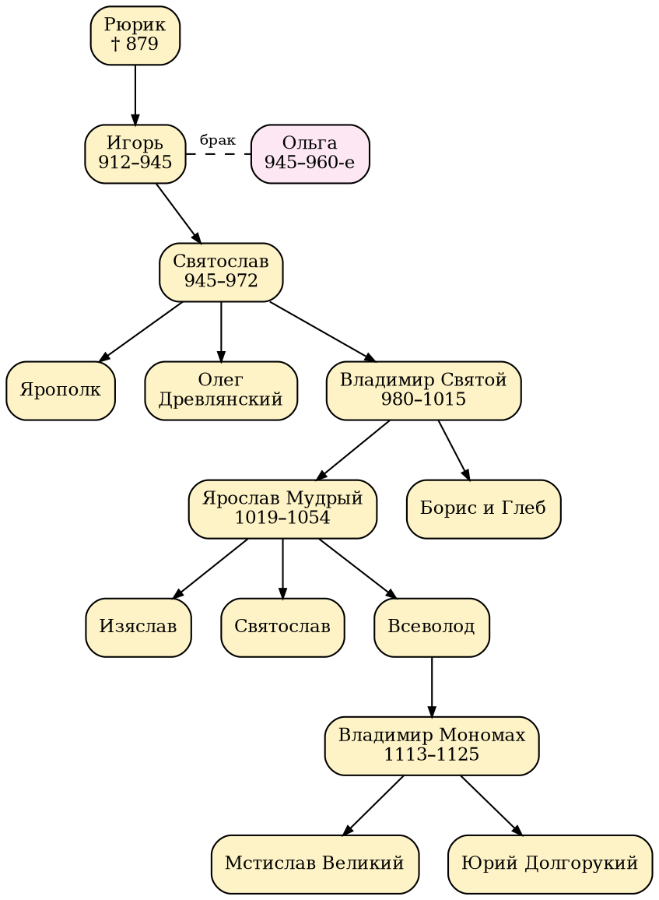
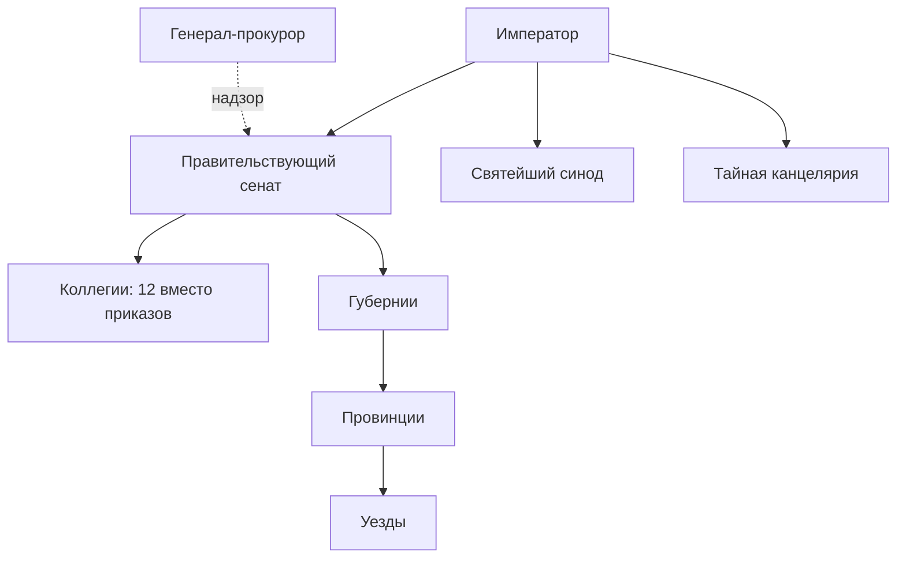
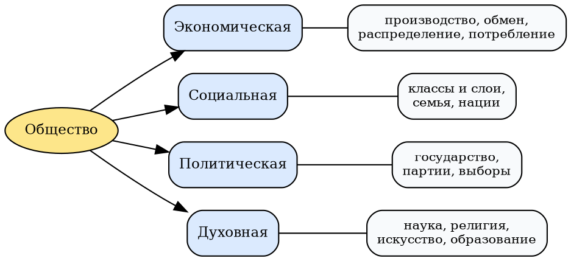
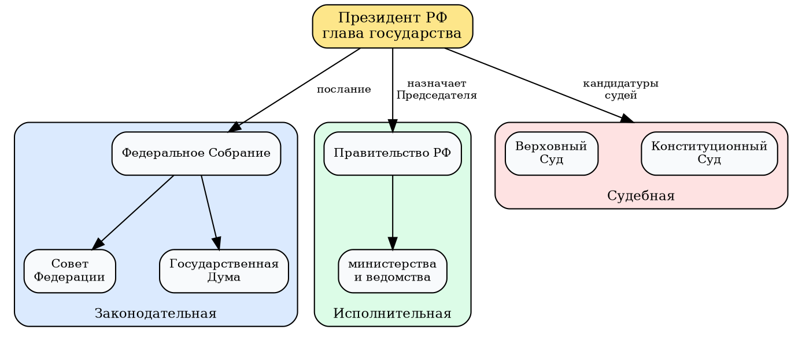

<!-- Собрано автоматически из документов-примеров Spiridus — правки в основном репозитории Spiridus. -->

<!-- раздел: Школа | теги: география, история, обществознание, 5 класс, 6 класс, 7 класс, 8 класс, 9 класс, 10 класс, 11 класс, карта, климатограмма, роза ветров, часовые пояса, демография, лента времени, династии, органы власти, спрос и предложение -->
# География, история, обществознание: 5–11 класс

Типичные рисунки учебников: карты, климатограммы, профили, разрезы, ленты времени, родословные, схемы власти, экономические графики.

## География

### Политическая карта мира (7, 10 класс)

```echarts
{"width":720,"height":400,"title":{"text":"Крупнейшие по площади страны мира, млн км²","left":"center","textStyle":{"fontSize":14}},
 "visualMap":{"type":"continuous","min":2.5,"max":17.1,"orient":"horizontal","left":"center","bottom":0,"text":["17","2,5"],"inRange":{"color":["#fde68a","#f97316","#9a3412"]}},
 "series":[{"type":"map","map":"мир","top":40,"bottom":50,"itemStyle":{"areaColor":"#eef2f7","borderColor":"#94a3b8","borderWidth":0.4},
  "data":[{"name":"Россия","value":17.1},{"name":"Канада","value":10.0},{"name":"Китай","value":9.6},{"name":"США","value":9.5},{"name":"Бразилия","value":8.5},{"name":"Австралия","value":7.7},{"name":"Индия","value":3.3},{"name":"Аргентина","value":2.8},{"name":"Казахстан","value":2.7}]}]}
```

### Федеральные округа и города-миллионники (8–9 класс)

```echarts
{"width":720,"height":420,"title":{"text":"Население федеральных округов, млн чел. (2024, округлённо)","left":"center","textStyle":{"fontSize":14}},
 "geo":{"map":"федеральные округа","top":40,"bottom":50,"itemStyle":{"borderColor":"#475569"}},
 "visualMap":{"type":"continuous","seriesIndex":0,"min":7,"max":41,"text":["41","7"],"orient":"horizontal","left":"center","bottom":0,"inRange":{"color":["#e0f2fe","#0369a1"]}},
 "series":[
  {"type":"map","geoIndex":0,"data":[{"name":"Центральный","value":40.2},{"name":"Северо-Западный","value":13.9},{"name":"Южный","value":16.5},{"name":"Северо-Кавказский","value":10.2},{"name":"Приволжский","value":28.7},{"name":"Уральский","value":12.3},{"name":"Сибирский","value":16.6},{"name":"Дальневосточный","value":7.9}]},
  {"type":"scatter","coordinateSystem":"geo","symbolSize":7,"itemStyle":{"color":"#b91c1c"},"label":{"color":"#111","textBorderColor":"#fff","textBorderWidth":3,"show":true,"formatter":"{b}","position":"right","fontSize":10},
   "data":[{"name":"Москва","value":[37.6,55.75]},{"name":"Санкт-Петербург","value":[30.3,59.94]},{"name":"Новосибирск","value":[82.9,55.03]},{"name":"Екатеринбург","value":[60.6,56.84]},{"name":"Казань","value":[49.1,55.79]},{"name":"Красноярск","value":[92.9,56.01]},{"name":"Омск","value":[73.4,54.99]}]}]}
```

### Часовые пояса России (8 класс)

Не названные на карте субъекты живут по московскому времени (МСК = UTC+3). Якутия показана по большей части своей территории (МСК+6).

```echarts
{"width":720,"height":420,"title":{"text":"Часовые пояса России: разница с Москвой","left":"center","textStyle":{"fontSize":14}},
 "visualMap":{"type":"piecewise","orient":"horizontal","left":"center","bottom":0,"itemWidth":14,"textStyle":{"fontSize":11},
  "pieces":[{"value":-1,"label":"−1","color":"#a5b4fc"},{"value":0,"label":"МСК","color":"#e2e8f0"},{"value":1,"label":"+1","color":"#fef08a"},{"value":2,"label":"+2","color":"#fde047"},{"value":3,"label":"+3","color":"#fdba74"},{"value":4,"label":"+4","color":"#fb923c"},{"value":5,"label":"+5","color":"#f87171"},{"value":6,"label":"+6","color":"#86efac"},{"value":7,"label":"+7","color":"#4ade80"},{"value":8,"label":"+8","color":"#22d3ee"},{"value":9,"label":"+9","color":"#60a5fa"}]},
 "series":[{"type":"map","map":"Россия","top":40,"bottom":60,"itemStyle":{"areaColor":"#e2e8f0","borderColor":"#64748b","borderWidth":0.4},
  "data":[{"name":"Москва","value":0},{"name":"Калининградская область","value":-1},
   {"name":"Астраханская область","value":1},{"name":"Самарская область","value":1},{"name":"Саратовская область","value":1},{"name":"Удмуртская Республика","value":1},{"name":"Ульяновская область","value":1},
   {"name":"Республика Башкортостан","value":2},{"name":"Курганская область","value":2},{"name":"Оренбургская область","value":2},{"name":"Пермский край","value":2},{"name":"Свердловская область","value":2},{"name":"Тюменская область","value":2},{"name":"Ханты-Мансийский автономный округ — Югра","value":2},{"name":"Ямало-Ненецкий автономный округ","value":2},{"name":"Челябинская область","value":2},
   {"name":"Омская область","value":3},
   {"name":"Алтайский край","value":4},{"name":"Республика Алтай","value":4},{"name":"Кемеровская область — Кузбасс","value":4},{"name":"Красноярский край","value":4},{"name":"Новосибирская область","value":4},{"name":"Томская область","value":4},{"name":"Республика Тыва","value":4},{"name":"Республика Хакасия","value":4},
   {"name":"Иркутская область","value":5},{"name":"Республика Бурятия","value":5},
   {"name":"Забайкальский край","value":6},{"name":"Амурская область","value":6},{"name":"Республика Саха (Якутия)","value":6},
   {"name":"Приморский край","value":7},{"name":"Хабаровский край","value":7},{"name":"Еврейская автономная область","value":7},
   {"name":"Магаданская область","value":8},{"name":"Сахалинская область","value":8},
   {"name":"Камчатский край","value":9},{"name":"Чукотский автономный округ","value":9}]}]}
```

### Климатограмма (6 и 8 класс)

```echarts
{"width":620,"height":320,"title":{"text":"Москва: температура и осадки по месяцам","left":"center","textStyle":{"fontSize":14}},
 "legend":{"bottom":0},"grid":{"left":50,"right":50,"top":50,"bottom":60},
 "xAxis":{"type":"category","data":["Я","Ф","М","А","М","И","И","А","С","О","Н","Д"]},
 "yAxis":[{"type":"value","name":"осадки, мм","min":0,"max":100},{"type":"value","name":"t, °C","min":-10,"max":25,"splitLine":{"show":false}}],
 "series":[{"name":"осадки, мм","type":"bar","itemStyle":{"color":"#60a5fa"},"data":[53,44,39,37,61,78,84,83,68,71,55,52]},
  {"name":"температура, °C","type":"line","yAxisIndex":1,"itemStyle":{"color":"#dc2626"},"data":[-6.5,-6.7,-1.0,6.7,13.2,17.0,19.2,17.0,11.3,5.6,-0.8,-4.9]}]}
```

### Роза ветров (6 класс)

```echarts
{"width":420,"height":380,"title":{"text":"Роза ветров за январь, число дней","left":"center","textStyle":{"fontSize":14}},
 "polar":{"radius":["0%","70%"],"center":["50%","55%"]},
 "angleAxis":{"type":"category","data":["С","СВ","В","ЮВ","Ю","ЮЗ","З","СЗ"],"startAngle":112.5},
 "radiusAxis":{"min":0,"max":9,"interval":3,"axisLabel":{"show":false}},
 "series":[{"type":"bar","coordinateSystem":"polar","data":[2,1,2,3,5,7,8,3],"itemStyle":{"color":"#0369a1"},"barCategoryGap":"8%",
  "label":{"show":true,"position":"insideEnd","fontSize":11,"color":"#fff"}}]}
```

### Профиль рельефа (6 и 8 класс)

```echarts
{"width":680,"height":300,"title":{"text":"Профиль рельефа по 60° с. ш. (упрощённо)","left":"center","textStyle":{"fontSize":14}},
 "grid":{"left":60,"right":30,"top":50,"bottom":50},
 "xAxis":{"type":"value","name":"км","nameLocation":"middle","nameGap":28,"min":0,"max":3200},
 "yAxis":{"type":"value","name":"высота, м","min":0,"max":1600},
 "series":[{"type":"line","smooth":true,"symbol":"none","lineStyle":{"color":"#78350f"},"areaStyle":{"color":"#d6b98c"},
  "data":[[0,5],[250,250],[500,150],[900,200],[1300,120],[1600,250],[1750,500],[1850,1400],[1950,600],[2100,150],[2500,60],[2900,50],[3200,90]],
  "markPoint":{"symbol":"pin","symbolSize":30,"label":{"fontSize":9},"data":[{"name":"Урал","coord":[1850,1400],"value":"Урал"}]}}]}
```

Подписи частей профиля: Санкт-Петербург (0 км) → Валдайская возвышенность → Восточно-Европейская равнина → Уральские горы → Западно-Сибирская равнина.

### Разрез земной коры (5 и 7 класс)

```tikz
\begin{tikzpicture}[scale=0.9]
  % слои осадочных пород со складкой
  \fill[yellow!30] (0,0) -- (0,3) .. controls (2,4.2) and (3,4.2) .. (5,3) -- (5,0) -- cycle;
  \fill[orange!40] (0,0) -- (0,2) .. controls (2,3.2) and (3,3.2) .. (5,2) -- (5,0) -- cycle;
  \fill[brown!40] (0,0) -- (0,1) .. controls (2,2.2) and (3,2.2) .. (5,1) -- (5,0) -- cycle;
  % сброс: правый блок опущен
  \fill[yellow!30] (5,0) rectangle (9,2.4);
  \fill[orange!40] (5,0) rectangle (9,1.4);
  \fill[brown!40] (5,0) rectangle (9,0.5);
  \draw[very thick,red!70!black] (5,-0.2) -- (5,4.2);
  \draw[-{Latex},thick] (5.4,3.0) -- (5.4,2.5);
  % вулкан и магматический очаг
  \fill[gray!60] (9,0) -- (9,2.4) -- (10.4,4.2) -- (11,4.2) -- (12.4,2.4) -- (12.4,0) -- cycle;
  \fill[red!60] (10.7,-0.6) ellipse (1.1 and 0.4);
  \draw[red!70,line width=3pt] (10.7,-0.3) -- (10.7,4.1);
  \draw (0,-0.6) -- (12.4,-0.6);
  \node[font=\small] at (2.5,4.5) {антиклиналь (складка)};
  \node[font=\small,red!60!black] at (5,4.5) {сброс};
  \node[font=\small] at (10.7,4.6) {вулкан};
  \node[font=\small,white] at (10.7,-0.6) {магма};
  \node[font=\scriptsize] at (7,2.0) {песчаник};
  \node[font=\scriptsize] at (7,1.0) {известняк};
  \node[font=\scriptsize] at (7,0.25) {глина};
\end{tikzpicture}
```

### Градусная сетка, координаты и масштаб (5 класс)

```tikz
\begin{tikzpicture}
  \def\R{2.2}
  \shade[ball color=blue!15] (0,0) circle (\R);
  \foreach \l in {-60,-30,30,60} \draw[gray!80!black] ({-\R*cos(\l)},{\R*sin(\l)}) arc[x radius={\R*cos(\l)}, y radius={0.25*\R*cos(\l)}, start angle=180, end angle=360];
  \draw[thick,red!70!black] (-\R,0) arc[x radius=\R, y radius={0.25*\R}, start angle=180, end angle=360] node[right,font=\small] {экватор};
  \foreach \m in {30,60} { \draw[gray!80!black] (0,\R) arc[x radius={\R*sin(\m)}, y radius=\R, start angle=90, end angle=270]; \draw[gray!80!black] (0,\R) arc[x radius={\R*sin(\m)}, y radius=\R, start angle=90, end angle=-90]; }
  \draw[thick,blue!70!black] (0,\R) -- (0,-\R);
  \node[font=\scriptsize,blue!70!black,rotate=90] at (-0.18,-1.2) {нулевой меридиан};
  \draw (0,0) circle (\R);
  \fill (0,\R) circle (1.5pt) node[above,font=\small] {Северный полюс};
  \fill[red] (1.1,0.95) circle (2pt); \draw[red] (1.1,0.95) -- (2.5,1.6) node[right,font=\small] {A (30° с. ш., 30° в. д.)};
  % линейный масштаб
  \begin{scope}[shift={(-2.5,-3.3)}]
    \foreach \i/\c in {0/black,1/white,2/black,3/white,4/black} \fill[\c,draw=black] (\i,0) rectangle (\i+1,0.15);
    \foreach \i/\t in {0/0,1/5,2/10,3/15,4/20,5/25 км} \node[below,font=\scriptsize] at (\i,0) {\t};
    \node[right,font=\small] at (5.6,0.07) {в 1 см 5 км (1:500\,000)};
  \end{scope}
\end{tikzpicture}
```

Расстояние на местности: $L = l \cdot M$, где $l$ — отрезок на карте, $M$ — знаменатель масштаба. При $1:500\,000$ отрезок 3,4 см — это $3{,}4 \cdot 5 = 17$ км.

### Половозрастная пирамида (8–9 класс)

```echarts
{"width":680,"height":360,"title":{"text":"Половозрастной состав населения России, млн чел. (около 2021 г.)","left":"center","textStyle":{"fontSize":14}},
 "legend":{"bottom":0,"data":["мужчины","женщины"]},
 "grid":[{"left":"6%","width":"40%","top":50,"bottom":50},{"left":"54%","width":"40%","top":50,"bottom":50}],
 "xAxis":[{"type":"value","gridIndex":0,"inverse":true,"max":13},{"type":"value","gridIndex":1,"max":13}],
 "yAxis":[{"type":"category","gridIndex":0,"position":"right","axisLabel":{"show":false},"data":["0–9","10–19","20–29","30–39","40–49","50–59","60–69","70–79","80+"]},
          {"type":"category","gridIndex":1,"position":"left","axisLabel":{"margin":30,"fontSize":10,"align":"center"},"data":["0–9","10–19","20–29","30–39","40–49","50–59","60–69","70–79","80+"]}],
 "series":[{"name":"мужчины","type":"bar","xAxisIndex":0,"yAxisIndex":0,"itemStyle":{"color":"#3b82f6"},"data":[9.3,8.0,7.3,11.8,9.8,8.6,7.2,2.9,1.0]},
           {"name":"женщины","type":"bar","xAxisIndex":1,"yAxisIndex":1,"itemStyle":{"color":"#ec4899"},"data":[8.8,7.6,7.1,12.0,10.4,10.2,10.2,5.6,3.1]}]}
```

### Структура хозяйства (8–11 класс)

```echarts
{"width":620,"height":320,"title":{"text":"Структура ВВП по секторам, % (округлённо)","left":"center","textStyle":{"fontSize":14}},
 "legend":{"bottom":0},"grid":{"left":80,"right":30,"top":45,"bottom":55},
 "xAxis":{"type":"value","max":100},"yAxis":{"type":"category","data":["Эфиопия","Индия","Китай","Россия","США"]},
 "series":[{"name":"сельское хозяйство","type":"bar","stack":"s","itemStyle":{"color":"#3f6212"},"label":{"show":true},"data":[33,17,7,4,1]},
  {"name":"промышленность","type":"bar","stack":"s","itemStyle":{"color":"#ea580c"},"label":{"show":true},"data":[23,26,39,32,18]},
  {"name":"услуги","type":"bar","stack":"s","itemStyle":{"color":"#2563eb"},"label":{"show":true},"data":[44,57,54,64,81]}]}
```

## История

### Лента времени: Древняя Русь (6 класс)

```tikz
\begin{tikzpicture}[x=0.043cm]
  \draw[-{Latex},thick] (850,0) -- (1260,0);
  \foreach \y in {900,1000,1100,1200} { \draw (\y,0.1) -- (\y,-0.1) node[below,font=\scriptsize] {\y}; }
  \foreach \y/\t/\h in {862/Призвание\\Рюрика/0.6, 882/Олег\\в Киеве/1.8, 988/Крещение\\Руси/0.6, 1016/Русская\\Правда/1.8, 1097/Любечский\\съезд/0.6, 1147/Москва\\в летописи/1.8, 1237/Нашествие\\Батыя/0.6}
    { \fill[red!70!black] (\y,0) circle (2.5pt); \draw[gray] (\y,0) -- (\y,\h); \node[above,font=\scriptsize,align=center] at (\y,\h) {\y\\\t}; }
  \fill[orange!40] (1019,-0.95) rectangle (1054,-0.7); \node[right,font=\scriptsize] at (1054,-0.82) {правление Ярослава Мудрого, 1019–1054};
\end{tikzpicture}
```

### Родословная: Рюриковичи (6 класс)



### Хронологическая таблица и шкала правлений (7 класс)

| Правитель | Годы правления | Главные события |
|---|---|---|
| Михаил Фёдорович | 1613–1645 | конец Смуты, Столбовский мир, Деулинское перемирие |
| Алексей Михайлович | 1645–1676 | Соборное уложение 1649 г., церковный раскол, Переяславская рада |
| Фёдор Алексеевич | 1676–1682 | отмена местничества |
| Софья (регент) | 1682–1689 | Вечный мир с Польшей, Крымские походы |
| Пётр I | 1682–1725 | Северная война, Табель о рангах, провозглашение империи |

```echarts
{"width":680,"height":300,"title":{"text":"Правления и войны XVII – начала XVIII века","left":"center","textStyle":{"fontSize":14}},
 "grid":{"left":150,"right":30,"top":45,"bottom":35},
 "xAxis":{"type":"value","min":1610,"max":1740,"interval":10,"axisLabel":{"show":false}},
 "yAxis":{"type":"category","inverse":true,"axisLabel":{"fontSize":11},"data":["Михаил Фёдорович","Алексей Михайлович","Фёдор Алексеевич","Софья (регент)","Пётр I","Смоленская война","Русско-польская война","Северная война"]},
 "series":[{"type":"bar","stack":"t","silent":true,"itemStyle":{"color":"transparent"},"data":[1613,1645,1676,1682,1682,1632,1654,1700]},
  {"type":"bar","stack":"t","barWidth":14,"label":{"show":true,"position":"right","fontSize":9},
   "data":[{"value":32,"itemStyle":{"color":"#2563eb"},"label":{"formatter":"1613–1645"}},{"value":31,"itemStyle":{"color":"#2563eb"},"label":{"formatter":"1645–1676"}},{"value":6,"itemStyle":{"color":"#2563eb"},"label":{"formatter":"1676–1682"}},{"value":7,"itemStyle":{"color":"#a855f7"},"label":{"formatter":"1682–1689"}},{"value":43,"itemStyle":{"color":"#2563eb"},"label":{"formatter":"1682–1725"}},{"value":2,"itemStyle":{"color":"#dc2626"},"label":{"formatter":"1632–1634"}},{"value":13,"itemStyle":{"color":"#dc2626"},"label":{"formatter":"1654–1667"}},{"value":21,"itemStyle":{"color":"#dc2626"},"label":{"formatter":"1700–1721"}}]}]}
```

### Великие географические открытия (7 класс история, 5 класс география)

```echarts
{"width":720,"height":420,"title":{"text":"Плавания Колумба, да Гамы и Магеллана","left":"center","textStyle":{"fontSize":14}},
 "legend":{"bottom":0},
 "geo":{"map":"мир","top":40,"bottom":40,"itemStyle":{"areaColor":"#f1f5f9","borderColor":"#94a3b8","borderWidth":0.4}},
 "series":[
  {"name":"Колумб, 1492","type":"lines","coordinateSystem":"geo","polyline":true,"lineStyle":{"color":"#dc2626","width":2},"data":[{"coords":[[-6.9,37.2],[-15.4,28.1],[-40,26],[-74.5,24.1]]}]},
  {"name":"Васко да Гама, 1497–1498","type":"lines","coordinateSystem":"geo","polyline":true,"lineStyle":{"color":"#16a34a","width":2},"data":[{"coords":[[-9.1,38.7],[-20,12],[-15,-15],[18.5,-35.5],[35,-25],[40.1,-3.2],[60,6],[75.8,11.2]]}]},
  {"name":"Магеллан и Элькано, 1519–1522","type":"lines","coordinateSystem":"geo","polyline":true,"lineStyle":{"color":"#2563eb","width":2,"type":"dashed"},"data":[{"coords":[[-6.0,37.4],[-25,5],[-43,-23],[-60,-45],[-70,-53],[-80,-40],[-110,-15],[-160,8],[-180,10]]},{"coords":[[180,10],[145,13],[124,10],[120,-5],[100,-15],[60,-30],[18.5,-35.5],[-15,-5],[-20,20],[-6.0,37.4]]}]},
  {"type":"scatter","coordinateSystem":"geo","symbolSize":6,"itemStyle":{"color":"#111827"},"label":{"color":"#111","textBorderColor":"#fff","textBorderWidth":3,"show":true,"formatter":"{b}","position":"right","fontSize":9},
   "data":[{"name":"Палос","value":[-6.9,37.2]},{"name":"Сан-Сальвадор","value":[-74.5,24.1]},{"name":"мыс Доброй Надежды","value":[18.5,-34.4]},{"name":"Каликут","value":[75.8,11.2]},{"name":"Магелланов пролив","value":[-70,-53]},{"name":"Филиппины","value":[124,10]}]}]}
```

### Карта похода: Отечественная война 1812 года (8 класс)

Современные границы даны для ориентира: исторических карт в пакете нет.

```echarts
{"width":720,"height":420,"title":{"text":"Наступление и отступление армии Наполеона, 1812","left":"center","textStyle":{"fontSize":14,"textBorderColor":"#fff","textBorderWidth":3}},
 "legend":{"bottom":0,"textStyle":{"textBorderColor":"#fff","textBorderWidth":3}},
 "geo":{"map":"мир","center":[30.8,55],"zoom":30,"top":40,"bottom":40,"silent":true,"label":{"show":false},"itemStyle":{"areaColor":"#f8fafc","borderColor":"#94a3b8","borderWidth":0.6}},
 "series":[
  {"name":"наступление (июнь–сентябрь)","type":"lines","coordinateSystem":"geo","polyline":true,"lineStyle":{"color":"#b45309","width":4},"data":[{"coords":[[23.9,54.9],[25.3,54.7],[30.2,55.2],[32.0,54.8],[34.3,55.2],[35.8,55.5],[37.6,55.75]]}]},
  {"name":"отступление (октябрь–декабрь)","type":"lines","coordinateSystem":"geo","polyline":true,"lineStyle":{"color":"#111827","width":2,"type":"dashed"},"data":[{"coords":[[37.6,55.75],[36.5,55.0],[35.4,55.3],[34.3,55.1],[32.0,54.7],[30.4,54.5],[28.4,54.3],[25.3,54.6],[23.9,54.8]]}]},
  {"type":"effectScatter","coordinateSystem":"geo","symbolSize":10,"itemStyle":{"color":"#dc2626"},"label":{"color":"#111","textBorderColor":"#fff","textBorderWidth":3,"show":true,"formatter":"{b}","position":"top","fontSize":10},
   "data":[{"name":"Бородино","value":[35.8,55.5]},{"name":"Малоярославец","value":[36.5,55.0]},{"name":"Березина","value":[28.4,54.3]},{"name":"Смоленск","value":[32.0,54.8]}]},
  {"type":"scatter","coordinateSystem":"geo","symbolSize":6,"itemStyle":{"color":"#1e3a8a"},"label":{"color":"#111","textBorderColor":"#fff","textBorderWidth":3,"show":true,"formatter":"{b}","position":"bottom","fontSize":10},
   "data":[{"name":"Москва","value":[37.6,55.75]},{"name":"Вильна","value":[25.3,54.7]},{"name":"Ковно","value":[23.9,54.9]},{"name":"Витебск","value":[30.2,55.2]}]}]}
```

### Схема сражения: Куликовская битва, 1380 (6 класс)

```tikz
\begin{tikzpicture}[polk/.style={draw,fill=red!20,minimum width=1.8cm,minimum height=0.5cm,font=\scriptsize,align=center},
  orda/.style={draw,fill=gray!30,minimum width=1.8cm,minimum height=0.5cm,font=\scriptsize}]
  % реки
  \draw[blue!60,line width=2pt] (-4.2,-3.4) .. controls (-4.5,-1) and (-4,1) .. (-4.4,3.2) node[above,font=\scriptsize] {Дон};
  \draw[blue!60,line width=1.5pt] (-4.3,-1.5) .. controls (-2,-2.6) and (1,-2.4) .. (4,-3.2) node[right,font=\scriptsize] {Непрядва};
  % лес
  \foreach \x/\y in {-3.4/1.5, -3.0/1.8, -2.6/1.5} \fill[green!50!black] (\x,\y) circle (0.22);
  \node[font=\scriptsize,green!30!black] at (-3,2.4) {Зелёная дубрава};
  % русские полки
  \node[polk] (st) at (0,0.9) {Сторожевой};
  \node[polk] (pr) at (0,0.2) {Передовой};
  \node[polk] (bo) at (0,-0.6) {Большой полк};
  \node[polk] (pp) at (2.2,-0.6) {Правой руки};
  \node[polk] (lp) at (-2.2,-0.6) {Левой руки};
  \node[polk,fill=red!40] (za) at (-3,0.9) {Засадный};
  \node[polk,fill=red!10] at (0,-1.5) {Резерв};
  % войско Мамая
  \node[orda,minimum width=6cm] (ma) at (0,2.9) {войско Мамая};
  \node[font=\scriptsize] at (0,3.6) {Красный холм — ставка Мамая};
  \draw[-{Latex},thick,gray!70!black] (-0.8,2.6) -- (-2,0);
  \draw[-{Latex},very thick,red!70!black] (za.south east) -- (-1.5,0.3);
  \node[font=\scriptsize,red!70!black,align=center] at (-1.2,1.7) {удар\\засадного полка};
\end{tikzpicture}
```

### Схема управления: реформы Петра I (8 класс)



### Произведение эпохи Возрождения (7 класс)


## Обществознание

### Сферы общественной жизни (6 и 10 класс)



### Органы государственной власти РФ (9 и 11 класс)



### Формы государства (9 и 11 класс)

| Признак | Варианты | Примеры |
|---|---|---|
| Форма правления | монархия (абсолютная, конституционная); республика (президентская, парламентская, смешанная) | Саудовская Аравия, Великобритания; США, Германия, Россия |
| Форма устройства | унитарное, федеративное государство, конфедерация | Франция; Россия, Германия |
| Политический режим | демократический, авторитарный, тоталитарный | — |

### Спрос и предложение (8 и 11 класс)

```tikz
\begin{tikzpicture}
  \begin{axis}[width=9cm,height=7cm,xmin=0,xmax=10,ymin=0,ymax=10,axis lines=left,
    xlabel={количество, $Q$},ylabel={цена, $P$},xtick=\empty,ytick=\empty,clip=false]
    \addplot[blue,thick,domain=1:9] {10-x} node[pos=1,right] {$D$};
    \addplot[blue,dashed,thick,domain=3:10] {12-x} node[pos=1,right] {$D'$};
    \addplot[red,thick,domain=0.5:8] {2+x} node[pos=1,right] {$S$};
    \addplot[only marks,mark=*] coordinates {(4,6) (5,7)};
    \draw[dotted] (axis cs:4,0) -- (axis cs:4,6) -- (axis cs:0,6);
    \draw[dotted] (axis cs:5,0) -- (axis cs:5,7) -- (axis cs:0,7);
    \node[below] at (axis cs:4,0) {$Q_E$};
    \node[below] at (axis cs:5,0) {$Q_E'$};
    \node[left] at (axis cs:0,6) {$P_E$};
    \node[left] at (axis cs:0,7) {$P_E'$};
    \node[above left,font=\small] at (axis cs:4,6) {$E$};
    \draw[-{Latex},thick,gray] (axis cs:6.5,3.2) -- (axis cs:7.6,4.2) node[right,font=\small,black] {рост спроса};
  \end{axis}
\end{tikzpicture}
```

Точка $E$ — равновесие: $Q_D = Q_S$. Если $Q_D = 10 - P$ и $Q_S = P - 2$, то $P_E = 6$, $Q_E = 4$.

### Структура расходов семьи (7 класс)

```echarts
{"width":520,"height":320,"title":{"text":"Расходы семьи за месяц, %","left":"center","textStyle":{"fontSize":14}},
 "series":[{"type":"pie","radius":["35%","65%"],"center":["50%","56%"],"label":{"formatter":"{b}: {c}%"},
  "data":[{"name":"питание","value":35},{"name":"жильё и ЖКУ","value":15},{"name":"транспорт","value":10},{"name":"одежда","value":10},{"name":"образование","value":8},{"name":"отдых","value":7},{"name":"сбережения","value":15}]}]}
```
