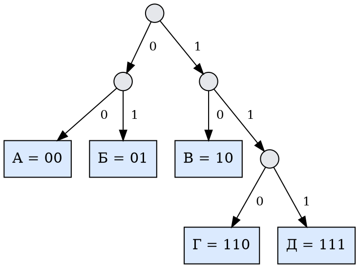
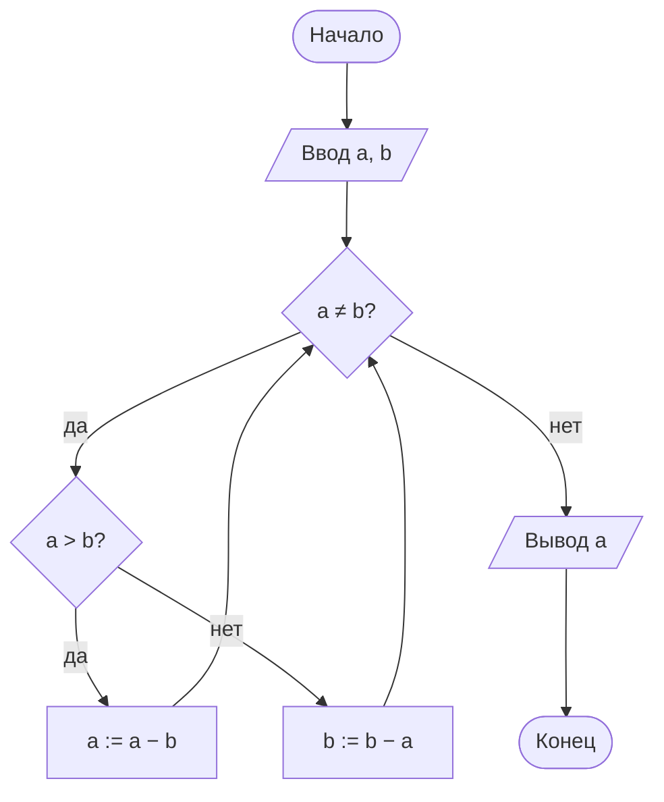
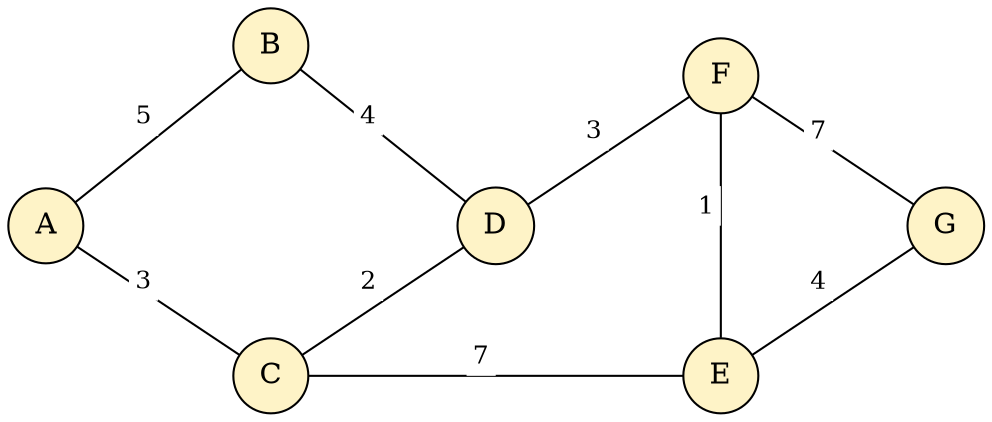
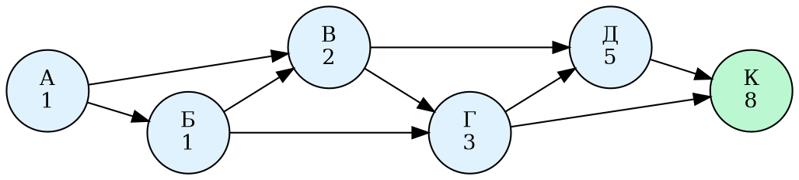
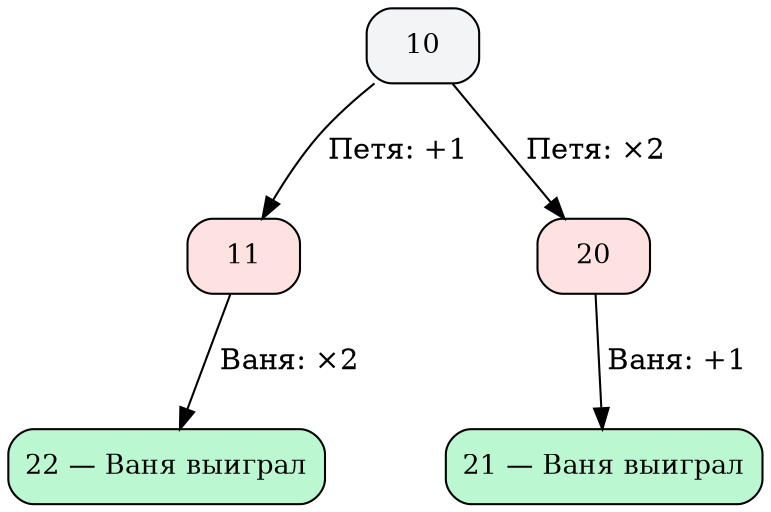
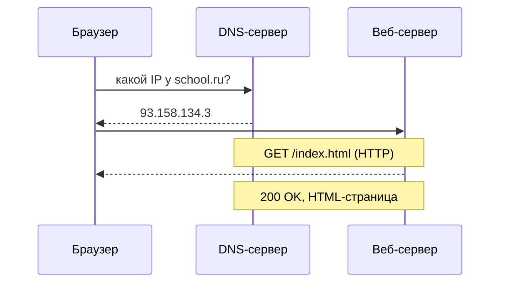
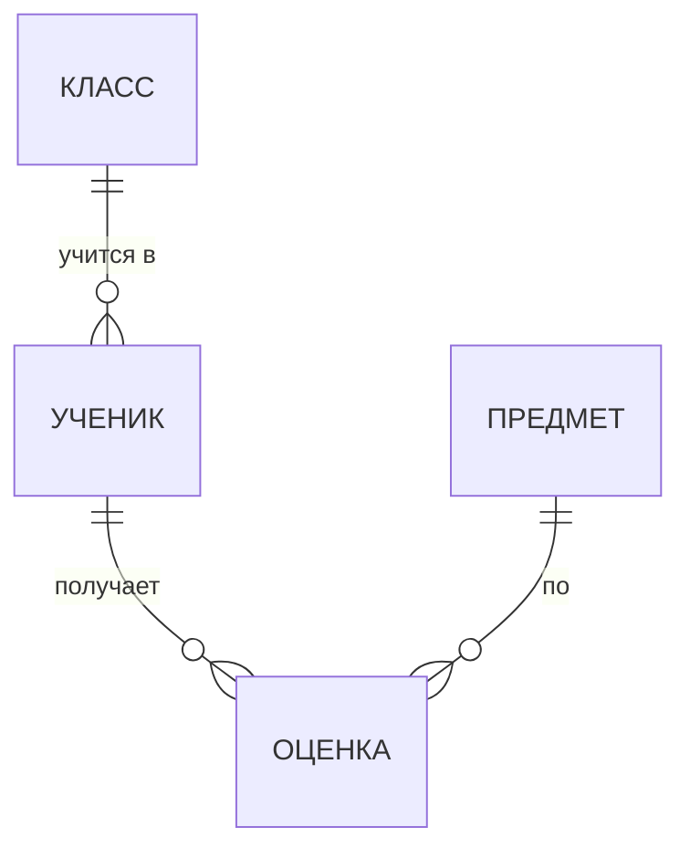

<!-- Собрано автоматически из документов-примеров Spiridus — правки в основном репозитории Spiridus. -->

<!-- раздел: Школа | теги: информатика, алгоритмы, программирование, системы счисления, логика, графы, сети, базы данных, электронные таблицы, ЕГЭ -->
# Информатика: 7–11 класс

Типичные материалы школьного курса информатики и задач ЕГЭ: системы счисления, кодирование, логика, алгоритмы и программы, графы, игры, сети, базы данных, электронные таблицы, графика и устройство компьютера. Всё собрано из блоков рендера — формул, таблиц, TikZ, Graphviz, D2, Mermaid, ECharts и блоков кода.

## Системы счисления

### Перевод из десятичной в двоичную: деление на 2

Делим число на 2, пока частное не станет нулём; остатки читаем снизу вверх.

$$
\begin{array}{r|l}
37 & 1 \\
18 & 0 \\
9 & 1 \\
4 & 0 \\
2 & 0 \\
1 & 1 \\
0 &
\end{array}
\qquad\Longrightarrow\qquad 37_{10} = 100101_2
$$

### Обратный перевод: развёрнутая форма

$$
100101_2 = 1\cdot 2^5 + 0\cdot 2^4 + 0\cdot 2^3 + 1\cdot 2^2 + 0\cdot 2^1 + 1\cdot 2^0 = 32 + 4 + 1 = 37_{10}
$$

$$
2\text{A}7_{16} = 2\cdot 16^2 + 10\cdot 16 + 7 = 679_{10}, \qquad 157_8 = 1\cdot 64 + 5\cdot 8 + 7 = 111_{10}
$$

### Двоичная, восьмеричная и шестнадцатеричная: триады и тетрады

| 10 | 2 | 8 | 16 |
|---:|---:|---:|---:|
| 0 | 0000 | 0 | 0 |
| 5 | 0101 | 5 | 5 |
| 7 | 0111 | 7 | 7 |
| 9 | 1001 | 11 | 9 |
| 10 | 1010 | 12 | A |
| 12 | 1100 | 14 | C |
| 15 | 1111 | 17 | F |

$$
\underbrace{1}_{1}\,\underbrace{101}_{5}\,\underbrace{011}_{3}{}_2 = 153_8,
\qquad
\underbrace{0110}_{6}\,\underbrace{1011}_{\text{B}}{}_2 = 6\text{B}_{16}
$$

## Кодирование информации

### Формула Хартли и объём сообщения

$$
N = 2^i, \qquad I = K \cdot i
$$

Алфавит из 64 символов: $i = \log_2 64 = 6$ бит на символ. Текст из 2048 символов: $I = 2048 \cdot 6 = 12\,288$ бит $= 1536$ байт $= 1{,}5$ КБайт.

| Единица | Сколько |
|:--|:--|
| 1 байт | 8 бит |
| 1 Кбайт | $2^{10} = 1024$ байт |
| 1 Мбайт | $2^{10}$ Кбайт $= 2^{20}$ байт |
| 1 Гбайт | $2^{10}$ Мбайт $= 2^{30}$ байт |

### Неравномерный префиксный код (условие Фано)

Ни одно кодовое слово не служит началом другого — значит, сообщение декодируется однозначно. Дерево кода: налево — 0, направо — 1, буквы только в листьях.



### Кодирование графики и звука

$$
I_{\text{рисунка}} = W \cdot H \cdot i, \qquad N_{\text{цветов}} = 2^i;
\qquad
I_{\text{звука}} = f \cdot i \cdot t \cdot k
$$

Рисунок $1024 \times 768$ точек, 256 цветов ($i = 8$ бит): $1024 \cdot 768 \cdot 8$ бит $= 768$ Кбайт.

## Основы логики

### Таблица истинности

$F = (A \land B) \lor \lnot C$

| $A$ | $B$ | $C$ | $A \land B$ | $\lnot C$ | $F$ |
|:-:|:-:|:-:|:-:|:-:|:-:|
| 0 | 0 | 0 | 0 | 1 | **1** |
| 0 | 0 | 1 | 0 | 0 | 0 |
| 0 | 1 | 0 | 0 | 1 | **1** |
| 0 | 1 | 1 | 0 | 0 | 0 |
| 1 | 0 | 0 | 0 | 1 | **1** |
| 1 | 0 | 1 | 0 | 0 | 0 |
| 1 | 1 | 0 | 1 | 1 | **1** |
| 1 | 1 | 1 | 1 | 0 | **1** |

Законы алгебры логики:

$$
\begin{gathered}
\lnot(A \land B) = \lnot A \lor \lnot B, \qquad
\lnot(A \lor B) = \lnot A \land \lnot B, \\
A \to B = \lnot A \lor B, \qquad
A \equiv B = (A \land B) \lor (\lnot A \land \lnot B)
\end{gathered}
$$

### Логическая схема

Та же функция на логических элементах (обозначения ГОСТ/МЭК: «&» — И, «1» — ИЛИ, «1» с меткой инверсии на выходе — НЕ).

```tikz
\begin{circuitikz}
  \draw (0,2) node[european and port] (and1) {};
  \draw (0,0) node[european not port] (not1) {};
  \draw (3,1) node[european or port] (or1) {};
  \draw (and1.out) -- ++(0.4,0) |- (or1.in 1);
  \draw (not1.out) -- ++(0.4,0) |- (or1.in 2);
  \draw (and1.in 1) -- ++(-0.6,0) node[left] {$A$};
  \draw (and1.in 2) -- ++(-0.6,0) node[left] {$B$};
  \draw (not1.in) -- ++(-0.6,0) node[left] {$C$};
  \draw (or1.out) -- ++(0.6,0) node[right] {$F$};
\end{circuitikz}
```

### Запросы к поисковой системе: круги Эйлера

Запрос «Кошки & Собаки» находит только общую часть, «Кошки | Собаки» — всё вместе.

| Запрос | Найдено страниц |
|:--|--:|
| Кошки | 4800 |
| Собаки | 5200 |
| Кошки & Собаки | 1100 |
| Кошки \| Собаки | ? |

$|К \cup С| = |К| + |С| - |К \cap С| = 4800 + 5200 - 1100 = 8900$.

```tikz
\begin{tikzpicture}
  \def\K{(0,0) circle (1.6)}
  \def\S{(2.2,0) circle (1.6)}
  \fill[blue!12] \K; \fill[orange!15] \S;
  \begin{scope}\clip \K; \fill[green!35] \S; \end{scope}
  \draw[thick] \K; \draw[thick] \S;
  \node at (-0.6,0) {3700};
  \node at (1.1,0) {1100};
  \node at (2.8,0) {4100};
  \node[above] at (-0.4,1.6) {Кошки};
  \node[above] at (2.6,1.6) {Собаки};
\end{tikzpicture}
```

## Алгоритмы

### Блок-схема: алгоритм Евклида



### Трассировочная таблица

Исполнение для $a = 48$, $b = 18$:

| Шаг | $a$ | $b$ | $a \ne b$? | $a > b$? |
|--:|--:|--:|:-:|:-:|
| 0 | 48 | 18 | да | да |
| 1 | 30 | 18 | да | да |
| 2 | 12 | 18 | да | нет |
| 3 | 12 | 6 | да | да |
| 4 | 6 | 6 | нет | — |

Ответ: НОД(48, 18) = 6.

### Исполнитель Черепаха

Программа `Повтори 4 [Вперёд 6 Направо 90]` рисует квадрат. Сколько точек с целыми координатами лежит строго внутри?

```tikz
\begin{tikzpicture}[scale=0.55]
  \draw[gray!40] (-1,-1) grid (7,7);
  \draw[->] (-1,0) -- (7.5,0) node[right] {$x$};
  \draw[->] (0,-1) -- (0,7.5) node[above] {$y$};
  \draw[very thick, blue] (0,0) -- (0,6) -- (6,6) -- (6,0) -- cycle;
  \foreach \x in {1,...,5} \foreach \y in {1,...,5} \fill[red] (\x,\y) circle (2.5pt);
  \fill[green!50!black] (0,0) circle (4pt);
  \draw[->, very thick, green!50!black] (0,0) -- (0,1.2);
\end{tikzpicture}
```

Ответ: $5 \times 5 = 25$ точек.

## Программирование

### Python: перебор для таблицы истинности (ЕГЭ, задание 2)

```python
print('x y z w')
for x in range(2):
    for y in range(2):
        for z in range(2):
            for w in range(2):
                F = ((x <= y) or (z == w)) and not (y and w)
                if not F:
                    print(x, y, z, w)
```

### Pascal: алгоритм Евклида

```pascal
program Euclid;
var a, b: integer;
begin
  readln(a, b);
  while a <> b do
    if a > b then a := a - b
    else b := b - a;
  writeln('НОД = ', a);
end.
```

### C++: решето Эратосфена

```cpp
#include <iostream>
#include <vector>

int main() {
    const int N = 100;
    std::vector<bool> prime(N + 1, true);
    prime[0] = prime[1] = false;
    for (int i = 2; i * i <= N; ++i)
        if (prime[i])
            for (int j = i * i; j <= N; j += i)
                prime[j] = false;
    for (int i = 2; i <= N; ++i)
        if (prime[i]) std::cout << i << ' ';
}
```

### Python: рекурсия (ЕГЭ, задание 16)

```python
from functools import lru_cache

@lru_cache(None)
def F(n):
    if n < 3:
        return n
    return F(n - 1) + 2 * F(n - 2)

print(F(20))
```

## Графы и деревья

### Схема дорог и таблица смежности (ЕГЭ, задание 1)

Числа на рёбрах — длины дорог в километрах.



В таблице пункты пронумерованы иначе, чем на схеме:

| | П1 | П2 | П3 | П4 | П5 | П6 | П7 |
|:-:|:-:|:-:|:-:|:-:|:-:|:-:|:-:|
| **П1** | | | | 2 | 3 | 4 | |
| **П2** | | | | 3 | | 5 | |
| **П3** | | | | | 7 | | 4 |
| **П4** | 2 | 3 | | | | | 7 |
| **П5** | 3 | | 7 | | | | 1 |
| **П6** | 4 | 5 | | | | | |
| **П7** | | | 4 | 7 | 1 | | |

Дорога длины 5 на схеме одна — A–B, в таблице 5 стоит между П2 и П6. Из П2 идёт ещё дорога длины 3, как A–C, значит, П2 = A, П6 = B, П4 = C. Так восстанавливаем: П1 = D, П2 = A, П3 = G, П4 = C, П5 = F, П6 = B, П7 = E.

### Кратчайший путь (алгоритм Дейкстры)

| Шаг | A | B | C | D | E | F | G |
|--:|:-:|:-:|:-:|:-:|:-:|:-:|:-:|
| 1 | **0** | 5 | 3 | ∞ | ∞ | ∞ | ∞ |
| 2 | | 5 | **3** | 5 | 10 | ∞ | ∞ |
| 3 | | **5** | | 5 | 10 | ∞ | ∞ |
| 4 | | | | **5** | 10 | 8 | ∞ |
| 5 | | | | | 9 | **8** | 15 |
| 6 | | | | | **9** | | 13 |
| 7 | | | | | | | **13** |

Кратчайший путь A → C → D → F → E → G, длина 13 км.

### Количество путей (ЕГЭ, задание 13)

Число путей в вершину равно сумме чисел у вершин, из которых в неё ведут стрелки.



## Теория игр: выигрышная стратегия

В куче $S$ камней. За ход можно добавить 1 камень или удвоить кучу. Выигрывает тот, после чьего хода в куче станет не меньше 21 камня. Первым ходит Петя. При $S = 10$ Ваня выигрывает своим первым ходом при любом ходе Пети:



| $S$ | Кто выигрывает | Почему |
|:--|:--|:--|
| 11…20 | Петя первым ходом | удвоение даёт не меньше 22 |
| 10 | Ваня первым ходом | оба хода Пети ведут в 11 или 20 |

## Компьютерные сети

### Схема локальной сети

```d2
direction: down
Интернет: {shape: cloud}
Маршрутизатор: "Маршрутизатор\n192.168.1.1"
Коммутатор
ПК1: "ПК 1\n192.168.1.10"
ПК2: "ПК 2\n192.168.1.11"
Принтер: "Принтер\n192.168.1.20"
Интернет <-> Маршрутизатор
Маршрутизатор <-> Коммутатор
Коммутатор <-> ПК1
Коммутатор <-> ПК2
Коммутатор <-> Принтер
```

### IP-адрес и маска: адрес сети (ЕГЭ, задание 13)

Адрес сети — поразрядная конъюнкция адреса узла и маски.

| | Десятичная запись | Последний байт в двоичной |
|:--|:--|:--|
| IP-адрес | 192.168.32.**173** | `10101101` |
| Маска | 255.255.255.**240** | `11110000` |
| Адрес сети | 192.168.32.**160** | `10100000` |

Под номер узла остаётся 4 бита: $2^4 - 2 = 14$ адресов для компьютеров.

### Как браузер открывает страницу



## Базы данных

### Реляционная база: таблицы и связи

```d2
Ученик: {
  shape: sql_table
  id: int {constraint: primary_key}
  фамилия: text
  класс_id: int {constraint: foreign_key}
}
Класс: {
  shape: sql_table
  id: int {constraint: primary_key}
  название: text
}
Оценка: {
  shape: sql_table
  ученик_id: int {constraint: foreign_key}
  предмет_id: int {constraint: foreign_key}
  балл: int
  дата: date
}
Предмет: {
  shape: sql_table
  id: int {constraint: primary_key}
  название: text
}
Ученик.класс_id -> Класс.id
Оценка.ученик_id -> Ученик.id
Оценка.предмет_id -> Предмет.id
```

### ER-диаграмма



### Запрос к базе

```sql
SELECT у.фамилия, AVG(о.балл) AS средний
FROM Ученик у
JOIN Оценка о ON о.ученик_id = у.id
WHERE о.предмет_id = 3
GROUP BY у.фамилия
ORDER BY средний DESC;
```

## Электронные таблицы

### Формулы и ссылки

|   | A | B | C | D |
|:-:|:--|--:|--:|:--|
| **1** | Товар | Цена | Кол-во | Сумма |
| **2** | Тетрадь | 45 | 10 | `=B2*C2` → 450 |
| **3** | Ручка | 30 | 12 | `=B3*C3` → 360 |
| **4** | Линейка | 60 | 3 | `=B4*C4` → 180 |
| **5** | | | Итого | `=СУММ(D2:D4)` → 990 |

При копировании формулы `=$B2*C$1` из D2 в E3 относительные части сдвигаются, а помеченные `$` — нет: получится `=$B3*D$1`.

### Диаграмма по данным таблицы

```echarts
{"width":520,"height":300,
 "title":{"text":"Сумма по товарам, ₽","left":"center","textStyle":{"fontSize":14}},
 "tooltip":{},
 "xAxis":{"type":"category","data":["Тетрадь","Ручка","Линейка"]},
 "yAxis":{"type":"value"},
 "series":[{"type":"bar","data":[450,360,180],"label":{"show":true,"position":"top"},"itemStyle":{"color":"#3b82f6"}}]}
```

```echarts
{"width":520,"height":280,
 "tooltip":{"trigger":"item"},
 "legend":{"bottom":0},
 "series":[{"type":"pie","radius":["35%","65%"],"label":{"formatter":"{b}: {d}%"},
   "data":[{"name":"Тетрадь","value":450},{"name":"Ручка","value":360},{"name":"Линейка","value":180}]}]}
```

## Компьютерная графика

### Растровое изображение: пиксели и двоичный код

Чёрно-белый рисунок $8 \times 8$: каждый пиксель — 1 бит (1 — закрашен). Всего $64$ бита $= 8$ байт.

```tikz
\begin{tikzpicture}[scale=0.5]
  \foreach \y/\cells/\row in {7/{2,3,4,5}/00111100, 6/{1,6}/01000010, 5/{0,2,5,7}/10100101, 4/{0,7}/10000001,
      3/{0,2,5,7}/10100101, 2/{0,3,4,7}/10011001, 1/{1,6}/01000010, 0/{2,3,4,5}/00111100} {
    \foreach \x in \cells \fill[black] (\x,\y) rectangle ++(1,1);
    \node[anchor=west, font=\ttfamily] at (8.5,\y+0.5) {\row};
  }
  \draw[gray] (0,0) grid (8,8);
\end{tikzpicture}
```

### Цвет в модели RGB

| Цвет | R | G | B | Шестнадцатеричный код |
|:--|--:|--:|--:|:--|
| Красный | 255 | 0 | 0 | `#FF0000` |
| Жёлтый | 255 | 255 | 0 | `#FFFF00` |
| Голубой | 0 | 255 | 255 | `#00FFFF` |
| Серый | 128 | 128 | 128 | `#808080` |

## Устройство компьютера

### Архитектура фон Неймана

```d2
direction: down
ЦП: "Процессор" {
  УУ: "Устройство управления"
  АЛУ
  Регистры
  УУ -> АЛУ
  АЛУ <-> Регистры
}
ОЗУ: "Оперативная память\n(программа и данные)"
Ввод: "Устройства ввода\nклавиатура, мышь"
Вывод: "Устройства вывода\nмонитор, принтер"
ВЗУ: "Внешняя память\nSSD, флешка"
ЦП <-> ОЗУ: шина
Ввод -> ЦП
ЦП -> Вывод
ОЗУ <-> ВЗУ
```
