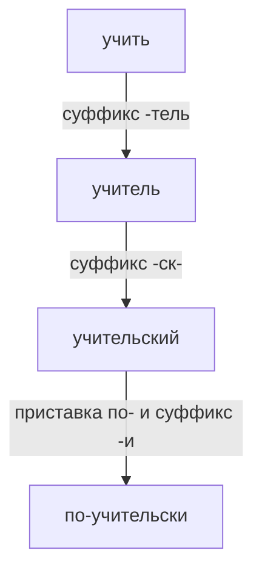
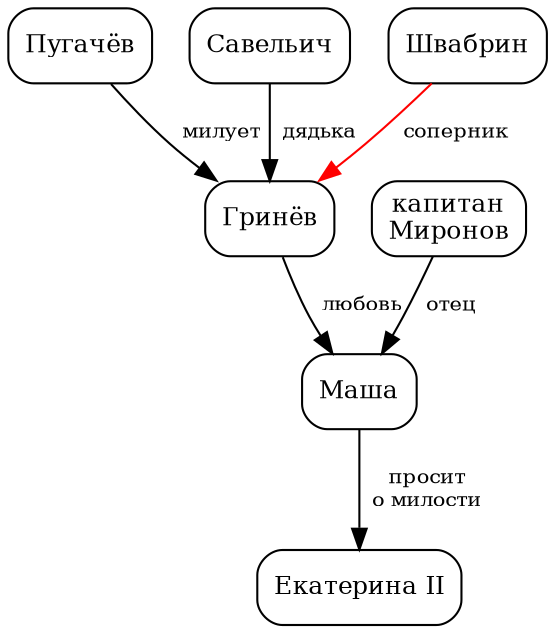

<!-- Собрано автоматически из документов-примеров Spiridus — правки в основном репозитории Spiridus. -->

<!-- раздел: Школа | теги: русский язык, литература, английский, 5 класс, 6 класс, 7 класс, 8 класс, 9 класс, 10 класс, 11 класс, разбор, синтаксис, стихосложение, грамматика, проверка -->
# Русский язык, литература, английский: 5–11 класс

Типичные материалы учебников основной и старшей школы по трём языковым предметам: разбор слова и предложения, схемы и таблицы по русскому языку; стихосложение, сюжет и персонажи по литературе; времена, транскрипция и порядок слов по английскому.

## Русский язык

### Части речи

| Самостоятельные | Служебные | Особые |
|---|---|---|
| существительное, прилагательное, числительное, местоимение, глагол, наречие | предлог, союз, частица | междометие, звукоподражательные слова |

Причастие и деепричастие в школьной программе — особые формы глагола.

### Разбор слова по составу

```razbor
под/п окон/к ник/с 0/0
рас/п сказ/к чиц/с а/о
пере/п ход/к 0/0
без/п бреж/к н/с ый/о
```

### Словообразовательная цепочка



### Ударение и орфограммы

Ударение ставится знаком над гласной: звони́т, догово́р, краси́вее, щаве́ль, кварта́л.

| Орфограмма | Пример | Проверка |
|---|---|---|
| Безударная гласная в корне | в**о**да́ | во́ды |
| Чередование *раст/ращ/рос* | р**а**сти́, р**о**с | перед *ст*, *щ* — *а* |
| Парная согласная в корне | ду**б** | дубы́ |
| Непроизносимая согласная | ме**ст**ный | ме́сто |
| *Пре-* / *при-* | **пре**красный, **при**ехать | «очень» / «приближение» |
| *Н* и *нн* в прилагательных | деревя**нн**ый, кожа**н**ый | исключения: стеклянный, оловянный, деревянный |

### Морфологический разбор

Глагол *(они) прочитали*:

1. Часть речи — глагол, обозначает действие, отвечает на вопрос *что сделали?*
2. Начальная форма — *прочитать*. Постоянные признаки: совершенный вид, переходный, невозвратный, I спряжение.
3. Непостоянные признаки: изъявительное наклонение, прошедшее время, множественное число.
4. Синтаксическая роль — сказуемое.

### Склонение существительных

| Падеж | 1 скл. | 2 скл., м. р. | 2 скл., ср. р. | 3 скл. |
|---|---|---|---|---|
| И. | стран**а** | кон**ь** | окн**о** | ноч**ь** |
| Р. | стран**ы** | кон**я** | окн**а** | ноч**и** |
| Д. | стран**е** | кон**ю** | окн**у** | ноч**и** |
| В. | стран**у** | кон**я** | окн**о** | ноч**ь** |
| Т. | стран**ой** | кон**ём** | окн**ом** | ноч**ью** |
| П. | о стран**е** | о кон**е** | об окн**е** | о ноч**и** |

### Спряжение глаголов

| Лицо | I спряжение: *читать* | II спряжение: *говорить* |
|---|---|---|
| я | чита**ю** | говор**ю** |
| ты | чита**ешь** | говор**ишь** |
| он, она | чита**ет** | говор**ит** |
| мы | чита**ем** | говор**им** |
| вы | чита**ете** | говор**ите** |
| они | чита**ют** | говор**ят** |

Ко II спряжению относятся глаголы на *-ить* (кроме *брить, стелить*) и 11 исключений: *гнать, держать, дышать, слышать, смотреть, видеть, ненавидеть, обидеть, терпеть, вертеть, зависеть*.

### Члены предложения и обособленные обороты

Простое предложение, однородные сказуемые, причастный и деепричастный обороты:

```razbor
Осенний/~ ветер/1 гнал/2 по/-. дорогам/-. жёлтые/~ листья/--
Дети/1 бегали/2 и смеялись/2
Мальчик,/1 "сидевший у окна,"/~ читал/2 книгу/--
Ученик,/1 "закончив работу,"/-. ушёл/2 домой/-.
```

### Схемы сложных предложений

```tikz
\begin{tikzpicture}[every node/.style={inner sep=2pt}]
  \node[anchor=west] at (0,0) {Сложносочинённое: \quad [\quad ], и [\quad ].};
  \node[anchor=west] at (0,-0.7) {Сложноподчинённое: \quad [\quad ], (когда\quad ).};
  \node[anchor=west] at (0,-1.4) {Бессоюзное: \quad [\quad ]: [\quad ].};
  % вертикальная схема СПП
  \node[draw, minimum width=3cm, minimum height=0.6cm] (m) at (10.5,0) {[Я знаю]};
  \node[draw, rounded corners=6pt, minimum width=3.4cm, minimum height=0.6cm] (s) at (10.5,-1.6) {(что ты придёшь)};
  \draw[-latex, thick] (m.south) -- node[right] {\textit{что знаю?}} (s.north);
\end{tikzpicture}
```

### Пунктуационные схемы

| Схема | Пример |
|---|---|
| О, О и О. | Мы видели *реку, лес и поле*. |
| О: О, О, О. | На столе лежали *книги: учебник, тетрадь, дневник*. |
| \|О, \| О. | *Звонко крича*, птицы улетели. |
| «П», — а. | «Я приду», — сказал он. |
| А: «П?» | Мама спросила: «Ты поел?» |
| «П, — а, — п». | «Завтра, — сказал учитель, — контрольная». |

## Литература

### Размер стиха: четырёхстопный ямб

```tikz
\begin{tikzpicture}[x=1.15cm]
  \foreach \s/\m [count=\i] in {Мой/$\smile$, д\'{я}/---, дя/$\smile$, с\'{а}/---, мых/$\smile$, ч\'{е}ст/---, ных/$\smile$, пр\'{а}/---, вил/$\smile$} {
    \node at (\i,0) {\s};
    \node at (\i,0.6) {\m};
  }
  \foreach \x in {2.5,4.5,6.5,8.5} \draw[gray] (\x,0.35) -- (\x,0.85);
  \node[anchor=west, font=\small] at (10,0.3) {$(\smile\,-)\times 4$};
\end{tikzpicture}
```

| Размер | Схема стопы | Пример |
|---|---|---|
| Ямб | ∪ — | Мой дя́дя са́мых че́стных пра́вил |
| Хорей | — ∪ | Бу́ря мгло́ю не́бо кро́ет |
| Дактиль | — ∪ ∪ | Ту́чки небе́сные, ве́чные стра́нники |
| Амфибрахий | ∪ — ∪ | Однажды в студёную зи́мнюю по́ру |
| Анапест | ∪ ∪ — | Я тебе́ ничего́ не скажу́ |

### Схема рифмовки: перекрёстная рифма

```tikz
\begin{tikzpicture}[font=\itshape]
  \node[anchor=west] at (0,0)    {Я помню чудное мгнов\textbf{енье}:};
  \node[anchor=west] at (0,-0.6) {Передо мной явилась \textbf{ты},};
  \node[anchor=west] at (0,-1.2) {Как мимолётное вид\textbf{енье},};
  \node[anchor=west] at (0,-1.8) {Как гений чистой красо\textbf{ты}.};
  \foreach \l/\y in {А/0, б/-0.6, А/-1.2, б/-1.8} \node[font=\bfseries\upshape] at (7.4,\y) {\l};
  \draw[thick, red!70!black] (7.8,0) to[bend left=50] (7.8,-1.2);
  \draw[thick, blue!70!black] (8.2,-0.6) to[bend left=50] (8.2,-1.8);
\end{tikzpicture}
```

Заглавная буква — женская рифма (ударение на предпоследнем слоге), строчная — мужская. Бывает ещё парная (ААбб) и кольцевая (АббА) рифма.

### Композиция сюжета

```tikz
\begin{tikzpicture}[font=\small]
  \draw[very thick] (0,0) -- (2,0) -- (4,1.6) -- (6,3) -- (8,1) -- (10,0.4);
  \foreach \x/\y/\t/\p in {1/0/экспозиция/below, 2/0/завязка/below right, 4/1.6/развитие действия/left, 6/3/кульминация/above, 8/1/развязка/right, 10/0.4/эпилог/below}
    { \fill (\x,\y) circle (2pt); \node[\p] at (\x,\y) {\t}; }
\end{tikzpicture}
```

### Система персонажей: «Капитанская дочка»



### Лента жизни: А. С. Пушкин

```tikz
\begin{tikzpicture}[font=\small]
  \draw[thick, ->] (0,0.3) -- (0,-6.6);
  \foreach \y/\d/\t in {0/1799/родился в Москве, -1.2/1811--1817/Царскосельский лицей, -2.4/1820--1826/южная и михайловская ссылки, -3.6/1830/Болдинская осень, -4.8/1836/<<Капитанская дочка>>, -6/1837/дуэль и смерть}
    { \fill (0,\y) circle (2.5pt); \node[anchor=east, font=\small\bfseries] at (-0.25,\y) {\d}; \node[anchor=west] at (0.25,\y) {\t}; }
\end{tikzpicture}
```

### Годы жизни писателей XIX века

```echarts
{
  "width": 360, "height": 340,
  "grid": { "left": 95, "right": 15, "top": 10, "bottom": 30 },
  "xAxis": { "type": "value", "min": 1790, "max": 1915, "splitNumber": 3, "axisLabel": { "formatter": "{value}" } },
  "yAxis": { "type": "category", "inverse": true, "axisLabel": { "lineHeight": 15 },
    "data": ["Пушкин\n1799–1837", "Тютчев\n1803–1873", "Гоголь\n1809–1852", "Лермонтов\n1814–1841", "Тургенев\n1818–1883", "Достоевский\n1821–1881", "Толстой\n1828–1910", "Чехов\n1860–1904"] },
  "series": [
    { "type": "bar", "stack": "life", "itemStyle": { "color": "transparent" }, "data": [1799, 1803, 1809, 1814, 1818, 1821, 1828, 1860] },
    { "type": "bar", "stack": "life", "name": "лет жизни", "data": [38, 70, 43, 27, 65, 60, 82, 44], "label": { "show": true, "position": "inside" } }
  ]
}
```

### Цитата

> Чем меньше женщину мы любим,\
> Тем легче нравимся мы ей…
>
> — А. С. Пушкин, «Евгений Онегин», гл. 4

## Английский язык

### Времена группы Simple, Continuous, Perfect

| | Past | Present | Future |
|---|---|---|---|
| **Simple** | I worked | I work / he works | I will work |
| **Continuous** | I was working | I am working | I will be working |
| **Perfect** | I had worked | I have worked | I will have worked |
| **Perfect Continuous** | I had been working | I have been working | I will have been working |

### Линии времени

```tikz
\usetikzlibrary{decorations.pathmorphing}
\begin{tikzpicture}[x=1cm, y=1cm, font=\small]
  \foreach \y/\t in {0/Past Simple, -1.1/Past Continuous, -2.2/Present Perfect, -3.3/Present Continuous, -4.4/Future Simple} {
    \node[anchor=east] at (-0.2,\y) {\t};
    \draw[->, gray] (0,\y) -- (10,\y);
    \draw[gray] (6,\y+0.2) -- (6,\y-0.2);
  }
  \node[above, gray] at (6,0.2) {now};
  % Past Simple: точка в прошлом
  \node[red, font=\large\bfseries] at (2.5,0) {$\times$};
  \node[below, font=\scriptsize] at (2.5,-0.15) {yesterday};
  % Past Continuous: процесс, прерванный действием
  \draw[blue, thick, decorate, decoration={snake, amplitude=1.5pt, segment length=6pt}] (1.5,-1.1) -- (4,-1.1);
  \node[red, font=\large\bfseries] at (3,-1.1) {$\times$};
  \node[below, font=\scriptsize] at (3,-1.25) {when he came};
  % Present Perfect: от прошлого к настоящему, результат сейчас
  \draw[red, thick, -latex] (3,-2.0) to[bend left=30] (6,-2.0);
  \node[red, font=\large\bfseries] at (3,-2.2) {$\times$};
  \node[below, font=\scriptsize] at (4.5,-2.35) {result now};
  % Present Continuous: процесс вокруг «сейчас»
  \draw[blue, thick, decorate, decoration={snake, amplitude=1.5pt, segment length=6pt}] (5,-3.3) -- (7,-3.3);
  % Future Simple
  \node[red, font=\large\bfseries] at (8.5,-4.4) {$\times$};
  \node[below, font=\scriptsize] at (8.5,-4.55) {tomorrow};
\end{tikzpicture}
```

### Транскрипция

| Звук | Как в слове | Звук | Как в слове |
|---|---|---|---|
| [θ] | think [θɪŋk] | [ð] | this [ðɪs] |
| [ʃ] | ship [ʃɪp] | [ʒ] | measure [ˈmeʒə] |
| [æ] | cat [kæt] | [ʌ] | cup [kʌp] |
| [ɜː] | bird [bɜːd] | [ə] | about [əˈbaʊt] |
| [ŋ] | sing [sɪŋ] | [eɪ] | name [neɪm] |

То же в TeX (пакет tipa):

```tikz
\begin{tikzpicture}
  \node[align=left, font=\large] {think \textipa{[TINk]} \quad this \textipa{[DIs]} \quad bird \textipa{[b3:d]} \quad about \textipa{[@"baUt]}};
\end{tikzpicture}
```

### Порядок слов в утвердительном предложении

```tikz
\begin{tikzpicture}[box/.style={draw, rounded corners, minimum width=2.4cm, minimum height=0.8cm, font=\small\bfseries}]
  \foreach \t/\w/\c [count=\i] in {Subject/My sister/blue, Verb/reads/red, Object/English books/green!60!black, Place/at home/orange, Time/every evening/violet} {
    \node[box, fill=\c!15, draw=\c] (b\i) at (\i*2.7,0) {\t};
    \node[below=3pt, font=\small\itshape] at (b\i.south) {\w};
  }
  \foreach \i [evaluate=\i as \j using int(\i+1)] in {1,...,4} \draw[-latex] (b\i) -- (b\j);
\end{tikzpicture}
```

| Тип вопроса | Схема | Пример |
|---|---|---|
| Общий | Aux + S + V? | **Do** you like tea? |
| Специальный | Wh + Aux + S + V? | **Where do** you live? |
| К подлежащему | Who + V? | **Who** lives here? |
| Разделительный | S + V, aux not + S? | She works, **doesn't she**? |

### Неправильные глаголы

| Infinitive | Past Simple | Past Participle | Перевод |
|---|---|---|---|
| be | was / were | been | быть |
| begin | began | begun | начинать |
| bring | brought | brought | приносить |
| buy | bought | bought | покупать |
| go | went | gone | идти |
| see | saw | seen | видеть |
| write | wrote | written | писать |

### Карточки слов

| Word | Transcription | Translation | Example |
|---|---|---|---|
| **journey** | [ˈdʒɜːni] | путешествие | It was a long *journey*. |
| **brave** | [breɪv] | храбрый | The *brave* knight won. |
| **borrow** | [ˈbɒrəʊ] | брать взаймы | Can I *borrow* your pen? |

### Диалог

> **Anna:** Excuse me, how can I get to the museum?
>
> **Man:** Go straight on and turn left at the bank.
>
> **Anna:** Is it far from here?
>
> **Man:** No, it's about five minutes' walk.
>
> **Anna:** Thank you very much!
