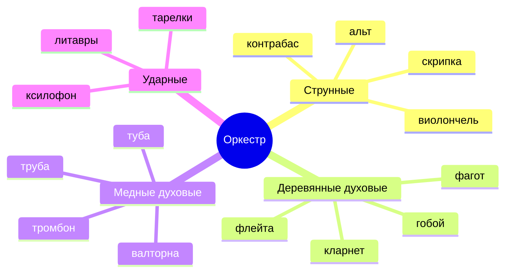
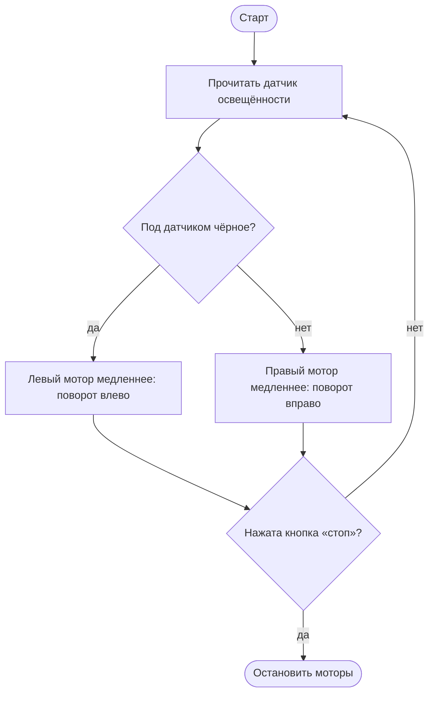
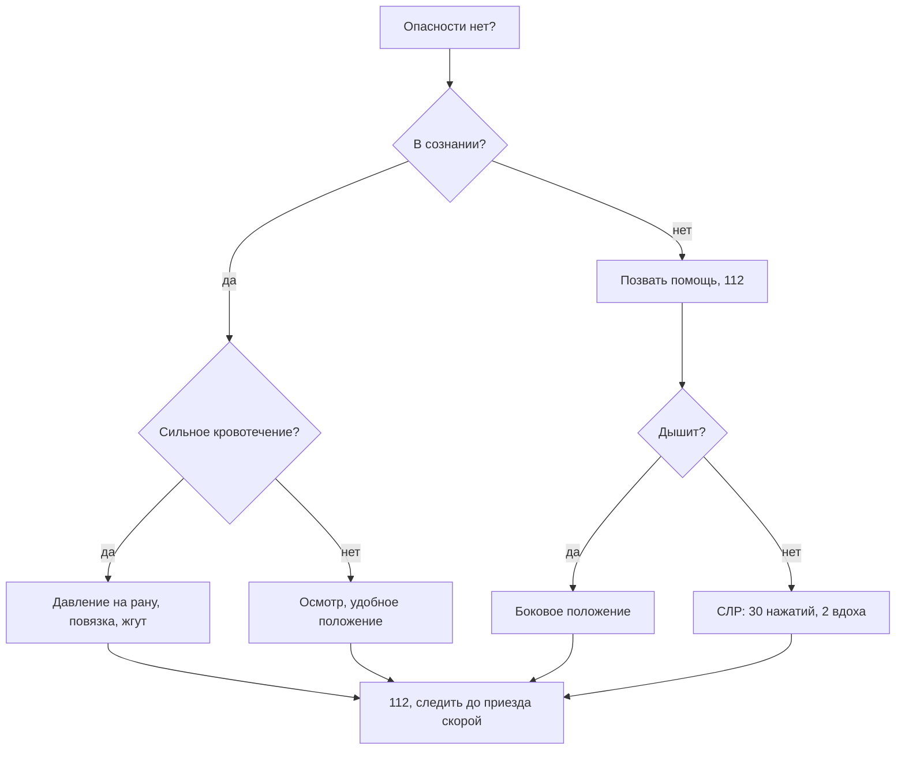

<!-- Собрано автоматически из документов-примеров Spiridus — правки в основном репозитории Spiridus. -->

<!-- раздел: Школа | теги: музыка, изо, технология, обзр, физкультура, 5 класс, 6 класс, 7 класс, 8 класс, 9 класс, 10 класс, 11 класс, ноты, перспектива, чертёж, ескд, разрез, схема, эвакуация, первая помощь, топография, площадка, нормативы, проверка -->
# Музыка, ИЗО, технология, ОБЗР, физкультура: 5–11 класс

Типичные материалы учебников по предметам «Музыка» (5–8), «Изобразительное искусство» (5–7), «Труд (технология)» (5–9), ОБЗР (8–11) и «Физическая культура» (5–11). Ноты — блоком ABC, рисунки и чертежи — TikZ, схемы — Mermaid и SVG, 3D-деталь — OpenSCAD.

## Музыка

### Песня с аккордами и словами

```abc
X:1
T:Во поле берёза стояла
C:русская народная песня
M:2/4
L:1/8
K:Dm
"Dm"A A A A | "C"G G "Dm"F E | "Dm"D2 D2 |]
w:Во по-ле бе-рё-за сто-я-ла, _
```

### Длительности нот и пауз

```abc
X:2
T:Длительности
M:4/4
L:1/4
K:C
"^целая"B4 | "^половинные"B2 B2 | "^четверти"B B B B |
"^восьмые"B/B/ B/B/ B/B/ B/B/ | "^шестнадцатые"B/4B/4B/4B/4 B/4B/4B/4B/4 B2 |
"^паузы"z4 | z2 z2 | z z z z | z/z/ z/z/ z2 |]
```

### Лады и главные трезвучия

Мажор и параллельный минор звучат на одних и тех же белых клавишах, но опора у них разная: до и ля. Главные трезвучия: тоника (T), субдоминанта (S), доминанта (D).

```abc
X:3
T:До мажор, ля минор, T–S–D
M:4/4
L:1/4
K:C
"^до мажор"C D E F | G A B c |
"^ля минор"A, B, C D | E F G A |
"^T"[CEG]2 "^S"[FAc]2 | "^D"[GBd]2 "^T"[CEG]4 |]
```

### Клавиатура: названия звуков

```tikz
\usetikzlibrary{decorations.pathreplacing}
\begin{tikzpicture}
  \foreach \i in {0,...,13} \draw[fill=white] (\i*0.8,0) rectangle +(0.8,4);
  \foreach \o in {0,7} \foreach \k in {0,1,3,4,5}
    \fill ({(\o+\k+1)*0.8-0.25},1.6) rectangle +(0.5,2.4);
  \foreach \n [count=\i from 0] in {до,ре,ми,фа,соль,ля,си,до,ре,ми,фа,соль,ля,си}
    \node[font=\small] at (\i*0.8+0.4,0.4) {\n};
  \draw[decorate, decoration={brace, amplitude=5pt, mirror}] (0,-0.2) -- node[below=6pt] {первая октава} (5.6,-0.2);
  \draw[decorate, decoration={brace, amplitude=5pt, mirror}] (5.6,-0.2) -- node[below=6pt] {вторая октава} (11.2,-0.2);
\end{tikzpicture}
```

### Симфонический оркестр



Строение формы: **рондо** — A B A C A (рефрен возвращается между эпизодами), **трёхчастная** — A B A, **вариации** — A A₁ A₂ A₃.

## Изобразительное искусство

### Цветовой круг

Основные цвета — жёлтый, красный, синий; между ними составные. Цвета напротив друг друга — дополнительные: рядом они усиливают друг друга.

```tikz
\begin{tikzpicture}
  \foreach \c [count=\i from 0] in {FFE600,FFB300,FF8000,FF4A00,E60012,B0006A,6A1B9A,3F2A9E,1E4FC2,0098A8,1FA040,9BCB2E} {
    \definecolor{cc}{HTML}{\c}
    \fill[cc, draw=white, line width=1pt] (0,0) -- ({90-\i*30+15}:3) arc[start angle={90-\i*30+15}, end angle={90-\i*30-15}, radius=3] -- cycle;
  }
  \fill[white] (0,0) circle (1.1);
  \node[font=\small] at (90:3.5) {жёлтый};
  \node[font=\small] at (-30:3.9) {красный};
  \node[font=\small] at (210:3.8) {синий};
  \node[font=\small] at (30:3.9) {оранжевый};
  \node[font=\small] at (-90:3.4) {фиолетовый};
  \node[font=\small] at (150:3.8) {зелёный};
  \draw[dashed, thick] (90:1.1) -- (90:2.6) (-90:1.1) -- (-90:2.6);
  \node[font=\footnotesize, align=center] at (0,0) {дополни-\\тельные};
\end{tikzpicture}
```

### Линейная перспектива: одна точка схода

```tikz
\usetikzlibrary{calc}
\begin{tikzpicture}
  \coordinate (V) at (0,0);
  \draw[gray] (-6,0) -- (6,0);
  \node[above right, font=\small, gray] at (-6,0) {линия горизонта};
  \fill[red] (V) circle (2pt) node[above, font=\small] {точка схода};
  % ящик ниже горизонта
  \foreach \p in {(-4,-3),(-2,-3),(-2,-1),(-4,-1)} \draw[gray, dashed] \p -- (V);
  \coordinate (a) at ($(-4,-1)!0.35!(V)$); \coordinate (b) at ($(-2,-1)!0.35!(V)$);
  \coordinate (c) at ($(-2,-3)!0.35!(V)$);
  \draw[thick, fill=orange!25] (-4,-1) -- (a) -- (b) -- (-2,-1) -- cycle;
  \draw[thick, fill=orange!45] (-2,-3) -- (c) -- (b) -- (-2,-1) -- cycle;
  \draw[thick, fill=orange!10] (-4,-3) rectangle (-2,-1);
  % ящик выше горизонта
  \foreach \p in {(2,1),(4,1),(4,2.5),(2,2.5)} \draw[gray, dashed] \p -- (V);
  \coordinate (d) at ($(2,1)!0.35!(V)$); \coordinate (e) at ($(4,1)!0.35!(V)$);
  \coordinate (f) at ($(2,2.5)!0.35!(V)$);
  \draw[thick, fill=blue!35] (2,1) -- (d) -- (e) -- (4,1) -- cycle;
  \draw[thick, fill=blue!20] (2,1) -- (d) -- (f) -- (2,2.5) -- cycle;
  \draw[thick, fill=blue!8] (2,1) rectangle (4,2.5);
  \node[font=\small, align=center] at (-3,-3.6) {видим верх};
  \node[font=\small, align=center] at (3,3.1) {видим низ};
\end{tikzpicture}
```

### Пропорции лица

Лицо делится на три равные части: от линии волос до бровей, от бровей до основания носа, от носа до подбородка. Глаза — на середине высоты головы, расстояние между ними — ширина глаза.

```tikz
\begin{tikzpicture}
  \draw[thick] (0,0) ellipse (2 and 2.8);
  \draw[gray, dashed] (0,2.8) -- (0,-2.8);
  \foreach \y/\t in {2.2/линия волос, 0.53/брови, 0/глаза — середина головы, -1.13/основание носа, -1.75/линия рта, -2.8/подбородок}
    \draw[gray] (-2.3,\y) -- (2.6,\y) node[right, black, font=\small] {\t};
  \draw[thick] (-0.8,0) ellipse (0.4 and 0.16) (0.8,0) ellipse (0.4 and 0.16);
  \draw[thick] (-1.2,0.53) .. controls (-0.8,0.7) .. (-0.4,0.58) (0.4,0.58) .. controls (0.8,0.7) .. (1.2,0.53);
  \draw[thick] (-0.1,-0.2) -- (-0.25,-1.0) -- (0.2,-1.13);
  \draw[thick] (-0.5,-1.75) .. controls (0,-1.9) .. (0.5,-1.75);
  \draw[<->, blue] (-2.6,2.2) -- node[left, font=\small] {1} (-2.6,0.53);
  \draw[<->, blue] (-2.6,0.53) -- node[left, font=\small] {1} (-2.6,-1.13);
  \draw[<->, blue] (-2.6,-1.13) -- node[left, font=\small] {1} (-2.6,-2.8);
\end{tikzpicture}
```

### Орнамент: розетка и меандр

```svg
<svg xmlns="http://www.w3.org/2000/svg" viewBox="0 0 600 200" width="600" height="200">
  <rect x="0" y="0" width="600" height="200" fill="#fff8ec"/>
  <g fill="#c62828" stroke="#7f1d1d" stroke-width="2">
    <ellipse cx="100" cy="62" rx="12" ry="32"/>
    <ellipse cx="100" cy="62" rx="12" ry="32" transform="rotate(45 100 100)"/>
    <ellipse cx="100" cy="62" rx="12" ry="32" transform="rotate(90 100 100)"/>
    <ellipse cx="100" cy="62" rx="12" ry="32" transform="rotate(135 100 100)"/>
    <ellipse cx="100" cy="62" rx="12" ry="32" transform="rotate(180 100 100)"/>
    <ellipse cx="100" cy="62" rx="12" ry="32" transform="rotate(225 100 100)"/>
    <ellipse cx="100" cy="62" rx="12" ry="32" transform="rotate(270 100 100)"/>
    <ellipse cx="100" cy="62" rx="12" ry="32" transform="rotate(315 100 100)"/>
  </g>
  <circle cx="100" cy="100" r="14" fill="#f9a825" stroke="#7f1d1d" stroke-width="2"/>
  <circle cx="100" cy="100" r="88" fill="none" stroke="#7f1d1d" stroke-width="3"/>
  <path d="M192,48H584M192,152H584M192,140H584" stroke="#1f2937" stroke-width="3" fill="none"/>
  <path d="M200,140V60H236V116H212V84H224M248,140V60H284V116H260V84H272M296,140V60H332V116H308V84H320M344,140V60H380V116H356V84H368M392,140V60H428V116H404V84H416M440,140V60H476V116H452V84H464M488,140V60H524V116H500V84H512M536,140V60H572V116H548V84H560" stroke="#1f2937" stroke-width="5" fill="none" stroke-linecap="square"/>
</svg>
```

### Произведение искусства: композиция портрета

Фигура вписана в треугольник, взгляд — на уровне верхней трети, за спиной — воздушная перспектива пейзажа.


## Технология

### Чертёж детали: три вида и размеры (ГОСТ 2.305, 2.307)

Главный вид, под ним — вид сверху, справа — вид слева. Невидимый контур — штриховой линией, оси — штрихпунктирной, размеры в миллиметрах.

```tikz
\usetikzlibrary{arrows.meta}
\begin{tikzpicture}[x=0.08cm, y=0.08cm,
  contour/.style={line width=0.8pt},
  thinl/.style={line width=0.3pt},
  hidden/.style={line width=0.4pt, dash pattern=on 3pt off 1.5pt},
  axisl/.style={line width=0.3pt, dash pattern=on 8pt off 1.5pt on 1pt off 1.5pt},
  dim/.style={line width=0.3pt, {Stealth[length=2.2mm,width=0.8mm]}-{Stealth[length=2.2mm,width=0.8mm]}},
  every node/.style={font=\small}]
  % главный вид
  \draw[contour] (0,0) -- (60,0) -- (60,20) -- (30,20) -- (30,40) -- (0,40) -- cycle;
  \draw[hidden] (40,0) -- (40,20) (50,0) -- (50,20);
  \draw[axisl] (45,-3) -- (45,23);
  % вид сверху
  \draw[contour] (0,-80) rectangle (60,-50);
  \draw[contour] (30,-80) -- (30,-50);
  \draw[contour] (45,-65) circle (5);
  \draw[axisl] (38,-65) -- (52,-65) (45,-72) -- (45,-58);
  % вид слева
  \draw[contour] (80,0) rectangle (110,40);
  \draw[hidden] (80,20) -- (110,20);
  \draw[hidden] (90,0) -- (90,20) (100,0) -- (100,20);
  \draw[axisl] (95,-3) -- (95,23);
  % размеры
  \draw[thinl] (-2,0) -- (-13,0) (-2,40) -- (-13,40);
  \draw[dim] (-10,0) -- node[above, sloped] {40} (-10,40);
  \draw[thinl] (0,42) -- (0,51) (30,42) -- (30,51);
  \draw[dim] (0,48) -- node[above] {30} (30,48);
  \draw[thinl] (62,0) -- (71,0) (62,20) -- (71,20);
  \draw[dim] (68,0) -- node[above, sloped] {20} (68,20);
  \draw[thinl] (0,-82) -- (0,-93) (60,-82) -- (60,-93);
  \draw[dim] (0,-90) -- node[above] {60} (60,-90);
  \draw[thinl] (45,-57) -- (45,-41) (60,-48) -- (60,-41);
  \draw[dim] (45,-44) -- node[above] {15} (60,-44);
  \draw[thinl] (80,-2) -- (80,-11) (110,-2) -- (110,-11);
  \draw[dim] (80,-8) -- node[below] {30} (110,-8);
  \draw[dim] (41.46,-68.54) -- (48.54,-61.46);
  \draw[thinl] (48.54,-61.46) -- (66,-56) -- (80,-56);
  \node[above] at (73,-56) {$\oslash$10};
\end{tikzpicture}
```

### Разрез втулки (ГОСТ 2.305, штриховка — ГОСТ 2.306)

```tikz
\usetikzlibrary{arrows.meta, patterns}
\begin{tikzpicture}[x=0.08cm, y=0.08cm,
  contour/.style={line width=0.8pt},
  thinl/.style={line width=0.3pt},
  axisl/.style={line width=0.3pt, dash pattern=on 8pt off 1.5pt on 1pt off 1.5pt},
  dim/.style={line width=0.3pt, {Stealth[length=2.2mm,width=0.8mm]}-{Stealth[length=2.2mm,width=0.8mm]}},
  every node/.style={font=\small}]
  % разрез А-А
  \fill[pattern=north east lines] (-90,10) rectangle (-40,20) (-90,-20) rectangle (-40,-10);
  \draw[contour] (-90,-20) rectangle (-40,20);
  \draw[contour] (-90,10) -- (-40,10) (-90,-10) -- (-40,-10);
  \draw[axisl] (-95,0) -- (-35,0);
  \node[font=\normalsize] at (-65,27) {А--А};
  \draw[thinl] (-90,-22) -- (-90,-33) (-40,-22) -- (-40,-33);
  \draw[dim] (-90,-30) -- node[above] {50} (-40,-30);
  \draw[thinl] (-92,20) -- (-103,20) (-92,-20) -- (-103,-20);
  \draw[dim] (-100,-20) -- node[above, sloped] {$\oslash$40} (-100,20);
  \draw[dim] (-75,-10) -- node[above, sloped] {$\oslash$20} (-75,10);
  % вид слева с линией сечения
  \draw[contour] (0,0) circle (20) (0,0) circle (10);
  \draw[axisl] (-24,0) -- (24,0) (0,-12) -- (0,12);
  \draw[line width=1.2pt] (0,23) -- (0,30) (0,-23) -- (0,-30);
  \draw[thinl, -{Stealth[length=2.5mm]}] (0,29) -- (-9,29);
  \draw[thinl, -{Stealth[length=2.5mm]}] (0,-29) -- (-9,-29);
  \node at (-6,34) {А}; \node at (-6,-24) {А};
\end{tikzpicture}
```

### 3D-модель для печати: втулка с фланцем

Пластмасса — штриховка «неметалл» (перекрещивающиеся линии). Нажмите «⤢», чтобы повернуть модель, кнопка STL скачивает файл для слайсера.

```openscad
// section А-А: y = 0
// hatch: nonmetal
$fn = 64;
difference() {
  union() {
    cylinder(d = 40, h = 5);
    cylinder(d = 20, h = 25);
  }
  translate([0, 0, -1]) cylinder(d = 10, h = 30);
  for (a = [0, 120, 240])
    rotate([0, 0, a]) translate([15, 0, -1]) cylinder(d = 4, h = 7);
}
```

### Развёртка цилиндра

```tikz
\begin{tikzpicture}[fold/.style={line width=0.4pt, dash pattern=on 6pt off 1.5pt on 1pt off 1.5pt on 1pt off 1.5pt}]
  \draw[thick] (0,0) -- (9.42,0) (0,3) -- (9.42,3) (0,0) -- (0,3);
  \draw[fold] (9.42,0) -- (9.42,3);
  \draw[thick, fill=gray!15] (9.42,0) -- (9.92,0.3) -- (9.92,2.7) -- (9.42,3);
  \node[font=\footnotesize, rotate=90] at (9.67,1.5) {клапан};
  \draw[thick] (1.5,4.5) circle (1.5) (1.5,-1.5) circle (1.5);
  \draw[fold] (0,3) -- (3,3) (0,0) -- (3,0);
  \draw[<->] (0,-3.3) -- node[below, font=\small] {$2\pi r \approx 94{,}2$ мм} (9.42,-3.3);
  \draw[<->] (10.4,0) -- node[right, font=\small] {$h = 30$ мм} (10.4,3);
  \draw (1.5,4.5) -- node[above, font=\small] {$r = 15$} (3,4.5);
  \node[font=\small, align=left, anchor=west] at (4,5) {штрихпунктир с двумя\\точками — линия сгиба};
\end{tikzpicture}
```

### Электрическая цепь

Источник GB, выключатель SA, лампа HL, амперметр PA — последовательно; вольтметр PV — параллельно лампе.

```tikz
\begin{circuitikz}[european]
  \draw (0,0) to[battery1, l=$GB$] (0,3) to[switch, l=$SA$] (4,3) to[lamp, l=$HL$] (4,0) to[rmeter, t=A, l=$PA$] (0,0);
  \draw (4,3) -- (6.5,3) to[rmeter, t=V, l=$PV$] (6.5,0) -- (4,0);
\end{circuitikz}
```

### Технологическая карта: разделочная доска

| № | Операция | Инструменты и оснастка |
|---|---|---|
| 1 | Выбрать заготовку, проверить влажность и пороки | линейка, влагомер |
| 2 | Разметить контур по шаблону | шаблон, карандаш |
| 3 | Выпилить контур | лобзик, струбцина |
| 4 | Просверлить отверстие ⌀10 под ручку | сверлильный станок, сверло ⌀10 |
| 5 | Зачистить кромки и пласти | напильник, шлифовальная шкурка |
| 6 | Покрыть пищевым маслом | кисть |

### Робототехника: движение по линии



## ОБЗР

### План эвакуации этажа

```svg
<svg xmlns="http://www.w3.org/2000/svg" viewBox="0 0 640 380" width="640" height="380" font-family="sans-serif" font-size="13">
  <rect x="0" y="0" width="640" height="380" fill="#ffffff"/>
  <g fill="#f3f4f6" stroke="#111827" stroke-width="3">
    <rect x="20" y="20" width="150" height="120"/>
    <rect x="170" y="20" width="150" height="120"/>
    <rect x="320" y="20" width="150" height="120"/>
    <rect x="470" y="20" width="150" height="120"/>
    <rect x="20" y="200" width="200" height="120"/>
    <rect x="220" y="200" width="200" height="120"/>
    <rect x="420" y="200" width="200" height="120"/>
  </g>
  <g fill="#ffffff">
    <rect x="80" y="134" width="30" height="12"/><rect x="230" y="134" width="30" height="12"/>
    <rect x="380" y="134" width="30" height="12"/><rect x="530" y="134" width="30" height="12"/>
    <rect x="100" y="194" width="30" height="12"/><rect x="300" y="194" width="30" height="12"/>
    <rect x="500" y="194" width="30" height="12"/>
    <rect x="14" y="150" width="12" height="40"/><rect x="614" y="150" width="12" height="40"/>
  </g>
  <g fill="#111827" text-anchor="middle">
    <text x="95" y="85">Кабинет 21</text><text x="245" y="85">Кабинет 22</text>
    <text x="395" y="85">Кабинет 23</text><text x="545" y="85">Кабинет 24</text>
    <text x="120" y="265">Кабинет 25</text><text x="320" y="265">Учительская</text>
    <text x="520" y="265">Кабинет 26</text>
  </g>
  <g stroke="#15803d" stroke-width="5" fill="none">
    <path d="M320,170H60"/><path d="M340,170H580"/>
    <path d="M245,110V160"/><path d="M395,110V160"/>
  </g>
  <g fill="#15803d">
    <polygon points="44,170 62,160 62,180"/><polygon points="596,170 578,160 578,180"/>
  </g>
  <rect x="0" y="152" width="14" height="36" fill="#15803d"/>
  <rect x="626" y="152" width="14" height="36" fill="#15803d"/>
  <text x="34" y="194" fill="#15803d" font-weight="bold">ВЫХОД</text>
  <text x="606" y="194" fill="#15803d" font-weight="bold" text-anchor="end">ВЫХОД</text>
  <circle cx="395" cy="110" r="9" fill="#dc2626"/>
  <text x="410" y="115" fill="#dc2626" font-size="12">Вы здесь</text>
  <rect x="160" y="148" width="14" height="14" fill="#dc2626"/>
  <text x="167" y="159" fill="#fff" font-size="10" text-anchor="middle">ОТ</text>
  <g font-size="12" fill="#111827">
    <line x1="20" y1="350" x2="60" y2="350" stroke="#15803d" stroke-width="5"/>
    <text x="68" y="354">путь эвакуации</text>
    <circle cx="210" cy="350" r="7" fill="#dc2626"/><text x="224" y="354">место нахождения</text>
    <rect x="360" y="343" width="14" height="14" fill="#dc2626"/><text x="382" y="354">огнетушитель</text>
    <rect x="490" y="343" width="14" height="14" fill="#15803d"/><text x="512" y="354">эвакуационный выход</text>
  </g>
</svg>
```

### Первая помощь: порядок действий



### Знаки безопасности (ГОСТ 12.4.026)

```svg
<svg xmlns="http://www.w3.org/2000/svg" viewBox="0 0 640 210" width="640" height="210" font-family="sans-serif" font-size="12">
  <rect x="0" y="0" width="640" height="210" fill="#ffffff"/>
  <!-- запрещающий -->
  <circle cx="64" cy="70" r="50" fill="#fff" stroke="#d32f2f" stroke-width="10"/>
  <rect x="36" y="66" width="56" height="10" fill="#111"/><rect x="82" y="66" width="10" height="10" fill="#f57c00"/>
  <line x1="29" y1="35" x2="99" y2="105" stroke="#d32f2f" stroke-width="10"/>
  <text x="64" y="150" text-anchor="middle">Запрещается</text><text x="64" y="166" text-anchor="middle">курить</text>
  <!-- предупреждающий -->
  <polygon points="192,22 248,118 136,118" fill="#fbc02d" stroke="#111" stroke-width="6" stroke-linejoin="round"/>
  <polygon points="198,48 178,88 192,88 184,110 208,74 194,74 204,48" fill="#111"/>
  <text x="192" y="150" text-anchor="middle">Опасность</text><text x="192" y="166" text-anchor="middle">поражения током</text>
  <!-- предписывающий -->
  <circle cx="320" cy="70" r="50" fill="#1565c0"/>
  <circle cx="302" cy="72" r="13" fill="none" stroke="#fff" stroke-width="6"/>
  <circle cx="338" cy="72" r="13" fill="none" stroke="#fff" stroke-width="6"/>
  <path d="M315,70H325M289,70L276,62M351,70L364,62" stroke="#fff" stroke-width="5"/>
  <text x="320" y="150" text-anchor="middle">Работать в</text><text x="320" y="166" text-anchor="middle">защитных очках</text>
  <!-- эвакуационный -->
  <rect x="398" y="30" width="100" height="80" fill="#2e7d32"/>
  <rect x="408" y="40" width="34" height="60" fill="none" stroke="#fff" stroke-width="5"/>
  <path d="M452,70H488M476,58L488,70L476,82" stroke="#fff" stroke-width="6" fill="none"/>
  <text x="448" y="150" text-anchor="middle">Выход</text><text x="448" y="166" text-anchor="middle">здесь</text>
  <!-- пожарный -->
  <rect x="526" y="20" width="100" height="100" fill="#d32f2f"/>
  <rect x="564" y="48" width="24" height="60" rx="8" fill="#fff"/>
  <path d="M576,48V36H596" stroke="#fff" stroke-width="6" fill="none"/>
  <text x="576" y="150" text-anchor="middle">Огнетушитель</text>
  <text x="320" y="200" text-anchor="middle" fill="#555">запрещающий · предупреждающий · предписывающий · эвакуационный · пожарный</text>
</svg>
```

### Топография: азимут и условные знаки

Азимут — угол между направлением на север и направлением на предмет, отсчитанный по часовой стрелке.

```tikz
\usetikzlibrary{arrows.meta}
\begin{tikzpicture}[every node/.style={font=\small}]
  % компас
  \draw[thick] (0,0) circle (2);
  \foreach \a in {0,30,...,330} \draw ({90-\a}:1.85) -- ({90-\a}:2);
  \node at (90:2.35) {С}; \node at (-90:2.35) {Ю}; \node at (0:2.35) {В}; \node at (180:2.35) {З};
  \draw[-{Stealth[length=3mm]}, thick, blue] (0,0) -- (90:1.8);
  \draw[-{Stealth[length=3mm]}, very thick, red] (0,0) -- (30:1.8) node[pos=1.1, right] {на ориентир};
  \draw[->] (90:0.9) arc[start angle=90, end angle=30, radius=0.9];
  \node at (60:1.25) {$60^\circ$};
  % условные знаки
  \begin{scope}[xshift=4.8cm, yshift=1.6cm]
    \draw (0,0) rectangle (1.2,0.6); \fill[green!25] (0,0) rectangle (1.2,0.6);
    \foreach \x in {0.2,0.6,1.0} \draw[green!50!black] (\x,0.3) circle (0.1);
    \node[right] at (1.4,0.3) {лес};
    \draw (0,-1) rectangle (1.2,-0.4);
    \foreach \x in {0.2,0.5,0.8} \draw[green!50!black] (\x,-0.85) -- (\x,-0.6) (\x+0.08,-0.85) -- (\x+0.08,-0.6);
    \node[right] at (1.4,-0.7) {луг};
    \draw (0,-2) rectangle (1.2,-1.4);
    \foreach \y in {-1.55,-1.7,-1.85} \draw[blue, thick] (0.15,\y) -- (0.5,\y) (0.7,\y) -- (1.05,\y);
    \node[right] at (1.4,-1.7) {болото};
    \draw[blue, very thick, domain=0:1.2, samples=40] plot (\x, {-2.7+0.08*sin(\x*600)});
    \node[right] at (1.4,-2.7) {река};
    \fill[orange!70] (0,-3.78) rectangle (1.2,-3.62); \draw (0,-3.78) -- (1.2,-3.78) (0,-3.62) -- (1.2,-3.62);
    \node[right] at (1.4,-3.7) {шоссе};
    \draw[green!50!black, thick] (0.6,-4.85) -- (0.6,-4.6); \fill[green!50!black] (0.6,-4.5) circle (0.12);
    \node[right] at (1.4,-4.7) {отдельное дерево};
  \end{scope}
\end{tikzpicture}
```

## Физическая культура

### Волейбольная площадка 18 × 9 м

```tikz
\begin{tikzpicture}[x=0.6cm, y=0.6cm, every node/.style={font=\small}]
  \fill[orange!15] (0,0) rectangle (18,9);
  \draw[very thick] (0,0) rectangle (18,9);
  \draw[very thick] (9,-0.6) -- (9,9.6) node[above] {сетка};
  \draw[thick] (6,0) -- (6,9) (12,0) -- (12,9);
  \node at (6,-0.5) {линия атаки}; 
  \foreach \z/\x/\y in {1/1.5/1.5, 2/7.5/1.5, 3/7.5/4.5, 4/7.5/7.5, 5/1.5/7.5, 6/1.5/4.5}
    \node[circle, draw, fill=white, inner sep=1.5pt] at (\x,\y) {\z};
  \draw[<->] (0,-1.5) -- node[below] {18 м} (18,-1.5);
  \draw[<->] (19,0) -- node[right] {9 м} (19,9);
  \draw[<->] (12,9.4) -- node[above] {3 м} (9,9.4);
\end{tikzpicture}
```

Цифры — зоны игроков; переход по часовой стрелке.

### Баскетбольная площадка 28 × 15 м

```tikz
\begin{tikzpicture}[x=0.4cm, y=0.4cm, every node/.style={font=\small}]
  \fill[brown!15] (0,0) rectangle (28,15);
  \draw[very thick] (0,0) rectangle (28,15);
  \draw[thick] (14,0) -- (14,15) (14,7.5) circle (1.8);
  \foreach \s/\b in {1/0, -1/28} {
    \begin{scope}[xshift=\b*0.4cm, xscale=\s]
      \fill[orange!30] (0,5.05) rectangle (5.8,9.95); \draw[thick] (0,5.05) rectangle (5.8,9.95);
      \draw[thick] (5.8,7.5) circle (1.8);
      \draw[thick] (0,0.9) -- (2.99,0.9) arc[start angle=-77.98, end angle=77.98, radius=6.75] -- (0,14.1);
      \draw[thick] (1.2,6.6) -- (1.2,8.4); \draw[thick] (1.575,7.5) circle (0.225);
    \end{scope}
  }
  \draw[<->] (0,-1.2) -- node[below] {28 м} (28,-1.2);
  \draw[<->] (29,0) -- node[right] {15 м} (29,15);
  \node[above] at (5,15) {трёхочковая линия 6,75 м};
\end{tikzpicture}
```

### Пульс на уроке: кривая нагрузки

```echarts
{"width":620,"height":300,
 "title":{"text":"Частота сердечных сокращений, уд/мин","left":"center","textStyle":{"fontSize":14}},
 "tooltip":{"trigger":"axis"},
 "grid":{"left":50,"right":20,"top":50,"bottom":40},
 "xAxis":{"type":"category","name":"мин","data":["0","5","10","15","20","25","30","35","40","45"]},
 "yAxis":{"type":"value","min":60,"max":200},
 "series":[{"type":"line","smooth":true,"data":[78,110,135,150,165,170,160,145,120,95],
   "markArea":{"itemStyle":{"opacity":0.15},"data":[
     [{"name":"разминка","xAxis":"0"},{"xAxis":"10"}],
     [{"name":"основная часть","xAxis":"10"},{"xAxis":"35"}],
     [{"name":"заключительная","xAxis":"35"},{"xAxis":"45"}]]},
   "markLine":{"symbol":"none","lineStyle":{"type":"dashed"},"data":[{"yAxis":180,"name":"предел"}]}}]}
```

### Нормативы (примерные, 7 класс)

| Упражнение | Мальчики «5» | «4» | «3» | Девочки «5» | «4» | «3» |
|---|---|---|---|---|---|---|
| Бег 60 м, с | 9,4 | 10,2 | 11,0 | 9,8 | 10,4 | 11,2 |
| Челночный бег 3 × 10 м, с | 8,3 | 8,8 | 9,3 | 8,7 | 9,3 | 10,0 |
| Прыжок в длину с места, см | 190 | 175 | 160 | 175 | 160 | 145 |
| Подтягивание / отжимание, раз | 8 | 6 | 4 | 15 | 10 | 6 |
| Наклон вперёд сидя, см | 9 | 6 | 3 | 13 | 9 | 5 |
