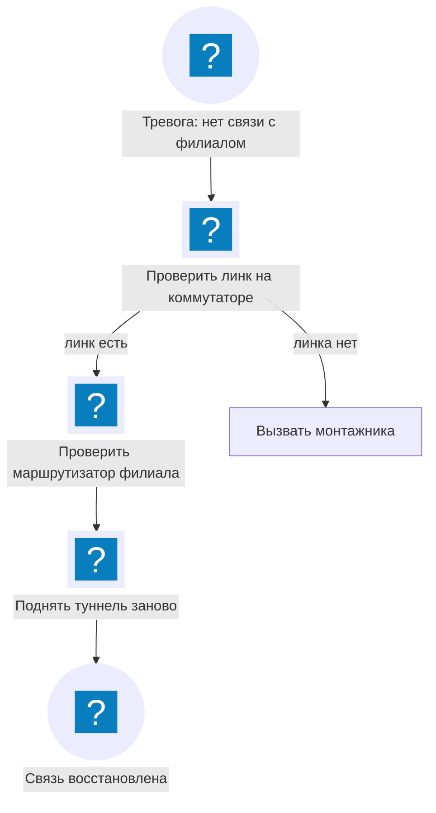
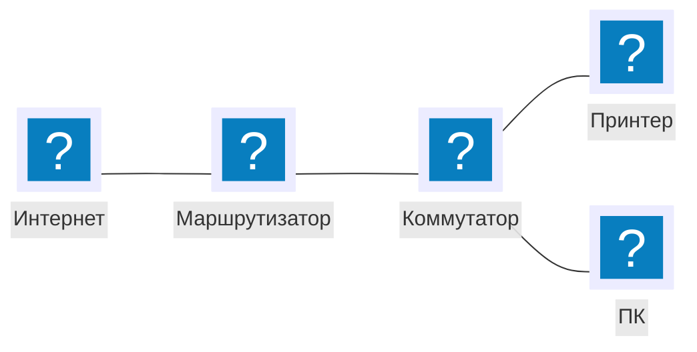

<!-- Собрано автоматически из документов-примеров Spiridus — правки в основном репозитории Spiridus. -->

<!-- раздел: Схемы | теги: сеть, сетевой инженер, топология, иконки, d2, mermaid, провайдер, vlan, офис -->
# Схемы сети с иконками

Иконки берутся из наших наборов (`render_icons`): `affinity` — сетевые, цветные; `mdi` —
значки устройств; `logos` — логотипы продуктов. Схемы живые: кнопка «⤢» открывает их на весь
экран.

## D2: узел провайдера

Контейнеры — площадки и VLAN, узлы-иконки (`shape: image`) с подписью справа (`label.near: outside-right-center`) — снизу её пересекали бы связи; раскладка dagre ведёт связи к самим значкам.

Участки одной сети; повторённое имя обозначает то же устройство. Все связи исходной топологии сохранены.

```d2
classes: { dev: { shape: image; width: 48; height: 48; style.font-size: 18; label.near: outside-right-center } }
direction: down
inet: Интернет\nAS64500 { class: dev; icon: affinity:globe }
uplink1: Аплинк 1\n10 Гбит/с { class: dev; icon: affinity:link-gray }
inet -> uplink1
```

```d2
classes: { dev: { shape: image; width: 48; height: 48; style.font-size: 18; label.near: outside-right-center } }
direction: down
inet: Интернет\nAS64500 { class: dev; icon: affinity:globe }
uplink2: Аплинк 2\n10 Гбит/с { class: dev; icon: affinity:link-gray }
inet -> uplink2
```

Площадки: Узел связи — ул. Ленина 1.

```d2
classes: { dev: { shape: image; width: 48; height: 48; style.font-size: 18; label.near: outside-right-center } }
direction: down
pop: "" {
  br1: Граничный\nмаршрутизатор 1\n203.0.113.1 { class: dev; icon: affinity:router }
  br2: Граничный\nмаршрутизатор 2\n203.0.113.2 { class: dev; icon: affinity:router }
}
pop.br1 <-> pop.br2: iBGP, VRRP
```

Площадки: Узел связи — ул. Ленина 1.

```d2
classes: { dev: { shape: image; width: 48; height: 48; style.font-size: 18; label.near: outside-right-center } }
direction: down
pop: "" {
  br2: Граничный\nмаршрутизатор 2\n203.0.113.2 { class: dev; icon: affinity:router }
}
uplink2: Аплинк 2\n10 Гбит/с { class: dev; icon: affinity:link-gray }
uplink2 -> pop.br2
```

Площадки: Узел связи — ул. Ленина 1.

```d2
classes: { dev: { shape: image; width: 48; height: 48; style.font-size: 18; label.near: outside-right-center } }
direction: down
pop: "" {
  br1: Граничный\nмаршрутизатор 1\n203.0.113.1 { class: dev; icon: affinity:router }
  fw: Межсетевой экран\nкластер { class: dev; icon: affinity:firewall-red }
}
pop.br1 -> pop.fw
```

Площадки: Узел связи — ул. Ленина 1.

```d2
classes: { dev: { shape: image; width: 48; height: 48; style.font-size: 18; label.near: outside-right-center } }
direction: down
pop: "" {
  br2: Граничный\nмаршрутизатор 2\n203.0.113.2 { class: dev; icon: affinity:router }
  fw: Межсетевой экран\nкластер { class: dev; icon: affinity:firewall-red }
}
pop.br2 -> pop.fw
```

Площадки: Узел связи — ул. Ленина 1.

```d2
classes: { dev: { shape: image; width: 48; height: 48; style.font-size: 18; label.near: outside-right-center } }
direction: down
pop: "" {
  core: Ядро\nкоммутатор L3 { class: dev; icon: affinity:switch-multilayer }
  fw: Межсетевой экран\nкластер { class: dev; icon: affinity:firewall-red }
}
pop.fw -> pop.core
```

Площадки: Узел связи — ул. Ленина 1; Серверная.

```d2
classes: { dev: { shape: image; width: 48; height: 48; style.font-size: 18; label.near: outside-right-center } }
direction: down
pop: "" {
  core: Ядро\nкоммутатор L3 { class: dev; icon: affinity:switch-multilayer }
  srv: "" {
    dns: DNS, DHCP\n10.0.10.5 { class: dev; icon: affinity:server-green }
  }
}
pop.core -> pop.srv.dns
```

Площадки: Узел связи — ул. Ленина 1; Серверная.

```d2
classes: { dev: { shape: image; width: 48; height: 48; style.font-size: 18; label.near: outside-right-center } }
direction: down
pop: "" {
  core: Ядро\nкоммутатор L3 { class: dev; icon: affinity:switch-multilayer }
  srv: "" {
    mon: Мониторинг\n10.0.10.7 { class: dev; icon: affinity:statistics-green }
  }
}
pop.core -> pop.srv.mon
```

Площадки: Узел связи — ул. Ленина 1; Серверная.

```d2
classes: { dev: { shape: image; width: 48; height: 48; style.font-size: 18; label.near: outside-right-center } }
direction: down
pop: "" {
  core: Ядро\nкоммутатор L3 { class: dev; icon: affinity:switch-multilayer }
  srv: "" {
    nas: Хранилище\n10.0.10.20 { class: dev; icon: affinity:nas-green }
  }
}
pop.core -> pop.srv.nas
```

Площадки: Узел связи — ул. Ленина 1.

```d2
classes: { dev: { shape: image; width: 48; height: 48; style.font-size: 18; label.near: outside-right-center } }
direction: down
pop: "" {
  core: Ядро\nкоммутатор L3 { class: dev; icon: affinity:switch-multilayer }
  olt: OLT\nGPON { class: dev; icon: affinity:interconnect }
}
pop.core -> pop.olt: VLAN 100–199
```

Площадки: Узел связи — ул. Ленина 1.

```d2
classes: { dev: { shape: image; width: 48; height: 48; style.font-size: 18; label.near: outside-right-center } }
direction: down
pop: "" {
  br1: Граничный\nмаршрутизатор 1\n203.0.113.1 { class: dev; icon: affinity:router }
}
uplink1: Аплинк 1\n10 Гбит/с { class: dev; icon: affinity:link-gray }
uplink1 -> pop.br1
```

Площадки: Абоненты; Узел связи — ул. Ленина 1.

```d2
classes: { dev: { shape: image; width: 48; height: 48; style.font-size: 18; label.near: outside-right-center } }
direction: down
abon: "" {
  h1: Дом\n100 квартир { class: dev; icon: affinity:office-gray }
}
pop: "" {
  olt: OLT\nGPON { class: dev; icon: affinity:interconnect }
}
pop.olt -> abon.h1: сплиттер 1:32
```

Площадки: Абоненты; Узел связи — ул. Ленина 1.

```d2
classes: { dev: { shape: image; width: 48; height: 48; style.font-size: 18; label.near: outside-right-center } }
direction: down
abon: "" {
  h2: Частный сектор { class: dev; icon: affinity:house-gray }
}
pop: "" {
  olt: OLT\nGPON { class: dev; icon: affinity:interconnect }
}
pop.olt -> abon.h2: сплиттер 1:64
```

Площадки: Абоненты.

```d2
classes: { dev: { shape: image; width: 48; height: 48; style.font-size: 18; label.near: outside-right-center } }
direction: down
abon: "" {
  h1: Дом\n100 квартир { class: dev; icon: affinity:office-gray }
  ont: Розетка у абонента { class: dev; icon: affinity:rj45-gray }
}
abon.h1 -> abon.ont
```

## Mermaid: офисная сеть, схема архитектуры

В `architecture-beta` подпись стоит под значком, и вертикальная связь прошла бы через неё —
поэтому связи только по горизонтали, цепочкой; ветвления сети удобнее рисовать в D2 (выше).


## Mermaid: разбор инцидента со значками Material



## Mermaid: тот же узел контурными иконками

Набор `-line` — без фона, для чёрно-белой печати.


