<!-- Собрано автоматически из документов-примеров Spiridus — правки в основном репозитории Spiridus. -->

<!-- раздел: Схемы | теги: plantuml, uml, c4, nwdiag, сеть, последовательность, классы, состояния, mindmap -->
# PlantUML: схемы из песочницы

PlantUML работает не в браузере, а на сервере: MCP-инструмент `plantuml_run` рисует схему в
песочнице и отдаёт `artifact:<id>/diagram.svg`, а блок показывает готовый SVG. Первая строка
блока — `' result: …` от инструмента, вторая — сборка. Стандартная библиотека (C4, иконки AWS,
Azure, Font Awesome, логотипы) — внутри PlantUML; интернет не нужен и не разрешён.

## Последовательность

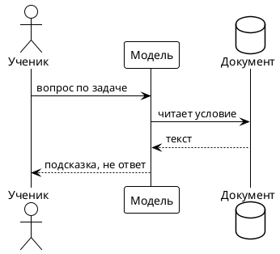

## Сетевая схема nwdiag

Подсети полосами; адреса узлов — в подписи узла (`description`), а не полем `address`: его nwdiag пишет поверх линии подключения.

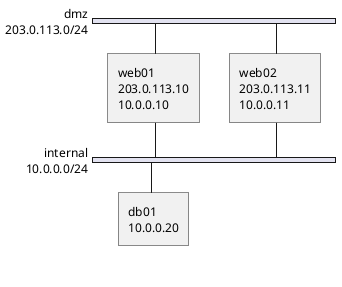

## C4: контейнеры

`!include` с адреса C4-PlantUML на GitHub шлюз сам подменил на копию из стандартной библиотеки
и сообщил об этом в ответе.

Два вида одной системы: чтение и утверждение документов; инструменты модели и песочницы. Контейнер «Документы» общий.

Внешние участники и их обращения к рендеру:

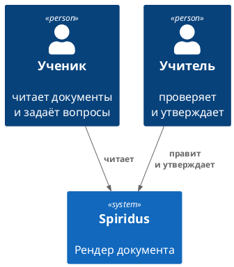

Внутренние контейнеры Spiridus:

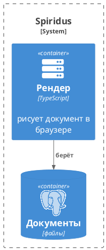

Внешние участники и их обращения к шлюзу MCP:

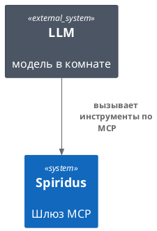

Внутренние контейнеры Spiridus:

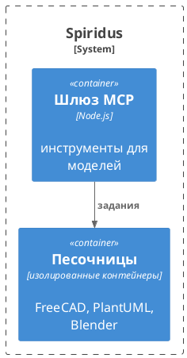

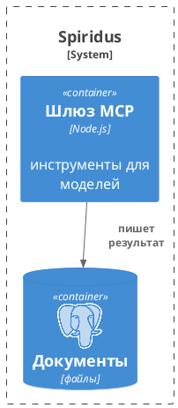

## Состояния документа

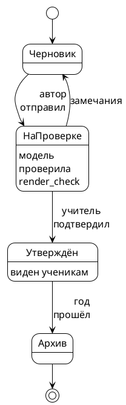

## Классы

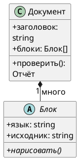

Реализации одного абстрактного контракта; повторённый «Блок» — тот же класс.

```plantuml
' result: artifact:98450800ef3694c8/diagram.svg
' build: plantuml-1.2026.9-asl
@startuml
skinparam defaultFontSize 16
skinparam wrapWidth 140
skinparam maxMessageSize 100
skinparam nodesep 25
skinparam ranksep 40
skinparam classAttributeIconSize 0
abstract class Блок {
  +язык: string
  +исходник: string
  {abstract} +нарисовать()
}
class Схема extends Блок
@enduml
```

```plantuml
' result: artifact:d50810cf68700f1a/diagram.svg
' build: plantuml-1.2026.9-asl
@startuml
skinparam defaultFontSize 16
skinparam wrapWidth 140
skinparam maxMessageSize 100
skinparam nodesep 25
skinparam ranksep 40
skinparam classAttributeIconSize 0
abstract class Блок {
  +язык: string
  +исходник: string
  {abstract} +нарисовать()
}
class Формула extends Блок
@enduml
```

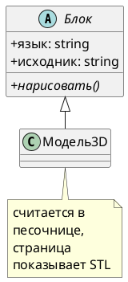

## Mindmap

Четыре ветви одной карты «Силы в механике»:

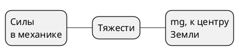

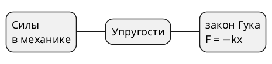

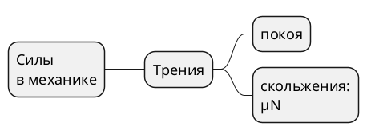

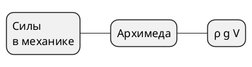
