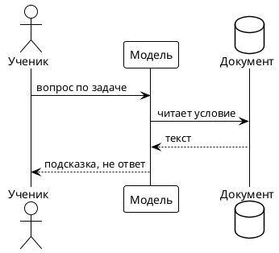
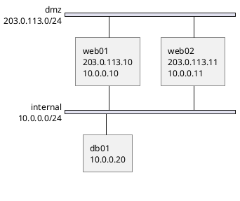
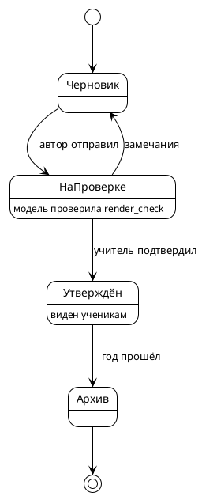
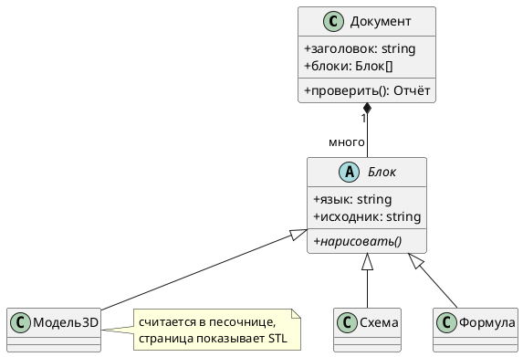
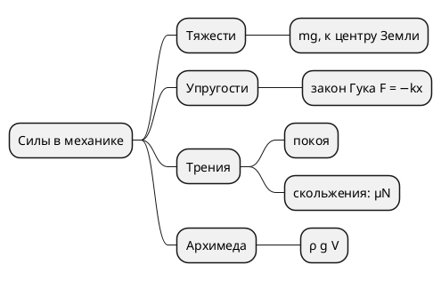

<!-- Собрано автоматически из документов-примеров Spiridus — правки в основном репозитории Spiridus. -->

<!-- раздел: Схемы | теги: plantuml, uml, c4, nwdiag, сеть, последовательность, классы, состояния, mindmap -->
# PlantUML: схемы из песочницы

PlantUML работает не в браузере, а на сервере: MCP-инструмент `plantuml_run` рисует схему в
песочнице и отдаёт `artifact:<id>/diagram.svg`, а блок показывает готовый SVG. Первая строка
блока — `' result: …` от инструмента, вторая — сборка. Стандартная библиотека (C4, иконки AWS,
Azure, Font Awesome, логотипы) — внутри PlantUML; интернет не нужен и не разрешён.

## Последовательность



## Сетевая схема nwdiag

Подсети полосами; адреса узлов — в подписи узла (`description`), а не полем `address`: его nwdiag пишет поверх линии подключения.



## C4: контейнеры

`!include` с адреса C4-PlantUML на GitHub шлюз сам подменил на копию из стандартной библиотеки
и сообщил об этом в ответе.

```plantuml
' result: artifact:b9e3c7003037c477/diagram.svg
' build: plantuml-1.2026.9-asl
@startuml
!include https://raw.githubusercontent.com/plantuml-stdlib/C4-PlantUML/master/C4_Container.puml
UpdateElementStyle("external_system", $bgColor="#4b5563", $borderColor="#374151")
!include <tupadr3/font-awesome-5/server>
!include <logos/postgresql>
Person(user, "Ученик", "читает документы и задаёт вопросы")
Person(teacher, "Учитель", "проверяет и утверждает")
System_Boundary(s, "Spiridus") {
  Container(web, "Рендер", "TypeScript", "рисует документ в браузере", $sprite="server")
  Container(mcp, "Шлюз MCP", "Node.js", "инструменты для моделей")
  Container(sb, "Песочницы", "изолированные контейнеры", "FreeCAD, PlantUML, Blender")
  ContainerDb(db, "Документы", "файлы", "", $sprite="postgresql")
}
System_Ext(llm, "LLM", "модель в комнате")
Rel(user, web, "читает")
Rel(teacher, web, "правит и утверждает")
Rel(llm, mcp, " вызывает инструменты", "MCP")
Rel(mcp, sb, " задания")
Rel(mcp, db, "пишет результат")
Rel(web, db, " берёт")
@enduml
```

## Состояния документа



## Классы



## Mindmap


