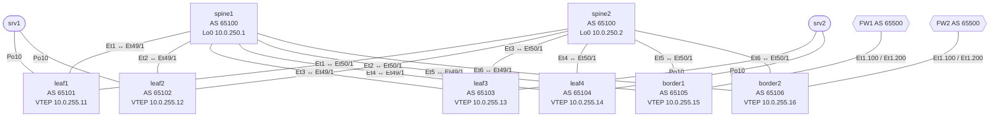

<!-- Собрано из apps/playground/examples/30-evpn-fabric.md основного репозитория Spiridus (scripts/build-public-docs.mjs) — правьте там. -->

<!-- раздел: Сети | теги: evpn, vxlan, bgp, arista, цод, spine-leaf, конфигурация -->
# Фабрика ЦОД: BGP EVPN / VXLAN на Arista EOS

Design-документ: spine-leaf фабрика с VXLAN data plane и MP-BGP EVPN control plane. Команды проверки ниже — инлайн-кодом: щелчок по команде копирует её. Полные конфигурации свёрнуты — раскройте нужное устройство.

**Параметры**

| Параметр | Значение |
|---|---|
| Вендор / ОС | Arista EOS 4.32 |
| Spine | 2 (spine1, spine2), AS 65100 |
| Leaf | 4: пары ESI-LAG leaf1+leaf2, leaf3+leaf4 |
| Border leaf | 2 (border1, border2) |
| Линки | leaf–spine 100G, серверы 25G |
| VRF | PROD (ID 1), DEV (ID 2) |
| VLAN → подсети | PROD: VLAN10 192.168.10.0/24, VLAN20 192.168.20.0/24; DEV: VLAN110 192.168.110.0/24 |
| Внешние подключения | 2× FW к border, eBGP, AS 65500 |
| IPv6 | нет |
| DCI | нет |

## 1. Схема топологии

```text
                 ┌──────────────┐                    ┌──────────────┐
                 │   spine1     │                    │   spine2     │
                 │  AS 65100    │                    │  AS 65100    │
                 │ Lo0 10.0.250.1│                   │ Lo0 10.0.250.2│
                 └┬──┬──┬──┬──┬──┬┘                   └┬──┬──┬──┬──┬──┬┘
              Et1 │Et2│Et3│Et4│Et5│Et6                Et1│Et2│Et3│Et4│Et5│Et6
   ┌──────────────┘  │  │  │  │  └─────────┐  (каждый leaf и border — двумя
   │      ┌──────────┘  │  │  └─────┐      │   линками: Et49/1 → spine1,
   │      │      ┌──────┘  └──┐     │      │   Et50/1 → spine2)
┌──┴───┐┌─┴────┐┌┴─────┐┌─────┴┐┌───┴───┐┌─┴─────┐
│leaf1 ││leaf2 ││leaf3 ││leaf4 ││border1││border2│
│65101 ││65102 ││65103 ││65104 ││ 65105 ││ 65106 │
└──┬───┘└──┬───┘└──┬───┘└──┬───┘└───┬───┘└───┬───┘
   │ Et1    │ Et1   │ Et1   │ Et1     │ Et1     │ Et1
   └──┬─────┘       └──┬────┘         │         │
    Po10 ESI-LAG    Po10 ESI-LAG    ┌──┴──┐   ┌──┴──┐
   ┌───┴───┐        ┌───┴───┐       │ FW1 │   │ FW2 │
   │ srv1  │        │ srv2  │       │65500│   │65500│
   └───────┘        └───────┘       └─────┘   └─────┘
```



Та же фабрика с иконками:

```d2
classes: { dev: { shape: image; label.near: outside-right-center } }
direction: down
spines: Spine, AS 65100 {
  spine1: spine1\nLo0 10.0.250.1 { class: dev; icon: affinity:switch-multilayer }
  spine2: spine2\nLo0 10.0.250.2 { class: dev; icon: affinity:switch-multilayer }
}
leaves: "" {
  leaf1: leaf1\nAS 65101 { class: dev; icon: affinity:switch }
  leaf2: leaf2\nAS 65102 { class: dev; icon: affinity:switch }
  leaf3: leaf3\nAS 65103 { class: dev; icon: affinity:switch }
  leaf4: leaf4\nAS 65104 { class: dev; icon: affinity:switch }
  border1: border1\nAS 65105 { class: dev; icon: affinity:router-red }
  border2: border2\nAS 65106 { class: dev; icon: affinity:router-red }
}
spines.spine1 -- leaves.leaf1
spines.spine1 -- leaves.leaf2
spines.spine1 -- leaves.leaf3
spines.spine1 -- leaves.leaf4
spines.spine1 -- leaves.border1
spines.spine1 -- leaves.border2
spines.spine2 -- leaves.leaf1
spines.spine2 -- leaves.leaf2
spines.spine2 -- leaves.leaf3
spines.spine2 -- leaves.leaf4
spines.spine2 -- leaves.border1
spines.spine2 -- leaves.border2
srv1: srv1 { class: dev; icon: affinity:server }
srv2: srv2 { class: dev; icon: affinity:server }
fw1: FW1\nAS 65500 { class: dev; icon: affinity:firewall-red }
fw2: FW2\nAS 65500 { class: dev; icon: affinity:firewall-red }
leaves.leaf1 -- srv1: Po10
leaves.leaf2 -- srv1: Po10
leaves.leaf3 -- srv2: Po10
leaves.leaf4 -- srv2: Po10
leaves.border1 -- fw1
leaves.border2 -- fw2
```

## 2. Обоснование решений

| Компонент | Решение | Почему |
|---|---|---|
| Underlay | eBGP по RFC 7938, P2P /31 | один протокол на всю фабрику, простая отладка, ECMP без IGP |
| ASN | spine — общий 65100, leaf/border — уникальные 65101–65106 | AS-path сам защищает от петель; leaf видят друг друга через spine без allowas-in |
| MTU | 9214 на P2P | VXLAN добавляет 50 байт; кадр 9000 у сервера проходит без фрагментации |
| BFD | на всех BGP-сессиях | обнаружение отказа за доли секунды вместо hold-timer 90 с |
| Overlay | eBGP EVPN между Loopback0, spine — route server | spine не VTEP, next-hop-unchanged сохраняет адрес VTEP leaf |
| Loopback | Lo0 — router-id и EVPN, Lo1 — VTEP | можно менять VTEP (например, при переходе на anycast VTEP) без перестройки BGP |
| IRB | symmetric, L3VNI на VRF | маршрутизация на входном и выходном leaf, на leaf не нужны все VLAN |
| Шлюз | distributed anycast gateway | шлюз на первом же leaf, VM мигрирует без смены ARP |
| Multihoming | EVPN ESI-LAG all-active | нет MLAG и peer-link: пары независимы, обновляются по одной |
| BUM | ingress replication | без multicast в underlay; списки рассылки — из маршрутов Type-3 |
| Выход наружу | border + FW, Type-5 | межVRF и внешний трафик — только через FW, политика в одном месте |
| Управление | VRF MGMT на Management1, OOB | управление не зависит от состояния фабрики |

## 3. Адресный план

**Loopback0 (router-id, EVPN) и Loopback1 (VTEP), ASN**

| Устройство | Роль | ASN | Loopback0 | Loopback1 | Management1 (VRF MGMT) |
|---|---|---|---|---|---|
| spine1 | spine | 65100 | 10.0.250.1/32 | — | 10.255.0.1/24 |
| spine2 | spine | 65100 | 10.0.250.2/32 | — | 10.255.0.2/24 |
| leaf1 | leaf | 65101 | 10.0.250.11/32 | 10.0.255.11/32 | 10.255.0.11/24 |
| leaf2 | leaf | 65102 | 10.0.250.12/32 | 10.0.255.12/32 | 10.255.0.12/24 |
| leaf3 | leaf | 65103 | 10.0.250.13/32 | 10.0.255.13/32 | 10.255.0.13/24 |
| leaf4 | leaf | 65104 | 10.0.250.14/32 | 10.0.255.14/32 | 10.255.0.14/24 |
| border1 | border | 65105 | 10.0.250.15/32 | 10.0.255.15/32 | 10.255.0.15/24 |
| border2 | border | 65106 | 10.0.250.16/32 | 10.0.255.16/32 | 10.255.0.16/24 |

**P2P-линки underlay (/31, MTU 9214)**

| Устройство A | Интерфейс A | IP A | Устройство B | Интерфейс B | IP B |
|---|---|---|---|---|---|
| spine1 | Ethernet1 | 10.0.1.0/31 | leaf1 | Ethernet49/1 | 10.0.1.1/31 |
| spine1 | Ethernet2 | 10.0.1.2/31 | leaf2 | Ethernet49/1 | 10.0.1.3/31 |
| spine1 | Ethernet3 | 10.0.1.4/31 | leaf3 | Ethernet49/1 | 10.0.1.5/31 |
| spine1 | Ethernet4 | 10.0.1.6/31 | leaf4 | Ethernet49/1 | 10.0.1.7/31 |
| spine1 | Ethernet5 | 10.0.1.8/31 | border1 | Ethernet49/1 | 10.0.1.9/31 |
| spine1 | Ethernet6 | 10.0.1.10/31 | border2 | Ethernet49/1 | 10.0.1.11/31 |
| spine2 | Ethernet1 | 10.0.2.0/31 | leaf1 | Ethernet50/1 | 10.0.2.1/31 |
| spine2 | Ethernet2 | 10.0.2.2/31 | leaf2 | Ethernet50/1 | 10.0.2.3/31 |
| spine2 | Ethernet3 | 10.0.2.4/31 | leaf3 | Ethernet50/1 | 10.0.2.5/31 |
| spine2 | Ethernet4 | 10.0.2.6/31 | leaf4 | Ethernet50/1 | 10.0.2.7/31 |
| spine2 | Ethernet5 | 10.0.2.8/31 | border1 | Ethernet50/1 | 10.0.2.9/31 |
| spine2 | Ethernet6 | 10.0.2.10/31 | border2 | Ethernet50/1 | 10.0.2.11/31 |

**Border ↔ FW (eBGP, AS 65500)**

| Border | Интерфейс | VRF | IP border | IP FW | FW |
|---|---|---|---|---|---|
| border1 | Ethernet1.100 | PROD | 10.100.1.0/31 | 10.100.1.1/31 | FW1 |
| border1 | Ethernet1.200 | DEV | 10.100.1.2/31 | 10.100.1.3/31 | FW1 |
| border2 | Ethernet1.100 | PROD | 10.100.2.0/31 | 10.100.2.1/31 | FW2 |
| border2 | Ethernet1.200 | DEV | 10.100.2.2/31 | 10.100.2.3/31 | FW2 |

**VRF, VLAN, VNI, RT**

| VRF | ID | L3VNI | RT VRF | VLAN | Имя | Подсеть / шлюз | L2VNI | RT VLAN |
|---|---|---|---|---|---|---|---|---|
| PROD | 1 | 50001 | 50001:50001 | 10 | PROD-WEB | 192.168.10.0/24, шлюз 192.168.10.1 | 10010 | 10010:10010 |
| PROD | 1 | 50001 | 50001:50001 | 20 | PROD-APP | 192.168.20.0/24, шлюз 192.168.20.1 | 10020 | 10020:10020 |
| DEV | 2 | 50002 | 50002:50002 | 110 | DEV-WEB | 192.168.110.0/24, шлюз 192.168.110.1 | 10110 | 10110:10110 |

Виртуальный MAC anycast-шлюза: `00:1c:73:00:00:99`. ESI-LAG: srv1 — ESI `0000:0000:0001:0001:0010`, LACP system-id `0000.0101.0010`; srv2 — ESI `0000:0000:0002:0002:0020`, LACP system-id `0000.0202.0020`.

## 4. Конфигурации

Полные конфигурации, по одной на устройство. `# ПРОВЕРИТЬ` — место, где синтаксис или поведение нужно сверить с документацией EOS 4.32 перед применением.

<details>
<summary>spine1 — полная конфигурация</summary>

```text
! spine1 — spine, AS 65100, route server EVPN; Arista EOS 4.32
! Пароли — плейсхолдеры, заменить перед применением
service routing protocols model multi-agent
!
hostname spine1
!
spanning-tree mode mstp
!
! OOB-управление: отдельный VRF, через фабрику не ходит
vrf instance MGMT
!
interface Management1
   description OOB
   vrf MGMT
   ip address 10.255.0.1/24
!
ip route vrf MGMT 0.0.0.0/0 10.255.0.254
no ip routing vrf MGMT
!
ip routing
!
interface Ethernet1
   description leaf1 Ethernet49/1
   mtu 9214
   no switchport
   ip address 10.0.1.0/31
!
interface Ethernet2
   description leaf2 Ethernet49/1
   mtu 9214
   no switchport
   ip address 10.0.1.2/31
!
interface Ethernet3
   description leaf3 Ethernet49/1
   mtu 9214
   no switchport
   ip address 10.0.1.4/31
!
interface Ethernet4
   description leaf4 Ethernet49/1
   mtu 9214
   no switchport
   ip address 10.0.1.6/31
!
interface Ethernet5
   description border1 Ethernet49/1
   mtu 9214
   no switchport
   ip address 10.0.1.8/31
!
interface Ethernet6
   description border2 Ethernet49/1
   mtu 9214
   no switchport
   ip address 10.0.1.10/31
!
interface Loopback0
   description router-id, EVPN peering
   ip address 10.0.250.1/32
!
router bgp 65100
   router-id 10.0.250.1
   no bgp default ipv4-unicast
   maximum-paths 4 ecmp 4
   distance bgp 20 200 200
   ! underlay: eBGP по P2P /31, BFD, только IPv4 unicast
   neighbor UNDERLAY peer group
   neighbor UNDERLAY password 0 <BGP_PASSWORD>
   neighbor UNDERLAY bfd
   neighbor UNDERLAY send-community
   neighbor UNDERLAY maximum-routes 12000
   neighbor 10.0.1.1 peer group UNDERLAY
   neighbor 10.0.1.1 remote-as 65101
   neighbor 10.0.1.1 description leaf1
   neighbor 10.0.1.3 peer group UNDERLAY
   neighbor 10.0.1.3 remote-as 65102
   neighbor 10.0.1.3 description leaf2
   neighbor 10.0.1.5 peer group UNDERLAY
   neighbor 10.0.1.5 remote-as 65103
   neighbor 10.0.1.5 description leaf3
   neighbor 10.0.1.7 peer group UNDERLAY
   neighbor 10.0.1.7 remote-as 65104
   neighbor 10.0.1.7 description leaf4
   neighbor 10.0.1.9 peer group UNDERLAY
   neighbor 10.0.1.9 remote-as 65105
   neighbor 10.0.1.9 description border1
   neighbor 10.0.1.11 peer group UNDERLAY
   neighbor 10.0.1.11 remote-as 65106
   neighbor 10.0.1.11 description border2
   ! overlay: eBGP EVPN между Loopback0
   neighbor EVPN-OVERLAY peer group
   ! spine — route server: next-hop остаётся адресом VTEP, сам spine не VTEP
   neighbor EVPN-OVERLAY next-hop-unchanged
   neighbor EVPN-OVERLAY update-source Loopback0
   neighbor EVPN-OVERLAY ebgp-multihop 3
   neighbor EVPN-OVERLAY password 0 <BGP_PASSWORD>
   neighbor EVPN-OVERLAY bfd
   neighbor EVPN-OVERLAY send-community extended
   neighbor EVPN-OVERLAY maximum-routes 0
   neighbor 10.0.250.11 peer group EVPN-OVERLAY
   neighbor 10.0.250.11 remote-as 65101
   neighbor 10.0.250.11 description leaf1
   neighbor 10.0.250.12 peer group EVPN-OVERLAY
   neighbor 10.0.250.12 remote-as 65102
   neighbor 10.0.250.12 description leaf2
   neighbor 10.0.250.13 peer group EVPN-OVERLAY
   neighbor 10.0.250.13 remote-as 65103
   neighbor 10.0.250.13 description leaf3
   neighbor 10.0.250.14 peer group EVPN-OVERLAY
   neighbor 10.0.250.14 remote-as 65104
   neighbor 10.0.250.14 description leaf4
   neighbor 10.0.250.15 peer group EVPN-OVERLAY
   neighbor 10.0.250.15 remote-as 65105
   neighbor 10.0.250.15 description border1
   neighbor 10.0.250.16 peer group EVPN-OVERLAY
   neighbor 10.0.250.16 remote-as 65106
   neighbor 10.0.250.16 description border2
   !
   address-family evpn
      neighbor EVPN-OVERLAY activate
   !
   address-family ipv4
      neighbor UNDERLAY activate
      network 10.0.250.1/32
!
end
```

</details>

<details>
<summary>spine2 — полная конфигурация</summary>

```text
! spine2 — spine, AS 65100, route server EVPN; Arista EOS 4.32
! Пароли — плейсхолдеры, заменить перед применением
service routing protocols model multi-agent
!
hostname spine2
!
spanning-tree mode mstp
!
! OOB-управление: отдельный VRF, через фабрику не ходит
vrf instance MGMT
!
interface Management1
   description OOB
   vrf MGMT
   ip address 10.255.0.2/24
!
ip route vrf MGMT 0.0.0.0/0 10.255.0.254
no ip routing vrf MGMT
!
ip routing
!
interface Ethernet1
   description leaf1 Ethernet50/1
   mtu 9214
   no switchport
   ip address 10.0.2.0/31
!
interface Ethernet2
   description leaf2 Ethernet50/1
   mtu 9214
   no switchport
   ip address 10.0.2.2/31
!
interface Ethernet3
   description leaf3 Ethernet50/1
   mtu 9214
   no switchport
   ip address 10.0.2.4/31
!
interface Ethernet4
   description leaf4 Ethernet50/1
   mtu 9214
   no switchport
   ip address 10.0.2.6/31
!
interface Ethernet5
   description border1 Ethernet50/1
   mtu 9214
   no switchport
   ip address 10.0.2.8/31
!
interface Ethernet6
   description border2 Ethernet50/1
   mtu 9214
   no switchport
   ip address 10.0.2.10/31
!
interface Loopback0
   description router-id, EVPN peering
   ip address 10.0.250.2/32
!
router bgp 65100
   router-id 10.0.250.2
   no bgp default ipv4-unicast
   maximum-paths 4 ecmp 4
   distance bgp 20 200 200
   ! underlay: eBGP по P2P /31, BFD, только IPv4 unicast
   neighbor UNDERLAY peer group
   neighbor UNDERLAY password 0 <BGP_PASSWORD>
   neighbor UNDERLAY bfd
   neighbor UNDERLAY send-community
   neighbor UNDERLAY maximum-routes 12000
   neighbor 10.0.2.1 peer group UNDERLAY
   neighbor 10.0.2.1 remote-as 65101
   neighbor 10.0.2.1 description leaf1
   neighbor 10.0.2.3 peer group UNDERLAY
   neighbor 10.0.2.3 remote-as 65102
   neighbor 10.0.2.3 description leaf2
   neighbor 10.0.2.5 peer group UNDERLAY
   neighbor 10.0.2.5 remote-as 65103
   neighbor 10.0.2.5 description leaf3
   neighbor 10.0.2.7 peer group UNDERLAY
   neighbor 10.0.2.7 remote-as 65104
   neighbor 10.0.2.7 description leaf4
   neighbor 10.0.2.9 peer group UNDERLAY
   neighbor 10.0.2.9 remote-as 65105
   neighbor 10.0.2.9 description border1
   neighbor 10.0.2.11 peer group UNDERLAY
   neighbor 10.0.2.11 remote-as 65106
   neighbor 10.0.2.11 description border2
   ! overlay: eBGP EVPN между Loopback0
   neighbor EVPN-OVERLAY peer group
   ! spine — route server: next-hop остаётся адресом VTEP, сам spine не VTEP
   neighbor EVPN-OVERLAY next-hop-unchanged
   neighbor EVPN-OVERLAY update-source Loopback0
   neighbor EVPN-OVERLAY ebgp-multihop 3
   neighbor EVPN-OVERLAY password 0 <BGP_PASSWORD>
   neighbor EVPN-OVERLAY bfd
   neighbor EVPN-OVERLAY send-community extended
   neighbor EVPN-OVERLAY maximum-routes 0
   neighbor 10.0.250.11 peer group EVPN-OVERLAY
   neighbor 10.0.250.11 remote-as 65101
   neighbor 10.0.250.11 description leaf1
   neighbor 10.0.250.12 peer group EVPN-OVERLAY
   neighbor 10.0.250.12 remote-as 65102
   neighbor 10.0.250.12 description leaf2
   neighbor 10.0.250.13 peer group EVPN-OVERLAY
   neighbor 10.0.250.13 remote-as 65103
   neighbor 10.0.250.13 description leaf3
   neighbor 10.0.250.14 peer group EVPN-OVERLAY
   neighbor 10.0.250.14 remote-as 65104
   neighbor 10.0.250.14 description leaf4
   neighbor 10.0.250.15 peer group EVPN-OVERLAY
   neighbor 10.0.250.15 remote-as 65105
   neighbor 10.0.250.15 description border1
   neighbor 10.0.250.16 peer group EVPN-OVERLAY
   neighbor 10.0.250.16 remote-as 65106
   neighbor 10.0.250.16 description border2
   !
   address-family evpn
      neighbor EVPN-OVERLAY activate
   !
   address-family ipv4
      neighbor UNDERLAY activate
      network 10.0.250.2/32
!
end
```

</details>

<details>
<summary>leaf1 — полная конфигурация</summary>

```text
! leaf1 — leaf, VTEP, anycast-шлюз, AS 65101; Arista EOS 4.32
! Пароли — плейсхолдеры, заменить перед применением
service routing protocols model multi-agent
!
hostname leaf1
!
spanning-tree mode mstp
!
! OOB-управление: отдельный VRF, через фабрику не ходит
vrf instance MGMT
!
interface Management1
   description OOB
   vrf MGMT
   ip address 10.255.0.11/24
!
ip route vrf MGMT 0.0.0.0/0 10.255.0.254
no ip routing vrf MGMT
!
! VRF тенантов: межVRF-трафик только через FW (утечки маршрутов между VRF нет)
vrf instance PROD
vrf instance DEV
!
ip routing
ip routing vrf PROD
ip routing vrf DEV
!
vlan 10
   name PROD-WEB
!
vlan 20
   name PROD-APP
!
vlan 110
   name DEV-WEB
!
! distributed anycast gateway: одинаковые IP и MAC на всех leaf
ip virtual-router mac-address 00:1c:73:00:00:99
!
! ESI-LAG к srv1: all-active, без MLAG и peer-link; ESI, RT и LACP system-id
! одинаковые на обоих leaf пары
interface Ethernet1
   description srv1 eth0 (25G)
   channel-group 10 mode active
!
interface Port-Channel10
   description srv1 bond0
   switchport
   switchport mode trunk
   switchport trunk allowed vlan 10,20,110
   evpn ethernet-segment
      identifier 0000:0000:0001:0001:0010
      route-target import 00:00:01:01:00:10
   lacp system-id 0000.0101.0010
!
interface Ethernet49/1
   description spine1 Ethernet1
   mtu 9214
   no switchport
   ip address 10.0.1.1/31
!
interface Ethernet50/1
   description spine2 Ethernet1
   mtu 9214
   no switchport
   ip address 10.0.2.1/31
!
interface Loopback0
   description router-id, EVPN peering
   ip address 10.0.250.11/32
!
interface Loopback1
   description VTEP source
   ip address 10.0.255.11/32
!
interface Vlan10
   description PROD-WEB
   vrf PROD
   ip address virtual 192.168.10.1/24
!
interface Vlan20
   description PROD-APP
   vrf PROD
   ip address virtual 192.168.20.1/24
!
interface Vlan110
   description DEV-WEB
   vrf DEV
   ip address virtual 192.168.110.1/24
!
interface Vxlan1
   description VTEP
   vxlan source-interface Loopback1
   vxlan udp-port 4789
   ! ARP suppression: при EVPN и ip address virtual leaf отвечает на ARP сам по Type-2   # ПРОВЕРИТЬ: включено ли по умолчанию в 4.32 и нужна ли отдельная команда
   vxlan vlan 10 vni 10010
   vxlan vlan 20 vni 10020
   vxlan vlan 110 vni 10110
   vxlan vrf PROD vni 50001
   vxlan vrf DEV vni 50002
!
router bgp 65101
   router-id 10.0.250.11
   no bgp default ipv4-unicast
   maximum-paths 4 ecmp 4
   distance bgp 20 200 200
   ! underlay: eBGP по P2P /31, BFD, только IPv4 unicast
   neighbor UNDERLAY peer group
   neighbor UNDERLAY password 0 <BGP_PASSWORD>
   neighbor UNDERLAY bfd
   neighbor UNDERLAY send-community
   neighbor UNDERLAY maximum-routes 12000
   neighbor 10.0.1.0 peer group UNDERLAY
   neighbor 10.0.1.0 remote-as 65100
   neighbor 10.0.1.0 description spine1
   neighbor 10.0.2.0 peer group UNDERLAY
   neighbor 10.0.2.0 remote-as 65100
   neighbor 10.0.2.0 description spine2
   ! overlay: eBGP EVPN между Loopback0
   neighbor EVPN-OVERLAY peer group
   neighbor EVPN-OVERLAY update-source Loopback0
   neighbor EVPN-OVERLAY ebgp-multihop 3
   neighbor EVPN-OVERLAY password 0 <BGP_PASSWORD>
   neighbor EVPN-OVERLAY bfd
   neighbor EVPN-OVERLAY send-community extended
   neighbor EVPN-OVERLAY maximum-routes 0
   neighbor 10.0.250.1 peer group EVPN-OVERLAY
   neighbor 10.0.250.1 remote-as 65100
   neighbor 10.0.250.1 description spine1
   neighbor 10.0.250.2 peer group EVPN-OVERLAY
   neighbor 10.0.250.2 remote-as 65100
   neighbor 10.0.250.2 description spine2
   !
   ! L2VNI 10010: RT = VNI:VNI; BUM — ingress replication по маршрутам Type-3
   vlan 10
      rd 10.0.250.11:10010
      route-target both 10010:10010
      redistribute learned
   !
   ! L2VNI 10020: RT = VNI:VNI; BUM — ingress replication по маршрутам Type-3
   vlan 20
      rd 10.0.250.11:10020
      route-target both 10020:10020
      redistribute learned
   !
   ! L2VNI 10110: RT = VNI:VNI; BUM — ingress replication по маршрутам Type-3
   vlan 110
      rd 10.0.250.11:10110
      route-target both 10110:10110
      redistribute learned
   !
   address-family evpn
      neighbor EVPN-OVERLAY activate
   !
   address-family ipv4
      neighbor UNDERLAY activate
      network 10.0.250.11/32
      network 10.0.255.11/32
   !
   ! symmetric IRB: L3VNI 50001 для VRF PROD
   vrf PROD
      rd 10.0.250.11:50001
      route-target import evpn 50001:50001
      route-target export evpn 50001:50001
      router-id 10.0.250.11
      redistribute connected
   !
   ! symmetric IRB: L3VNI 50002 для VRF DEV
   vrf DEV
      rd 10.0.250.11:50002
      route-target import evpn 50002:50002
      route-target export evpn 50002:50002
      router-id 10.0.250.11
      redistribute connected
!
end
```

</details>

<details>
<summary>leaf2 — полная конфигурация</summary>

```text
! leaf2 — leaf, VTEP, anycast-шлюз, AS 65102; Arista EOS 4.32
! Пароли — плейсхолдеры, заменить перед применением
service routing protocols model multi-agent
!
hostname leaf2
!
spanning-tree mode mstp
!
! OOB-управление: отдельный VRF, через фабрику не ходит
vrf instance MGMT
!
interface Management1
   description OOB
   vrf MGMT
   ip address 10.255.0.12/24
!
ip route vrf MGMT 0.0.0.0/0 10.255.0.254
no ip routing vrf MGMT
!
! VRF тенантов: межVRF-трафик только через FW (утечки маршрутов между VRF нет)
vrf instance PROD
vrf instance DEV
!
ip routing
ip routing vrf PROD
ip routing vrf DEV
!
vlan 10
   name PROD-WEB
!
vlan 20
   name PROD-APP
!
vlan 110
   name DEV-WEB
!
! distributed anycast gateway: одинаковые IP и MAC на всех leaf
ip virtual-router mac-address 00:1c:73:00:00:99
!
! ESI-LAG к srv1: all-active, без MLAG и peer-link; ESI, RT и LACP system-id
! одинаковые на обоих leaf пары
interface Ethernet1
   description srv1 eth0 (25G)
   channel-group 10 mode active
!
interface Port-Channel10
   description srv1 bond0
   switchport
   switchport mode trunk
   switchport trunk allowed vlan 10,20,110
   evpn ethernet-segment
      identifier 0000:0000:0001:0001:0010
      route-target import 00:00:01:01:00:10
   lacp system-id 0000.0101.0010
!
interface Ethernet49/1
   description spine1 Ethernet2
   mtu 9214
   no switchport
   ip address 10.0.1.3/31
!
interface Ethernet50/1
   description spine2 Ethernet2
   mtu 9214
   no switchport
   ip address 10.0.2.3/31
!
interface Loopback0
   description router-id, EVPN peering
   ip address 10.0.250.12/32
!
interface Loopback1
   description VTEP source
   ip address 10.0.255.12/32
!
interface Vlan10
   description PROD-WEB
   vrf PROD
   ip address virtual 192.168.10.1/24
!
interface Vlan20
   description PROD-APP
   vrf PROD
   ip address virtual 192.168.20.1/24
!
interface Vlan110
   description DEV-WEB
   vrf DEV
   ip address virtual 192.168.110.1/24
!
interface Vxlan1
   description VTEP
   vxlan source-interface Loopback1
   vxlan udp-port 4789
   ! ARP suppression: при EVPN и ip address virtual leaf отвечает на ARP сам по Type-2   # ПРОВЕРИТЬ: включено ли по умолчанию в 4.32 и нужна ли отдельная команда
   vxlan vlan 10 vni 10010
   vxlan vlan 20 vni 10020
   vxlan vlan 110 vni 10110
   vxlan vrf PROD vni 50001
   vxlan vrf DEV vni 50002
!
router bgp 65102
   router-id 10.0.250.12
   no bgp default ipv4-unicast
   maximum-paths 4 ecmp 4
   distance bgp 20 200 200
   ! underlay: eBGP по P2P /31, BFD, только IPv4 unicast
   neighbor UNDERLAY peer group
   neighbor UNDERLAY password 0 <BGP_PASSWORD>
   neighbor UNDERLAY bfd
   neighbor UNDERLAY send-community
   neighbor UNDERLAY maximum-routes 12000
   neighbor 10.0.1.2 peer group UNDERLAY
   neighbor 10.0.1.2 remote-as 65100
   neighbor 10.0.1.2 description spine1
   neighbor 10.0.2.2 peer group UNDERLAY
   neighbor 10.0.2.2 remote-as 65100
   neighbor 10.0.2.2 description spine2
   ! overlay: eBGP EVPN между Loopback0
   neighbor EVPN-OVERLAY peer group
   neighbor EVPN-OVERLAY update-source Loopback0
   neighbor EVPN-OVERLAY ebgp-multihop 3
   neighbor EVPN-OVERLAY password 0 <BGP_PASSWORD>
   neighbor EVPN-OVERLAY bfd
   neighbor EVPN-OVERLAY send-community extended
   neighbor EVPN-OVERLAY maximum-routes 0
   neighbor 10.0.250.1 peer group EVPN-OVERLAY
   neighbor 10.0.250.1 remote-as 65100
   neighbor 10.0.250.1 description spine1
   neighbor 10.0.250.2 peer group EVPN-OVERLAY
   neighbor 10.0.250.2 remote-as 65100
   neighbor 10.0.250.2 description spine2
   !
   ! L2VNI 10010: RT = VNI:VNI; BUM — ingress replication по маршрутам Type-3
   vlan 10
      rd 10.0.250.12:10010
      route-target both 10010:10010
      redistribute learned
   !
   ! L2VNI 10020: RT = VNI:VNI; BUM — ingress replication по маршрутам Type-3
   vlan 20
      rd 10.0.250.12:10020
      route-target both 10020:10020
      redistribute learned
   !
   ! L2VNI 10110: RT = VNI:VNI; BUM — ingress replication по маршрутам Type-3
   vlan 110
      rd 10.0.250.12:10110
      route-target both 10110:10110
      redistribute learned
   !
   address-family evpn
      neighbor EVPN-OVERLAY activate
   !
   address-family ipv4
      neighbor UNDERLAY activate
      network 10.0.250.12/32
      network 10.0.255.12/32
   !
   ! symmetric IRB: L3VNI 50001 для VRF PROD
   vrf PROD
      rd 10.0.250.12:50001
      route-target import evpn 50001:50001
      route-target export evpn 50001:50001
      router-id 10.0.250.12
      redistribute connected
   !
   ! symmetric IRB: L3VNI 50002 для VRF DEV
   vrf DEV
      rd 10.0.250.12:50002
      route-target import evpn 50002:50002
      route-target export evpn 50002:50002
      router-id 10.0.250.12
      redistribute connected
!
end
```

</details>

<details>
<summary>leaf3 — полная конфигурация</summary>

```text
! leaf3 — leaf, VTEP, anycast-шлюз, AS 65103; Arista EOS 4.32
! Пароли — плейсхолдеры, заменить перед применением
service routing protocols model multi-agent
!
hostname leaf3
!
spanning-tree mode mstp
!
! OOB-управление: отдельный VRF, через фабрику не ходит
vrf instance MGMT
!
interface Management1
   description OOB
   vrf MGMT
   ip address 10.255.0.13/24
!
ip route vrf MGMT 0.0.0.0/0 10.255.0.254
no ip routing vrf MGMT
!
! VRF тенантов: межVRF-трафик только через FW (утечки маршрутов между VRF нет)
vrf instance PROD
vrf instance DEV
!
ip routing
ip routing vrf PROD
ip routing vrf DEV
!
vlan 10
   name PROD-WEB
!
vlan 20
   name PROD-APP
!
vlan 110
   name DEV-WEB
!
! distributed anycast gateway: одинаковые IP и MAC на всех leaf
ip virtual-router mac-address 00:1c:73:00:00:99
!
! ESI-LAG к srv2: all-active, без MLAG и peer-link; ESI, RT и LACP system-id
! одинаковые на обоих leaf пары
interface Ethernet1
   description srv2 eth0 (25G)
   channel-group 10 mode active
!
interface Port-Channel10
   description srv2 bond0
   switchport
   switchport mode trunk
   switchport trunk allowed vlan 10,20,110
   evpn ethernet-segment
      identifier 0000:0000:0002:0002:0020
      route-target import 00:00:02:02:00:20
   lacp system-id 0000.0202.0020
!
interface Ethernet49/1
   description spine1 Ethernet3
   mtu 9214
   no switchport
   ip address 10.0.1.5/31
!
interface Ethernet50/1
   description spine2 Ethernet3
   mtu 9214
   no switchport
   ip address 10.0.2.5/31
!
interface Loopback0
   description router-id, EVPN peering
   ip address 10.0.250.13/32
!
interface Loopback1
   description VTEP source
   ip address 10.0.255.13/32
!
interface Vlan10
   description PROD-WEB
   vrf PROD
   ip address virtual 192.168.10.1/24
!
interface Vlan20
   description PROD-APP
   vrf PROD
   ip address virtual 192.168.20.1/24
!
interface Vlan110
   description DEV-WEB
   vrf DEV
   ip address virtual 192.168.110.1/24
!
interface Vxlan1
   description VTEP
   vxlan source-interface Loopback1
   vxlan udp-port 4789
   ! ARP suppression: при EVPN и ip address virtual leaf отвечает на ARP сам по Type-2   # ПРОВЕРИТЬ: включено ли по умолчанию в 4.32 и нужна ли отдельная команда
   vxlan vlan 10 vni 10010
   vxlan vlan 20 vni 10020
   vxlan vlan 110 vni 10110
   vxlan vrf PROD vni 50001
   vxlan vrf DEV vni 50002
!
router bgp 65103
   router-id 10.0.250.13
   no bgp default ipv4-unicast
   maximum-paths 4 ecmp 4
   distance bgp 20 200 200
   ! underlay: eBGP по P2P /31, BFD, только IPv4 unicast
   neighbor UNDERLAY peer group
   neighbor UNDERLAY password 0 <BGP_PASSWORD>
   neighbor UNDERLAY bfd
   neighbor UNDERLAY send-community
   neighbor UNDERLAY maximum-routes 12000
   neighbor 10.0.1.4 peer group UNDERLAY
   neighbor 10.0.1.4 remote-as 65100
   neighbor 10.0.1.4 description spine1
   neighbor 10.0.2.4 peer group UNDERLAY
   neighbor 10.0.2.4 remote-as 65100
   neighbor 10.0.2.4 description spine2
   ! overlay: eBGP EVPN между Loopback0
   neighbor EVPN-OVERLAY peer group
   neighbor EVPN-OVERLAY update-source Loopback0
   neighbor EVPN-OVERLAY ebgp-multihop 3
   neighbor EVPN-OVERLAY password 0 <BGP_PASSWORD>
   neighbor EVPN-OVERLAY bfd
   neighbor EVPN-OVERLAY send-community extended
   neighbor EVPN-OVERLAY maximum-routes 0
   neighbor 10.0.250.1 peer group EVPN-OVERLAY
   neighbor 10.0.250.1 remote-as 65100
   neighbor 10.0.250.1 description spine1
   neighbor 10.0.250.2 peer group EVPN-OVERLAY
   neighbor 10.0.250.2 remote-as 65100
   neighbor 10.0.250.2 description spine2
   !
   ! L2VNI 10010: RT = VNI:VNI; BUM — ingress replication по маршрутам Type-3
   vlan 10
      rd 10.0.250.13:10010
      route-target both 10010:10010
      redistribute learned
   !
   ! L2VNI 10020: RT = VNI:VNI; BUM — ingress replication по маршрутам Type-3
   vlan 20
      rd 10.0.250.13:10020
      route-target both 10020:10020
      redistribute learned
   !
   ! L2VNI 10110: RT = VNI:VNI; BUM — ingress replication по маршрутам Type-3
   vlan 110
      rd 10.0.250.13:10110
      route-target both 10110:10110
      redistribute learned
   !
   address-family evpn
      neighbor EVPN-OVERLAY activate
   !
   address-family ipv4
      neighbor UNDERLAY activate
      network 10.0.250.13/32
      network 10.0.255.13/32
   !
   ! symmetric IRB: L3VNI 50001 для VRF PROD
   vrf PROD
      rd 10.0.250.13:50001
      route-target import evpn 50001:50001
      route-target export evpn 50001:50001
      router-id 10.0.250.13
      redistribute connected
   !
   ! symmetric IRB: L3VNI 50002 для VRF DEV
   vrf DEV
      rd 10.0.250.13:50002
      route-target import evpn 50002:50002
      route-target export evpn 50002:50002
      router-id 10.0.250.13
      redistribute connected
!
end
```

</details>

<details>
<summary>leaf4 — полная конфигурация</summary>

```text
! leaf4 — leaf, VTEP, anycast-шлюз, AS 65104; Arista EOS 4.32
! Пароли — плейсхолдеры, заменить перед применением
service routing protocols model multi-agent
!
hostname leaf4
!
spanning-tree mode mstp
!
! OOB-управление: отдельный VRF, через фабрику не ходит
vrf instance MGMT
!
interface Management1
   description OOB
   vrf MGMT
   ip address 10.255.0.14/24
!
ip route vrf MGMT 0.0.0.0/0 10.255.0.254
no ip routing vrf MGMT
!
! VRF тенантов: межVRF-трафик только через FW (утечки маршрутов между VRF нет)
vrf instance PROD
vrf instance DEV
!
ip routing
ip routing vrf PROD
ip routing vrf DEV
!
vlan 10
   name PROD-WEB
!
vlan 20
   name PROD-APP
!
vlan 110
   name DEV-WEB
!
! distributed anycast gateway: одинаковые IP и MAC на всех leaf
ip virtual-router mac-address 00:1c:73:00:00:99
!
! ESI-LAG к srv2: all-active, без MLAG и peer-link; ESI, RT и LACP system-id
! одинаковые на обоих leaf пары
interface Ethernet1
   description srv2 eth0 (25G)
   channel-group 10 mode active
!
interface Port-Channel10
   description srv2 bond0
   switchport
   switchport mode trunk
   switchport trunk allowed vlan 10,20,110
   evpn ethernet-segment
      identifier 0000:0000:0002:0002:0020
      route-target import 00:00:02:02:00:20
   lacp system-id 0000.0202.0020
!
interface Ethernet49/1
   description spine1 Ethernet4
   mtu 9214
   no switchport
   ip address 10.0.1.7/31
!
interface Ethernet50/1
   description spine2 Ethernet4
   mtu 9214
   no switchport
   ip address 10.0.2.7/31
!
interface Loopback0
   description router-id, EVPN peering
   ip address 10.0.250.14/32
!
interface Loopback1
   description VTEP source
   ip address 10.0.255.14/32
!
interface Vlan10
   description PROD-WEB
   vrf PROD
   ip address virtual 192.168.10.1/24
!
interface Vlan20
   description PROD-APP
   vrf PROD
   ip address virtual 192.168.20.1/24
!
interface Vlan110
   description DEV-WEB
   vrf DEV
   ip address virtual 192.168.110.1/24
!
interface Vxlan1
   description VTEP
   vxlan source-interface Loopback1
   vxlan udp-port 4789
   ! ARP suppression: при EVPN и ip address virtual leaf отвечает на ARP сам по Type-2   # ПРОВЕРИТЬ: включено ли по умолчанию в 4.32 и нужна ли отдельная команда
   vxlan vlan 10 vni 10010
   vxlan vlan 20 vni 10020
   vxlan vlan 110 vni 10110
   vxlan vrf PROD vni 50001
   vxlan vrf DEV vni 50002
!
router bgp 65104
   router-id 10.0.250.14
   no bgp default ipv4-unicast
   maximum-paths 4 ecmp 4
   distance bgp 20 200 200
   ! underlay: eBGP по P2P /31, BFD, только IPv4 unicast
   neighbor UNDERLAY peer group
   neighbor UNDERLAY password 0 <BGP_PASSWORD>
   neighbor UNDERLAY bfd
   neighbor UNDERLAY send-community
   neighbor UNDERLAY maximum-routes 12000
   neighbor 10.0.1.6 peer group UNDERLAY
   neighbor 10.0.1.6 remote-as 65100
   neighbor 10.0.1.6 description spine1
   neighbor 10.0.2.6 peer group UNDERLAY
   neighbor 10.0.2.6 remote-as 65100
   neighbor 10.0.2.6 description spine2
   ! overlay: eBGP EVPN между Loopback0
   neighbor EVPN-OVERLAY peer group
   neighbor EVPN-OVERLAY update-source Loopback0
   neighbor EVPN-OVERLAY ebgp-multihop 3
   neighbor EVPN-OVERLAY password 0 <BGP_PASSWORD>
   neighbor EVPN-OVERLAY bfd
   neighbor EVPN-OVERLAY send-community extended
   neighbor EVPN-OVERLAY maximum-routes 0
   neighbor 10.0.250.1 peer group EVPN-OVERLAY
   neighbor 10.0.250.1 remote-as 65100
   neighbor 10.0.250.1 description spine1
   neighbor 10.0.250.2 peer group EVPN-OVERLAY
   neighbor 10.0.250.2 remote-as 65100
   neighbor 10.0.250.2 description spine2
   !
   ! L2VNI 10010: RT = VNI:VNI; BUM — ingress replication по маршрутам Type-3
   vlan 10
      rd 10.0.250.14:10010
      route-target both 10010:10010
      redistribute learned
   !
   ! L2VNI 10020: RT = VNI:VNI; BUM — ingress replication по маршрутам Type-3
   vlan 20
      rd 10.0.250.14:10020
      route-target both 10020:10020
      redistribute learned
   !
   ! L2VNI 10110: RT = VNI:VNI; BUM — ingress replication по маршрутам Type-3
   vlan 110
      rd 10.0.250.14:10110
      route-target both 10110:10110
      redistribute learned
   !
   address-family evpn
      neighbor EVPN-OVERLAY activate
   !
   address-family ipv4
      neighbor UNDERLAY activate
      network 10.0.250.14/32
      network 10.0.255.14/32
   !
   ! symmetric IRB: L3VNI 50001 для VRF PROD
   vrf PROD
      rd 10.0.250.14:50001
      route-target import evpn 50001:50001
      route-target export evpn 50001:50001
      router-id 10.0.250.14
      redistribute connected
   !
   ! symmetric IRB: L3VNI 50002 для VRF DEV
   vrf DEV
      rd 10.0.250.14:50002
      route-target import evpn 50002:50002
      route-target export evpn 50002:50002
      router-id 10.0.250.14
      redistribute connected
!
end
```

</details>

<details>
<summary>border1 — полная конфигурация</summary>

```text
! border1 — border leaf, выход к FW, AS 65105; Arista EOS 4.32
! Пароли — плейсхолдеры, заменить перед применением
service routing protocols model multi-agent
!
hostname border1
!
spanning-tree mode mstp
!
! OOB-управление: отдельный VRF, через фабрику не ходит
vrf instance MGMT
!
interface Management1
   description OOB
   vrf MGMT
   ip address 10.255.0.15/24
!
ip route vrf MGMT 0.0.0.0/0 10.255.0.254
no ip routing vrf MGMT
!
! VRF тенантов: межVRF-трафик только через FW (утечки маршрутов между VRF нет)
vrf instance PROD
vrf instance DEV
!
ip routing
ip routing vrf PROD
ip routing vrf DEV
!
! к FW1: по сабинтерфейсу на VRF
interface Ethernet1
   description fw1 port1
   no switchport
!
interface Ethernet1.100
   description fw1 PROD
   encapsulation dot1q vlan 100
   vrf PROD
   ip address 10.100.1.0/31
!
interface Ethernet1.200
   description fw1 DEV
   encapsulation dot1q vlan 200
   vrf DEV
   ip address 10.100.1.2/31
!
interface Ethernet49/1
   description spine1 Ethernet5
   mtu 9214
   no switchport
   ip address 10.0.1.9/31
!
interface Ethernet50/1
   description spine2 Ethernet5
   mtu 9214
   no switchport
   ip address 10.0.2.9/31
!
interface Loopback0
   description router-id, EVPN peering
   ip address 10.0.250.15/32
!
interface Loopback1
   description VTEP source
   ip address 10.0.255.15/32
!
interface Vxlan1
   description VTEP
   vxlan source-interface Loopback1
   vxlan udp-port 4789
   vxlan vrf PROD vni 50001
   vxlan vrf DEV vni 50002
!
! от FW принимаем только маршрут по умолчанию: всё, что вне VRF, — через FW
ip prefix-list PL-DEFAULT
   seq 10 permit 0.0.0.0/0
!
route-map RM-FW-IN permit 10
   match ip address prefix-list PL-DEFAULT
!
router bgp 65105
   router-id 10.0.250.15
   no bgp default ipv4-unicast
   maximum-paths 4 ecmp 4
   distance bgp 20 200 200
   ! underlay: eBGP по P2P /31, BFD, только IPv4 unicast
   neighbor UNDERLAY peer group
   neighbor UNDERLAY password 0 <BGP_PASSWORD>
   neighbor UNDERLAY bfd
   neighbor UNDERLAY send-community
   neighbor UNDERLAY maximum-routes 12000
   neighbor 10.0.1.8 peer group UNDERLAY
   neighbor 10.0.1.8 remote-as 65100
   neighbor 10.0.1.8 description spine1
   neighbor 10.0.2.8 peer group UNDERLAY
   neighbor 10.0.2.8 remote-as 65100
   neighbor 10.0.2.8 description spine2
   ! overlay: eBGP EVPN между Loopback0
   neighbor EVPN-OVERLAY peer group
   neighbor EVPN-OVERLAY update-source Loopback0
   neighbor EVPN-OVERLAY ebgp-multihop 3
   neighbor EVPN-OVERLAY password 0 <BGP_PASSWORD>
   neighbor EVPN-OVERLAY bfd
   neighbor EVPN-OVERLAY send-community extended
   neighbor EVPN-OVERLAY maximum-routes 0
   neighbor 10.0.250.1 peer group EVPN-OVERLAY
   neighbor 10.0.250.1 remote-as 65100
   neighbor 10.0.250.1 description spine1
   neighbor 10.0.250.2 peer group EVPN-OVERLAY
   neighbor 10.0.250.2 remote-as 65100
   neighbor 10.0.250.2 description spine2
   !
   address-family evpn
      neighbor EVPN-OVERLAY activate
   !
   address-family ipv4
      neighbor UNDERLAY activate
      network 10.0.250.15/32
      network 10.0.255.15/32
   !
   ! symmetric IRB: L3VNI 50001 для VRF PROD
   vrf PROD
      rd 10.0.250.15:50001
      route-target import evpn 50001:50001
      route-target export evpn 50001:50001
      router-id 10.0.250.15
      ! внешние префиксы от FW уходят в EVPN как Type-5   # ПРОВЕРИТЬ: экспорт eBGP-маршрутов VRF в EVPN без redistribute
      neighbor 10.100.1.1 remote-as 65500
      neighbor 10.100.1.1 description fw1-PROD
      neighbor 10.100.1.1 password 0 <BGP_PASSWORD>
      neighbor 10.100.1.1 bfd
      neighbor 10.100.1.1 route-map RM-FW-IN in
      !
      address-family ipv4
         neighbor 10.100.1.1 activate
   !
   ! symmetric IRB: L3VNI 50002 для VRF DEV
   vrf DEV
      rd 10.0.250.15:50002
      route-target import evpn 50002:50002
      route-target export evpn 50002:50002
      router-id 10.0.250.15
      ! внешние префиксы от FW уходят в EVPN как Type-5   # ПРОВЕРИТЬ: экспорт eBGP-маршрутов VRF в EVPN без redistribute
      neighbor 10.100.1.3 remote-as 65500
      neighbor 10.100.1.3 description fw1-DEV
      neighbor 10.100.1.3 password 0 <BGP_PASSWORD>
      neighbor 10.100.1.3 bfd
      neighbor 10.100.1.3 route-map RM-FW-IN in
      !
      address-family ipv4
         neighbor 10.100.1.3 activate
!
end
```

</details>

<details>
<summary>border2 — полная конфигурация</summary>

```text
! border2 — border leaf, выход к FW, AS 65106; Arista EOS 4.32
! Пароли — плейсхолдеры, заменить перед применением
service routing protocols model multi-agent
!
hostname border2
!
spanning-tree mode mstp
!
! OOB-управление: отдельный VRF, через фабрику не ходит
vrf instance MGMT
!
interface Management1
   description OOB
   vrf MGMT
   ip address 10.255.0.16/24
!
ip route vrf MGMT 0.0.0.0/0 10.255.0.254
no ip routing vrf MGMT
!
! VRF тенантов: межVRF-трафик только через FW (утечки маршрутов между VRF нет)
vrf instance PROD
vrf instance DEV
!
ip routing
ip routing vrf PROD
ip routing vrf DEV
!
! к FW2: по сабинтерфейсу на VRF
interface Ethernet1
   description fw2 port1
   no switchport
!
interface Ethernet1.100
   description fw2 PROD
   encapsulation dot1q vlan 100
   vrf PROD
   ip address 10.100.2.0/31
!
interface Ethernet1.200
   description fw2 DEV
   encapsulation dot1q vlan 200
   vrf DEV
   ip address 10.100.2.2/31
!
interface Ethernet49/1
   description spine1 Ethernet6
   mtu 9214
   no switchport
   ip address 10.0.1.11/31
!
interface Ethernet50/1
   description spine2 Ethernet6
   mtu 9214
   no switchport
   ip address 10.0.2.11/31
!
interface Loopback0
   description router-id, EVPN peering
   ip address 10.0.250.16/32
!
interface Loopback1
   description VTEP source
   ip address 10.0.255.16/32
!
interface Vxlan1
   description VTEP
   vxlan source-interface Loopback1
   vxlan udp-port 4789
   vxlan vrf PROD vni 50001
   vxlan vrf DEV vni 50002
!
! от FW принимаем только маршрут по умолчанию: всё, что вне VRF, — через FW
ip prefix-list PL-DEFAULT
   seq 10 permit 0.0.0.0/0
!
route-map RM-FW-IN permit 10
   match ip address prefix-list PL-DEFAULT
!
router bgp 65106
   router-id 10.0.250.16
   no bgp default ipv4-unicast
   maximum-paths 4 ecmp 4
   distance bgp 20 200 200
   ! underlay: eBGP по P2P /31, BFD, только IPv4 unicast
   neighbor UNDERLAY peer group
   neighbor UNDERLAY password 0 <BGP_PASSWORD>
   neighbor UNDERLAY bfd
   neighbor UNDERLAY send-community
   neighbor UNDERLAY maximum-routes 12000
   neighbor 10.0.1.10 peer group UNDERLAY
   neighbor 10.0.1.10 remote-as 65100
   neighbor 10.0.1.10 description spine1
   neighbor 10.0.2.10 peer group UNDERLAY
   neighbor 10.0.2.10 remote-as 65100
   neighbor 10.0.2.10 description spine2
   ! overlay: eBGP EVPN между Loopback0
   neighbor EVPN-OVERLAY peer group
   neighbor EVPN-OVERLAY update-source Loopback0
   neighbor EVPN-OVERLAY ebgp-multihop 3
   neighbor EVPN-OVERLAY password 0 <BGP_PASSWORD>
   neighbor EVPN-OVERLAY bfd
   neighbor EVPN-OVERLAY send-community extended
   neighbor EVPN-OVERLAY maximum-routes 0
   neighbor 10.0.250.1 peer group EVPN-OVERLAY
   neighbor 10.0.250.1 remote-as 65100
   neighbor 10.0.250.1 description spine1
   neighbor 10.0.250.2 peer group EVPN-OVERLAY
   neighbor 10.0.250.2 remote-as 65100
   neighbor 10.0.250.2 description spine2
   !
   address-family evpn
      neighbor EVPN-OVERLAY activate
   !
   address-family ipv4
      neighbor UNDERLAY activate
      network 10.0.250.16/32
      network 10.0.255.16/32
   !
   ! symmetric IRB: L3VNI 50001 для VRF PROD
   vrf PROD
      rd 10.0.250.16:50001
      route-target import evpn 50001:50001
      route-target export evpn 50001:50001
      router-id 10.0.250.16
      ! внешние префиксы от FW уходят в EVPN как Type-5   # ПРОВЕРИТЬ: экспорт eBGP-маршрутов VRF в EVPN без redistribute
      neighbor 10.100.2.1 remote-as 65500
      neighbor 10.100.2.1 description fw2-PROD
      neighbor 10.100.2.1 password 0 <BGP_PASSWORD>
      neighbor 10.100.2.1 bfd
      neighbor 10.100.2.1 route-map RM-FW-IN in
      !
      address-family ipv4
         neighbor 10.100.2.1 activate
   !
   ! symmetric IRB: L3VNI 50002 для VRF DEV
   vrf DEV
      rd 10.0.250.16:50002
      route-target import evpn 50002:50002
      route-target export evpn 50002:50002
      router-id 10.0.250.16
      ! внешние префиксы от FW уходят в EVPN как Type-5   # ПРОВЕРИТЬ: экспорт eBGP-маршрутов VRF в EVPN без redistribute
      neighbor 10.100.2.3 remote-as 65500
      neighbor 10.100.2.3 description fw2-DEV
      neighbor 10.100.2.3 password 0 <BGP_PASSWORD>
      neighbor 10.100.2.3 bfd
      neighbor 10.100.2.3 route-map RM-FW-IN in
      !
      address-family ipv4
         neighbor 10.100.2.3 activate
!
end
```

</details>

## 5. Путь пакета

**L2 внутри VLAN 10: srv1 (192.168.10.11) → srv2 (192.168.10.12)**

1. srv1 шлёт ARP за 192.168.10.12; leaf1 (или leaf2 — хеш LACP) знает MAC/IP srv2 из маршрута Type-2 и отвечает сам (ARP suppression), BUM в фабрику не уходит.
1. srv1 шлёт кадр на MAC srv2 в Po10. leaf1 находит MAC в таблице: удалённый, за VTEP 10.0.255.13 (или 10.0.255.14 — ESI-LAG, ECMP по Type-1/Type-2).
1. leaf1 упаковывает кадр в VXLAN с VNI 10010, источник 10.0.255.11, назначение 10.0.255.13; underlay ведёт пакет ECMP через spine1 или spine2.
1. leaf3 снимает VXLAN, по VNI 10010 кладёт кадр в VLAN 10 и отправляет в Po10 к srv2.

**L3 между VLAN 10 и VLAN 20 в VRF PROD: srv1 (192.168.10.11) → srv2 (192.168.20.12), symmetric IRB**

1. srv1 шлёт пакет на шлюз 192.168.10.1 (MAC 00:1c:73:00:00:99) — он есть на leaf1 как anycast-шлюз.
1. leaf1 маршрутизирует в VRF PROD: 192.168.20.12/32 известен из Type-2 (MAC+IP) с RT 50001:50001, next-hop — VTEP 10.0.255.13, router MAC leaf3.
1. leaf1 упаковывает пакет в VXLAN с L3VNI 50001 (не L2VNI 10020!), внутренний MAC назначения — router MAC leaf3.
1. leaf3 по VNI 50001 находит VRF PROD, маршрутизирует в Vlan20 и доставляет srv2 по ARP-таблице.
1. Трафик PROD → DEV между VRF не маршрутизируется на leaf: у VRF нет общих RT, пакет идёт по маршруту по умолчанию (Type-5 от border) к FW, и FW решает, пропустить ли его.

## 6. Команды проверки

| Команда | Где | Что должно быть |
|---|---|---|
| `show ip bgp summary` | все | сессии underlay Estab: у spine — 6, у leaf и border — 2 |
| `show bfd peers` | все | все соседи Up, по одному на P2P и на EVPN-сессию |
| `show bgp evpn summary` | все | у spine — 6 EVPN-сессий, у leaf — 2, все Estab, PfxRcd > 0 |
| `show interfaces Ethernet49/1 \| include MTU` | leaf | IP MTU 9214 |
| `ping 10.0.255.13 source Loopback1 size 9000 df-bit` | leaf1 | ответы без потерь: MTU underlay выдерживает VXLAN |
| `show vxlan vtep` | leaf | в списке VTEP остальных leaf и border (10.0.255.11–16, кроме себя) |
| `show vxlan address-table` | leaf | MAC серверов удалённых пар — за их VTEP |
| `show bgp evpn route-type mac-ip` | leaf | Type-2 по MAC/IP серверов с RT 10010:10010 и 50001:50001 |
| `show bgp evpn route-type imet` | leaf | Type-3 от каждого VTEP для VNI 10010, 10020, 10110 — это списки ingress replication |
| `show bgp evpn route-type ethernet-segment` | leaf1 | Type-4 по ESI srv1 от leaf1 и leaf2, выбран DF |
| `show bgp evpn route-type ip-prefix ipv4` | leaf | Type-5 0.0.0.0/0 от border1 и border2 в VRF PROD и DEV |
| `show ip route vrf PROD` | leaf | маршрут по умолчанию через VTEP 10.0.255.15 и .16, удалённые /32 через VXLAN |
| `show port-channel 10 detailed` | leaf1 | Po10 Active, член Ethernet1 в состоянии Bundled |
| `show lacp neighbor` | leaf1 | партнёр — srv1, actor system-id 0000.0101.0010 на leaf1 и leaf2 |

## 7. Чек-лист типовых ошибок

- **MTU**: на P2P меньше 9214 (или у сервера 9000 и underlay 9000) — большие пакеты VXLAN теряются, ping мелкими проходит. Проверка — `ping … size 9000 df-bit`.
- **next-hop-unchanged на spine** забыт — next-hop EVPN-маршрутов становится адресом spine, туннели строятся на spine, трафик пропадает.
- **send-community extended** не включён на EVPN-соседях — RT не передаются, маршруты не импортируются в VLAN и VRF.
- **ESI или LACP system-id различаются** на leaf пары — сервер видит два разных партнёра LACP, один из линков не войдёт в агрегат.
- **RT не по схеме VNI:VNI** на одном leaf — его хосты не видны остальным; сравните `route-target` в `router bgp` на всех leaf.
- **L3VNI не объявлен** в `interface Vxlan1` (`vxlan vrf PROD vni 50001`) — L2 работает, маршрутизация между leaf нет.
- **Разный virtual MAC** шлюза на leaf — после миграции VM ARP-запись шлюза у неё устаревает, трафик теряется до истечения ARP.
- **Loopback1 не анонсирован** в underlay (`network 10.0.255.x/32`) — VTEP недоступен, `show vxlan vtep` пуст.
- **ebgp-multihop** не задан для EVPN между Loopback0 — сессии висят в Active: соседи не на одном линке.
- **Утечка между VRF** (общие RT или import из чужого VRF) — трафик PROD↔DEV минует FW; RT VRF должны быть уникальны.
- **Маршрут по умолчанию от FW** не принят (route-map, нет `activate` в address-family VRF) — нет Type-5, выхода наружу нет.
