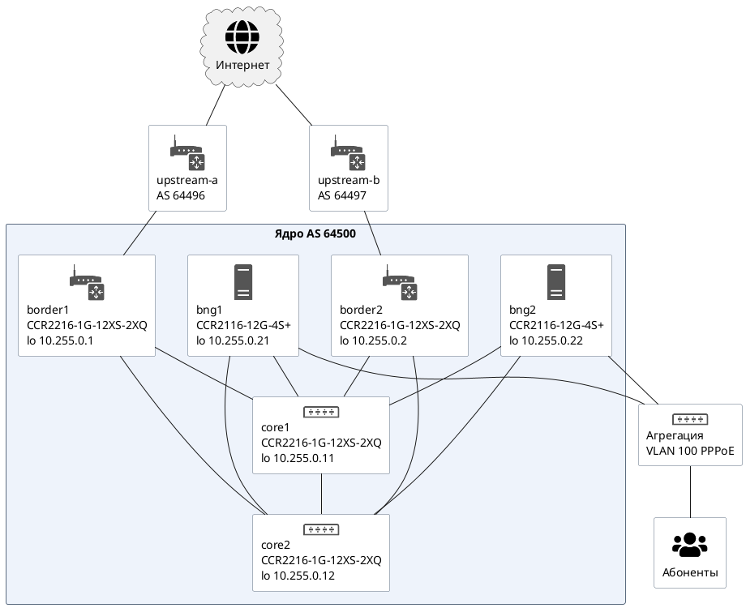
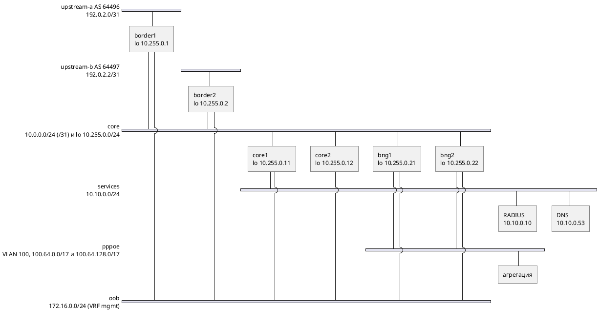

<!-- Собрано из apps/playground/examples/32-mikrotik-core.md основного репозитория Spiridus (scripts/build-public-docs.mjs) — правьте там. -->

<!-- раздел: Сети | теги: mikrotik, routeros, isp, оператор, bgp, ospf, mpls, ldp, pppoe, cgnat, bng, конфигурация -->
# Ядро оператора на MikroTik: BGP, OSPF, MPLS, BNG и CGNAT

Небольшой оператор (до ~20 тысяч абонентов) целиком на MikroTik `RouterOS 7.18`: две границы с разными аплинками, два маршрутизатора ядра — они же отражатели маршрутов, два BNG с PPPoE и CGNAT. Названия устройств, моделей и команды — инлайн-кодом: наведите и щёлкните, чтобы скопировать. Пояснения «почему так» и полные конфигурации свёрнуты.

**Параметры**

| Параметр | Значение |
| --- | --- |
| ОС | `RouterOS 7.18` |
| Свой AS | `64500` |
| Свои префиксы | `203.0.113.0/24`, `198.51.100.0/24` |
| Аплинки | `border1` → upstream-a, AS `64496`, сосед `192.0.2.0`; `border2` → upstream-b, AS `64497`, сосед `192.0.2.2` |
| IGP / метки | OSPFv2 area 0 только для инфраструктуры; MPLS LDP |
| Абоненты | PPPoE в VLAN 100, RADIUS, CGNAT из 100.64.0.0/10 |
| Управление | OOB: ether1 в VRF mgmt, 172.16.0.0/24 |

## 1. Схема

Три вида одной сети: топология в PlantUML (значки Office, раскладка Graphviz), адресный план в nwdiag — сети полосами, кто в какой сети, — и та же топология в D2.

**Топология, PlantUML**



**Адресный план, PlantUML nwdiag**



**Топология, D2**

```d2
classes: { dev: { shape: image; label.near: outside-right-center } }
direction: down
inet: Интернет { class: dev; icon: affinity:globe }
upstream-a: upstream-a\nAS64496 { class: dev; icon: affinity:router-gray }
upstream-b: upstream-b\nAS64497 { class: dev; icon: affinity:router-gray }
core: Ядро AS 64500 {
  border1: border1\nCCR2216-1G-12XS-2XQ\nlo 10.255.0.1 { class: dev; icon: affinity:router }
  border2: border2\nCCR2216-1G-12XS-2XQ\nlo 10.255.0.2 { class: dev; icon: affinity:router }
  core1: core1\nCCR2216-1G-12XS-2XQ\nlo 10.255.0.11 { class: dev; icon: affinity:switch-multilayer }
  core2: core2\nCCR2216-1G-12XS-2XQ\nlo 10.255.0.12 { class: dev; icon: affinity:switch-multilayer }
  bng1: bng1\nCCR2116-12G-4S+\nlo 10.255.0.21 { class: dev; icon: affinity:server-green }
  bng2: bng2\nCCR2116-12G-4S+\nlo 10.255.0.22 { class: dev; icon: affinity:server-green }
  border1 -- core1
  border1 -- core2
  border2 -- core1
  border2 -- core2
  core1 -- core2
  bng1 -- core1
  bng1 -- core2
  bng2 -- core1
  bng2 -- core2
}
inet -- upstream-a
upstream-a -- core.border1
inet -- upstream-b
upstream-b -- core.border2
access: Агрегация\nVLAN 100 PPPoE { class: dev; icon: affinity:switch-gray }
core.bng1 -- access
core.bng2 -- access
subs: Абоненты { class: dev; icon: affinity:house-gray }
access -- subs
```

## 2. Решения

| Компонент | Решение |
| --- | --- |
| IGP | OSPFv2 area 0, ptp, только loopback и /31, MD5, BFD |
| Транспорт | MPLS LDP — ядро не держит полную таблицу |
| BGP | AS `64500`: iBGP через два RR (`core1` `10.255.0.11`, `core2` `10.255.0.12`); eBGP только на границе |
| Полная таблица | только на границах; внутрь — маршрут по умолчанию |
| Абоненты | PPPoE на BNG, адреса из 100.64.0.0/10, RADIUS + CoA |
| NAT | CGNAT на BNG, netmap — без журнала трансляций |
| Управление | OOB в VRF mgmt, сервисы только оттуда |

<details>
<summary>Почему так, а не иначе — пояснения</summary>

- **OSPF, а не IS-IS.** В RouterOS 7 OSPFv2/v3 — основной и наиболее отлаженный IGP; IS-IS появился позже и в нём меньше возможностей. Для шести маршрутизаторов разницы в масштабе нет.
- **BGP-free core через LDP.** Маршруты по умолчанию от границ приходят на BNG с next-hop = loopback границы; путь к нему — LSP по LDP. Ядро коммутирует по меткам и не держит интернет-таблицу.
- **RR на маршрутизаторах ядра.** Шесть устройств — полная связность iBGP ещё возможна, но RR избавляет от правки всех конфигов при добавлении третьего BNG.
- **Маршрут по умолчанию вместо полной таблицы на BNG.** У `CCR2116-12G-4S+` хватит памяти и на полную таблицу, но выигрыша для абонентского трафика нет: выход один — граница.
- **CGNAT на BNG, а не на границе.** Нагрузка трансляции делится по BNG; пулы `198.51.100.0/27` и `198.51.100.32/27` анонсируются от «своего» BNG, обратный трафик приходит туда же.
- **netmap.** Детерминированная трансляция: по внешнему адресу и порту абонент вычисляется без журнала NAT — это проще хранить, чем терабайты логов.

</details>

## 3. Адресный план

**Loopback и управление**

| Устройство | Модель | Роль | Loopback | OOB (ether1) |
| --- | --- | --- | --- | --- |
| `border1` | `CCR2216-1G-12XS-2XQ` | граница | `10.255.0.1/32` | `172.16.0.1/24` |
| `border2` | `CCR2216-1G-12XS-2XQ` | граница | `10.255.0.2/32` | `172.16.0.2/24` |
| `core1` | `CCR2216-1G-12XS-2XQ` | ядро, RR | `10.255.0.11/32` | `172.16.0.11/24` |
| `core2` | `CCR2216-1G-12XS-2XQ` | ядро, RR | `10.255.0.12/32` | `172.16.0.12/24` |
| `bng1` | `CCR2116-12G-4S+` | BNG, CGNAT | `10.255.0.21/32` | `172.16.0.21/24` |
| `bng2` | `CCR2116-12G-4S+` | BNG, CGNAT | `10.255.0.22/32` | `172.16.0.22/24` |

**Линки ядра (/31)**

| A | Интерфейс A | IP A | B | Интерфейс B | IP B | Скорость |
| --- | --- | --- | --- | --- | --- | --- |
| `border1` | `qsfp28-1-1` | `10.0.0.0` | `core1` | `qsfp28-1-1` | `10.0.0.1` | 100G |
| `border1` | `qsfp28-2-1` | `10.0.0.2` | `core2` | `qsfp28-1-1` | `10.0.0.3` | 100G |
| `border2` | `qsfp28-1-1` | `10.0.0.4` | `core1` | `qsfp28-2-1` | `10.0.0.5` | 100G |
| `border2` | `qsfp28-2-1` | `10.0.0.6` | `core2` | `qsfp28-2-1` | `10.0.0.7` | 100G |
| `core1` | `sfp28-1` | `10.0.0.8` | `core2` | `sfp28-1` | `10.0.0.9` | 25G |
| `bng1` | `sfp-sfpplus1` | `10.0.0.10` | `core1` | `sfp28-3` | `10.0.0.11` | 10G |
| `bng1` | `sfp-sfpplus2` | `10.0.0.12` | `core2` | `sfp28-3` | `10.0.0.13` | 10G |
| `bng2` | `sfp-sfpplus1` | `10.0.0.14` | `core1` | `sfp28-4` | `10.0.0.15` | 10G |
| `bng2` | `sfp-sfpplus2` | `10.0.0.16` | `core2` | `sfp28-4` | `10.0.0.17` | 10G |

**Внешние и абонентские сети**

| Что | Где | Сеть |
| --- | --- | --- |
| upstream-a, AS `64496` | `border1` `sfp28-1` | `192.0.2.1/31`, сосед `192.0.2.0` |
| upstream-b, AS `64497` | `border2` `sfp28-1` | `192.0.2.3/31`, сосед `192.0.2.2` |
| абоненты PPPoE | `bng1` | `100.64.0.0/17` |
| пул CGNAT | `bng1` | `198.51.100.0/27` |
| абоненты PPPoE | `bng2` | `100.64.128.0/17` |
| пул CGNAT | `bng2` | `198.51.100.32/27` |
| сервисы (RADIUS, DNS) | `core1` `sfp28-5` | `10.10.0.0/24`: RADIUS `10.10.0.10`, DNS `10.10.0.53` |

## 4. Конфигурации

Полные, для каждого устройства; строки с `# ПРОВЕРИТЬ` — места, где синтаксис или предел зависит от сборки RouterOS и модели.

<details>
<summary>border1 — CCR2216-1G-12XS-2XQ, полная конфигурация</summary>

```routeros
# border1 — CCR2216-1G-12XS-2XQ, RouterOS 7.18; граница
# сгенерировано scripts/build-mikrotik-example.mjs; пароли и секреты — плейсхолдеры
/system identity set name=border1
/system clock set time-zone-name=Europe/Moscow
/system ntp client set enabled=yes vrf=mgmt servers=172.16.0.250

# --- управление: отдельный VRF на ether1, в ядро не выходит
/ip vrf add name=mgmt interfaces=ether1
/ip address add address=172.16.0.1/24 interface=ether1 comment=OOB
/ip route add dst-address=0.0.0.0/0 gateway=172.16.0.254@mgmt routing-table=mgmt
/ip service set [find name~"telnet|ftp|www|www-ssl|api|api-ssl"] disabled=yes
/ip service set ssh address=172.16.0.0/24 vrf=mgmt
/ip service set winbox address=172.16.0.0/24 vrf=mgmt
/tool mac-server set allowed-interface-list=none
/tool mac-server mac-winbox set allowed-interface-list=none
/ip neighbor discovery-settings set discover-interface-list=none

# --- loopback: router-id OSPF, BGP и LDP
/interface bridge add name=loopback protocol-mode=none comment="loopback, без портов"
/ip address add address=10.255.0.1/32 interface=loopback

# --- линки ядра: /31, jumbo для MPLS
/interface list add name=core
/interface ethernet set [find default-name=qsfp28-1-1] mtu=9000 l2mtu=9216 comment="100G к core1" # ПРОВЕРИТЬ: предел l2mtu у порта модели
/ip address add address=10.0.0.0/31 interface=qsfp28-1-1 comment="к core1 10.0.0.1"
/interface list member add list=core interface=qsfp28-1-1
/interface ethernet set [find default-name=qsfp28-2-1] mtu=9000 l2mtu=9216 comment="100G к core2" # ПРОВЕРИТЬ: предел l2mtu у порта модели
/ip address add address=10.0.0.2/31 interface=qsfp28-2-1 comment="к core2 10.0.0.3"
/interface list member add list=core interface=qsfp28-2-1

# --- OSPFv2: только инфраструктура (loopback и /31), абонентов и интернет не носит
/routing ospf instance add name=core version=2 router-id=10.255.0.1
/routing ospf area add name=backbone area-id=0.0.0.0 instance=core
/routing ospf interface-template add area=backbone interfaces=core type=ptp cost=10 auth=md5 auth-key=<OSPF_KEY> auth-id=1 use-bfd=yes # ПРОВЕРИТЬ: use-bfd в вашей сборке 7.x
/routing ospf interface-template add area=backbone interfaces=loopback passive

# --- MPLS LDP: метки до loopback'ов, ядро без полной таблицы (BGP-free core)
/mpls ldp add afi=ip lsr-id=10.255.0.1 transport-addresses=10.255.0.1
/mpls ldp interface add interface=core

# --- BGP AS 64500
/routing bgp template set default as=64500 router-id=10.255.0.1
/routing bgp connection add name=to-core1 remote.address=10.255.0.11 remote.as=64500 local.address=10.255.0.1 local.role=ibgp-rr-client templates=default address-families=ip output.default-originate=always output.filter-chain=to-ibgp
/routing bgp connection add name=to-core2 remote.address=10.255.0.12 remote.as=64500 local.address=10.255.0.1 local.role=ibgp-rr-client templates=default address-families=ip output.default-originate=always output.filter-chain=to-ibgp

# --- upstream-a: eBGP, полная таблица внутрь, наружу — только свои префиксы
/ip address add address=192.0.2.1/31 interface=sfp28-1 comment="upstream-a AS64496"
/ip route add dst-address=203.0.113.0/24 blackhole comment="агрегат для анонса"
/ip firewall address-list add list=own-prefixes address=203.0.113.0/24
/ip route add dst-address=198.51.100.0/24 blackhole comment="агрегат для анонса"
/ip firewall address-list add list=own-prefixes address=198.51.100.0/24
/routing bgp connection add name=upstream-a remote.address=192.0.2.0 remote.as=64496 local.address=192.0.2.1 local.role=ebgp-provider templates=default address-families=ip input.filter=upstream-a-in output.filter-chain=upstream-a-out output.network=own-prefixes
# вход: без бого́нов, без своих префиксов, без длиннее /24, без чужих AS-путей длиннее 64
/routing filter rule add chain=upstream-a-in rule="if (dst in 10.0.0.0/8 || dst in 172.16.0.0/12 || dst in 192.168.0.0/16 || dst in 100.64.0.0/10 || dst in 127.0.0.0/8 || dst in 0.0.0.0/8) { reject; }"
/routing filter rule add chain=upstream-a-in rule="if (dst in 203.0.113.0/24 || dst in 198.51.100.0/24) { reject; }"
/routing filter rule add chain=upstream-a-in rule="if (dst-len > 24) { reject; }"
/routing filter rule add chain=upstream-a-in rule="accept;"
/routing filter rule add chain=upstream-a-out rule="if (dst in 203.0.113.0/24 && dst-len == 24 || dst in 198.51.100.0/24 && dst-len == 24) { accept; }"
/routing filter rule add chain=upstream-a-out rule="reject;"
# внутрь ядра — только маршрут по умолчанию от этой границы
/routing filter rule add chain=to-ibgp rule="if (dst == 0.0.0.0/0) { accept; }" # ПРОВЕРИТЬ: проходит ли default-originate через output.filter-chain
/routing filter rule add chain=to-ibgp rule="reject;"

# --- защита самого маршрутизатора (input)
/ip firewall filter add chain=input connection-state=established,related action=accept
/ip firewall filter add chain=input connection-state=invalid action=drop
/ip firewall filter add chain=input protocol=icmp action=accept
/ip firewall filter add chain=input in-interface-list=core protocol=ospf action=accept
/ip firewall filter add chain=input in-interface-list=core protocol=udp dst-port=646,3784,3785 action=accept comment="LDP hello, BFD"
/ip firewall filter add chain=input protocol=tcp dst-port=179,646 src-address=10.255.0.0/24 action=accept comment="iBGP и LDP от loopback'ов"
/ip firewall filter add chain=input protocol=tcp dst-port=179 src-address=192.0.2.0 action=accept comment="eBGP upstream-a"
/ip firewall filter add chain=input in-interface=ether1 src-address=172.16.0.0/24 action=accept comment=OOB
/ip firewall filter add chain=input action=drop comment="остальное — нет"
```

</details>

<details>
<summary>border2 — CCR2216-1G-12XS-2XQ, полная конфигурация</summary>

```routeros
# border2 — CCR2216-1G-12XS-2XQ, RouterOS 7.18; граница
# сгенерировано scripts/build-mikrotik-example.mjs; пароли и секреты — плейсхолдеры
/system identity set name=border2
/system clock set time-zone-name=Europe/Moscow
/system ntp client set enabled=yes vrf=mgmt servers=172.16.0.250

# --- управление: отдельный VRF на ether1, в ядро не выходит
/ip vrf add name=mgmt interfaces=ether1
/ip address add address=172.16.0.2/24 interface=ether1 comment=OOB
/ip route add dst-address=0.0.0.0/0 gateway=172.16.0.254@mgmt routing-table=mgmt
/ip service set [find name~"telnet|ftp|www|www-ssl|api|api-ssl"] disabled=yes
/ip service set ssh address=172.16.0.0/24 vrf=mgmt
/ip service set winbox address=172.16.0.0/24 vrf=mgmt
/tool mac-server set allowed-interface-list=none
/tool mac-server mac-winbox set allowed-interface-list=none
/ip neighbor discovery-settings set discover-interface-list=none

# --- loopback: router-id OSPF, BGP и LDP
/interface bridge add name=loopback protocol-mode=none comment="loopback, без портов"
/ip address add address=10.255.0.2/32 interface=loopback

# --- линки ядра: /31, jumbo для MPLS
/interface list add name=core
/interface ethernet set [find default-name=qsfp28-1-1] mtu=9000 l2mtu=9216 comment="100G к core1" # ПРОВЕРИТЬ: предел l2mtu у порта модели
/ip address add address=10.0.0.4/31 interface=qsfp28-1-1 comment="к core1 10.0.0.5"
/interface list member add list=core interface=qsfp28-1-1
/interface ethernet set [find default-name=qsfp28-2-1] mtu=9000 l2mtu=9216 comment="100G к core2" # ПРОВЕРИТЬ: предел l2mtu у порта модели
/ip address add address=10.0.0.6/31 interface=qsfp28-2-1 comment="к core2 10.0.0.7"
/interface list member add list=core interface=qsfp28-2-1

# --- OSPFv2: только инфраструктура (loopback и /31), абонентов и интернет не носит
/routing ospf instance add name=core version=2 router-id=10.255.0.2
/routing ospf area add name=backbone area-id=0.0.0.0 instance=core
/routing ospf interface-template add area=backbone interfaces=core type=ptp cost=10 auth=md5 auth-key=<OSPF_KEY> auth-id=1 use-bfd=yes # ПРОВЕРИТЬ: use-bfd в вашей сборке 7.x
/routing ospf interface-template add area=backbone interfaces=loopback passive

# --- MPLS LDP: метки до loopback'ов, ядро без полной таблицы (BGP-free core)
/mpls ldp add afi=ip lsr-id=10.255.0.2 transport-addresses=10.255.0.2
/mpls ldp interface add interface=core

# --- BGP AS 64500
/routing bgp template set default as=64500 router-id=10.255.0.2
/routing bgp connection add name=to-core1 remote.address=10.255.0.11 remote.as=64500 local.address=10.255.0.2 local.role=ibgp-rr-client templates=default address-families=ip output.default-originate=always output.filter-chain=to-ibgp
/routing bgp connection add name=to-core2 remote.address=10.255.0.12 remote.as=64500 local.address=10.255.0.2 local.role=ibgp-rr-client templates=default address-families=ip output.default-originate=always output.filter-chain=to-ibgp

# --- upstream-b: eBGP, полная таблица внутрь, наружу — только свои префиксы
/ip address add address=192.0.2.3/31 interface=sfp28-1 comment="upstream-b AS64497"
/ip route add dst-address=203.0.113.0/24 blackhole comment="агрегат для анонса"
/ip firewall address-list add list=own-prefixes address=203.0.113.0/24
/ip route add dst-address=198.51.100.0/24 blackhole comment="агрегат для анонса"
/ip firewall address-list add list=own-prefixes address=198.51.100.0/24
/routing bgp connection add name=upstream-b remote.address=192.0.2.2 remote.as=64497 local.address=192.0.2.3 local.role=ebgp-provider templates=default address-families=ip input.filter=upstream-b-in output.filter-chain=upstream-b-out output.network=own-prefixes
# вход: без бого́нов, без своих префиксов, без длиннее /24, без чужих AS-путей длиннее 64
/routing filter rule add chain=upstream-b-in rule="if (dst in 10.0.0.0/8 || dst in 172.16.0.0/12 || dst in 192.168.0.0/16 || dst in 100.64.0.0/10 || dst in 127.0.0.0/8 || dst in 0.0.0.0/8) { reject; }"
/routing filter rule add chain=upstream-b-in rule="if (dst in 203.0.113.0/24 || dst in 198.51.100.0/24) { reject; }"
/routing filter rule add chain=upstream-b-in rule="if (dst-len > 24) { reject; }"
/routing filter rule add chain=upstream-b-in rule="accept;"
/routing filter rule add chain=upstream-b-out rule="if (dst in 203.0.113.0/24 && dst-len == 24 || dst in 198.51.100.0/24 && dst-len == 24) { accept; }"
/routing filter rule add chain=upstream-b-out rule="reject;"
# внутрь ядра — только маршрут по умолчанию от этой границы
/routing filter rule add chain=to-ibgp rule="if (dst == 0.0.0.0/0) { accept; }" # ПРОВЕРИТЬ: проходит ли default-originate через output.filter-chain
/routing filter rule add chain=to-ibgp rule="reject;"

# --- защита самого маршрутизатора (input)
/ip firewall filter add chain=input connection-state=established,related action=accept
/ip firewall filter add chain=input connection-state=invalid action=drop
/ip firewall filter add chain=input protocol=icmp action=accept
/ip firewall filter add chain=input in-interface-list=core protocol=ospf action=accept
/ip firewall filter add chain=input in-interface-list=core protocol=udp dst-port=646,3784,3785 action=accept comment="LDP hello, BFD"
/ip firewall filter add chain=input protocol=tcp dst-port=179,646 src-address=10.255.0.0/24 action=accept comment="iBGP и LDP от loopback'ов"
/ip firewall filter add chain=input protocol=tcp dst-port=179 src-address=192.0.2.2 action=accept comment="eBGP upstream-b"
/ip firewall filter add chain=input in-interface=ether1 src-address=172.16.0.0/24 action=accept comment=OOB
/ip firewall filter add chain=input action=drop comment="остальное — нет"
```

</details>

<details>
<summary>core1 — CCR2216-1G-12XS-2XQ, полная конфигурация</summary>

```routeros
# core1 — CCR2216-1G-12XS-2XQ, RouterOS 7.18; ядро, RR
# сгенерировано scripts/build-mikrotik-example.mjs; пароли и секреты — плейсхолдеры
/system identity set name=core1
/system clock set time-zone-name=Europe/Moscow
/system ntp client set enabled=yes vrf=mgmt servers=172.16.0.250

# --- управление: отдельный VRF на ether1, в ядро не выходит
/ip vrf add name=mgmt interfaces=ether1
/ip address add address=172.16.0.11/24 interface=ether1 comment=OOB
/ip route add dst-address=0.0.0.0/0 gateway=172.16.0.254@mgmt routing-table=mgmt
/ip service set [find name~"telnet|ftp|www|www-ssl|api|api-ssl"] disabled=yes
/ip service set ssh address=172.16.0.0/24 vrf=mgmt
/ip service set winbox address=172.16.0.0/24 vrf=mgmt
/tool mac-server set allowed-interface-list=none
/tool mac-server mac-winbox set allowed-interface-list=none
/ip neighbor discovery-settings set discover-interface-list=none

# --- loopback: router-id OSPF, BGP и LDP
/interface bridge add name=loopback protocol-mode=none comment="loopback, без портов"
/ip address add address=10.255.0.11/32 interface=loopback

# --- линки ядра: /31, jumbo для MPLS
/interface list add name=core
/interface ethernet set [find default-name=qsfp28-1-1] mtu=9000 l2mtu=9216 comment="100G к border1" # ПРОВЕРИТЬ: предел l2mtu у порта модели
/ip address add address=10.0.0.1/31 interface=qsfp28-1-1 comment="к border1 10.0.0.0"
/interface list member add list=core interface=qsfp28-1-1
/interface ethernet set [find default-name=qsfp28-2-1] mtu=9000 l2mtu=9216 comment="100G к border2" # ПРОВЕРИТЬ: предел l2mtu у порта модели
/ip address add address=10.0.0.5/31 interface=qsfp28-2-1 comment="к border2 10.0.0.4"
/interface list member add list=core interface=qsfp28-2-1
/interface ethernet set [find default-name=sfp28-1] mtu=9000 l2mtu=9216 comment="25G к core2" # ПРОВЕРИТЬ: предел l2mtu у порта модели
/ip address add address=10.0.0.8/31 interface=sfp28-1 comment="к core2 10.0.0.9"
/interface list member add list=core interface=sfp28-1
/interface ethernet set [find default-name=sfp28-3] mtu=9000 l2mtu=9216 comment="10G к bng1" # ПРОВЕРИТЬ: предел l2mtu у порта модели
/ip address add address=10.0.0.11/31 interface=sfp28-3 comment="к bng1 10.0.0.10"
/interface list member add list=core interface=sfp28-3
/interface ethernet set [find default-name=sfp28-4] mtu=9000 l2mtu=9216 comment="10G к bng2" # ПРОВЕРИТЬ: предел l2mtu у порта модели
/ip address add address=10.0.0.15/31 interface=sfp28-4 comment="к bng2 10.0.0.14"
/interface list member add list=core interface=sfp28-4

# --- сервисная сеть: RADIUS 10.10.0.10, DNS 10.10.0.53
/ip address add address=10.10.0.1/24 interface=sfp28-5 comment=services

# --- OSPFv2: только инфраструктура (loopback и /31), абонентов и интернет не носит
/routing ospf instance add name=core version=2 router-id=10.255.0.11
/routing ospf area add name=backbone area-id=0.0.0.0 instance=core
/routing ospf interface-template add area=backbone interfaces=core type=ptp cost=10 auth=md5 auth-key=<OSPF_KEY> auth-id=1 use-bfd=yes # ПРОВЕРИТЬ: use-bfd в вашей сборке 7.x
/routing ospf interface-template add area=backbone interfaces=loopback passive
/routing ospf interface-template add area=backbone networks=10.10.0.0/24 passive

# --- MPLS LDP: метки до loopback'ов, ядро без полной таблицы (BGP-free core)
/mpls ldp add afi=ip lsr-id=10.255.0.11 transport-addresses=10.255.0.11
/mpls ldp interface add interface=core

# --- BGP AS 64500
/routing bgp template set default as=64500 router-id=10.255.0.11
# отражатель маршрутов: клиенты — граница и BNG, второй RR — обычный iBGP
/routing bgp connection add name=rr-border1 remote.address=10.255.0.1 remote.as=64500 local.address=10.255.0.11 local.role=ibgp-rr templates=default address-families=ip
/routing bgp connection add name=rr-border2 remote.address=10.255.0.2 remote.as=64500 local.address=10.255.0.11 local.role=ibgp-rr templates=default address-families=ip
/routing bgp connection add name=rr-bng1 remote.address=10.255.0.21 remote.as=64500 local.address=10.255.0.11 local.role=ibgp-rr templates=default address-families=ip
/routing bgp connection add name=rr-bng2 remote.address=10.255.0.22 remote.as=64500 local.address=10.255.0.11 local.role=ibgp-rr templates=default address-families=ip
/routing bgp connection add name=ibgp-core2 remote.address=10.255.0.12 remote.as=64500 local.address=10.255.0.11 local.role=ibgp templates=default address-families=ip

# --- защита самого маршрутизатора (input)
/ip firewall filter add chain=input connection-state=established,related action=accept
/ip firewall filter add chain=input connection-state=invalid action=drop
/ip firewall filter add chain=input protocol=icmp action=accept
/ip firewall filter add chain=input in-interface-list=core protocol=ospf action=accept
/ip firewall filter add chain=input in-interface-list=core protocol=udp dst-port=646,3784,3785 action=accept comment="LDP hello, BFD"
/ip firewall filter add chain=input protocol=tcp dst-port=179,646 src-address=10.255.0.0/24 action=accept comment="iBGP и LDP от loopback'ов"
/ip firewall filter add chain=input in-interface=ether1 src-address=172.16.0.0/24 action=accept comment=OOB
/ip firewall filter add chain=input action=drop comment="остальное — нет"
```

</details>

<details>
<summary>core2 — CCR2216-1G-12XS-2XQ, полная конфигурация</summary>

```routeros
# core2 — CCR2216-1G-12XS-2XQ, RouterOS 7.18; ядро, RR
# сгенерировано scripts/build-mikrotik-example.mjs; пароли и секреты — плейсхолдеры
/system identity set name=core2
/system clock set time-zone-name=Europe/Moscow
/system ntp client set enabled=yes vrf=mgmt servers=172.16.0.250

# --- управление: отдельный VRF на ether1, в ядро не выходит
/ip vrf add name=mgmt interfaces=ether1
/ip address add address=172.16.0.12/24 interface=ether1 comment=OOB
/ip route add dst-address=0.0.0.0/0 gateway=172.16.0.254@mgmt routing-table=mgmt
/ip service set [find name~"telnet|ftp|www|www-ssl|api|api-ssl"] disabled=yes
/ip service set ssh address=172.16.0.0/24 vrf=mgmt
/ip service set winbox address=172.16.0.0/24 vrf=mgmt
/tool mac-server set allowed-interface-list=none
/tool mac-server mac-winbox set allowed-interface-list=none
/ip neighbor discovery-settings set discover-interface-list=none

# --- loopback: router-id OSPF, BGP и LDP
/interface bridge add name=loopback protocol-mode=none comment="loopback, без портов"
/ip address add address=10.255.0.12/32 interface=loopback

# --- линки ядра: /31, jumbo для MPLS
/interface list add name=core
/interface ethernet set [find default-name=qsfp28-1-1] mtu=9000 l2mtu=9216 comment="100G к border1" # ПРОВЕРИТЬ: предел l2mtu у порта модели
/ip address add address=10.0.0.3/31 interface=qsfp28-1-1 comment="к border1 10.0.0.2"
/interface list member add list=core interface=qsfp28-1-1
/interface ethernet set [find default-name=qsfp28-2-1] mtu=9000 l2mtu=9216 comment="100G к border2" # ПРОВЕРИТЬ: предел l2mtu у порта модели
/ip address add address=10.0.0.7/31 interface=qsfp28-2-1 comment="к border2 10.0.0.6"
/interface list member add list=core interface=qsfp28-2-1
/interface ethernet set [find default-name=sfp28-1] mtu=9000 l2mtu=9216 comment="25G к core1" # ПРОВЕРИТЬ: предел l2mtu у порта модели
/ip address add address=10.0.0.9/31 interface=sfp28-1 comment="к core1 10.0.0.8"
/interface list member add list=core interface=sfp28-1
/interface ethernet set [find default-name=sfp28-3] mtu=9000 l2mtu=9216 comment="10G к bng1" # ПРОВЕРИТЬ: предел l2mtu у порта модели
/ip address add address=10.0.0.13/31 interface=sfp28-3 comment="к bng1 10.0.0.12"
/interface list member add list=core interface=sfp28-3
/interface ethernet set [find default-name=sfp28-4] mtu=9000 l2mtu=9216 comment="10G к bng2" # ПРОВЕРИТЬ: предел l2mtu у порта модели
/ip address add address=10.0.0.17/31 interface=sfp28-4 comment="к bng2 10.0.0.16"
/interface list member add list=core interface=sfp28-4

# --- OSPFv2: только инфраструктура (loopback и /31), абонентов и интернет не носит
/routing ospf instance add name=core version=2 router-id=10.255.0.12
/routing ospf area add name=backbone area-id=0.0.0.0 instance=core
/routing ospf interface-template add area=backbone interfaces=core type=ptp cost=10 auth=md5 auth-key=<OSPF_KEY> auth-id=1 use-bfd=yes # ПРОВЕРИТЬ: use-bfd в вашей сборке 7.x
/routing ospf interface-template add area=backbone interfaces=loopback passive

# --- MPLS LDP: метки до loopback'ов, ядро без полной таблицы (BGP-free core)
/mpls ldp add afi=ip lsr-id=10.255.0.12 transport-addresses=10.255.0.12
/mpls ldp interface add interface=core

# --- BGP AS 64500
/routing bgp template set default as=64500 router-id=10.255.0.12
# отражатель маршрутов: клиенты — граница и BNG, второй RR — обычный iBGP
/routing bgp connection add name=rr-border1 remote.address=10.255.0.1 remote.as=64500 local.address=10.255.0.12 local.role=ibgp-rr templates=default address-families=ip
/routing bgp connection add name=rr-border2 remote.address=10.255.0.2 remote.as=64500 local.address=10.255.0.12 local.role=ibgp-rr templates=default address-families=ip
/routing bgp connection add name=rr-bng1 remote.address=10.255.0.21 remote.as=64500 local.address=10.255.0.12 local.role=ibgp-rr templates=default address-families=ip
/routing bgp connection add name=rr-bng2 remote.address=10.255.0.22 remote.as=64500 local.address=10.255.0.12 local.role=ibgp-rr templates=default address-families=ip
/routing bgp connection add name=ibgp-core1 remote.address=10.255.0.11 remote.as=64500 local.address=10.255.0.12 local.role=ibgp templates=default address-families=ip

# --- защита самого маршрутизатора (input)
/ip firewall filter add chain=input connection-state=established,related action=accept
/ip firewall filter add chain=input connection-state=invalid action=drop
/ip firewall filter add chain=input protocol=icmp action=accept
/ip firewall filter add chain=input in-interface-list=core protocol=ospf action=accept
/ip firewall filter add chain=input in-interface-list=core protocol=udp dst-port=646,3784,3785 action=accept comment="LDP hello, BFD"
/ip firewall filter add chain=input protocol=tcp dst-port=179,646 src-address=10.255.0.0/24 action=accept comment="iBGP и LDP от loopback'ов"
/ip firewall filter add chain=input in-interface=ether1 src-address=172.16.0.0/24 action=accept comment=OOB
/ip firewall filter add chain=input action=drop comment="остальное — нет"
```

</details>

<details>
<summary>bng1 — CCR2116-12G-4S+, полная конфигурация</summary>

```routeros
# bng1 — CCR2116-12G-4S+, RouterOS 7.18; BNG, CGNAT
# сгенерировано scripts/build-mikrotik-example.mjs; пароли и секреты — плейсхолдеры
/system identity set name=bng1
/system clock set time-zone-name=Europe/Moscow
/system ntp client set enabled=yes vrf=mgmt servers=172.16.0.250

# --- управление: отдельный VRF на ether1, в ядро не выходит
/ip vrf add name=mgmt interfaces=ether1
/ip address add address=172.16.0.21/24 interface=ether1 comment=OOB
/ip route add dst-address=0.0.0.0/0 gateway=172.16.0.254@mgmt routing-table=mgmt
/ip service set [find name~"telnet|ftp|www|www-ssl|api|api-ssl"] disabled=yes
/ip service set ssh address=172.16.0.0/24 vrf=mgmt
/ip service set winbox address=172.16.0.0/24 vrf=mgmt
/tool mac-server set allowed-interface-list=none
/tool mac-server mac-winbox set allowed-interface-list=none
/ip neighbor discovery-settings set discover-interface-list=none

# --- loopback: router-id OSPF, BGP и LDP
/interface bridge add name=loopback protocol-mode=none comment="loopback, без портов"
/ip address add address=10.255.0.21/32 interface=loopback

# --- линки ядра: /31, jumbo для MPLS
/interface list add name=core
/interface ethernet set [find default-name=sfp-sfpplus1] mtu=9000 l2mtu=9216 comment="10G к core1" # ПРОВЕРИТЬ: предел l2mtu у порта модели
/ip address add address=10.0.0.10/31 interface=sfp-sfpplus1 comment="к core1 10.0.0.11"
/interface list member add list=core interface=sfp-sfpplus1
/interface ethernet set [find default-name=sfp-sfpplus2] mtu=9000 l2mtu=9216 comment="10G к core2" # ПРОВЕРИТЬ: предел l2mtu у порта модели
/ip address add address=10.0.0.12/31 interface=sfp-sfpplus2 comment="к core2 10.0.0.13"
/interface list member add list=core interface=sfp-sfpplus2

# --- OSPFv2: только инфраструктура (loopback и /31), абонентов и интернет не носит
/routing ospf instance add name=core version=2 router-id=10.255.0.21
/routing ospf area add name=backbone area-id=0.0.0.0 instance=core
/routing ospf interface-template add area=backbone interfaces=core type=ptp cost=10 auth=md5 auth-key=<OSPF_KEY> auth-id=1 use-bfd=yes # ПРОВЕРИТЬ: use-bfd в вашей сборке 7.x
/routing ospf interface-template add area=backbone interfaces=loopback passive

# --- MPLS LDP: метки до loopback'ов, ядро без полной таблицы (BGP-free core)
/mpls ldp add afi=ip lsr-id=10.255.0.21 transport-addresses=10.255.0.21
/mpls ldp interface add interface=core

# --- BGP AS 64500
/routing bgp template set default as=64500 router-id=10.255.0.21
/routing bgp connection add name=to-core1 remote.address=10.255.0.11 remote.as=64500 local.address=10.255.0.21 local.role=ibgp-rr-client templates=default address-families=ip output.network=bng-pools
/routing bgp connection add name=to-core2 remote.address=10.255.0.12 remote.as=64500 local.address=10.255.0.21 local.role=ibgp-rr-client templates=default address-families=ip output.network=bng-pools

# --- BNG: PPPoE в VLAN 100 от агрегации, адреса из 100.64.0.0/17, авторизация RADIUS
/interface vlan add name=vlan100-pppoe vlan-id=100 interface=sfp-sfpplus3
/ip pool add name=subs ranges=100.64.0.1-100.64.127.254
/ppp profile add name=subs local-address=10.255.0.21 remote-address=subs dns-server=10.10.0.53 change-tcp-mss=yes only-one=yes
/interface pppoe-server server add service-name=isp interface=vlan100-pppoe default-profile=subs authentication=pap,chap,mschap2 max-mtu=1492 max-mru=1492 one-session-per-host=yes disabled=no
/radius add service=ppp address=10.10.0.10 secret=<RADIUS_SECRET> src-address=10.255.0.21 timeout=1s
/ppp aaa set use-radius=yes accounting=yes interim-update=5m
/radius incoming set accept=yes port=3799 # CoA и отключение сессий с RADIUS

# --- CGNAT: 100.64.0.0/17 → 198.51.100.0/27, детерминированно (netmap), логи не нужны
/ip route add dst-address=100.64.0.0/17 blackhole comment="агрегат абонентов"
/ip route add dst-address=198.51.100.0/27 blackhole comment="пул CGNAT"
/ip firewall address-list add list=bng-pools address=100.64.0.0/17
/ip firewall address-list add list=bng-pools address=198.51.100.0/27
/ip firewall nat add chain=srcnat src-address=100.64.0.0/17 out-interface-list=core action=netmap to-addresses=198.51.100.0/27 comment=CGNAT # ПРОВЕРИТЬ: портовые блоки на абонента — нужна схема netmap+ports под ваш пул
/ip firewall nat add chain=srcnat src-address=100.64.0.0/17 out-interface-list=core protocol=tcp action=netmap to-addresses=198.51.100.0/27 to-ports=1024-65535
/ip firewall nat add chain=srcnat src-address=100.64.0.0/17 out-interface-list=core protocol=udp action=netmap to-addresses=198.51.100.0/27 to-ports=1024-65535

# --- защита самого маршрутизатора (input)
/ip firewall filter add chain=input connection-state=established,related action=accept
/ip firewall filter add chain=input connection-state=invalid action=drop
/ip firewall filter add chain=input protocol=icmp action=accept
/ip firewall filter add chain=input in-interface-list=core protocol=ospf action=accept
/ip firewall filter add chain=input in-interface-list=core protocol=udp dst-port=646,3784,3785 action=accept comment="LDP hello, BFD"
/ip firewall filter add chain=input protocol=tcp dst-port=179,646 src-address=10.255.0.0/24 action=accept comment="iBGP и LDP от loopback'ов"
/ip firewall filter add chain=input protocol=udp src-address=10.10.0.10 dst-port=3799 action=accept comment="RADIUS CoA"
/ip firewall filter add chain=input in-interface=ether1 src-address=172.16.0.0/24 action=accept comment=OOB
/ip firewall filter add chain=input action=drop comment="остальное — нет"
```

</details>

<details>
<summary>bng2 — CCR2116-12G-4S+, полная конфигурация</summary>

```routeros
# bng2 — CCR2116-12G-4S+, RouterOS 7.18; BNG, CGNAT
# сгенерировано scripts/build-mikrotik-example.mjs; пароли и секреты — плейсхолдеры
/system identity set name=bng2
/system clock set time-zone-name=Europe/Moscow
/system ntp client set enabled=yes vrf=mgmt servers=172.16.0.250

# --- управление: отдельный VRF на ether1, в ядро не выходит
/ip vrf add name=mgmt interfaces=ether1
/ip address add address=172.16.0.22/24 interface=ether1 comment=OOB
/ip route add dst-address=0.0.0.0/0 gateway=172.16.0.254@mgmt routing-table=mgmt
/ip service set [find name~"telnet|ftp|www|www-ssl|api|api-ssl"] disabled=yes
/ip service set ssh address=172.16.0.0/24 vrf=mgmt
/ip service set winbox address=172.16.0.0/24 vrf=mgmt
/tool mac-server set allowed-interface-list=none
/tool mac-server mac-winbox set allowed-interface-list=none
/ip neighbor discovery-settings set discover-interface-list=none

# --- loopback: router-id OSPF, BGP и LDP
/interface bridge add name=loopback protocol-mode=none comment="loopback, без портов"
/ip address add address=10.255.0.22/32 interface=loopback

# --- линки ядра: /31, jumbo для MPLS
/interface list add name=core
/interface ethernet set [find default-name=sfp-sfpplus1] mtu=9000 l2mtu=9216 comment="10G к core1" # ПРОВЕРИТЬ: предел l2mtu у порта модели
/ip address add address=10.0.0.14/31 interface=sfp-sfpplus1 comment="к core1 10.0.0.15"
/interface list member add list=core interface=sfp-sfpplus1
/interface ethernet set [find default-name=sfp-sfpplus2] mtu=9000 l2mtu=9216 comment="10G к core2" # ПРОВЕРИТЬ: предел l2mtu у порта модели
/ip address add address=10.0.0.16/31 interface=sfp-sfpplus2 comment="к core2 10.0.0.17"
/interface list member add list=core interface=sfp-sfpplus2

# --- OSPFv2: только инфраструктура (loopback и /31), абонентов и интернет не носит
/routing ospf instance add name=core version=2 router-id=10.255.0.22
/routing ospf area add name=backbone area-id=0.0.0.0 instance=core
/routing ospf interface-template add area=backbone interfaces=core type=ptp cost=10 auth=md5 auth-key=<OSPF_KEY> auth-id=1 use-bfd=yes # ПРОВЕРИТЬ: use-bfd в вашей сборке 7.x
/routing ospf interface-template add area=backbone interfaces=loopback passive

# --- MPLS LDP: метки до loopback'ов, ядро без полной таблицы (BGP-free core)
/mpls ldp add afi=ip lsr-id=10.255.0.22 transport-addresses=10.255.0.22
/mpls ldp interface add interface=core

# --- BGP AS 64500
/routing bgp template set default as=64500 router-id=10.255.0.22
/routing bgp connection add name=to-core1 remote.address=10.255.0.11 remote.as=64500 local.address=10.255.0.22 local.role=ibgp-rr-client templates=default address-families=ip output.network=bng-pools
/routing bgp connection add name=to-core2 remote.address=10.255.0.12 remote.as=64500 local.address=10.255.0.22 local.role=ibgp-rr-client templates=default address-families=ip output.network=bng-pools

# --- BNG: PPPoE в VLAN 100 от агрегации, адреса из 100.64.128.0/17, авторизация RADIUS
/interface vlan add name=vlan100-pppoe vlan-id=100 interface=sfp-sfpplus3
/ip pool add name=subs ranges=100.64.128.1-100.64.255.254
/ppp profile add name=subs local-address=10.255.0.22 remote-address=subs dns-server=10.10.0.53 change-tcp-mss=yes only-one=yes
/interface pppoe-server server add service-name=isp interface=vlan100-pppoe default-profile=subs authentication=pap,chap,mschap2 max-mtu=1492 max-mru=1492 one-session-per-host=yes disabled=no
/radius add service=ppp address=10.10.0.10 secret=<RADIUS_SECRET> src-address=10.255.0.22 timeout=1s
/ppp aaa set use-radius=yes accounting=yes interim-update=5m
/radius incoming set accept=yes port=3799 # CoA и отключение сессий с RADIUS

# --- CGNAT: 100.64.128.0/17 → 198.51.100.32/27, детерминированно (netmap), логи не нужны
/ip route add dst-address=100.64.128.0/17 blackhole comment="агрегат абонентов"
/ip route add dst-address=198.51.100.32/27 blackhole comment="пул CGNAT"
/ip firewall address-list add list=bng-pools address=100.64.128.0/17
/ip firewall address-list add list=bng-pools address=198.51.100.32/27
/ip firewall nat add chain=srcnat src-address=100.64.128.0/17 out-interface-list=core action=netmap to-addresses=198.51.100.32/27 comment=CGNAT # ПРОВЕРИТЬ: портовые блоки на абонента — нужна схема netmap+ports под ваш пул
/ip firewall nat add chain=srcnat src-address=100.64.128.0/17 out-interface-list=core protocol=tcp action=netmap to-addresses=198.51.100.32/27 to-ports=1024-65535
/ip firewall nat add chain=srcnat src-address=100.64.128.0/17 out-interface-list=core protocol=udp action=netmap to-addresses=198.51.100.32/27 to-ports=1024-65535

# --- защита самого маршрутизатора (input)
/ip firewall filter add chain=input connection-state=established,related action=accept
/ip firewall filter add chain=input connection-state=invalid action=drop
/ip firewall filter add chain=input protocol=icmp action=accept
/ip firewall filter add chain=input in-interface-list=core protocol=ospf action=accept
/ip firewall filter add chain=input in-interface-list=core protocol=udp dst-port=646,3784,3785 action=accept comment="LDP hello, BFD"
/ip firewall filter add chain=input protocol=tcp dst-port=179,646 src-address=10.255.0.0/24 action=accept comment="iBGP и LDP от loopback'ов"
/ip firewall filter add chain=input protocol=udp src-address=10.10.0.10 dst-port=3799 action=accept comment="RADIUS CoA"
/ip firewall filter add chain=input in-interface=ether1 src-address=172.16.0.0/24 action=accept comment=OOB
/ip firewall filter add chain=input action=drop comment="остальное — нет"
```

</details>

## 5. Путь пакета абонента в интернет

<details>
<summary>Пошагово: от PPPoE до аплинка и обратно</summary>

1. Абонент поднимает PPPoE на `bng1`, RADIUS выдаёт адрес из `100.64.0.0/17`.
2. Пакет в интернет: на `bng1` маршрут по умолчанию от RR, next-hop — loopback ближайшей границы (`10.255.0.1`).
3. Перед отправкой — CGNAT: источник `100.64.x.x` → `198.51.100.0/27`.
4. До `10.255.0.1` пакет идёт по LSP: `core1`/`core2` коммутируют по меткам LDP, IP-таблицу интернета не смотрят.
5. `border1` по полной таблице выбирает аплинк и отправляет пакет в upstream-a.
6. Обратно: аплинк знает `198.51.100.0/24` от обеих границ; граница находит `198.51.100.0/27` в iBGP (анонс от `bng1`) и шлёт его по LSP до `10.255.0.21`.
7. `bng1` делает обратную трансляцию и отдаёт пакет в PPPoE-сессию абонента.

</details>

## 6. Команды проверки

| Команда | Что ожидать |
| --- | --- |
| `/routing ospf neighbor print` | на ядре — по соседу на каждый /31, state=Full |
| `/mpls ldp neighbor print` | соседи по всем линкам ядра, operational |
| `/mpls forwarding-table print where destination~"10.255.0"` | метки до каждого loopback |
| `/routing bgp session print` | на RR — 5 сессий established (4 клиента и второй RR) |
| `/ip route print where dst-address=0.0.0.0/0` | на BNG — два маршрута по умолчанию через loopback'и границ, один активный |
| `/routing bgp advertisements print peer=upstream-a` | на border1 — только 203.0.113.0/24 и 198.51.100.0/24 |
| `/ppp active print count-only` | на BNG — число активных сессий |
| `/ip firewall nat print stats where comment=CGNAT` | счётчики трансляции растут |
| `/tool traceroute 8.8.8.8 src-address=100.64.0.10` | через границу; на ядре — MPLS-метки в выводе |

## 7. Чек-лист ошибок

- MTU: на линках ядра `mtu=9000`, а на одном порту осталось 1500 — LDP поднялся, большие пакеты теряются.
- OSPF вещает абонентские сети — таблица IGP раздувается; в OSPF только loopback и /31.
- next-hop маршрута по умолчанию — адрес линка, а не loopback границы: при обрыве линка трафик уходит в никуда.
- Фильтр к аплинку пропускает /32 абонентов или 100.64.0.0/10 — утечка маршрутов.
- Нет blackhole-маршрута под анонсируемый агрегат — `output.network` его не объявит.
- CGNAT на границе и на BNG одновременно — двойная трансляция.
- `max-mtu=1492` без `change-tcp-mss=yes` — у абонентов «не открываются» часть сайтов.
- Сервисы (Winbox, SSH) доступны из ядра — должны быть только из VRF mgmt.
- RADIUS отвечает с другого адреса, чем `src-address` на BNG, — CoA не проходит.
