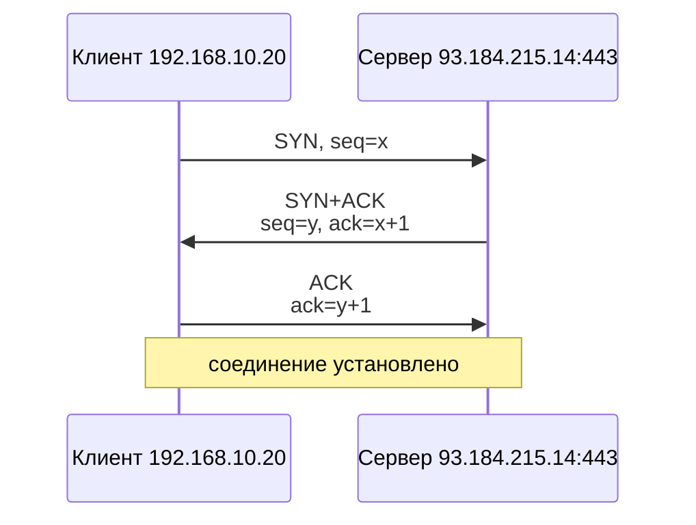
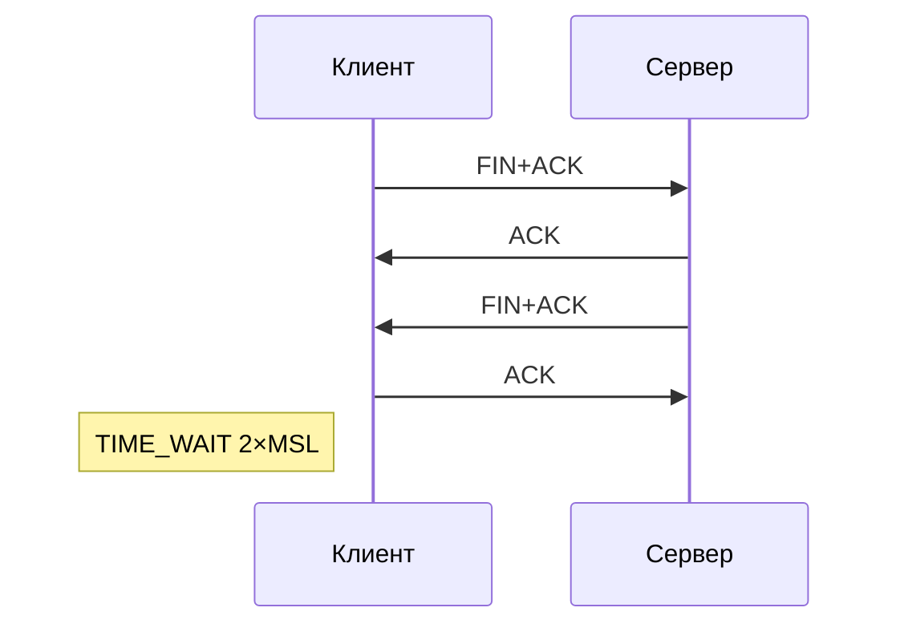
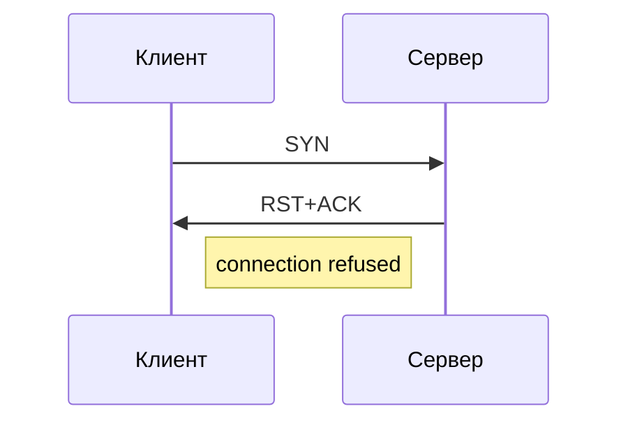
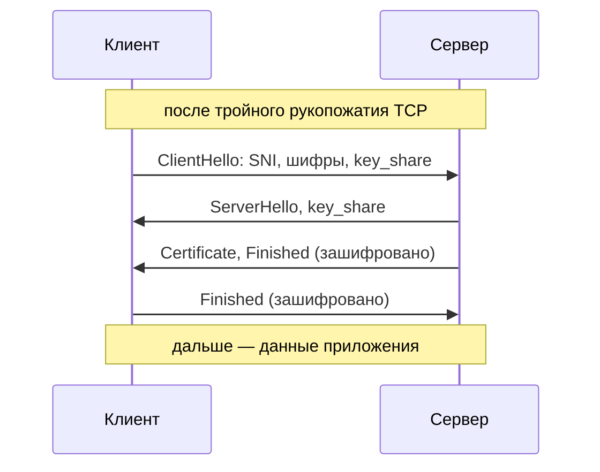
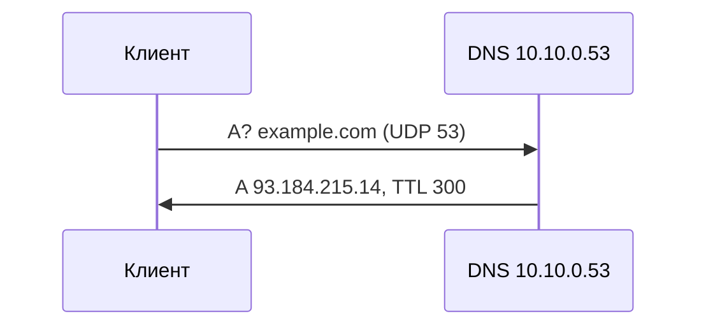
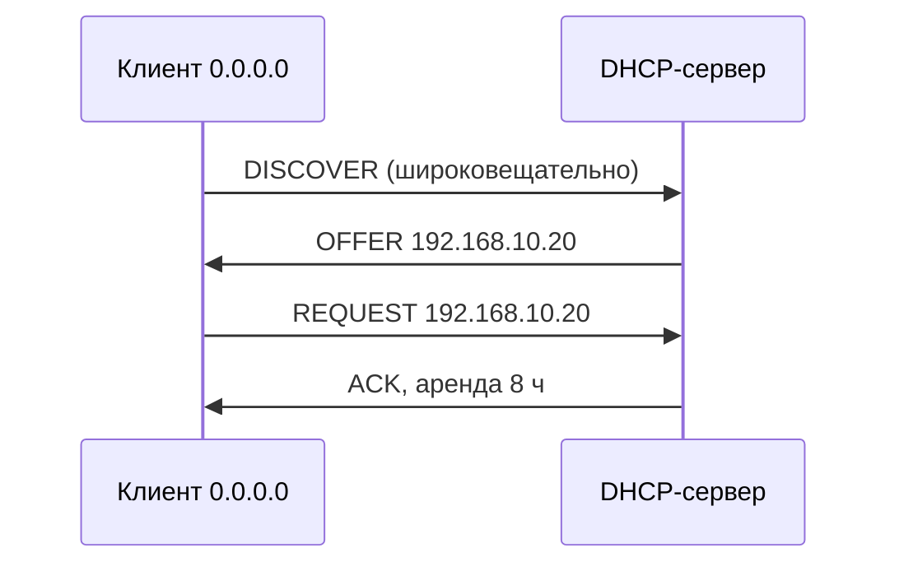
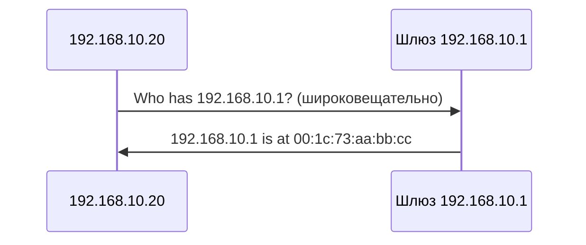
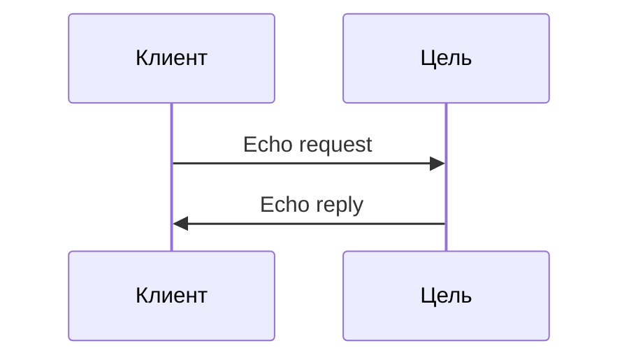
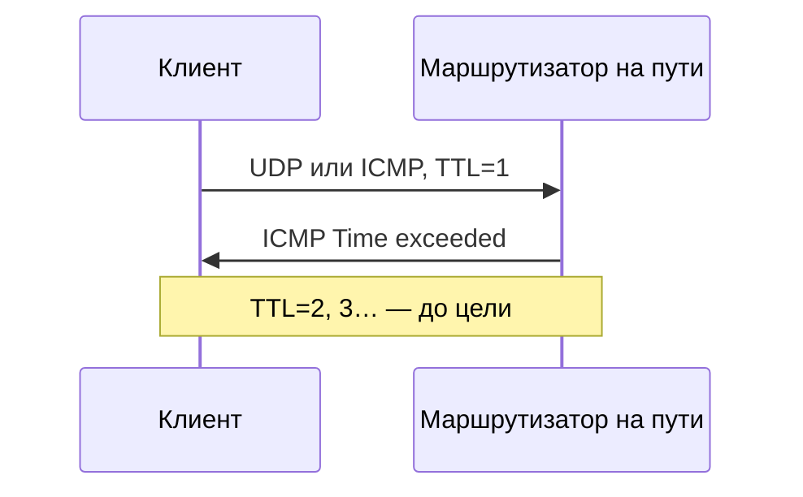

<!-- Собрано из apps/playground/examples/33-tcpdump.md основного репозитория Spiridus (scripts/build-public-docs.mjs) — правьте там. -->

<!-- раздел: Сети | теги: tcpdump, tcp, udp, tls, dns, dhcp, arp, icmp, хендшейк, bpf, фильтры, wireshark, диагностика -->
# tcpdump: захват трафика и хендшейки

Справочник по `tcpdump`: как запустить, как фильтровать, как читать вывод — и как увидеть в нём
хендшейки TCP, TLS, DNS, DHCP и ARP. Команды — инлайн-кодом: наведите и щёлкните, чтобы
скопировать. Длинные примеры вывода свёрнуты.

## 1. Запуск

| Задача | Команда |
|---|---|
| список интерфейсов | `tcpdump -D` |
| слушать интерфейс | `sudo tcpdump -i eth0` |
| без DNS-имён и имён портов | `sudo tcpdump -i eth0 -nn` |
| первые 20 пакетов | `sudo tcpdump -i eth0 -nn -c 20` |
| подробнее (TTL, длины, флаги IP) | `sudo tcpdump -i eth0 -nn -v` |
| содержимое пакета в ASCII | `sudo tcpdump -i eth0 -nn -A port 80` |
| содержимое в hex и ASCII | `sudo tcpdump -i eth0 -nn -X port 53` |
| записать в файл для Wireshark | `sudo tcpdump -i eth0 -nn -s 0 -w capture.pcap` |
| прочитать файл | `tcpdump -nn -r capture.pcap` |
| файлы по кругу: 10 штук по 100 МБ | `sudo tcpdump -i eth0 -w ring.pcap -C 100 -W 10` |
| время с датой | `sudo tcpdump -i eth0 -nn -tttt` |
| время от предыдущего пакета | `sudo tcpdump -i eth0 -nn -ttt` |

`-nn` почти всегда нужен: без него tcpdump ходит в DNS за именами, тормозит и сам добавляет
трафик в захват. `-s 0` — пакет целиком (в новых версиях это и так по умолчанию).

## 2. Фильтры (BPF)

Фильтр пишется последним аргументом; сложный — в одинарных кавычках.

| Что поймать | Фильтр |
|---|---|
| один хост | `host 10.0.0.5` |
| только от хоста / только к нему | `src host 10.0.0.5` · `dst host 10.0.0.5` |
| подсеть | `net 192.168.10.0/24` |
| порт | `port 443` |
| диапазон портов | `portrange 8000-8100` |
| протокол | `tcp` · `udp` · `icmp` · `arp` |
| DNS | `udp port 53 or tcp port 53` |
| DHCP | `udp port 67 or udp port 68` |
| хост и порт, без SSH-сессии, в которой работаете | `'host 10.0.0.5 and port 443 and not port 22'` |
| только SYN (новые соединения) | `'tcp[tcpflags] & tcp-syn != 0 and tcp[tcpflags] & tcp-ack == 0'` |
| только RST | `'tcp[tcpflags] & tcp-rst != 0'` |
| SYN или FIN | `'tcp[tcpflags] & (tcp-syn\|tcp-fin) != 0'` |
| пакеты больше 1000 байт | `greater 1000` |
| VLAN 100 | `'vlan 100 and host 10.0.0.5'` |

## 3. Как читать строку вывода

```text
14:02:11.481920 IP 192.168.10.20.51544 > 93.184.215.14.443: Flags [S], seq 3150371946, win 64240, options [mss 1460,sackOK,TS val 1882 ecr 0,nop,wscale 7], length 0
```

| Поле | Значение |
|---|---|
| `14:02:11.481920` | время пакета |
| `IP` | протокол сетевого уровня (`IP6` — IPv6) |
| `192.168.10.20.51544` | источник: адрес и порт (последнее число) |
| `93.184.215.14.443` | получатель |
| `Flags [S]` | флаги TCP |
| `seq`, `ack` | номера последовательности и подтверждения |
| `win` | окно приёма |
| `options [mss …]` | опции TCP: MSS, SACK, метки времени, масштаб окна |
| `length 0` | длина данных без заголовков |

Флаги TCP в выводе:

| В выводе | Флаг | Смысл |
|---|---|---|
| `[S]` | SYN | открыть соединение |
| `[S.]` | SYN+ACK | согласие открыть (точка — это ACK) |
| `[.]` | ACK | подтверждение |
| `[P.]` | PSH+ACK | данные, отдать приложению сразу |
| `[F.]` | FIN+ACK | закрыть свою сторону |
| `[R]` · `[R.]` | RST | сброс: соединения нет или оно убито |

Номера `seq` и `ack` tcpdump показывает относительными (от 1) после первого пакета; абсолютные —
с ключом `-S`.

## 4. TCP: тройное рукопожатие



Как увидеть: `sudo tcpdump -i eth0 -nn 'host 93.184.215.14 and port 443 and tcp[tcpflags] & (tcp-syn|tcp-ack) != 0' -c 3`

```text
14:02:11.481920 IP 192.168.10.20.51544 > 93.184.215.14.443: Flags [S], seq 3150371946, win 64240, length 0
14:02:11.523310 IP 93.184.215.14.443 > 192.168.10.20.51544: Flags [S.], seq 2041738005, ack 3150371947, win 65535, length 0
14:02:11.523390 IP 192.168.10.20.51544 > 93.184.215.14.443: Flags [.], ack 1, win 502, length 0
```

Время между `[S]` и `[S.]` — это RTT до сервера (здесь 41 мс).

## 5. TCP: закрытие и сброс



Если порт закрыт или межсетевой экран отвечает отказом, вместо `[S.]` приходит сброс:



Как увидеть закрытия и сбросы: `sudo tcpdump -i eth0 -nn 'tcp[tcpflags] & (tcp-fin|tcp-rst) != 0'`

Если на `[S]` нет ответа вовсе, а клиент повторяет его через 1, 2, 4 секунды — пакеты
отбрасываются по дороге (экран с `drop`, маршрута нет).

## 6. TLS 1.3 поверх TCP



Содержимое зашифровано, но первый пакет `ClientHello` — нет: в нём видно имя сайта (SNI).

Как увидеть: `sudo tcpdump -i eth0 -nn -A 'tcp port 443 and (tcp[((tcp[12:1] & 0xf0) >> 2):1] = 0x16)'` — пакеты рукопожатия TLS (тип записи 22). Удобнее записать `-w tls.pcap` и открыть в Wireshark с фильтром `tls.handshake`.

## 7. DNS



Как увидеть: `sudo tcpdump -i eth0 -nn udp port 53`

```text
14:05:02.100231 IP 192.168.10.20.40122 > 10.10.0.53.53: 41520+ A? example.com. (29)
14:05:02.103877 IP 10.10.0.53.53 > 192.168.10.20.40122: 41520 1/0/0 A 93.184.215.14 (45)
```

`41520` — номер запроса, `+` — нужна рекурсия, `1/0/0` — записей в ответе, полномочий и
дополнительных.

## 8. DHCP: DORA



Как увидеть: `sudo tcpdump -i eth0 -nn -v 'udp port 67 or udp port 68'`

<details>
<summary>Пример вывода с -v (длинный)</summary>

```text
14:10:00.000101 IP (tos 0x10, ttl 128, id 0, offset 0, flags [none], proto UDP (17), length 328)
    0.0.0.0.68 > 255.255.255.255.67: BOOTP/DHCP, Request from 52:54:00:12:34:56, length 300, xid 0x3903f326, Flags [none]
	  Client-Ethernet-Address 52:54:00:12:34:56
	  Vendor-rfc1048 Extensions
	    DHCP-Message (53), length 1: Discover
	    Requested-IP (50), length 4: 192.168.10.20
	    Parameter-Request (55), length 4: Subnet-Mask, Default-Gateway, Domain-Name-Server, Domain-Name
14:10:00.002410 IP (tos 0x0, ttl 64, id 0, offset 0, flags [none], proto UDP (17), length 328)
    192.168.10.1.67 > 192.168.10.20.68: BOOTP/DHCP, Reply, length 300, xid 0x3903f326, Flags [none]
	  Your-IP 192.168.10.20
	  Server-IP 192.168.10.1
	  Vendor-rfc1048 Extensions
	    DHCP-Message (53), length 1: Offer
	    Lease-Time (51), length 4: 28800
	    Subnet-Mask (1), length 4: 255.255.255.0
	    Default-Gateway (3), length 4: 192.168.10.1
	    Domain-Name-Server (6), length 4: 10.10.0.53
```

</details>

## 9. ARP



Как увидеть: `sudo tcpdump -i eth0 -nn -e arp` — `-e` добавляет MAC-адреса в начало строки.

## 10. ICMP: ping и traceroute



traceroute: каждый следующий маршрутизатор на пути отвечает, когда у пакета кончается TTL.



Как увидеть: `sudo tcpdump -i eth0 -nn icmp`; только недоступность и истечение TTL —
`sudo tcpdump -i eth0 -nn 'icmp[icmptype] == icmp-unreach or icmp[icmptype] == icmp-timxceed'`

## 11. Удалённый захват прямо в Wireshark

<details>
<summary>Через SSH, без записи файла на сервере</summary>

Запустите на своей машине:

`ssh admin@10.0.0.5 'sudo tcpdump -i eth0 -nn -U -s 0 -w - not port 22' | wireshark -k -i -`

`-w -` пишет pcap в стандартный вывод, `-U` — без буфера, `not port 22` — без пакетов самой
SSH-сессии. На маршрутизаторах MikroTik вместо tcpdump — `/tool sniffer` со стримингом на
адрес Wireshark (порт 37008, в Wireshark — фильтр `udp port 37008`).

</details>

## 12. Типовые ошибки

- Нет `-nn` — вывод медленный, а запросы tcpdump в DNS попадают в сам захват.
- Захват на неправильном интерфейсе: на сервере с bond или VLAN смотрите `tcpdump -D` и слушайте
  `bond0` или `eth0.100`, а для всего сразу — `-i any`.
- Сам SSH попадает в захват и порождает новые пакеты — добавляйте `not port 22`.
- `-w` без `-s 0` на старых версиях — пакеты обрезаны до 68 или 96 байт.
- Нет прав — нужен `sudo` или `cap_net_raw` на бинарь tcpdump.
- Большой захват без фильтра и `-C`/`-W` — заполненный диск сервера.
