<!-- Собрано автоматически из документов-примеров Spiridus — правки в основном репозитории Spiridus. -->

<!-- раздел: Сети | теги: evpn, vxlan, bgp, cisco, nexus, nx-os, цод, spine-leaf, vpc, esi, конфигурация -->
# Фабрика ЦОД: BGP EVPN / VXLAN на Cisco Nexus 9000

Та же фабрика, что в примере для Arista EOS, — на Cisco Nexus 9000 и NX-OS. Главный вопрос переноса — multihoming серверов: на Nexus долго был только vPC с peer-link, а EVPN ESI multi-homing для современных коммутаторов появился лишь в NX-OS 10.6(1)F. Команды проверки — инлайн-кодом: щелчок копирует. Полные конфигурации свёрнуты.

**Параметры**

| Параметр | Значение |
|---|---|
| Вендор / ОС | Cisco NX-OS 10.6(1)F или новее |
| Leaf и border | Nexus 93180YC-FX3: 48×25G + 6×100G |
| Spine | 2× Nexus 9364C-GX, AS 65100 |
| Leaf | 4: пары ESI leaf1+leaf2, leaf3+leaf4 |
| Border leaf | 2 (border1, border2) |
| Линки | leaf–spine 100G (Ethernet1/49, 1/50), серверы 25G |
| VRF | PROD (ID 1), DEV (ID 2) |
| VLAN → подсети | PROD: VLAN10 192.168.10.0/24, VLAN20 192.168.20.0/24; DEV: VLAN110 192.168.110.0/24 |
| Внешние подключения | 2× FW к border, eBGP, AS 65500 |
| IPv6 | нет |
| DCI | нет |

## Главное: ESI или vPC на Nexus

| Вопрос | Ответ по документации Cisco |
|---|---|
| Есть ли ESI multi-homing | Да, с NX-OS 10.6(1)F: «added ESI multi-homing feature which is a standardized solution that uses BGP-EVPN based communication between ESI peers» [1]. |
| На каких коммутаторах | Nexus 9300-FX2/FX3/GX/GX2/H2R/H1 и 9500 с картами 9700-GX/FX3 [2]. 93180YC-FX3 — в списке. |
| А раньше | До 10.6 EVPN multihoming был только на первом поколении 9300, не на 9300-EX и новее; первое поколение не поддерживается в 10.x [4]. На Cloud Scale до 10.6 — только vPC. |
| All-active | Да, active/active; active/standby не поддерживается [2]. До 4 leaf на сегмент [1][2]. |
| Ограничения, важные здесь | только port-channel L2; новый L3VNI (`vni … l3`) на всех участниках; `maximum-paths` в EVPN; TCAM `ing-flow-redirect 512` с перезагрузкой; `core-tracking` на аплинках; в PIP-режиме обязателен FRR [2]. |
| Не поддерживается | TRM, IPv6 underlay, DSVNI, VXLAN TE, active/standby, ESI на border gateway multi-site [2] — ничего из этого в фабрике нет. |
| vPC и ESI вместе | В одной фабрике можно, но каждый VTEP — либо vPC, либо ESI [2][3]. |
| Что советует Cisco | ESI — для стандартной EVPN-фабрики и n-way multihoming; «For traditional, static environments, classic vPC remains a highly reliable choice» [3]. |

**Решение.** Требование «ESI-LAG без MLAG и peer-link» на Nexus выполнимо — но только с NX-OS 10.6(1)F и на перечисленных платформах. Документ построен на ESI. Если в эксплуатации закреплена ветка 10.5 или старше, ESI нет: тогда пары leaf строятся на vPC (лучше vPC Fabric Peering — без физического peer-link), и требование 6 придётся ослабить. Функция в 10.6 новая: до внедрения проверьте известные дефекты в Bug Search Tool.

Как это выглядит в одной фабрике — ESI-пара (leaf1, leaf2) связана только через фабрику, vPC-пара (leaf3, leaf4) — ещё и прямым peer-link (пунктир); схема своя, по описанию из [2]:

```d2
classes: { dev: { shape: image; label.near: outside-right-center } }
direction: down
sp: Spine {
  s1: spine1 { class: dev; icon: affinity:switch-multilayer }
  s2: spine2 { class: dev; icon: affinity:switch-multilayer }
}
esi: "" {
  l1: leaf1\nESI { class: dev; icon: affinity:switch }
  l2: leaf2\nESI { class: dev; icon: affinity:switch }
}
vpc: "" {
  l3: leaf3\nvPC { class: dev; icon: affinity:switch-gray }
  l4: leaf4\nvPC { class: dev; icon: affinity:switch-gray }
  l3 -- l4: peer-link { style.stroke-dash: 4 }
}
h1: srv1 { class: dev; icon: affinity:server }
h2: srv2 { class: dev; icon: affinity:server }
sp.s1 -- esi.l1
sp.s1 -- esi.l2
sp.s2 -- esi.l1
sp.s2 -- esi.l2
sp.s1 -- vpc.l3
sp.s1 -- vpc.l4
sp.s2 -- vpc.l3
sp.s2 -- vpc.l4
esi.l1 -- h1
esi.l2 -- h1
vpc.l3 -- h2
vpc.l4 -- h2
```

В этом документе обе пары — ESI; vPC-пара на схеме — для сравнения.

## 1. Схема топологии

```text
              ┌──────────────┐                    ┌──────────────┐
              │   spine1     │                    │   spine2     │
              │  AS 65100    │                    │  AS 65100    │
              │Lo0 10.0.250.1│                    │Lo0 10.0.250.2│
              └──────┬───────┘                    └──────┬───────┘
        Ethernet1/1–1/6 — к каждому leaf и border; у leaf: Eth1/49 → spine1, Eth1/50 → spine2
┌──────┐┌──────┐┌──────┐┌──────┐┌───────┐┌───────┐
│leaf1 ││leaf2 ││leaf3 ││leaf4 ││border1││border2│
│65101 ││65102 ││65103 ││65104 ││ 65105 ││ 65106 │
└──┬───┘└──┬───┘└──┬───┘└──┬───┘└───┬───┘└───┬───┘
   │Eth1/1  │Eth1/1 │Eth1/1 │Eth1/1   │Eth1/1   │Eth1/1
   └──┬─────┘       └──┬────┘         │         │
   Po10 ESI        Po10 ESI         ┌──┴──┐   ┌──┴──┐
   ┌───┴───┐        ┌───┴───┐       │ FW1 │   │ FW2 │
   │ srv1  │        │ srv2  │       │65500│   │65500│
   └───────┘        └───────┘       └─────┘   └─────┘
```



```mermaid
graph TD
  spine1["spine1<br>AS 65100<br>Lo0 10.0.250.1"]
  spine2["spine2<br>AS 65100<br>Lo0 10.0.250.2"]
  leaf1["leaf1<br>AS 65101<br>VTEP 10.0.255.11"]
  leaf2["leaf2<br>AS 65102<br>VTEP 10.0.255.12"]
  leaf3["leaf3<br>AS 65103<br>VTEP 10.0.255.13"]
  leaf4["leaf4<br>AS 65104<br>VTEP 10.0.255.14"]
  border1["border1<br>AS 65105<br>VTEP 10.0.255.15"]
  border2["border2<br>AS 65106<br>VTEP 10.0.255.16"]
  spine1 ---|"Eth1/1 ↔ Eth1/49"| leaf1
  spine1 ---|"Eth1/2 ↔ Eth1/49"| leaf2
  spine1 ---|"Eth1/3 ↔ Eth1/49"| leaf3
  spine1 ---|"Eth1/4 ↔ Eth1/49"| leaf4
  spine1 ---|"Eth1/5 ↔ Eth1/49"| border1
  spine1 ---|"Eth1/6 ↔ Eth1/49"| border2
  spine2 ---|"Eth1/1 ↔ Eth1/50"| leaf1
  spine2 ---|"Eth1/2 ↔ Eth1/50"| leaf2
  spine2 ---|"Eth1/3 ↔ Eth1/50"| leaf3
  spine2 ---|"Eth1/4 ↔ Eth1/50"| leaf4
  spine2 ---|"Eth1/5 ↔ Eth1/50"| border1
  spine2 ---|"Eth1/6 ↔ Eth1/50"| border2
  srv1(["srv1"]) ---|"Po10"| leaf1
  srv1 ---|"Po10"| leaf2
  srv2(["srv2"]) ---|"Po10"| leaf3
  srv2 ---|"Po10"| leaf4
  fw1{{"FW1 AS 65500"}} ---|"Eth1/1.100 / .200"| border1
  fw2{{"FW2 AS 65500"}} ---|"Eth1/1.100 / .200"| border2
```

Та же фабрика с иконками:

```d2
classes: { dev: { shape: image; label.near: outside-right-center } }
direction: down
spines: Spine, AS 65100 {
  spine1: spine1\nLo0 10.0.250.1 { class: dev; icon: affinity:switch-multilayer }
  spine2: spine2\nLo0 10.0.250.2 { class: dev; icon: affinity:switch-multilayer }
}
leaves: "" {
  leaf1: leaf1\nAS 65101 { class: dev; icon: affinity:switch }
  leaf2: leaf2\nAS 65102 { class: dev; icon: affinity:switch }
  leaf3: leaf3\nAS 65103 { class: dev; icon: affinity:switch }
  leaf4: leaf4\nAS 65104 { class: dev; icon: affinity:switch }
  border1: border1\nAS 65105 { class: dev; icon: affinity:router-red }
  border2: border2\nAS 65106 { class: dev; icon: affinity:router-red }
}
spines.spine1 -- leaves.leaf1
spines.spine1 -- leaves.leaf2
spines.spine1 -- leaves.leaf3
spines.spine1 -- leaves.leaf4
spines.spine1 -- leaves.border1
spines.spine1 -- leaves.border2
spines.spine2 -- leaves.leaf1
spines.spine2 -- leaves.leaf2
spines.spine2 -- leaves.leaf3
spines.spine2 -- leaves.leaf4
spines.spine2 -- leaves.border1
spines.spine2 -- leaves.border2
srv1: srv1 { class: dev; icon: affinity:server }
srv2: srv2 { class: dev; icon: affinity:server }
fw1: FW1\nAS 65500 { class: dev; icon: affinity:firewall-red }
fw2: FW2\nAS 65500 { class: dev; icon: affinity:firewall-red }
leaves.leaf1 -- srv1
leaves.leaf2 -- srv1
leaves.leaf3 -- srv2
leaves.leaf4 -- srv2
leaves.border1 -- fw1
leaves.border2 -- fw2
```

## 2. Обоснование решений

| Компонент | Решение | Почему |
|---|---|---|
| Underlay | eBGP по RFC 7938, P2P /31, MTU 9214 | один протокол на фабрику, ECMP без IGP; VXLAN добавляет 50 байт |
| ASN | spine — 65100, leaf и border — 65101–65106 | AS-path защищает от петель без allowas-in |
| BFD | на всех сессиях | обнаружение отказа за доли секунды |
| Overlay | eBGP EVPN между loopback0; spine — `retain route-target all` и next-hop unchanged | без retain spine (eBGP) отбрасывает чужие RT; next-hop должен остаться VTEP leaf [5] |
| RT | вручную, VNI:VNI | для eBGP `route-target auto` не годится: в RT подставляется свой ASN, у leaf он разный [5] |
| Loopback | lo0 — router-id и EVPN, lo1 — VTEP, lo2 — FRR (ESI) | VTEP отделён от BGP; FRR-адрес уникален в фабрике [2] |
| IRB | symmetric, L3VNI нового вида `vni … l3` | без транзитного VLAN; для ESI обязателен на всех участниках [2] |
| Шлюз | distributed anycast gateway, `fabric forwarding` | шлюз на первом же leaf, одинаковый MAC везде |
| Multihoming | EVPN ESI Type-3, all-active, PIP | требование «без MLAG и peer-link» выполнимо с NX-OS 10.6(1)F [1][2]; пары независимы |
| BUM | ingress replication (BGP) | без multicast в underlay; списки — из Type-3 |
| Выход наружу | border + FW, Type-5 | межVRF и внешний трафик — только через FW |
| Управление | VRF management на mgmt0 | встроенный OOB-VRF NX-OS, не зависит от фабрики |

## 3. Адресный план

**Loopback и ASN**

| Устройство | Роль | ASN | loopback0 | loopback1 (VTEP) | loopback2 (FRR) | mgmt0 |
|---|---|---|---|---|---|---|
| spine1 | spine | 65100 | 10.0.250.1/32 | — | — | 10.255.0.1/24 |
| spine2 | spine | 65100 | 10.0.250.2/32 | — | — | 10.255.0.2/24 |
| leaf1 | leaf | 65101 | 10.0.250.11/32 | 10.0.255.11/32 | 10.0.254.11/32 | 10.255.0.11/24 |
| leaf2 | leaf | 65102 | 10.0.250.12/32 | 10.0.255.12/32 | 10.0.254.12/32 | 10.255.0.12/24 |
| leaf3 | leaf | 65103 | 10.0.250.13/32 | 10.0.255.13/32 | 10.0.254.13/32 | 10.255.0.13/24 |
| leaf4 | leaf | 65104 | 10.0.250.14/32 | 10.0.255.14/32 | 10.0.254.14/32 | 10.255.0.14/24 |
| border1 | border | 65105 | 10.0.250.15/32 | 10.0.255.15/32 | — | 10.255.0.15/24 |
| border2 | border | 65106 | 10.0.250.16/32 | 10.0.255.16/32 | — | 10.255.0.16/24 |

**P2P-линки underlay (/31, MTU 9214)**

| Устройство A | Интерфейс A | IP A | Устройство B | Интерфейс B | IP B |
|---|---|---|---|---|---|
| spine1 | Ethernet1/1 | 10.0.1.0/31 | leaf1 | Ethernet1/49 | 10.0.1.1/31 |
| spine1 | Ethernet1/2 | 10.0.1.2/31 | leaf2 | Ethernet1/49 | 10.0.1.3/31 |
| spine1 | Ethernet1/3 | 10.0.1.4/31 | leaf3 | Ethernet1/49 | 10.0.1.5/31 |
| spine1 | Ethernet1/4 | 10.0.1.6/31 | leaf4 | Ethernet1/49 | 10.0.1.7/31 |
| spine1 | Ethernet1/5 | 10.0.1.8/31 | border1 | Ethernet1/49 | 10.0.1.9/31 |
| spine1 | Ethernet1/6 | 10.0.1.10/31 | border2 | Ethernet1/49 | 10.0.1.11/31 |
| spine2 | Ethernet1/1 | 10.0.2.0/31 | leaf1 | Ethernet1/50 | 10.0.2.1/31 |
| spine2 | Ethernet1/2 | 10.0.2.2/31 | leaf2 | Ethernet1/50 | 10.0.2.3/31 |
| spine2 | Ethernet1/3 | 10.0.2.4/31 | leaf3 | Ethernet1/50 | 10.0.2.5/31 |
| spine2 | Ethernet1/4 | 10.0.2.6/31 | leaf4 | Ethernet1/50 | 10.0.2.7/31 |
| spine2 | Ethernet1/5 | 10.0.2.8/31 | border1 | Ethernet1/50 | 10.0.2.9/31 |
| spine2 | Ethernet1/6 | 10.0.2.10/31 | border2 | Ethernet1/50 | 10.0.2.11/31 |

**Border ↔ FW (eBGP, AS 65500)**

| Border | Интерфейс | VRF | IP border | IP FW | FW |
|---|---|---|---|---|---|
| border1 | Ethernet1/1.100 | PROD | 10.100.1.0/31 | 10.100.1.1/31 | FW1 |
| border1 | Ethernet1/1.200 | DEV | 10.100.1.2/31 | 10.100.1.3/31 | FW1 |
| border2 | Ethernet1/1.100 | PROD | 10.100.2.0/31 | 10.100.2.1/31 | FW2 |
| border2 | Ethernet1/1.200 | DEV | 10.100.2.2/31 | 10.100.2.3/31 | FW2 |

**VRF, VLAN, VNI, RT**

| VRF | ID | L3VNI | RT VRF | VLAN | Имя | Подсеть / шлюз | L2VNI | RT VLAN |
|---|---|---|---|---|---|---|---|---|
| PROD | 1 | 50001 | 50001:50001 | 10 | PROD-WEB | 192.168.10.0/24, шлюз 192.168.10.1 | 10010 | 10010:10010 |
| PROD | 1 | 50001 | 50001:50001 | 20 | PROD-APP | 192.168.20.0/24, шлюз 192.168.20.1 | 10020 | 10020:10020 |
| DEV | 2 | 50002 | 50002:50002 | 110 | DEV-WEB | 192.168.110.0/24, шлюз 192.168.110.1 | 10110 | 10110:10110 |

**Ethernet-сегменты (ESI Type-3)**

| Сервер | Leaf | Port-channel | ESI: system-mac, дискриминатор |
|---|---|---|---|
| srv1 | leaf1, leaf2 | port-channel10 | `0000.0101.0010`, 10 |
| srv2 | leaf3, leaf4 | port-channel10 | `0000.0202.0020`, 20 |

MAC anycast-шлюза: `001c.7300.0099`.

## 4. Конфигурации

Полные, по одной на устройство. `! ПРОВЕРИТЬ` — место, где синтаксис или поведение не удалось подтвердить документацией для NX-OS 10.6(1)F; сверить перед применением. После команд TCAM — `copy running-config startup-config` и перезагрузка.

<details>
<summary>spine1 — полная конфигурация</summary>

```text
! spine1 — spine, AS 65100, route server EVPN (не VTEP); Nexus 9364C-GX, NX-OS 10.6(1)F
! Пароли — плейсхолдеры, заменить перед применением
hostname spine1
!
! OOB-управление: встроенный VRF management на mgmt0, через фабрику не ходит
! (на NX-OS это и есть VRF MGMT из требований: отдельной таблицы создавать не нужно)
vrf context management
  ip route 0.0.0.0/0 10.255.0.254
interface mgmt0
  description OOB
  vrf member management
  ip address 10.255.0.1/24
!
feature bgp
feature bfd
! l2vpn evpn в BGP доступен только с nv overlay evpn; интерфейса nve на spine нет
feature nv overlay
nv overlay evpn
!
route-map NH-UNCHANGED permit 10
  set ip next-hop unchanged
!
interface Ethernet1/1
  description leaf1 Ethernet1/49
  no switchport
  mtu 9214
  ip address 10.0.1.0/31
  no shutdown
!
interface Ethernet1/2
  description leaf2 Ethernet1/49
  no switchport
  mtu 9214
  ip address 10.0.1.2/31
  no shutdown
!
interface Ethernet1/3
  description leaf3 Ethernet1/49
  no switchport
  mtu 9214
  ip address 10.0.1.4/31
  no shutdown
!
interface Ethernet1/4
  description leaf4 Ethernet1/49
  no switchport
  mtu 9214
  ip address 10.0.1.6/31
  no shutdown
!
interface Ethernet1/5
  description border1 Ethernet1/49
  no switchport
  mtu 9214
  ip address 10.0.1.8/31
  no shutdown
!
interface Ethernet1/6
  description border2 Ethernet1/49
  no switchport
  mtu 9214
  ip address 10.0.1.10/31
  no shutdown
!
interface loopback0
  description router-id, EVPN peering
  ip address 10.0.250.1/32
!
router bgp 65100
  router-id 10.0.250.1
  address-family ipv4 unicast
    network 10.0.250.1/32
    maximum-paths 4
  ! eBGP: без retain spine отбросит EVPN-маршруты, RT которых он сам не импортирует
  address-family l2vpn evpn
    retain route-target all
  ! underlay: eBGP по P2P /31, BFD
  neighbor 10.0.1.1
    remote-as 65101
    description leaf1 Ethernet1/49
    password 0 <BGP_PASSWORD>
    bfd
    address-family ipv4 unicast
  ! underlay: eBGP по P2P /31, BFD
  neighbor 10.0.1.3
    remote-as 65102
    description leaf2 Ethernet1/49
    password 0 <BGP_PASSWORD>
    bfd
    address-family ipv4 unicast
  ! underlay: eBGP по P2P /31, BFD
  neighbor 10.0.1.5
    remote-as 65103
    description leaf3 Ethernet1/49
    password 0 <BGP_PASSWORD>
    bfd
    address-family ipv4 unicast
  ! underlay: eBGP по P2P /31, BFD
  neighbor 10.0.1.7
    remote-as 65104
    description leaf4 Ethernet1/49
    password 0 <BGP_PASSWORD>
    bfd
    address-family ipv4 unicast
  ! underlay: eBGP по P2P /31, BFD
  neighbor 10.0.1.9
    remote-as 65105
    description border1 Ethernet1/49
    password 0 <BGP_PASSWORD>
    bfd
    address-family ipv4 unicast
  ! underlay: eBGP по P2P /31, BFD
  neighbor 10.0.1.11
    remote-as 65106
    description border2 Ethernet1/49
    password 0 <BGP_PASSWORD>
    bfd
    address-family ipv4 unicast
  ! overlay: eBGP EVPN между loopback0
  neighbor 10.0.250.11
    remote-as 65101
    description leaf1 EVPN
    update-source loopback0
    ebgp-multihop 3
    password 0 <BGP_PASSWORD>
    ! ПРОВЕРИТЬ: BFD на multihop-сессии (bfd multihop) — по версии и платформе
    bfd
    address-family l2vpn evpn
      send-community extended
      ! spine — route server: next-hop остаётся адресом VTEP leaf
      route-map NH-UNCHANGED out
  ! overlay: eBGP EVPN между loopback0
  neighbor 10.0.250.12
    remote-as 65102
    description leaf2 EVPN
    update-source loopback0
    ebgp-multihop 3
    password 0 <BGP_PASSWORD>
    ! ПРОВЕРИТЬ: BFD на multihop-сессии (bfd multihop) — по версии и платформе
    bfd
    address-family l2vpn evpn
      send-community extended
      ! spine — route server: next-hop остаётся адресом VTEP leaf
      route-map NH-UNCHANGED out
  ! overlay: eBGP EVPN между loopback0
  neighbor 10.0.250.13
    remote-as 65103
    description leaf3 EVPN
    update-source loopback0
    ebgp-multihop 3
    password 0 <BGP_PASSWORD>
    ! ПРОВЕРИТЬ: BFD на multihop-сессии (bfd multihop) — по версии и платформе
    bfd
    address-family l2vpn evpn
      send-community extended
      ! spine — route server: next-hop остаётся адресом VTEP leaf
      route-map NH-UNCHANGED out
  ! overlay: eBGP EVPN между loopback0
  neighbor 10.0.250.14
    remote-as 65104
    description leaf4 EVPN
    update-source loopback0
    ebgp-multihop 3
    password 0 <BGP_PASSWORD>
    ! ПРОВЕРИТЬ: BFD на multihop-сессии (bfd multihop) — по версии и платформе
    bfd
    address-family l2vpn evpn
      send-community extended
      ! spine — route server: next-hop остаётся адресом VTEP leaf
      route-map NH-UNCHANGED out
  ! overlay: eBGP EVPN между loopback0
  neighbor 10.0.250.15
    remote-as 65105
    description border1 EVPN
    update-source loopback0
    ebgp-multihop 3
    password 0 <BGP_PASSWORD>
    ! ПРОВЕРИТЬ: BFD на multihop-сессии (bfd multihop) — по версии и платформе
    bfd
    address-family l2vpn evpn
      send-community extended
      ! spine — route server: next-hop остаётся адресом VTEP leaf
      route-map NH-UNCHANGED out
  ! overlay: eBGP EVPN между loopback0
  neighbor 10.0.250.16
    remote-as 65106
    description border2 EVPN
    update-source loopback0
    ebgp-multihop 3
    password 0 <BGP_PASSWORD>
    ! ПРОВЕРИТЬ: BFD на multihop-сессии (bfd multihop) — по версии и платформе
    bfd
    address-family l2vpn evpn
      send-community extended
      ! spine — route server: next-hop остаётся адресом VTEP leaf
      route-map NH-UNCHANGED out
!
```

</details>

<details>
<summary>spine2 — полная конфигурация</summary>

```text
! spine2 — spine, AS 65100, route server EVPN (не VTEP); Nexus 9364C-GX, NX-OS 10.6(1)F
! Пароли — плейсхолдеры, заменить перед применением
hostname spine2
!
! OOB-управление: встроенный VRF management на mgmt0, через фабрику не ходит
! (на NX-OS это и есть VRF MGMT из требований: отдельной таблицы создавать не нужно)
vrf context management
  ip route 0.0.0.0/0 10.255.0.254
interface mgmt0
  description OOB
  vrf member management
  ip address 10.255.0.2/24
!
feature bgp
feature bfd
! l2vpn evpn в BGP доступен только с nv overlay evpn; интерфейса nve на spine нет
feature nv overlay
nv overlay evpn
!
route-map NH-UNCHANGED permit 10
  set ip next-hop unchanged
!
interface Ethernet1/1
  description leaf1 Ethernet1/50
  no switchport
  mtu 9214
  ip address 10.0.2.0/31
  no shutdown
!
interface Ethernet1/2
  description leaf2 Ethernet1/50
  no switchport
  mtu 9214
  ip address 10.0.2.2/31
  no shutdown
!
interface Ethernet1/3
  description leaf3 Ethernet1/50
  no switchport
  mtu 9214
  ip address 10.0.2.4/31
  no shutdown
!
interface Ethernet1/4
  description leaf4 Ethernet1/50
  no switchport
  mtu 9214
  ip address 10.0.2.6/31
  no shutdown
!
interface Ethernet1/5
  description border1 Ethernet1/50
  no switchport
  mtu 9214
  ip address 10.0.2.8/31
  no shutdown
!
interface Ethernet1/6
  description border2 Ethernet1/50
  no switchport
  mtu 9214
  ip address 10.0.2.10/31
  no shutdown
!
interface loopback0
  description router-id, EVPN peering
  ip address 10.0.250.2/32
!
router bgp 65100
  router-id 10.0.250.2
  address-family ipv4 unicast
    network 10.0.250.2/32
    maximum-paths 4
  ! eBGP: без retain spine отбросит EVPN-маршруты, RT которых он сам не импортирует
  address-family l2vpn evpn
    retain route-target all
  ! underlay: eBGP по P2P /31, BFD
  neighbor 10.0.2.1
    remote-as 65101
    description leaf1 Ethernet1/50
    password 0 <BGP_PASSWORD>
    bfd
    address-family ipv4 unicast
  ! underlay: eBGP по P2P /31, BFD
  neighbor 10.0.2.3
    remote-as 65102
    description leaf2 Ethernet1/50
    password 0 <BGP_PASSWORD>
    bfd
    address-family ipv4 unicast
  ! underlay: eBGP по P2P /31, BFD
  neighbor 10.0.2.5
    remote-as 65103
    description leaf3 Ethernet1/50
    password 0 <BGP_PASSWORD>
    bfd
    address-family ipv4 unicast
  ! underlay: eBGP по P2P /31, BFD
  neighbor 10.0.2.7
    remote-as 65104
    description leaf4 Ethernet1/50
    password 0 <BGP_PASSWORD>
    bfd
    address-family ipv4 unicast
  ! underlay: eBGP по P2P /31, BFD
  neighbor 10.0.2.9
    remote-as 65105
    description border1 Ethernet1/50
    password 0 <BGP_PASSWORD>
    bfd
    address-family ipv4 unicast
  ! underlay: eBGP по P2P /31, BFD
  neighbor 10.0.2.11
    remote-as 65106
    description border2 Ethernet1/50
    password 0 <BGP_PASSWORD>
    bfd
    address-family ipv4 unicast
  ! overlay: eBGP EVPN между loopback0
  neighbor 10.0.250.11
    remote-as 65101
    description leaf1 EVPN
    update-source loopback0
    ebgp-multihop 3
    password 0 <BGP_PASSWORD>
    ! ПРОВЕРИТЬ: BFD на multihop-сессии (bfd multihop) — по версии и платформе
    bfd
    address-family l2vpn evpn
      send-community extended
      ! spine — route server: next-hop остаётся адресом VTEP leaf
      route-map NH-UNCHANGED out
  ! overlay: eBGP EVPN между loopback0
  neighbor 10.0.250.12
    remote-as 65102
    description leaf2 EVPN
    update-source loopback0
    ebgp-multihop 3
    password 0 <BGP_PASSWORD>
    ! ПРОВЕРИТЬ: BFD на multihop-сессии (bfd multihop) — по версии и платформе
    bfd
    address-family l2vpn evpn
      send-community extended
      ! spine — route server: next-hop остаётся адресом VTEP leaf
      route-map NH-UNCHANGED out
  ! overlay: eBGP EVPN между loopback0
  neighbor 10.0.250.13
    remote-as 65103
    description leaf3 EVPN
    update-source loopback0
    ebgp-multihop 3
    password 0 <BGP_PASSWORD>
    ! ПРОВЕРИТЬ: BFD на multihop-сессии (bfd multihop) — по версии и платформе
    bfd
    address-family l2vpn evpn
      send-community extended
      ! spine — route server: next-hop остаётся адресом VTEP leaf
      route-map NH-UNCHANGED out
  ! overlay: eBGP EVPN между loopback0
  neighbor 10.0.250.14
    remote-as 65104
    description leaf4 EVPN
    update-source loopback0
    ebgp-multihop 3
    password 0 <BGP_PASSWORD>
    ! ПРОВЕРИТЬ: BFD на multihop-сессии (bfd multihop) — по версии и платформе
    bfd
    address-family l2vpn evpn
      send-community extended
      ! spine — route server: next-hop остаётся адресом VTEP leaf
      route-map NH-UNCHANGED out
  ! overlay: eBGP EVPN между loopback0
  neighbor 10.0.250.15
    remote-as 65105
    description border1 EVPN
    update-source loopback0
    ebgp-multihop 3
    password 0 <BGP_PASSWORD>
    ! ПРОВЕРИТЬ: BFD на multihop-сессии (bfd multihop) — по версии и платформе
    bfd
    address-family l2vpn evpn
      send-community extended
      ! spine — route server: next-hop остаётся адресом VTEP leaf
      route-map NH-UNCHANGED out
  ! overlay: eBGP EVPN между loopback0
  neighbor 10.0.250.16
    remote-as 65106
    description border2 EVPN
    update-source loopback0
    ebgp-multihop 3
    password 0 <BGP_PASSWORD>
    ! ПРОВЕРИТЬ: BFD на multihop-сессии (bfd multihop) — по версии и платформе
    bfd
    address-family l2vpn evpn
      send-community extended
      ! spine — route server: next-hop остаётся адресом VTEP leaf
      route-map NH-UNCHANGED out
!
```

</details>

<details>
<summary>leaf1 — полная конфигурация</summary>

```text
! leaf1 — leaf, VTEP, anycast-шлюз, ESI, AS 65101; Nexus 93180YC-FX3, NX-OS 10.6(1)F
! Пароли — плейсхолдеры, заменить перед применением
hostname leaf1
!
! OOB-управление: встроенный VRF management на mgmt0, через фабрику не ходит
! (на NX-OS это и есть VRF MGMT из требований: отдельной таблицы создавать не нужно)
vrf context management
  ip route 0.0.0.0/0 10.255.0.254
interface mgmt0
  description OOB
  vrf member management
  ip address 10.255.0.11/24
!
feature bgp
feature bfd
feature interface-vlan
feature vn-segment-vlan-based
feature nv overlay
feature fabric forwarding
nv overlay evpn
feature lacp
!
! TCAM: ESI требует ing-flow-redirect 512 (после — copy run start и перезагрузка);
! ARP suppression на Cloud Scale — регион arp-ether
hardware access-list tcam region ing-flow-redirect 512
! ПРОВЕРИТЬ: нужен ли arp-ether на FX3 и за счёт какого региона освободить под него место
hardware access-list tcam region arp-ether 256 double-wide
!
! distributed anycast gateway: одинаковые IP и MAC на всех leaf
fabric forwarding anycast-gateway-mac 001c.7300.0099
!
vlan 10
  name PROD-WEB
  vn-segment 10010
vlan 20
  name PROD-APP
  vn-segment 10020
vlan 110
  name DEV-WEB
  vn-segment 10110
!
! VRF тенантов: L3VNI нового вида (vni … l3) — без транзитного VLAN; ESI требует именно его
vrf context PROD
  vni 50001 l3
  rd auto
  address-family ipv4 unicast
    route-target both 50001:50001
    route-target both 50001:50001 evpn
vrf context DEV
  vni 50002 l3
  rd auto
  address-family ipv4 unicast
    route-target both 50002:50002
    route-target both 50002:50002 evpn
!
route-map RM-SVI permit 10
  match tag 12345
!
! ESI multi-homing (с NX-OS 10.6(1)F): all-active, без vPC и peer-link.
! PIP-режим: каждый leaf — своим VTEP-адресом; FRR в PIP обязателен, адрес уникален в фабрике
evpn multihoming
  frr anycast source-ip 10.0.254.11
  ethernet-segment delay-restore time 180
!
interface port-channel10
  description srv1 bond0
  switchport
  switchport mode trunk
  switchport trunk allowed vlan 10,20,110
  spanning-tree port type edge trunk
  mtu 9216
  ! ESI Type-3: MAC и дискриминатор одинаковы на обоих leaf пары; MAC уходит в LACP,
  ! поэтому сервер видит обе ноги как одного партнёра
  ethernet-segment
    esi system-mac 0000.0101.0010 10
  no shutdown
!
interface Ethernet1/1
  description srv1 eth0 (25G)
  switchport
  switchport mode trunk
  switchport trunk allowed vlan 10,20,110
  mtu 9216
  channel-group 10 mode active
  no shutdown
!
interface Vlan10
  description PROD-WEB
  no shutdown
  mtu 9216
  vrf member PROD
  ip address 192.168.10.1/24 tag 12345
  fabric forwarding mode anycast-gateway
!
interface Vlan20
  description PROD-APP
  no shutdown
  mtu 9216
  vrf member PROD
  ip address 192.168.20.1/24 tag 12345
  fabric forwarding mode anycast-gateway
!
interface Vlan110
  description DEV-WEB
  no shutdown
  mtu 9216
  vrf member DEV
  ip address 192.168.110.1/24 tag 12345
  fabric forwarding mode anycast-gateway
!
interface Ethernet1/49
  description spine1 Ethernet1/1
  no switchport
  mtu 9214
  ip address 10.0.1.1/31
  ! без живого ядра ES не поднимается; при потере всех аплинков ESI-порты гасятся
  evpn multihoming core-tracking
  no shutdown
!
interface Ethernet1/50
  description spine2 Ethernet1/1
  no switchport
  mtu 9214
  ip address 10.0.2.1/31
  ! без живого ядра ES не поднимается; при потере всех аплинков ESI-порты гасятся
  evpn multihoming core-tracking
  no shutdown
!
interface loopback0
  description router-id, EVPN peering
  ip address 10.0.250.11/32
!
interface loopback1
  description VTEP source
  ip address 10.0.255.11/32
!
! ПРОВЕРИТЬ: должен ли адрес FRR жить на loopback и анонсироваться в underlay
interface loopback2
  description FRR anycast source (ESI)
  ip address 10.0.254.11/32
!
interface nve1
  no shutdown
  host-reachability protocol bgp
  source-interface loopback1
  ! ARP suppression и BUM ingress replication — для всех L2VNI
  global suppress-arp
  global ingress-replication protocol bgp
  member vni 10010
  member vni 10020
  member vni 10110
  member vni 50001 associate-vrf
  member vni 50002 associate-vrf
!
router bgp 65101
  router-id 10.0.250.11
  ! маршрут по умолчанию приходит от двух border с разными AS: ECMP между ними
  bestpath as-path multipath-relax
  address-family ipv4 unicast
    network 10.0.250.11/32
    network 10.0.255.11/32
    network 10.0.254.11/32
    maximum-paths 4
  address-family l2vpn evpn
    ! ESI: maximum-paths в EVPN обязателен на всех участниках
    maximum-paths 4
  ! underlay: eBGP по P2P /31, BFD
  neighbor 10.0.1.0
    remote-as 65100
    description spine1 Ethernet1/1
    password 0 <BGP_PASSWORD>
    bfd
    address-family ipv4 unicast
  ! underlay: eBGP по P2P /31, BFD
  neighbor 10.0.2.0
    remote-as 65100
    description spine2 Ethernet1/1
    password 0 <BGP_PASSWORD>
    bfd
    address-family ipv4 unicast
  ! overlay: eBGP EVPN между loopback0
  neighbor 10.0.250.1
    remote-as 65100
    description spine1 EVPN
    update-source loopback0
    ebgp-multihop 3
    password 0 <BGP_PASSWORD>
    ! ПРОВЕРИТЬ: BFD на multihop-сессии (bfd multihop) — по версии и платформе
    bfd
    address-family l2vpn evpn
      send-community extended
  ! overlay: eBGP EVPN между loopback0
  neighbor 10.0.250.2
    remote-as 65100
    description spine2 EVPN
    update-source loopback0
    ebgp-multihop 3
    password 0 <BGP_PASSWORD>
    ! ПРОВЕРИТЬ: BFD на multihop-сессии (bfd multihop) — по версии и платформе
    bfd
    address-family l2vpn evpn
      send-community extended
  ! symmetric IRB: L3VNI 50001 для VRF PROD
  vrf PROD
    address-family ipv4 unicast
      ! подсети SVI — Type-5 (для «молчащих» хостов), хосты — Type-2
      redistribute direct route-map RM-SVI
      maximum-paths 4
  ! symmetric IRB: L3VNI 50002 для VRF DEV
  vrf DEV
    address-family ipv4 unicast
      ! подсети SVI — Type-5 (для «молчащих» хостов), хосты — Type-2
      redistribute direct route-map RM-SVI
      maximum-paths 4
!
! L2VNI: RT = VNI:VNI вручную — для eBGP auto не годится (RT auto берёт свой ASN)
evpn
  vni 10010 l2
    rd auto
    route-target import 10010:10010
    route-target export 10010:10010
  vni 10020 l2
    rd auto
    route-target import 10020:10020
    route-target export 10020:10020
  vni 10110 l2
    rd auto
    route-target import 10110:10110
    route-target export 10110:10110
!
```

</details>

<details>
<summary>leaf2 — полная конфигурация</summary>

```text
! leaf2 — leaf, VTEP, anycast-шлюз, ESI, AS 65102; Nexus 93180YC-FX3, NX-OS 10.6(1)F
! Пароли — плейсхолдеры, заменить перед применением
hostname leaf2
!
! OOB-управление: встроенный VRF management на mgmt0, через фабрику не ходит
! (на NX-OS это и есть VRF MGMT из требований: отдельной таблицы создавать не нужно)
vrf context management
  ip route 0.0.0.0/0 10.255.0.254
interface mgmt0
  description OOB
  vrf member management
  ip address 10.255.0.12/24
!
feature bgp
feature bfd
feature interface-vlan
feature vn-segment-vlan-based
feature nv overlay
feature fabric forwarding
nv overlay evpn
feature lacp
!
! TCAM: ESI требует ing-flow-redirect 512 (после — copy run start и перезагрузка);
! ARP suppression на Cloud Scale — регион arp-ether
hardware access-list tcam region ing-flow-redirect 512
! ПРОВЕРИТЬ: нужен ли arp-ether на FX3 и за счёт какого региона освободить под него место
hardware access-list tcam region arp-ether 256 double-wide
!
! distributed anycast gateway: одинаковые IP и MAC на всех leaf
fabric forwarding anycast-gateway-mac 001c.7300.0099
!
vlan 10
  name PROD-WEB
  vn-segment 10010
vlan 20
  name PROD-APP
  vn-segment 10020
vlan 110
  name DEV-WEB
  vn-segment 10110
!
! VRF тенантов: L3VNI нового вида (vni … l3) — без транзитного VLAN; ESI требует именно его
vrf context PROD
  vni 50001 l3
  rd auto
  address-family ipv4 unicast
    route-target both 50001:50001
    route-target both 50001:50001 evpn
vrf context DEV
  vni 50002 l3
  rd auto
  address-family ipv4 unicast
    route-target both 50002:50002
    route-target both 50002:50002 evpn
!
route-map RM-SVI permit 10
  match tag 12345
!
! ESI multi-homing (с NX-OS 10.6(1)F): all-active, без vPC и peer-link.
! PIP-режим: каждый leaf — своим VTEP-адресом; FRR в PIP обязателен, адрес уникален в фабрике
evpn multihoming
  frr anycast source-ip 10.0.254.12
  ethernet-segment delay-restore time 180
!
interface port-channel10
  description srv1 bond0
  switchport
  switchport mode trunk
  switchport trunk allowed vlan 10,20,110
  spanning-tree port type edge trunk
  mtu 9216
  ! ESI Type-3: MAC и дискриминатор одинаковы на обоих leaf пары; MAC уходит в LACP,
  ! поэтому сервер видит обе ноги как одного партнёра
  ethernet-segment
    esi system-mac 0000.0101.0010 10
  no shutdown
!
interface Ethernet1/1
  description srv1 eth0 (25G)
  switchport
  switchport mode trunk
  switchport trunk allowed vlan 10,20,110
  mtu 9216
  channel-group 10 mode active
  no shutdown
!
interface Vlan10
  description PROD-WEB
  no shutdown
  mtu 9216
  vrf member PROD
  ip address 192.168.10.1/24 tag 12345
  fabric forwarding mode anycast-gateway
!
interface Vlan20
  description PROD-APP
  no shutdown
  mtu 9216
  vrf member PROD
  ip address 192.168.20.1/24 tag 12345
  fabric forwarding mode anycast-gateway
!
interface Vlan110
  description DEV-WEB
  no shutdown
  mtu 9216
  vrf member DEV
  ip address 192.168.110.1/24 tag 12345
  fabric forwarding mode anycast-gateway
!
interface Ethernet1/49
  description spine1 Ethernet1/2
  no switchport
  mtu 9214
  ip address 10.0.1.3/31
  ! без живого ядра ES не поднимается; при потере всех аплинков ESI-порты гасятся
  evpn multihoming core-tracking
  no shutdown
!
interface Ethernet1/50
  description spine2 Ethernet1/2
  no switchport
  mtu 9214
  ip address 10.0.2.3/31
  ! без живого ядра ES не поднимается; при потере всех аплинков ESI-порты гасятся
  evpn multihoming core-tracking
  no shutdown
!
interface loopback0
  description router-id, EVPN peering
  ip address 10.0.250.12/32
!
interface loopback1
  description VTEP source
  ip address 10.0.255.12/32
!
! ПРОВЕРИТЬ: должен ли адрес FRR жить на loopback и анонсироваться в underlay
interface loopback2
  description FRR anycast source (ESI)
  ip address 10.0.254.12/32
!
interface nve1
  no shutdown
  host-reachability protocol bgp
  source-interface loopback1
  ! ARP suppression и BUM ingress replication — для всех L2VNI
  global suppress-arp
  global ingress-replication protocol bgp
  member vni 10010
  member vni 10020
  member vni 10110
  member vni 50001 associate-vrf
  member vni 50002 associate-vrf
!
router bgp 65102
  router-id 10.0.250.12
  ! маршрут по умолчанию приходит от двух border с разными AS: ECMP между ними
  bestpath as-path multipath-relax
  address-family ipv4 unicast
    network 10.0.250.12/32
    network 10.0.255.12/32
    network 10.0.254.12/32
    maximum-paths 4
  address-family l2vpn evpn
    ! ESI: maximum-paths в EVPN обязателен на всех участниках
    maximum-paths 4
  ! underlay: eBGP по P2P /31, BFD
  neighbor 10.0.1.2
    remote-as 65100
    description spine1 Ethernet1/2
    password 0 <BGP_PASSWORD>
    bfd
    address-family ipv4 unicast
  ! underlay: eBGP по P2P /31, BFD
  neighbor 10.0.2.2
    remote-as 65100
    description spine2 Ethernet1/2
    password 0 <BGP_PASSWORD>
    bfd
    address-family ipv4 unicast
  ! overlay: eBGP EVPN между loopback0
  neighbor 10.0.250.1
    remote-as 65100
    description spine1 EVPN
    update-source loopback0
    ebgp-multihop 3
    password 0 <BGP_PASSWORD>
    ! ПРОВЕРИТЬ: BFD на multihop-сессии (bfd multihop) — по версии и платформе
    bfd
    address-family l2vpn evpn
      send-community extended
  ! overlay: eBGP EVPN между loopback0
  neighbor 10.0.250.2
    remote-as 65100
    description spine2 EVPN
    update-source loopback0
    ebgp-multihop 3
    password 0 <BGP_PASSWORD>
    ! ПРОВЕРИТЬ: BFD на multihop-сессии (bfd multihop) — по версии и платформе
    bfd
    address-family l2vpn evpn
      send-community extended
  ! symmetric IRB: L3VNI 50001 для VRF PROD
  vrf PROD
    address-family ipv4 unicast
      ! подсети SVI — Type-5 (для «молчащих» хостов), хосты — Type-2
      redistribute direct route-map RM-SVI
      maximum-paths 4
  ! symmetric IRB: L3VNI 50002 для VRF DEV
  vrf DEV
    address-family ipv4 unicast
      ! подсети SVI — Type-5 (для «молчащих» хостов), хосты — Type-2
      redistribute direct route-map RM-SVI
      maximum-paths 4
!
! L2VNI: RT = VNI:VNI вручную — для eBGP auto не годится (RT auto берёт свой ASN)
evpn
  vni 10010 l2
    rd auto
    route-target import 10010:10010
    route-target export 10010:10010
  vni 10020 l2
    rd auto
    route-target import 10020:10020
    route-target export 10020:10020
  vni 10110 l2
    rd auto
    route-target import 10110:10110
    route-target export 10110:10110
!
```

</details>

<details>
<summary>leaf3 — полная конфигурация</summary>

```text
! leaf3 — leaf, VTEP, anycast-шлюз, ESI, AS 65103; Nexus 93180YC-FX3, NX-OS 10.6(1)F
! Пароли — плейсхолдеры, заменить перед применением
hostname leaf3
!
! OOB-управление: встроенный VRF management на mgmt0, через фабрику не ходит
! (на NX-OS это и есть VRF MGMT из требований: отдельной таблицы создавать не нужно)
vrf context management
  ip route 0.0.0.0/0 10.255.0.254
interface mgmt0
  description OOB
  vrf member management
  ip address 10.255.0.13/24
!
feature bgp
feature bfd
feature interface-vlan
feature vn-segment-vlan-based
feature nv overlay
feature fabric forwarding
nv overlay evpn
feature lacp
!
! TCAM: ESI требует ing-flow-redirect 512 (после — copy run start и перезагрузка);
! ARP suppression на Cloud Scale — регион arp-ether
hardware access-list tcam region ing-flow-redirect 512
! ПРОВЕРИТЬ: нужен ли arp-ether на FX3 и за счёт какого региона освободить под него место
hardware access-list tcam region arp-ether 256 double-wide
!
! distributed anycast gateway: одинаковые IP и MAC на всех leaf
fabric forwarding anycast-gateway-mac 001c.7300.0099
!
vlan 10
  name PROD-WEB
  vn-segment 10010
vlan 20
  name PROD-APP
  vn-segment 10020
vlan 110
  name DEV-WEB
  vn-segment 10110
!
! VRF тенантов: L3VNI нового вида (vni … l3) — без транзитного VLAN; ESI требует именно его
vrf context PROD
  vni 50001 l3
  rd auto
  address-family ipv4 unicast
    route-target both 50001:50001
    route-target both 50001:50001 evpn
vrf context DEV
  vni 50002 l3
  rd auto
  address-family ipv4 unicast
    route-target both 50002:50002
    route-target both 50002:50002 evpn
!
route-map RM-SVI permit 10
  match tag 12345
!
! ESI multi-homing (с NX-OS 10.6(1)F): all-active, без vPC и peer-link.
! PIP-режим: каждый leaf — своим VTEP-адресом; FRR в PIP обязателен, адрес уникален в фабрике
evpn multihoming
  frr anycast source-ip 10.0.254.13
  ethernet-segment delay-restore time 180
!
interface port-channel10
  description srv2 bond0
  switchport
  switchport mode trunk
  switchport trunk allowed vlan 10,20,110
  spanning-tree port type edge trunk
  mtu 9216
  ! ESI Type-3: MAC и дискриминатор одинаковы на обоих leaf пары; MAC уходит в LACP,
  ! поэтому сервер видит обе ноги как одного партнёра
  ethernet-segment
    esi system-mac 0000.0202.0020 20
  no shutdown
!
interface Ethernet1/1
  description srv2 eth0 (25G)
  switchport
  switchport mode trunk
  switchport trunk allowed vlan 10,20,110
  mtu 9216
  channel-group 10 mode active
  no shutdown
!
interface Vlan10
  description PROD-WEB
  no shutdown
  mtu 9216
  vrf member PROD
  ip address 192.168.10.1/24 tag 12345
  fabric forwarding mode anycast-gateway
!
interface Vlan20
  description PROD-APP
  no shutdown
  mtu 9216
  vrf member PROD
  ip address 192.168.20.1/24 tag 12345
  fabric forwarding mode anycast-gateway
!
interface Vlan110
  description DEV-WEB
  no shutdown
  mtu 9216
  vrf member DEV
  ip address 192.168.110.1/24 tag 12345
  fabric forwarding mode anycast-gateway
!
interface Ethernet1/49
  description spine1 Ethernet1/3
  no switchport
  mtu 9214
  ip address 10.0.1.5/31
  ! без живого ядра ES не поднимается; при потере всех аплинков ESI-порты гасятся
  evpn multihoming core-tracking
  no shutdown
!
interface Ethernet1/50
  description spine2 Ethernet1/3
  no switchport
  mtu 9214
  ip address 10.0.2.5/31
  ! без живого ядра ES не поднимается; при потере всех аплинков ESI-порты гасятся
  evpn multihoming core-tracking
  no shutdown
!
interface loopback0
  description router-id, EVPN peering
  ip address 10.0.250.13/32
!
interface loopback1
  description VTEP source
  ip address 10.0.255.13/32
!
! ПРОВЕРИТЬ: должен ли адрес FRR жить на loopback и анонсироваться в underlay
interface loopback2
  description FRR anycast source (ESI)
  ip address 10.0.254.13/32
!
interface nve1
  no shutdown
  host-reachability protocol bgp
  source-interface loopback1
  ! ARP suppression и BUM ingress replication — для всех L2VNI
  global suppress-arp
  global ingress-replication protocol bgp
  member vni 10010
  member vni 10020
  member vni 10110
  member vni 50001 associate-vrf
  member vni 50002 associate-vrf
!
router bgp 65103
  router-id 10.0.250.13
  ! маршрут по умолчанию приходит от двух border с разными AS: ECMP между ними
  bestpath as-path multipath-relax
  address-family ipv4 unicast
    network 10.0.250.13/32
    network 10.0.255.13/32
    network 10.0.254.13/32
    maximum-paths 4
  address-family l2vpn evpn
    ! ESI: maximum-paths в EVPN обязателен на всех участниках
    maximum-paths 4
  ! underlay: eBGP по P2P /31, BFD
  neighbor 10.0.1.4
    remote-as 65100
    description spine1 Ethernet1/3
    password 0 <BGP_PASSWORD>
    bfd
    address-family ipv4 unicast
  ! underlay: eBGP по P2P /31, BFD
  neighbor 10.0.2.4
    remote-as 65100
    description spine2 Ethernet1/3
    password 0 <BGP_PASSWORD>
    bfd
    address-family ipv4 unicast
  ! overlay: eBGP EVPN между loopback0
  neighbor 10.0.250.1
    remote-as 65100
    description spine1 EVPN
    update-source loopback0
    ebgp-multihop 3
    password 0 <BGP_PASSWORD>
    ! ПРОВЕРИТЬ: BFD на multihop-сессии (bfd multihop) — по версии и платформе
    bfd
    address-family l2vpn evpn
      send-community extended
  ! overlay: eBGP EVPN между loopback0
  neighbor 10.0.250.2
    remote-as 65100
    description spine2 EVPN
    update-source loopback0
    ebgp-multihop 3
    password 0 <BGP_PASSWORD>
    ! ПРОВЕРИТЬ: BFD на multihop-сессии (bfd multihop) — по версии и платформе
    bfd
    address-family l2vpn evpn
      send-community extended
  ! symmetric IRB: L3VNI 50001 для VRF PROD
  vrf PROD
    address-family ipv4 unicast
      ! подсети SVI — Type-5 (для «молчащих» хостов), хосты — Type-2
      redistribute direct route-map RM-SVI
      maximum-paths 4
  ! symmetric IRB: L3VNI 50002 для VRF DEV
  vrf DEV
    address-family ipv4 unicast
      ! подсети SVI — Type-5 (для «молчащих» хостов), хосты — Type-2
      redistribute direct route-map RM-SVI
      maximum-paths 4
!
! L2VNI: RT = VNI:VNI вручную — для eBGP auto не годится (RT auto берёт свой ASN)
evpn
  vni 10010 l2
    rd auto
    route-target import 10010:10010
    route-target export 10010:10010
  vni 10020 l2
    rd auto
    route-target import 10020:10020
    route-target export 10020:10020
  vni 10110 l2
    rd auto
    route-target import 10110:10110
    route-target export 10110:10110
!
```

</details>

<details>
<summary>leaf4 — полная конфигурация</summary>

```text
! leaf4 — leaf, VTEP, anycast-шлюз, ESI, AS 65104; Nexus 93180YC-FX3, NX-OS 10.6(1)F
! Пароли — плейсхолдеры, заменить перед применением
hostname leaf4
!
! OOB-управление: встроенный VRF management на mgmt0, через фабрику не ходит
! (на NX-OS это и есть VRF MGMT из требований: отдельной таблицы создавать не нужно)
vrf context management
  ip route 0.0.0.0/0 10.255.0.254
interface mgmt0
  description OOB
  vrf member management
  ip address 10.255.0.14/24
!
feature bgp
feature bfd
feature interface-vlan
feature vn-segment-vlan-based
feature nv overlay
feature fabric forwarding
nv overlay evpn
feature lacp
!
! TCAM: ESI требует ing-flow-redirect 512 (после — copy run start и перезагрузка);
! ARP suppression на Cloud Scale — регион arp-ether
hardware access-list tcam region ing-flow-redirect 512
! ПРОВЕРИТЬ: нужен ли arp-ether на FX3 и за счёт какого региона освободить под него место
hardware access-list tcam region arp-ether 256 double-wide
!
! distributed anycast gateway: одинаковые IP и MAC на всех leaf
fabric forwarding anycast-gateway-mac 001c.7300.0099
!
vlan 10
  name PROD-WEB
  vn-segment 10010
vlan 20
  name PROD-APP
  vn-segment 10020
vlan 110
  name DEV-WEB
  vn-segment 10110
!
! VRF тенантов: L3VNI нового вида (vni … l3) — без транзитного VLAN; ESI требует именно его
vrf context PROD
  vni 50001 l3
  rd auto
  address-family ipv4 unicast
    route-target both 50001:50001
    route-target both 50001:50001 evpn
vrf context DEV
  vni 50002 l3
  rd auto
  address-family ipv4 unicast
    route-target both 50002:50002
    route-target both 50002:50002 evpn
!
route-map RM-SVI permit 10
  match tag 12345
!
! ESI multi-homing (с NX-OS 10.6(1)F): all-active, без vPC и peer-link.
! PIP-режим: каждый leaf — своим VTEP-адресом; FRR в PIP обязателен, адрес уникален в фабрике
evpn multihoming
  frr anycast source-ip 10.0.254.14
  ethernet-segment delay-restore time 180
!
interface port-channel10
  description srv2 bond0
  switchport
  switchport mode trunk
  switchport trunk allowed vlan 10,20,110
  spanning-tree port type edge trunk
  mtu 9216
  ! ESI Type-3: MAC и дискриминатор одинаковы на обоих leaf пары; MAC уходит в LACP,
  ! поэтому сервер видит обе ноги как одного партнёра
  ethernet-segment
    esi system-mac 0000.0202.0020 20
  no shutdown
!
interface Ethernet1/1
  description srv2 eth0 (25G)
  switchport
  switchport mode trunk
  switchport trunk allowed vlan 10,20,110
  mtu 9216
  channel-group 10 mode active
  no shutdown
!
interface Vlan10
  description PROD-WEB
  no shutdown
  mtu 9216
  vrf member PROD
  ip address 192.168.10.1/24 tag 12345
  fabric forwarding mode anycast-gateway
!
interface Vlan20
  description PROD-APP
  no shutdown
  mtu 9216
  vrf member PROD
  ip address 192.168.20.1/24 tag 12345
  fabric forwarding mode anycast-gateway
!
interface Vlan110
  description DEV-WEB
  no shutdown
  mtu 9216
  vrf member DEV
  ip address 192.168.110.1/24 tag 12345
  fabric forwarding mode anycast-gateway
!
interface Ethernet1/49
  description spine1 Ethernet1/4
  no switchport
  mtu 9214
  ip address 10.0.1.7/31
  ! без живого ядра ES не поднимается; при потере всех аплинков ESI-порты гасятся
  evpn multihoming core-tracking
  no shutdown
!
interface Ethernet1/50
  description spine2 Ethernet1/4
  no switchport
  mtu 9214
  ip address 10.0.2.7/31
  ! без живого ядра ES не поднимается; при потере всех аплинков ESI-порты гасятся
  evpn multihoming core-tracking
  no shutdown
!
interface loopback0
  description router-id, EVPN peering
  ip address 10.0.250.14/32
!
interface loopback1
  description VTEP source
  ip address 10.0.255.14/32
!
! ПРОВЕРИТЬ: должен ли адрес FRR жить на loopback и анонсироваться в underlay
interface loopback2
  description FRR anycast source (ESI)
  ip address 10.0.254.14/32
!
interface nve1
  no shutdown
  host-reachability protocol bgp
  source-interface loopback1
  ! ARP suppression и BUM ingress replication — для всех L2VNI
  global suppress-arp
  global ingress-replication protocol bgp
  member vni 10010
  member vni 10020
  member vni 10110
  member vni 50001 associate-vrf
  member vni 50002 associate-vrf
!
router bgp 65104
  router-id 10.0.250.14
  ! маршрут по умолчанию приходит от двух border с разными AS: ECMP между ними
  bestpath as-path multipath-relax
  address-family ipv4 unicast
    network 10.0.250.14/32
    network 10.0.255.14/32
    network 10.0.254.14/32
    maximum-paths 4
  address-family l2vpn evpn
    ! ESI: maximum-paths в EVPN обязателен на всех участниках
    maximum-paths 4
  ! underlay: eBGP по P2P /31, BFD
  neighbor 10.0.1.6
    remote-as 65100
    description spine1 Ethernet1/4
    password 0 <BGP_PASSWORD>
    bfd
    address-family ipv4 unicast
  ! underlay: eBGP по P2P /31, BFD
  neighbor 10.0.2.6
    remote-as 65100
    description spine2 Ethernet1/4
    password 0 <BGP_PASSWORD>
    bfd
    address-family ipv4 unicast
  ! overlay: eBGP EVPN между loopback0
  neighbor 10.0.250.1
    remote-as 65100
    description spine1 EVPN
    update-source loopback0
    ebgp-multihop 3
    password 0 <BGP_PASSWORD>
    ! ПРОВЕРИТЬ: BFD на multihop-сессии (bfd multihop) — по версии и платформе
    bfd
    address-family l2vpn evpn
      send-community extended
  ! overlay: eBGP EVPN между loopback0
  neighbor 10.0.250.2
    remote-as 65100
    description spine2 EVPN
    update-source loopback0
    ebgp-multihop 3
    password 0 <BGP_PASSWORD>
    ! ПРОВЕРИТЬ: BFD на multihop-сессии (bfd multihop) — по версии и платформе
    bfd
    address-family l2vpn evpn
      send-community extended
  ! symmetric IRB: L3VNI 50001 для VRF PROD
  vrf PROD
    address-family ipv4 unicast
      ! подсети SVI — Type-5 (для «молчащих» хостов), хосты — Type-2
      redistribute direct route-map RM-SVI
      maximum-paths 4
  ! symmetric IRB: L3VNI 50002 для VRF DEV
  vrf DEV
    address-family ipv4 unicast
      ! подсети SVI — Type-5 (для «молчащих» хостов), хосты — Type-2
      redistribute direct route-map RM-SVI
      maximum-paths 4
!
! L2VNI: RT = VNI:VNI вручную — для eBGP auto не годится (RT auto берёт свой ASN)
evpn
  vni 10010 l2
    rd auto
    route-target import 10010:10010
    route-target export 10010:10010
  vni 10020 l2
    rd auto
    route-target import 10020:10020
    route-target export 10020:10020
  vni 10110 l2
    rd auto
    route-target import 10110:10110
    route-target export 10110:10110
!
```

</details>

<details>
<summary>border1 — полная конфигурация</summary>

```text
! border1 — border leaf, выход к FW, AS 65105; Nexus 93180YC-FX3, NX-OS 10.6(1)F
! Пароли — плейсхолдеры, заменить перед применением
hostname border1
!
! OOB-управление: встроенный VRF management на mgmt0, через фабрику не ходит
! (на NX-OS это и есть VRF MGMT из требований: отдельной таблицы создавать не нужно)
vrf context management
  ip route 0.0.0.0/0 10.255.0.254
interface mgmt0
  description OOB
  vrf member management
  ip address 10.255.0.15/24
!
feature bgp
feature bfd
feature interface-vlan
feature vn-segment-vlan-based
feature nv overlay
feature fabric forwarding
nv overlay evpn
!
! VRF тенантов: L3VNI нового вида (vni … l3) — без транзитного VLAN; ESI требует именно его
vrf context PROD
  vni 50001 l3
  rd auto
  address-family ipv4 unicast
    route-target both 50001:50001
    route-target both 50001:50001 evpn
vrf context DEV
  vni 50002 l3
  rd auto
  address-family ipv4 unicast
    route-target both 50002:50002
    route-target both 50002:50002 evpn
!
! от FW принимаем только маршрут по умолчанию: всё, что вне VRF, — через FW
ip prefix-list PL-DEFAULT seq 10 permit 0.0.0.0/0
route-map RM-FW-IN permit 10
  match ip address prefix-list PL-DEFAULT
!
interface Ethernet1/1
  description fw1 port1
  no switchport
  mtu 9216
  no shutdown
!
interface Ethernet1/1.100
  description fw1 PROD
  encapsulation dot1q 100
  vrf member PROD
  ip address 10.100.1.0/31
  no shutdown
!
interface Ethernet1/1.200
  description fw1 DEV
  encapsulation dot1q 200
  vrf member DEV
  ip address 10.100.1.2/31
  no shutdown
!
interface Ethernet1/49
  description spine1 Ethernet1/5
  no switchport
  mtu 9214
  ip address 10.0.1.9/31
  no shutdown
!
interface Ethernet1/50
  description spine2 Ethernet1/5
  no switchport
  mtu 9214
  ip address 10.0.2.9/31
  no shutdown
!
interface loopback0
  description router-id, EVPN peering
  ip address 10.0.250.15/32
!
interface loopback1
  description VTEP source
  ip address 10.0.255.15/32
!
interface nve1
  no shutdown
  host-reachability protocol bgp
  source-interface loopback1
  member vni 50001 associate-vrf
  member vni 50002 associate-vrf
!
router bgp 65105
  router-id 10.0.250.15
  ! маршрут по умолчанию приходит от двух border с разными AS: ECMP между ними
  bestpath as-path multipath-relax
  address-family ipv4 unicast
    network 10.0.250.15/32
    network 10.0.255.15/32
    maximum-paths 4
  address-family l2vpn evpn
    maximum-paths 4
  ! underlay: eBGP по P2P /31, BFD
  neighbor 10.0.1.8
    remote-as 65100
    description spine1 Ethernet1/5
    password 0 <BGP_PASSWORD>
    bfd
    address-family ipv4 unicast
  ! underlay: eBGP по P2P /31, BFD
  neighbor 10.0.2.8
    remote-as 65100
    description spine2 Ethernet1/5
    password 0 <BGP_PASSWORD>
    bfd
    address-family ipv4 unicast
  ! overlay: eBGP EVPN между loopback0
  neighbor 10.0.250.1
    remote-as 65100
    description spine1 EVPN
    update-source loopback0
    ebgp-multihop 3
    password 0 <BGP_PASSWORD>
    ! ПРОВЕРИТЬ: BFD на multihop-сессии (bfd multihop) — по версии и платформе
    bfd
    address-family l2vpn evpn
      send-community extended
  ! overlay: eBGP EVPN между loopback0
  neighbor 10.0.250.2
    remote-as 65100
    description spine2 EVPN
    update-source loopback0
    ebgp-multihop 3
    password 0 <BGP_PASSWORD>
    ! ПРОВЕРИТЬ: BFD на multihop-сессии (bfd multihop) — по версии и платформе
    bfd
    address-family l2vpn evpn
      send-community extended
  ! symmetric IRB: L3VNI 50001 для VRF PROD
  vrf PROD
    address-family ipv4 unicast
      maximum-paths 4
    ! маршрут по умолчанию от FW уходит в EVPN как Type-5 по export RT VRF
    ! ПРОВЕРИТЬ: нужен ли advertise l2vpn evpn в этой версии
    neighbor 10.100.1.1
      remote-as 65500
      description fw1-PROD
      password 0 <BGP_PASSWORD>
      bfd
      address-family ipv4 unicast
        route-map RM-FW-IN in
  ! symmetric IRB: L3VNI 50002 для VRF DEV
  vrf DEV
    address-family ipv4 unicast
      maximum-paths 4
    ! маршрут по умолчанию от FW уходит в EVPN как Type-5 по export RT VRF
    ! ПРОВЕРИТЬ: нужен ли advertise l2vpn evpn в этой версии
    neighbor 10.100.1.3
      remote-as 65500
      description fw1-DEV
      password 0 <BGP_PASSWORD>
      bfd
      address-family ipv4 unicast
        route-map RM-FW-IN in
!
```

</details>

<details>
<summary>border2 — полная конфигурация</summary>

```text
! border2 — border leaf, выход к FW, AS 65106; Nexus 93180YC-FX3, NX-OS 10.6(1)F
! Пароли — плейсхолдеры, заменить перед применением
hostname border2
!
! OOB-управление: встроенный VRF management на mgmt0, через фабрику не ходит
! (на NX-OS это и есть VRF MGMT из требований: отдельной таблицы создавать не нужно)
vrf context management
  ip route 0.0.0.0/0 10.255.0.254
interface mgmt0
  description OOB
  vrf member management
  ip address 10.255.0.16/24
!
feature bgp
feature bfd
feature interface-vlan
feature vn-segment-vlan-based
feature nv overlay
feature fabric forwarding
nv overlay evpn
!
! VRF тенантов: L3VNI нового вида (vni … l3) — без транзитного VLAN; ESI требует именно его
vrf context PROD
  vni 50001 l3
  rd auto
  address-family ipv4 unicast
    route-target both 50001:50001
    route-target both 50001:50001 evpn
vrf context DEV
  vni 50002 l3
  rd auto
  address-family ipv4 unicast
    route-target both 50002:50002
    route-target both 50002:50002 evpn
!
! от FW принимаем только маршрут по умолчанию: всё, что вне VRF, — через FW
ip prefix-list PL-DEFAULT seq 10 permit 0.0.0.0/0
route-map RM-FW-IN permit 10
  match ip address prefix-list PL-DEFAULT
!
interface Ethernet1/1
  description fw2 port1
  no switchport
  mtu 9216
  no shutdown
!
interface Ethernet1/1.100
  description fw2 PROD
  encapsulation dot1q 100
  vrf member PROD
  ip address 10.100.2.0/31
  no shutdown
!
interface Ethernet1/1.200
  description fw2 DEV
  encapsulation dot1q 200
  vrf member DEV
  ip address 10.100.2.2/31
  no shutdown
!
interface Ethernet1/49
  description spine1 Ethernet1/6
  no switchport
  mtu 9214
  ip address 10.0.1.11/31
  no shutdown
!
interface Ethernet1/50
  description spine2 Ethernet1/6
  no switchport
  mtu 9214
  ip address 10.0.2.11/31
  no shutdown
!
interface loopback0
  description router-id, EVPN peering
  ip address 10.0.250.16/32
!
interface loopback1
  description VTEP source
  ip address 10.0.255.16/32
!
interface nve1
  no shutdown
  host-reachability protocol bgp
  source-interface loopback1
  member vni 50001 associate-vrf
  member vni 50002 associate-vrf
!
router bgp 65106
  router-id 10.0.250.16
  ! маршрут по умолчанию приходит от двух border с разными AS: ECMP между ними
  bestpath as-path multipath-relax
  address-family ipv4 unicast
    network 10.0.250.16/32
    network 10.0.255.16/32
    maximum-paths 4
  address-family l2vpn evpn
    maximum-paths 4
  ! underlay: eBGP по P2P /31, BFD
  neighbor 10.0.1.10
    remote-as 65100
    description spine1 Ethernet1/6
    password 0 <BGP_PASSWORD>
    bfd
    address-family ipv4 unicast
  ! underlay: eBGP по P2P /31, BFD
  neighbor 10.0.2.10
    remote-as 65100
    description spine2 Ethernet1/6
    password 0 <BGP_PASSWORD>
    bfd
    address-family ipv4 unicast
  ! overlay: eBGP EVPN между loopback0
  neighbor 10.0.250.1
    remote-as 65100
    description spine1 EVPN
    update-source loopback0
    ebgp-multihop 3
    password 0 <BGP_PASSWORD>
    ! ПРОВЕРИТЬ: BFD на multihop-сессии (bfd multihop) — по версии и платформе
    bfd
    address-family l2vpn evpn
      send-community extended
  ! overlay: eBGP EVPN между loopback0
  neighbor 10.0.250.2
    remote-as 65100
    description spine2 EVPN
    update-source loopback0
    ebgp-multihop 3
    password 0 <BGP_PASSWORD>
    ! ПРОВЕРИТЬ: BFD на multihop-сессии (bfd multihop) — по версии и платформе
    bfd
    address-family l2vpn evpn
      send-community extended
  ! symmetric IRB: L3VNI 50001 для VRF PROD
  vrf PROD
    address-family ipv4 unicast
      maximum-paths 4
    ! маршрут по умолчанию от FW уходит в EVPN как Type-5 по export RT VRF
    ! ПРОВЕРИТЬ: нужен ли advertise l2vpn evpn в этой версии
    neighbor 10.100.2.1
      remote-as 65500
      description fw2-PROD
      password 0 <BGP_PASSWORD>
      bfd
      address-family ipv4 unicast
        route-map RM-FW-IN in
  ! symmetric IRB: L3VNI 50002 для VRF DEV
  vrf DEV
    address-family ipv4 unicast
      maximum-paths 4
    ! маршрут по умолчанию от FW уходит в EVPN как Type-5 по export RT VRF
    ! ПРОВЕРИТЬ: нужен ли advertise l2vpn evpn в этой версии
    neighbor 10.100.2.3
      remote-as 65500
      description fw2-DEV
      password 0 <BGP_PASSWORD>
      bfd
      address-family ipv4 unicast
        route-map RM-FW-IN in
!
```

</details>

## 5. Путь пакета

**L2 внутри VLAN 10: srv1 (192.168.10.11) → srv2 (192.168.10.12)**

1. srv1 шлёт ARP за 192.168.10.12; leaf1 (или leaf2 — хеш LACP) знает MAC/IP srv2 из Type-2 и отвечает сам (`suppress-arp`), BUM в фабрику не уходит.
1. Кадр к MAC srv2 приходит в port-channel10. MAC — удалённый, за VTEP leaf3 (10.0.255.13) и leaf4 (10.0.255.14): ESI-сегмент srv2 объявлен обоими (Type-1 и Type-4), трафик делится между ними.
1. leaf1 упаковывает кадр в VXLAN с VNI 10010 от 10.0.255.11; underlay ведёт его ECMP через spine1 или spine2.
1. leaf3 снимает VXLAN, по VNI 10010 кладёт кадр в VLAN 10 и отправляет в port-channel10 к srv2.

**L3 между VLAN 10 и VLAN 20 в VRF PROD: srv1 → srv2 (192.168.20.12), symmetric IRB**

1. srv1 шлёт пакет на шлюз 192.168.10.1 (MAC 001c.7300.0099) — anycast-шлюз есть на leaf1.
1. leaf1 маршрутизирует в VRF PROD: 192.168.20.12/32 известен из Type-2 с RT 50001:50001, next-hop — VTEP leaf3 или leaf4, router MAC — их.
1. leaf1 упаковывает пакет в VXLAN с L3VNI 50001, внутренний MAC назначения — router MAC выбранного leaf.
1. leaf3 по VNI 50001 находит VRF PROD, маршрутизирует в Vlan20 и отдаёт srv2.
1. PROD → DEV на leaf не маршрутизируется: общих RT нет, пакет идёт по маршруту по умолчанию (Type-5 от border) к FW.

**Отказ одной ноги ESI.** Если у leaf1 падает port-channel10, он отзывает Type-1 (EAD per ES); остальные VTEP перестают слать ему трафик к srv1, остаётся leaf2. Если у leaf1 падают оба аплинка, `core-tracking` гасит port-channel10, и сервер уходит на leaf2 по LACP.

## 6. Команды проверки

| Команда | Где | Что должно быть |
|---|---|---|
| `show bgp ipv4 unicast summary` | все | underlay Established: у spine — 6, у leaf — 2 |
| `show bfd neighbors` | все | все соседи Up |
| `show bgp l2vpn evpn summary` | все | у spine — 6 EVPN-сессий, у leaf — 2, префиксы приходят |
| `show interface ethernet 1/49 \| include MTU` | leaf | MTU 9214 |
| `ping 10.0.255.13 source-interface loopback1 packet-size 9000 df-bit` | leaf1 | ответы без потерь |
| `show nve peers` | leaf | остальные VTEP (10.0.255.11–16) в состоянии Up |
| `show nve vni` | leaf | L2VNI 10010, 10020, 10110 и L3VNI 50001, 50002 — Up, IR для L2 |
| `show l2route evpn mac all` | leaf | MAC серверов удалённых пар — за их VTEP |
| `show bgp l2vpn evpn route-type 2` | leaf | Type-2 по MAC/IP серверов с RT 10010:10010 и 50001:50001 |
| `show bgp l2vpn evpn route-type 3` | leaf | Type-3 от каждого VTEP — списки ingress replication |
| `show nve ethernet-segment` | leaf1 | ES srv1 Up, DF выбран, участники — leaf1 и leaf2 |
| `show l2route evpn ethernet-segment all detail` | leaf1 | ESI одинаков на leaf1 и leaf2 |
| `show nve core-links` | leaf | оба аплинка в core-tracking, Up |
| `show bgp l2vpn evpn route-type 5` | leaf | 0.0.0.0/0 от border1 и border2 в VRF PROD и DEV |
| `show ip route vrf PROD` | leaf | маршрут по умолчанию через оба border |
| `show port-channel summary` | leaf1 | Po10 (SU), Ethernet1/1 (P) |
| `show lacp neighbor interface port-channel 10` | leaf1 | партнёр — srv1; на leaf1 и leaf2 один и тот же system-id ESI |
| `show hardware access-list tcam region` | leaf | ing-flow-redirect 512 — после перезагрузки |

## 7. Чек-лист типовых ошибок

- **Версия ниже 10.6(1)F** — команд `evpn multihoming` и `ethernet-segment` нет; на 10.5 и старше пары строятся на vPC.
- **TCAM не размечен** (`ing-flow-redirect 512`) или нет перезагрузки — ES не работает.
- **Нет `evpn multihoming core-tracking`** на аплинках — ES не поднимается [2].
- **Нет `maximum-paths` в `address-family l2vpn evpn`** — трафик к ESI-сегменту идёт только через один leaf.
- **ESI различается** на leaf пары — консистенси-чекер этого не ловит [2]; сервер видит двух партнёров LACP.
- **Старый L3VNI** (VLAN + SVI под L3VNI) вместо `vni … l3` — для ESI нужен новый вид на всех участниках [2].
- **`retain route-target all` забыт на spine** — по eBGP spine отбрасывает EVPN-маршруты с чужими RT, leaf ничего не видят.
- **Нет route-map с `set ip next-hop unchanged`** на spine — next-hop становится адресом spine.
- **`route-target auto` при eBGP** — RT получают ASN каждого leaf, импорт не совпадает; задавать VNI:VNI вручную.
- **MTU**: на P2P меньше 9214 — большие VXLAN-пакеты теряются; проверка — ping 9000 с df-bit.
- **vPC и ESI на одном VTEP** — так нельзя: каждый VTEP либо vPC, либо ESI [2].
- **Нет `bestpath as-path multipath-relax`** — маршрут по умолчанию от двух border (разные AS) без ECMP.

## Источники

1. [Cisco Nexus 9000 NX-OS Release Notes, Release 10.6(1)F](https://www.cisco.com/c/en/us/td/docs/dcn/nx-os/nexus9000/106x/release-notes/cisco-nexus-9000-nxos-release-notes-1061F.html)
2. [Cisco Nexus 9000 NX-OS VXLAN Configuration Guide, Release 10.6(x): EVPN Ethernet Segment Identifier Multi-Homing](https://www.cisco.com/c/en/us/td/docs/dcn/nx-os/nexus9000/106x/configuration/vxlan/cisco-nexus-9000-series-nx-os-vxlan-configuration-guide-release-106x/configuring-esi-tx.html)
3. [Cisco Blogs: vPC and ESI-based multi-homing](https://blogs.cisco.com/datacenter/vpc-and-esi-based-multi-homing-the-dynamic-duo-powering-scalable-resilient-data-centers)
4. [Cisco Community: EVPN multihoming на 9300-EX и новее (цитата Guidelines and Limitations, до 10.6)](https://community.cisco.com/t5/data-center-switches/command-ethernet-segment-not-available-on-nexus-nx-osv-10-3-2/m-p/4792813)
5. [Cisco Nexus 9000 NX-OS VXLAN Configuration Guide, Release 10.3(x): Configuring VXLAN BGP EVPN (eBGP на spine, RT для eBGP)](https://www.cisco.com/c/en/us/td/docs/dcn/nx-os/nexus9000/103x/configuration/vxlan/cisco-nexus-9000-series-nx-os-vxlan-configuration-guide-release-103x/m_configuring_vxlan_bgp_evpn.html)
