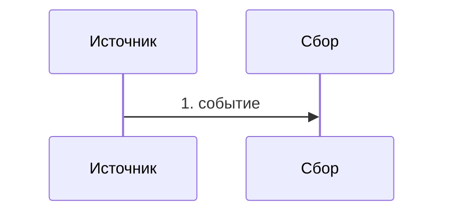
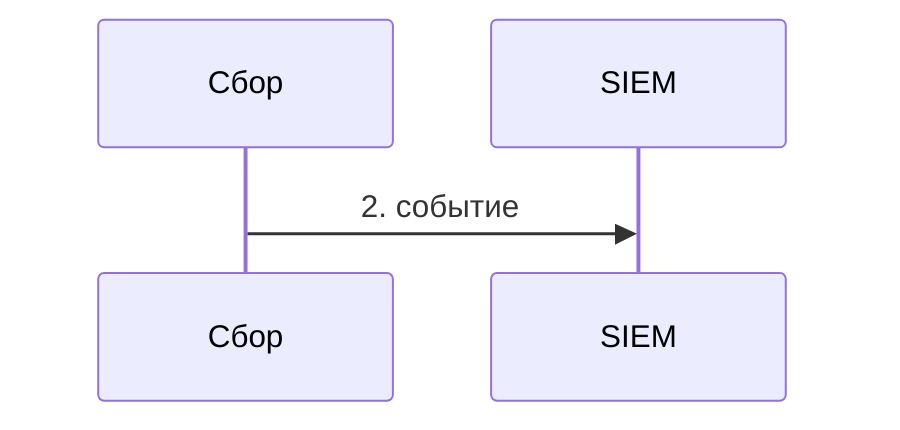
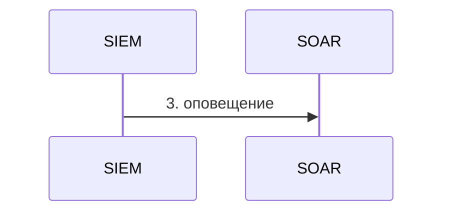
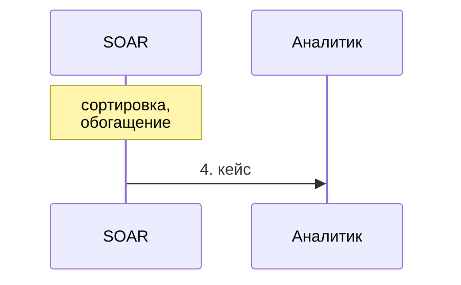
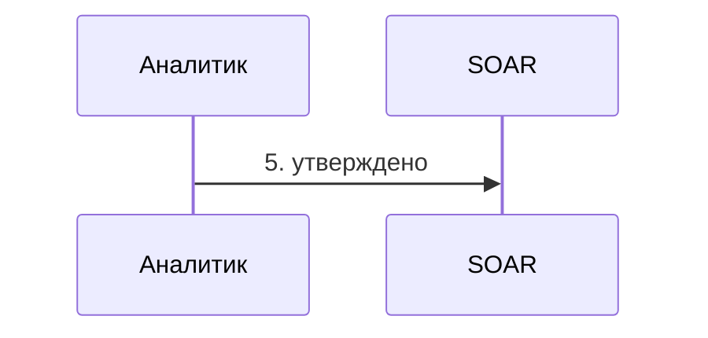
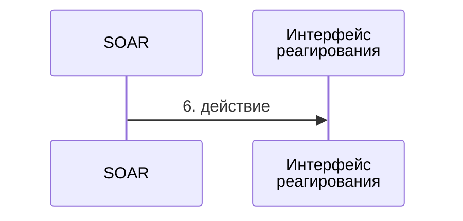
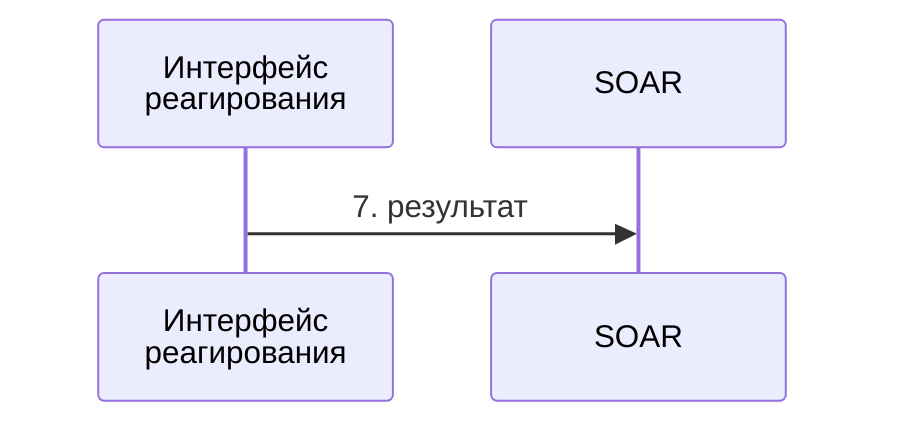
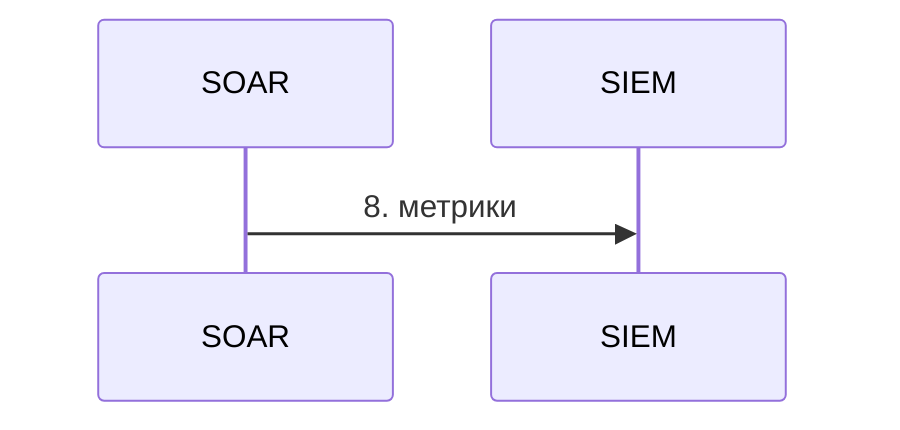
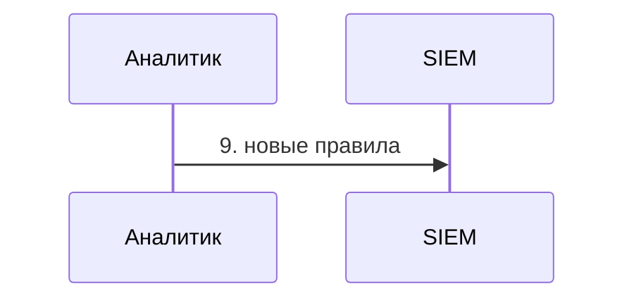

<!-- Собрано автоматически из документов-примеров Spiridus — правки в основном репозитории Spiridus. -->

<!-- раздел: Сети | теги: soc, siem, soar, кибербезопасность, архитектура, мониторинг, реагирование, threat intelligence -->
# Эталонная архитектура центра мониторинга безопасности (SOC)

Вендор-нейтральная эталонная архитектура SOC крупной распределённой организации с локальной,
облачной и гибридной инфраструктурой. Названия продуктов, адреса и детали реализации намеренно
не указаны: схема показывает функциональные зоны, их связи и границы доверия. Сначала — общая
картина, затем каждая зона отдельно, поток событий и матрица эскалации.

## 1. Общая схема

Платформа SOC отделена от систем предприятия, которые она наблюдает и которыми управляет:
между ними — граница доверия, через неё проходят только телеметрия внутрь и согласованные
действия реагирования наружу. Сквозные возможности (доступ, шифрование, журнал аудита,
отказоустойчивость) действуют во всех зонах. Узлы расставлены вручную (ECharts, `layout: none`),
зоны — прямоугольники под ними; наведите мышь на узел — подсказка с названием.

Подписи зон и потоков: Зона предприятия · 1. Источники данных и 7. платформы безопасности (локально, облака, гибрид); граница доверия; Зона SOC: доверенная платформа; Зона предприятия · 9. интеграционный слой и 7. платформы; оповещения; кейс; эскалация; утверждение; новые правила; уроки инцидентов; контекст; действие; 10. Сквозные возможности во всех зонах: RBAC · привилегированный доступ · шифрование · журнал аудита · HA и DR · сроки хранения; телеметрия; оркестрация; утверждение и действие; обратная связь.

```table
| Откуда | Куда | Поток |
|---|---|---|
| Рабочие места и серверы | 2. Сбор и приём: агенты · коллекторы · пересылка журналов · API · поток событий | телеметрия / данные |
| Сеть и МСЭ | 2. Сбор и приём: агенты · коллекторы · пересылка журналов · API · поток событий | телеметрия / данные |
| Учётные записи и доступ | 2. Сбор и приём: агенты · коллекторы · пересылка журналов · API · поток событий | телеметрия / данные |
| Облака и приложения | 2. Сбор и приём: агенты · коллекторы · пересылка журналов · API · поток событий | телеметрия / данные |
| Базы данных и почта | 2. Сбор и приём: агенты · коллекторы · пересылка журналов · API · поток событий | телеметрия / данные |
| EDR / XDR и NDR | 2. Сбор и приём: агенты · коллекторы · пересылка журналов · API · поток событий | телеметрия / данные |
| разбор · нормализация · обогащение · защищённый транспорт | 3. Централизованные журналы | телеметрия / данные |
| 3. Централизованные журналы | Корреляция, правила, поведенческая аналитика | телеметрия / данные |
| Внешняя разведка угроз | 5. Разведка угроз | телеметрия / данные |
| Корреляция, правила, поведенческая аналитика | 4. Сортировка и кейсы | оповещения |
| 4. Сортировка и кейсы | Сценарии реагирования | кейс |
| 4. Сортировка и кейсы | 6. Аналитики линий 1–3 | оркестрация / работа аналитика |
| 6. Аналитики линий 1–3 | Команда реагирования, руководство SOC | эскалация |
| Команда реагирования, руководство SOC | Сценарии реагирования | утверждение |
| 5. Разведка угроз | Инжиниринг детектирования | обратная связь |
| Охота за угрозами | Инжиниринг детектирования | обратная связь |
| Инжиниринг детектирования | Корреляция, правила, поведенческая аналитика | новые правила |
| Корреляция, правила, поведенческая аналитика | 8. Метрики, SLA, отчёты, аудит | обратная связь |
| Команда реагирования, руководство SOC | Охота за угрозами | уроки инцидентов |
| Сценарии реагирования | 9. ITSM и заявки | оркестрация / работа аналитика (двунаправленно) |
| Сценарии реагирования | Каналы оповещения | оркестрация / работа аналитика |
| Сценарии реагирования | Активы, CMDB, IAM / PAM | контекст (двунаправленно) |
| Сценарии реагирования | Разрешённые интерфейсы реагирования | действие |
```

Обзор по участкам; повторённое имя обозначает тот же компонент. Общая таблица выше связывает все участки.

```echarts
{"width":380,"height":760,"animation":false,"tooltip":{"trigger":"item","formatter":"{c}"},"graphic":[{"type":"rect","z":-10,"shape":{"x":20,"y":28.0,"width":294,"height":504.0,"r":6},"style":{"fill":"#f1f5f9","stroke":"#64748b","lineWidth":1}},{"type":"rect","z":-10,"shape":{"x":20,"y":568.0,"width":294,"height":144.0,"r":6},"style":{"fill":"#f8fafc","stroke":"#1e3a8a","lineWidth":3}}],"series":[{"type":"graph","layout":"none","left":0,"top":0,"right":0,"bottom":0,"roam":false,"edgeSymbolSize":8,"data":[{"name":"ep","value":"Рабочие места и серверы","x":175,"y":64.0,"symbol":"roundRect","symbolSize":[260,48],"itemStyle":{"color":"#e0e7ff","borderColor":"#4338ca","borderWidth":1.2},"label":{"show":true,"formatter":"Рабочие места и серверы","fontSize":16,"color":"#111","lineHeight":24}},{"name":"net","value":"Сеть и МСЭ","x":175,"y":172.0,"symbol":"roundRect","symbolSize":[260,48],"itemStyle":{"color":"#e0e7ff","borderColor":"#4338ca","borderWidth":1.2},"label":{"show":true,"formatter":"Сеть и МСЭ","fontSize":16,"color":"#111","lineHeight":24}},{"name":"idm","value":"Учётные записи и доступ","x":175,"y":280.0,"symbol":"roundRect","symbolSize":[260,48],"itemStyle":{"color":"#e0e7ff","borderColor":"#4338ca","borderWidth":1.2},"label":{"show":true,"formatter":"Учётные записи и доступ","fontSize":16,"color":"#111","lineHeight":24}},{"name":"cloud","value":"Облака и приложения","x":175,"y":388.0,"symbol":"roundRect","symbolSize":[260,48],"itemStyle":{"color":"#e0e7ff","borderColor":"#4338ca","borderWidth":1.2},"label":{"show":true,"formatter":"Облака и приложения","fontSize":16,"color":"#111","lineHeight":24}},{"name":"db","value":"Базы данных и почта","x":175,"y":496.0,"symbol":"roundRect","symbolSize":[260,48],"itemStyle":{"color":"#e0e7ff","borderColor":"#4338ca","borderWidth":1.2},"label":{"show":true,"formatter":"Базы данных и почта","fontSize":16,"color":"#111","lineHeight":24}},{"name":"col","value":"2. Сбор и приём: агенты · коллекторы · пересылка журналов · API · поток событий","x":175,"y":640.0,"symbol":"roundRect","symbolSize":[260,120],"itemStyle":{"color":"#dbeafe","borderColor":"#1d4ed8","borderWidth":1.2},"label":{"show":true,"formatter":"2. Сбор и приём: агенты ·\nколлекторы · пересылка\nжурналов · API · поток\nсобытий","fontSize":16,"color":"#111","lineHeight":24}},{"name":"_part0_0","x":306,"y":64.0,"symbolSize":1,"itemStyle":{"opacity":0},"label":{"show":false}},{"name":"_part0_1","x":330,"y":64.0,"symbolSize":1,"itemStyle":{"opacity":0},"label":{"show":false}},{"name":"_part0_2","x":330,"y":640.0,"symbolSize":1,"itemStyle":{"opacity":0},"label":{"show":false}},{"name":"_part0_3","x":306,"y":640.0,"symbolSize":1,"itemStyle":{"opacity":0},"label":{"show":false}},{"name":"_part1_0","x":306,"y":172.0,"symbolSize":1,"itemStyle":{"opacity":0},"label":{"show":false}},{"name":"_part1_1","x":337,"y":172.0,"symbolSize":1,"itemStyle":{"opacity":0},"label":{"show":false}},{"name":"_part1_2","x":337,"y":640.0,"symbolSize":1,"itemStyle":{"opacity":0},"label":{"show":false}},{"name":"_part1_3","x":306,"y":640.0,"symbolSize":1,"itemStyle":{"opacity":0},"label":{"show":false}},{"name":"_part2_0","x":306,"y":280.0,"symbolSize":1,"itemStyle":{"opacity":0},"label":{"show":false}},{"name":"_part2_1","x":344,"y":280.0,"symbolSize":1,"itemStyle":{"opacity":0},"label":{"show":false}},{"name":"_part2_2","x":344,"y":640.0,"symbolSize":1,"itemStyle":{"opacity":0},"label":{"show":false}},{"name":"_part2_3","x":306,"y":640.0,"symbolSize":1,"itemStyle":{"opacity":0},"label":{"show":false}},{"name":"_part3_0","x":306,"y":388.0,"symbolSize":1,"itemStyle":{"opacity":0},"label":{"show":false}},{"name":"_part3_1","x":351,"y":388.0,"symbolSize":1,"itemStyle":{"opacity":0},"label":{"show":false}},{"name":"_part3_2","x":351,"y":640.0,"symbolSize":1,"itemStyle":{"opacity":0},"label":{"show":false}},{"name":"_part3_3","x":306,"y":640.0,"symbolSize":1,"itemStyle":{"opacity":0},"label":{"show":false}},{"name":"_part4_0","x":306,"y":496.0,"symbolSize":1,"itemStyle":{"opacity":0},"label":{"show":false}},{"name":"_part4_1","x":358,"y":496.0,"symbolSize":1,"itemStyle":{"opacity":0},"label":{"show":false}},{"name":"_part4_2","x":358,"y":640.0,"symbolSize":1,"itemStyle":{"opacity":0},"label":{"show":false}},{"name":"_part4_3","x":306,"y":640.0,"symbolSize":1,"itemStyle":{"opacity":0},"label":{"show":false}},{"name":"_origin","x":0,"y":0,"symbolSize":1,"itemStyle":{"opacity":0},"label":{"show":false}},{"name":"_end","x":380,"y":760,"symbolSize":1,"itemStyle":{"opacity":0},"label":{"show":false}}],"links":[{"source":"_part0_0","target":"_part0_1","lineStyle":{"color":"#334155","width":1.6,"type":"solid","curveness":0},"symbol":["none","none"],"symbolSize":8},{"source":"_part0_1","target":"_part0_2","lineStyle":{"color":"#334155","width":1.6,"type":"solid","curveness":0},"symbol":["none","none"],"symbolSize":8},{"source":"_part0_2","target":"_part0_3","lineStyle":{"color":"#334155","width":1.6,"type":"solid","curveness":0},"symbol":["none","arrow"],"symbolSize":8},{"source":"_part1_0","target":"_part1_1","lineStyle":{"color":"#334155","width":1.6,"type":"solid","curveness":0},"symbol":["none","none"],"symbolSize":8},{"source":"_part1_1","target":"_part1_2","lineStyle":{"color":"#334155","width":1.6,"type":"solid","curveness":0},"symbol":["none","none"],"symbolSize":8},{"source":"_part1_2","target":"_part1_3","lineStyle":{"color":"#334155","width":1.6,"type":"solid","curveness":0},"symbol":["none","arrow"],"symbolSize":8},{"source":"_part2_0","target":"_part2_1","lineStyle":{"color":"#334155","width":1.6,"type":"solid","curveness":0},"symbol":["none","none"],"symbolSize":8},{"source":"_part2_1","target":"_part2_2","lineStyle":{"color":"#334155","width":1.6,"type":"solid","curveness":0},"symbol":["none","none"],"symbolSize":8},{"source":"_part2_2","target":"_part2_3","lineStyle":{"color":"#334155","width":1.6,"type":"solid","curveness":0},"symbol":["none","arrow"],"symbolSize":8},{"source":"_part3_0","target":"_part3_1","lineStyle":{"color":"#334155","width":1.6,"type":"solid","curveness":0},"symbol":["none","none"],"symbolSize":8},{"source":"_part3_1","target":"_part3_2","lineStyle":{"color":"#334155","width":1.6,"type":"solid","curveness":0},"symbol":["none","none"],"symbolSize":8},{"source":"_part3_2","target":"_part3_3","lineStyle":{"color":"#334155","width":1.6,"type":"solid","curveness":0},"symbol":["none","arrow"],"symbolSize":8},{"source":"_part4_0","target":"_part4_1","lineStyle":{"color":"#334155","width":1.6,"type":"solid","curveness":0},"symbol":["none","none"],"symbolSize":8},{"source":"_part4_1","target":"_part4_2","lineStyle":{"color":"#334155","width":1.6,"type":"solid","curveness":0},"symbol":["none","none"],"symbolSize":8},{"source":"_part4_2","target":"_part4_3","lineStyle":{"color":"#334155","width":1.6,"type":"solid","curveness":0},"symbol":["none","arrow"],"symbolSize":8}],"emphasis":{"disabled":true},"lineStyle":{"opacity":1}}]}
```

```echarts
{"width":380,"height":724,"animation":false,"tooltip":{"trigger":"item","formatter":"{c}"},"graphic":[{"type":"rect","z":-10,"shape":{"x":20,"y":28.0,"width":294,"height":72.0,"r":6},"style":{"fill":"#f1f5f9","stroke":"#64748b","lineWidth":1}},{"type":"rect","z":-10,"shape":{"x":20,"y":136.0,"width":294,"height":540.0,"r":6},"style":{"fill":"#f8fafc","stroke":"#1e3a8a","lineWidth":3}}],"series":[{"type":"graph","layout":"none","left":0,"top":0,"right":0,"bottom":0,"roam":false,"edgeSymbolSize":8,"data":[{"name":"edr","value":"EDR / XDR и NDR","x":175,"y":64.0,"symbol":"roundRect","symbolSize":[260,48],"itemStyle":{"color":"#dcfce7","borderColor":"#15803d","borderWidth":1.2},"label":{"show":true,"formatter":"EDR / XDR и NDR","fontSize":16,"color":"#111","lineHeight":24}},{"name":"col","value":"2. Сбор и приём: агенты · коллекторы · пересылка журналов · API · поток событий","x":175,"y":208.0,"symbol":"roundRect","symbolSize":[260,120],"itemStyle":{"color":"#dbeafe","borderColor":"#1d4ed8","borderWidth":1.2},"label":{"show":true,"formatter":"2. Сбор и приём: агенты ·\nколлекторы · пересылка\nжурналов · API · поток\nсобытий","fontSize":16,"color":"#111","lineHeight":24}},{"name":"norm","value":"разбор · нормализация · обогащение · защищённый транспорт","x":175,"y":376.0,"symbol":"roundRect","symbolSize":[260,96],"itemStyle":{"color":"#dbeafe","borderColor":"#1d4ed8","borderWidth":1.2},"label":{"show":true,"formatter":"разбор · нормализация ·\nобогащение · защищённый\nтранспорт","fontSize":16,"color":"#111","lineHeight":24}},{"name":"store","value":"3. Централизованные журналы","x":175,"y":508.0,"symbol":"roundRect","symbolSize":[260,48],"itemStyle":{"color":"#dbeafe","borderColor":"#1d4ed8","borderWidth":1.2},"label":{"show":true,"formatter":"3. Централизованные журналы","fontSize":16,"color":"#111","lineHeight":24}},{"name":"corr","value":"Корреляция, правила, поведенческая аналитика","x":175,"y":628.0,"symbol":"roundRect","symbolSize":[260,72],"itemStyle":{"color":"#dbeafe","borderColor":"#1d4ed8","borderWidth":1.2},"label":{"show":true,"formatter":"Корреляция, правила,\nповеденческая аналитика","fontSize":16,"color":"#111","lineHeight":24}},{"name":"_part0_0","x":306,"y":64.0,"symbolSize":1,"itemStyle":{"opacity":0},"label":{"show":false}},{"name":"_part0_1","x":330,"y":64.0,"symbolSize":1,"itemStyle":{"opacity":0},"label":{"show":false}},{"name":"_part0_2","x":330,"y":208.0,"symbolSize":1,"itemStyle":{"opacity":0},"label":{"show":false}},{"name":"_part0_3","x":306,"y":208.0,"symbolSize":1,"itemStyle":{"opacity":0},"label":{"show":false}},{"name":"_part1_0","x":306,"y":376.0,"symbolSize":1,"itemStyle":{"opacity":0},"label":{"show":false}},{"name":"_part1_1","x":337,"y":376.0,"symbolSize":1,"itemStyle":{"opacity":0},"label":{"show":false}},{"name":"_part1_2","x":337,"y":508.0,"symbolSize":1,"itemStyle":{"opacity":0},"label":{"show":false}},{"name":"_part1_3","x":306,"y":508.0,"symbolSize":1,"itemStyle":{"opacity":0},"label":{"show":false}},{"name":"_part2_0","x":306,"y":508.0,"symbolSize":1,"itemStyle":{"opacity":0},"label":{"show":false}},{"name":"_part2_1","x":344,"y":508.0,"symbolSize":1,"itemStyle":{"opacity":0},"label":{"show":false}},{"name":"_part2_2","x":344,"y":628.0,"symbolSize":1,"itemStyle":{"opacity":0},"label":{"show":false}},{"name":"_part2_3","x":306,"y":628.0,"symbolSize":1,"itemStyle":{"opacity":0},"label":{"show":false}},{"name":"_origin","x":0,"y":0,"symbolSize":1,"itemStyle":{"opacity":0},"label":{"show":false}},{"name":"_end","x":380,"y":724,"symbolSize":1,"itemStyle":{"opacity":0},"label":{"show":false}}],"links":[{"source":"_part0_0","target":"_part0_1","lineStyle":{"color":"#334155","width":1.6,"type":"solid","curveness":0},"symbol":["none","none"],"symbolSize":8},{"source":"_part0_1","target":"_part0_2","lineStyle":{"color":"#334155","width":1.6,"type":"solid","curveness":0},"symbol":["none","none"],"symbolSize":8},{"source":"_part0_2","target":"_part0_3","lineStyle":{"color":"#334155","width":1.6,"type":"solid","curveness":0},"symbol":["none","arrow"],"symbolSize":8},{"source":"_part1_0","target":"_part1_1","lineStyle":{"color":"#334155","width":1.6,"type":"solid","curveness":0},"symbol":["none","none"],"symbolSize":8},{"source":"_part1_1","target":"_part1_2","lineStyle":{"color":"#334155","width":1.6,"type":"solid","curveness":0},"symbol":["none","none"],"symbolSize":8},{"source":"_part1_2","target":"_part1_3","lineStyle":{"color":"#334155","width":1.6,"type":"solid","curveness":0},"symbol":["none","arrow"],"symbolSize":8},{"source":"_part2_0","target":"_part2_1","lineStyle":{"color":"#334155","width":1.6,"type":"solid","curveness":0},"symbol":["none","none"],"symbolSize":8},{"source":"_part2_1","target":"_part2_2","lineStyle":{"color":"#334155","width":1.6,"type":"solid","curveness":0},"symbol":["none","none"],"symbolSize":8},{"source":"_part2_2","target":"_part2_3","lineStyle":{"color":"#334155","width":1.6,"type":"solid","curveness":0},"symbol":["none","arrow"],"symbolSize":8}],"emphasis":{"disabled":true},"lineStyle":{"opacity":1}}]}
```

```echarts
{"width":380,"height":712,"animation":false,"tooltip":{"trigger":"item","formatter":"{c}"},"graphic":[{"type":"rect","z":-10,"shape":{"x":20,"y":28.0,"width":294,"height":72.0,"r":6},"style":{"fill":"#f1f5f9","stroke":"#64748b","lineWidth":1}},{"type":"rect","z":-10,"shape":{"x":20,"y":136.0,"width":294,"height":528.0,"r":6},"style":{"fill":"#f8fafc","stroke":"#1e3a8a","lineWidth":3}}],"series":[{"type":"graph","layout":"none","left":0,"top":0,"right":0,"bottom":0,"roam":false,"edgeSymbolSize":8,"data":[{"name":"xti","value":"Внешняя разведка угроз","x":175,"y":64.0,"symbol":"roundRect","symbolSize":[260,48],"itemStyle":{"color":"#ede9fe","borderColor":"#6d28d9","borderWidth":1.2},"label":{"show":true,"formatter":"Внешняя разведка угроз","fontSize":16,"color":"#111","lineHeight":24}},{"name":"corr","value":"Корреляция, правила, поведенческая аналитика","x":175,"y":184.0,"symbol":"roundRect","symbolSize":[260,72],"itemStyle":{"color":"#dbeafe","borderColor":"#1d4ed8","borderWidth":1.2},"label":{"show":true,"formatter":"Корреляция, правила,\nповеденческая аналитика","fontSize":16,"color":"#111","lineHeight":24}},{"name":"ti","value":"5. Разведка угроз","x":175,"y":304.0,"symbol":"roundRect","symbolSize":[260,48],"itemStyle":{"color":"#ede9fe","borderColor":"#6d28d9","borderWidth":1.2},"label":{"show":true,"formatter":"5. Разведка угроз","fontSize":16,"color":"#111","lineHeight":24}},{"name":"triage","value":"4. Сортировка и кейсы","x":175,"y":412.0,"symbol":"roundRect","symbolSize":[260,48],"itemStyle":{"color":"#fee2e2","borderColor":"#b91c1c","borderWidth":1.2},"label":{"show":true,"formatter":"4. Сортировка и кейсы","fontSize":16,"color":"#111","lineHeight":24}},{"name":"tiers","value":"6. Аналитики линий 1–3","x":175,"y":520.0,"symbol":"roundRect","symbolSize":[260,48],"itemStyle":{"color":"#fef9c3","borderColor":"#a16207","borderWidth":1.2},"label":{"show":true,"formatter":"6. Аналитики линий 1–3","fontSize":16,"color":"#111","lineHeight":24}},{"name":"pb","value":"Сценарии реагирования","x":175,"y":628.0,"symbol":"roundRect","symbolSize":[260,48],"itemStyle":{"color":"#fee2e2","borderColor":"#b91c1c","borderWidth":1.2},"label":{"show":true,"formatter":"Сценарии реагирования","fontSize":16,"color":"#111","lineHeight":24}},{"name":"_part0_0","x":306,"y":64.0,"symbolSize":1,"itemStyle":{"opacity":0},"label":{"show":false}},{"name":"_part0_1","x":330,"y":64.0,"symbolSize":1,"itemStyle":{"opacity":0},"label":{"show":false}},{"name":"_part0_2","x":330,"y":304.0,"symbolSize":1,"itemStyle":{"opacity":0},"label":{"show":false}},{"name":"_part0_3","x":306,"y":304.0,"symbolSize":1,"itemStyle":{"opacity":0},"label":{"show":false}},{"name":"_part1_0","x":306,"y":184.0,"symbolSize":1,"itemStyle":{"opacity":0},"label":{"show":false}},{"name":"_part1_1","x":337,"y":184.0,"symbolSize":1,"itemStyle":{"opacity":0},"label":{"show":false}},{"name":"_part1_2","x":337,"y":412.0,"symbolSize":1,"itemStyle":{"opacity":0},"label":{"show":false}},{"name":"_part1_3","x":306,"y":412.0,"symbolSize":1,"itemStyle":{"opacity":0},"label":{"show":false}},{"name":"_part2_0","x":306,"y":412.0,"symbolSize":1,"itemStyle":{"opacity":0},"label":{"show":false}},{"name":"_part2_1","x":344,"y":412.0,"symbolSize":1,"itemStyle":{"opacity":0},"label":{"show":false}},{"name":"_part2_2","x":344,"y":628.0,"symbolSize":1,"itemStyle":{"opacity":0},"label":{"show":false}},{"name":"_part2_3","x":306,"y":628.0,"symbolSize":1,"itemStyle":{"opacity":0},"label":{"show":false}},{"name":"_part3_0","x":306,"y":412.0,"symbolSize":1,"itemStyle":{"opacity":0},"label":{"show":false}},{"name":"_part3_1","x":351,"y":412.0,"symbolSize":1,"itemStyle":{"opacity":0},"label":{"show":false}},{"name":"_part3_2","x":351,"y":520.0,"symbolSize":1,"itemStyle":{"opacity":0},"label":{"show":false}},{"name":"_part3_3","x":306,"y":520.0,"symbolSize":1,"itemStyle":{"opacity":0},"label":{"show":false}},{"name":"_origin","x":0,"y":0,"symbolSize":1,"itemStyle":{"opacity":0},"label":{"show":false}},{"name":"_end","x":380,"y":712,"symbolSize":1,"itemStyle":{"opacity":0},"label":{"show":false}}],"links":[{"source":"_part0_0","target":"_part0_1","lineStyle":{"color":"#334155","width":1.6,"type":"solid","curveness":0},"symbol":["none","none"],"symbolSize":8},{"source":"_part0_1","target":"_part0_2","lineStyle":{"color":"#334155","width":1.6,"type":"solid","curveness":0},"symbol":["none","none"],"symbolSize":8},{"source":"_part0_2","target":"_part0_3","lineStyle":{"color":"#334155","width":1.6,"type":"solid","curveness":0},"symbol":["none","arrow"],"symbolSize":8},{"source":"_part1_0","target":"_part1_1","lineStyle":{"color":"#b91c1c","width":2.4,"type":"solid","curveness":0},"symbol":["none","none"],"symbolSize":8},{"source":"_part1_1","target":"_part1_2","lineStyle":{"color":"#b91c1c","width":2.4,"type":"solid","curveness":0},"symbol":["none","none"],"symbolSize":8},{"source":"_part1_2","target":"_part1_3","lineStyle":{"color":"#b91c1c","width":2.4,"type":"solid","curveness":0},"symbol":["none","arrow"],"symbolSize":8},{"source":"_part2_0","target":"_part2_1","lineStyle":{"color":"#1d4ed8","width":1.6,"type":"dashed","curveness":0},"symbol":["none","none"],"symbolSize":8},{"source":"_part2_1","target":"_part2_2","lineStyle":{"color":"#1d4ed8","width":1.6,"type":"dashed","curveness":0},"symbol":["none","none"],"symbolSize":8},{"source":"_part2_2","target":"_part2_3","lineStyle":{"color":"#1d4ed8","width":1.6,"type":"dashed","curveness":0},"symbol":["none","arrow"],"symbolSize":8},{"source":"_part3_0","target":"_part3_1","lineStyle":{"color":"#1d4ed8","width":1.6,"type":"dashed","curveness":0},"symbol":["none","none"],"symbolSize":8},{"source":"_part3_1","target":"_part3_2","lineStyle":{"color":"#1d4ed8","width":1.6,"type":"dashed","curveness":0},"symbol":["none","none"],"symbolSize":8},{"source":"_part3_2","target":"_part3_3","lineStyle":{"color":"#1d4ed8","width":1.6,"type":"dashed","curveness":0},"symbol":["none","arrow"],"symbolSize":8}],"emphasis":{"disabled":true},"lineStyle":{"opacity":1}}]}
```

```echarts
{"width":380,"height":712,"animation":false,"tooltip":{"trigger":"item","formatter":"{c}"},"graphic":[{"type":"rect","z":-10,"shape":{"x":20,"y":28.0,"width":294,"height":636.0,"r":6},"style":{"fill":"#f8fafc","stroke":"#1e3a8a","lineWidth":3}}],"series":[{"type":"graph","layout":"none","left":0,"top":0,"right":0,"bottom":0,"roam":false,"edgeSymbolSize":8,"data":[{"name":"ti","value":"5. Разведка угроз","x":175,"y":64.0,"symbol":"roundRect","symbolSize":[260,48],"itemStyle":{"color":"#ede9fe","borderColor":"#6d28d9","borderWidth":1.2},"label":{"show":true,"formatter":"5. Разведка угроз","fontSize":16,"color":"#111","lineHeight":24}},{"name":"rules","value":"Инжиниринг детектирования","x":175,"y":172.0,"symbol":"roundRect","symbolSize":[260,48],"itemStyle":{"color":"#ede9fe","borderColor":"#6d28d9","borderWidth":1.2},"label":{"show":true,"formatter":"Инжиниринг детектирования","fontSize":16,"color":"#111","lineHeight":24}},{"name":"tiers","value":"6. Аналитики линий 1–3","x":175,"y":280.0,"symbol":"roundRect","symbolSize":[260,48],"itemStyle":{"color":"#fef9c3","borderColor":"#a16207","borderWidth":1.2},"label":{"show":true,"formatter":"6. Аналитики линий 1–3","fontSize":16,"color":"#111","lineHeight":24}},{"name":"pb","value":"Сценарии реагирования","x":175,"y":388.0,"symbol":"roundRect","symbolSize":[260,48],"itemStyle":{"color":"#fee2e2","borderColor":"#b91c1c","borderWidth":1.2},"label":{"show":true,"formatter":"Сценарии реагирования","fontSize":16,"color":"#111","lineHeight":24}},{"name":"hunt","value":"Охота за угрозами","x":175,"y":496.0,"symbol":"roundRect","symbolSize":[260,48],"itemStyle":{"color":"#ede9fe","borderColor":"#6d28d9","borderWidth":1.2},"label":{"show":true,"formatter":"Охота за угрозами","fontSize":16,"color":"#111","lineHeight":24}},{"name":"ir","value":"Команда реагирования, руководство SOC","x":175,"y":616.0,"symbol":"roundRect","symbolSize":[260,72],"itemStyle":{"color":"#fef9c3","borderColor":"#a16207","borderWidth":1.2},"label":{"show":true,"formatter":"Команда реагирования,\nруководство SOC","fontSize":16,"color":"#111","lineHeight":24}},{"name":"_part0_0","x":306,"y":280.0,"symbolSize":1,"itemStyle":{"opacity":0},"label":{"show":false}},{"name":"_part0_1","x":330,"y":280.0,"symbolSize":1,"itemStyle":{"opacity":0},"label":{"show":false}},{"name":"_part0_2","x":330,"y":616.0,"symbolSize":1,"itemStyle":{"opacity":0},"label":{"show":false}},{"name":"_part0_3","x":306,"y":616.0,"symbolSize":1,"itemStyle":{"opacity":0},"label":{"show":false}},{"name":"_part1_0","x":306,"y":616.0,"symbolSize":1,"itemStyle":{"opacity":0},"label":{"show":false}},{"name":"_part1_1","x":337,"y":616.0,"symbolSize":1,"itemStyle":{"opacity":0},"label":{"show":false}},{"name":"_part1_2","x":337,"y":388.0,"symbolSize":1,"itemStyle":{"opacity":0},"label":{"show":false}},{"name":"_part1_3","x":306,"y":388.0,"symbolSize":1,"itemStyle":{"opacity":0},"label":{"show":false}},{"name":"_part2_0","x":306,"y":64.0,"symbolSize":1,"itemStyle":{"opacity":0},"label":{"show":false}},{"name":"_part2_1","x":344,"y":64.0,"symbolSize":1,"itemStyle":{"opacity":0},"label":{"show":false}},{"name":"_part2_2","x":344,"y":172.0,"symbolSize":1,"itemStyle":{"opacity":0},"label":{"show":false}},{"name":"_part2_3","x":306,"y":172.0,"symbolSize":1,"itemStyle":{"opacity":0},"label":{"show":false}},{"name":"_part3_0","x":306,"y":496.0,"symbolSize":1,"itemStyle":{"opacity":0},"label":{"show":false}},{"name":"_part3_1","x":351,"y":496.0,"symbolSize":1,"itemStyle":{"opacity":0},"label":{"show":false}},{"name":"_part3_2","x":351,"y":172.0,"symbolSize":1,"itemStyle":{"opacity":0},"label":{"show":false}},{"name":"_part3_3","x":306,"y":172.0,"symbolSize":1,"itemStyle":{"opacity":0},"label":{"show":false}},{"name":"_origin","x":0,"y":0,"symbolSize":1,"itemStyle":{"opacity":0},"label":{"show":false}},{"name":"_end","x":380,"y":712,"symbolSize":1,"itemStyle":{"opacity":0},"label":{"show":false}}],"links":[{"source":"_part0_0","target":"_part0_1","lineStyle":{"color":"#1d4ed8","width":1.6,"type":"dashed","curveness":0},"symbol":["none","none"],"symbolSize":8},{"source":"_part0_1","target":"_part0_2","lineStyle":{"color":"#1d4ed8","width":1.6,"type":"dashed","curveness":0},"symbol":["none","none"],"symbolSize":8},{"source":"_part0_2","target":"_part0_3","lineStyle":{"color":"#1d4ed8","width":1.6,"type":"dashed","curveness":0},"symbol":["none","arrow"],"symbolSize":8},{"source":"_part1_0","target":"_part1_1","lineStyle":{"color":"#6d28d9","width":3.2,"type":"solid","curveness":0},"symbol":["none","none"],"symbolSize":8},{"source":"_part1_1","target":"_part1_2","lineStyle":{"color":"#6d28d9","width":3.2,"type":"solid","curveness":0},"symbol":["none","none"],"symbolSize":8},{"source":"_part1_2","target":"_part1_3","lineStyle":{"color":"#6d28d9","width":3.2,"type":"solid","curveness":0},"symbol":["none","arrow"],"symbolSize":8},{"source":"_part2_0","target":"_part2_1","lineStyle":{"color":"#15803d","width":1.6,"type":"dotted","curveness":0},"symbol":["none","none"],"symbolSize":8},{"source":"_part2_1","target":"_part2_2","lineStyle":{"color":"#15803d","width":1.6,"type":"dotted","curveness":0},"symbol":["none","none"],"symbolSize":8},{"source":"_part2_2","target":"_part2_3","lineStyle":{"color":"#15803d","width":1.6,"type":"dotted","curveness":0},"symbol":["none","arrow"],"symbolSize":8},{"source":"_part3_0","target":"_part3_1","lineStyle":{"color":"#15803d","width":1.6,"type":"dotted","curveness":0},"symbol":["none","none"],"symbolSize":8},{"source":"_part3_1","target":"_part3_2","lineStyle":{"color":"#15803d","width":1.6,"type":"dotted","curveness":0},"symbol":["none","none"],"symbolSize":8},{"source":"_part3_2","target":"_part3_3","lineStyle":{"color":"#15803d","width":1.6,"type":"dotted","curveness":0},"symbol":["none","arrow"],"symbolSize":8}],"emphasis":{"disabled":true},"lineStyle":{"opacity":1}}]}
```

```echarts
{"width":380,"height":652,"animation":false,"tooltip":{"trigger":"item","formatter":"{c}"},"graphic":[{"type":"rect","z":-10,"shape":{"x":20,"y":28.0,"width":294,"height":576.0,"r":6},"style":{"fill":"#f8fafc","stroke":"#1e3a8a","lineWidth":3}}],"series":[{"type":"graph","layout":"none","left":0,"top":0,"right":0,"bottom":0,"roam":false,"edgeSymbolSize":8,"data":[{"name":"corr","value":"Корреляция, правила, поведенческая аналитика","x":175,"y":76.0,"symbol":"roundRect","symbolSize":[260,72],"itemStyle":{"color":"#dbeafe","borderColor":"#1d4ed8","borderWidth":1.2},"label":{"show":true,"formatter":"Корреляция, правила,\nповеденческая аналитика","fontSize":16,"color":"#111","lineHeight":24}},{"name":"gov","value":"8. Метрики, SLA, отчёты, аудит","x":175,"y":208.0,"symbol":"roundRect","symbolSize":[260,72],"itemStyle":{"color":"#dcfce7","borderColor":"#15803d","borderWidth":1.2},"label":{"show":true,"formatter":"8. Метрики, SLA, отчёты,\nаудит","fontSize":16,"color":"#111","lineHeight":24}},{"name":"rules","value":"Инжиниринг детектирования","x":175,"y":328.0,"symbol":"roundRect","symbolSize":[260,48],"itemStyle":{"color":"#ede9fe","borderColor":"#6d28d9","borderWidth":1.2},"label":{"show":true,"formatter":"Инжиниринг детектирования","fontSize":16,"color":"#111","lineHeight":24}},{"name":"hunt","value":"Охота за угрозами","x":175,"y":436.0,"symbol":"roundRect","symbolSize":[260,48],"itemStyle":{"color":"#ede9fe","borderColor":"#6d28d9","borderWidth":1.2},"label":{"show":true,"formatter":"Охота за угрозами","fontSize":16,"color":"#111","lineHeight":24}},{"name":"ir","value":"Команда реагирования, руководство SOC","x":175,"y":556.0,"symbol":"roundRect","symbolSize":[260,72],"itemStyle":{"color":"#fef9c3","borderColor":"#a16207","borderWidth":1.2},"label":{"show":true,"formatter":"Команда реагирования,\nруководство SOC","fontSize":16,"color":"#111","lineHeight":24}},{"name":"_part0_0","x":306,"y":328.0,"symbolSize":1,"itemStyle":{"opacity":0},"label":{"show":false}},{"name":"_part0_1","x":330,"y":328.0,"symbolSize":1,"itemStyle":{"opacity":0},"label":{"show":false}},{"name":"_part0_2","x":330,"y":76.0,"symbolSize":1,"itemStyle":{"opacity":0},"label":{"show":false}},{"name":"_part0_3","x":306,"y":76.0,"symbolSize":1,"itemStyle":{"opacity":0},"label":{"show":false}},{"name":"_part1_0","x":306,"y":76.0,"symbolSize":1,"itemStyle":{"opacity":0},"label":{"show":false}},{"name":"_part1_1","x":337,"y":76.0,"symbolSize":1,"itemStyle":{"opacity":0},"label":{"show":false}},{"name":"_part1_2","x":337,"y":208.0,"symbolSize":1,"itemStyle":{"opacity":0},"label":{"show":false}},{"name":"_part1_3","x":306,"y":208.0,"symbolSize":1,"itemStyle":{"opacity":0},"label":{"show":false}},{"name":"_part2_0","x":306,"y":556.0,"symbolSize":1,"itemStyle":{"opacity":0},"label":{"show":false}},{"name":"_part2_1","x":344,"y":556.0,"symbolSize":1,"itemStyle":{"opacity":0},"label":{"show":false}},{"name":"_part2_2","x":344,"y":436.0,"symbolSize":1,"itemStyle":{"opacity":0},"label":{"show":false}},{"name":"_part2_3","x":306,"y":436.0,"symbolSize":1,"itemStyle":{"opacity":0},"label":{"show":false}},{"name":"_origin","x":0,"y":0,"symbolSize":1,"itemStyle":{"opacity":0},"label":{"show":false}},{"name":"_end","x":380,"y":652,"symbolSize":1,"itemStyle":{"opacity":0},"label":{"show":false}}],"links":[{"source":"_part0_0","target":"_part0_1","lineStyle":{"color":"#15803d","width":1.6,"type":"dotted","curveness":0},"symbol":["none","none"],"symbolSize":8},{"source":"_part0_1","target":"_part0_2","lineStyle":{"color":"#15803d","width":1.6,"type":"dotted","curveness":0},"symbol":["none","none"],"symbolSize":8},{"source":"_part0_2","target":"_part0_3","lineStyle":{"color":"#15803d","width":1.6,"type":"dotted","curveness":0},"symbol":["none","arrow"],"symbolSize":8},{"source":"_part1_0","target":"_part1_1","lineStyle":{"color":"#15803d","width":1.6,"type":"dotted","curveness":0},"symbol":["none","none"],"symbolSize":8},{"source":"_part1_1","target":"_part1_2","lineStyle":{"color":"#15803d","width":1.6,"type":"dotted","curveness":0},"symbol":["none","none"],"symbolSize":8},{"source":"_part1_2","target":"_part1_3","lineStyle":{"color":"#15803d","width":1.6,"type":"dotted","curveness":0},"symbol":["none","arrow"],"symbolSize":8},{"source":"_part2_0","target":"_part2_1","lineStyle":{"color":"#15803d","width":1.6,"type":"dotted","curveness":0},"symbol":["none","none"],"symbolSize":8},{"source":"_part2_1","target":"_part2_2","lineStyle":{"color":"#15803d","width":1.6,"type":"dotted","curveness":0},"symbol":["none","none"],"symbolSize":8},{"source":"_part2_2","target":"_part2_3","lineStyle":{"color":"#15803d","width":1.6,"type":"dotted","curveness":0},"symbol":["none","arrow"],"symbolSize":8}],"emphasis":{"disabled":true},"lineStyle":{"opacity":1}}]}
```

```echarts
{"width":380,"height":604,"animation":false,"tooltip":{"trigger":"item","formatter":"{c}"},"graphic":[{"type":"rect","z":-10,"shape":{"x":20,"y":28.0,"width":294,"height":72.0,"r":6},"style":{"fill":"#f8fafc","stroke":"#1e3a8a","lineWidth":3}},{"type":"rect","z":-10,"shape":{"x":20,"y":136.0,"width":294,"height":420.0,"r":6},"style":{"fill":"#f1f5f9","stroke":"#64748b","lineWidth":1}}],"series":[{"type":"graph","layout":"none","left":0,"top":0,"right":0,"bottom":0,"roam":false,"edgeSymbolSize":8,"data":[{"name":"pb","value":"Сценарии реагирования","x":175,"y":64.0,"symbol":"roundRect","symbolSize":[260,48],"itemStyle":{"color":"#fee2e2","borderColor":"#b91c1c","borderWidth":1.2},"label":{"show":true,"formatter":"Сценарии реагирования","fontSize":16,"color":"#111","lineHeight":24}},{"name":"itsm","value":"9. ITSM и заявки","x":175,"y":172.0,"symbol":"roundRect","symbolSize":[260,48],"itemStyle":{"color":"#ffedd5","borderColor":"#c2410c","borderWidth":1.2},"label":{"show":true,"formatter":"9. ITSM и заявки","fontSize":16,"color":"#111","lineHeight":24}},{"name":"notify","value":"Каналы оповещения","x":175,"y":280.0,"symbol":"roundRect","symbolSize":[260,48],"itemStyle":{"color":"#ffedd5","borderColor":"#c2410c","borderWidth":1.2},"label":{"show":true,"formatter":"Каналы оповещения","fontSize":16,"color":"#111","lineHeight":24}},{"name":"cmdb","value":"Активы, CMDB, IAM / PAM","x":175,"y":388.0,"symbol":"roundRect","symbolSize":[260,48],"itemStyle":{"color":"#dcfce7","borderColor":"#15803d","borderWidth":1.2},"label":{"show":true,"formatter":"Активы, CMDB, IAM / PAM","fontSize":16,"color":"#111","lineHeight":24}},{"name":"resp","value":"Разрешённые интерфейсы реагирования","x":175,"y":508.0,"symbol":"roundRect","symbolSize":[260,72],"itemStyle":{"color":"#ede9fe","borderColor":"#6d28d9","borderWidth":1.2},"label":{"show":true,"formatter":"Разрешённые интерфейсы\nреагирования","fontSize":16,"color":"#111","lineHeight":24}},{"name":"_part0_0","x":306,"y":64.0,"symbolSize":1,"itemStyle":{"opacity":0},"label":{"show":false}},{"name":"_part0_1","x":330,"y":64.0,"symbolSize":1,"itemStyle":{"opacity":0},"label":{"show":false}},{"name":"_part0_2","x":330,"y":172.0,"symbolSize":1,"itemStyle":{"opacity":0},"label":{"show":false}},{"name":"_part0_3","x":306,"y":172.0,"symbolSize":1,"itemStyle":{"opacity":0},"label":{"show":false}},{"name":"_part1_0","x":306,"y":64.0,"symbolSize":1,"itemStyle":{"opacity":0},"label":{"show":false}},{"name":"_part1_1","x":337,"y":64.0,"symbolSize":1,"itemStyle":{"opacity":0},"label":{"show":false}},{"name":"_part1_2","x":337,"y":280.0,"symbolSize":1,"itemStyle":{"opacity":0},"label":{"show":false}},{"name":"_part1_3","x":306,"y":280.0,"symbolSize":1,"itemStyle":{"opacity":0},"label":{"show":false}},{"name":"_part2_0","x":306,"y":64.0,"symbolSize":1,"itemStyle":{"opacity":0},"label":{"show":false}},{"name":"_part2_1","x":344,"y":64.0,"symbolSize":1,"itemStyle":{"opacity":0},"label":{"show":false}},{"name":"_part2_2","x":344,"y":388.0,"symbolSize":1,"itemStyle":{"opacity":0},"label":{"show":false}},{"name":"_part2_3","x":306,"y":388.0,"symbolSize":1,"itemStyle":{"opacity":0},"label":{"show":false}},{"name":"_part3_0","x":306,"y":64.0,"symbolSize":1,"itemStyle":{"opacity":0},"label":{"show":false}},{"name":"_part3_1","x":351,"y":64.0,"symbolSize":1,"itemStyle":{"opacity":0},"label":{"show":false}},{"name":"_part3_2","x":351,"y":508.0,"symbolSize":1,"itemStyle":{"opacity":0},"label":{"show":false}},{"name":"_part3_3","x":306,"y":508.0,"symbolSize":1,"itemStyle":{"opacity":0},"label":{"show":false}},{"name":"_origin","x":0,"y":0,"symbolSize":1,"itemStyle":{"opacity":0},"label":{"show":false}},{"name":"_end","x":380,"y":604,"symbolSize":1,"itemStyle":{"opacity":0},"label":{"show":false}}],"links":[{"source":"_part0_0","target":"_part0_1","lineStyle":{"color":"#1d4ed8","width":1.6,"type":"dashed","curveness":0},"symbol":["arrow","none"],"symbolSize":8},{"source":"_part0_1","target":"_part0_2","lineStyle":{"color":"#1d4ed8","width":1.6,"type":"dashed","curveness":0},"symbol":["none","none"],"symbolSize":8},{"source":"_part0_2","target":"_part0_3","lineStyle":{"color":"#1d4ed8","width":1.6,"type":"dashed","curveness":0},"symbol":["none","arrow"],"symbolSize":8},{"source":"_part1_0","target":"_part1_1","lineStyle":{"color":"#1d4ed8","width":1.6,"type":"dashed","curveness":0},"symbol":["none","none"],"symbolSize":8},{"source":"_part1_1","target":"_part1_2","lineStyle":{"color":"#1d4ed8","width":1.6,"type":"dashed","curveness":0},"symbol":["none","none"],"symbolSize":8},{"source":"_part1_2","target":"_part1_3","lineStyle":{"color":"#1d4ed8","width":1.6,"type":"dashed","curveness":0},"symbol":["none","arrow"],"symbolSize":8},{"source":"_part2_0","target":"_part2_1","lineStyle":{"color":"#1d4ed8","width":1.6,"type":"dashed","curveness":0},"symbol":["arrow","none"],"symbolSize":8},{"source":"_part2_1","target":"_part2_2","lineStyle":{"color":"#1d4ed8","width":1.6,"type":"dashed","curveness":0},"symbol":["none","none"],"symbolSize":8},{"source":"_part2_2","target":"_part2_3","lineStyle":{"color":"#1d4ed8","width":1.6,"type":"dashed","curveness":0},"symbol":["none","arrow"],"symbolSize":8},{"source":"_part3_0","target":"_part3_1","lineStyle":{"color":"#6d28d9","width":3.2,"type":"solid","curveness":0},"symbol":["none","none"],"symbolSize":8},{"source":"_part3_1","target":"_part3_2","lineStyle":{"color":"#6d28d9","width":3.2,"type":"solid","curveness":0},"symbol":["none","none"],"symbolSize":8},{"source":"_part3_2","target":"_part3_3","lineStyle":{"color":"#6d28d9","width":3.2,"type":"solid","curveness":0},"symbol":["none","arrow"],"symbolSize":8}],"emphasis":{"disabled":true},"lineStyle":{"opacity":1}}]}
```

```echarts
{"width":380,"height":172,"animation":false,"tooltip":{"trigger":"item","formatter":"{c}"},"graphic":[{"type":"rect","z":-10,"shape":{"x":20,"y":28.0,"width":294,"height":96.0,"r":6},"style":{"fill":"#f1f5f9","stroke":"#64748b","lineWidth":1}}],"series":[{"type":"graph","layout":"none","left":0,"top":0,"right":0,"bottom":0,"roam":false,"edgeSymbolSize":8,"data":[{"name":"vuln","value":"Уязвимости и поверхность атаки","x":175,"y":76.0,"symbol":"roundRect","symbolSize":[260,72],"itemStyle":{"color":"#dcfce7","borderColor":"#15803d","borderWidth":1.2},"label":{"show":true,"formatter":"Уязвимости и поверхность\nатаки","fontSize":16,"color":"#111","lineHeight":24}},{"name":"_origin","x":0,"y":0,"symbolSize":1,"itemStyle":{"opacity":0},"label":{"show":false}},{"name":"_end","x":380,"y":172,"symbolSize":1,"itemStyle":{"opacity":0},"label":{"show":false}}],"links":[],"emphasis":{"disabled":true},"lineStyle":{"opacity":1}}]}
```

**Легенда стрелок**

| Стиль | Что означает |
|---|---|
| сплошная серая | поток телеметрии и событий |
| сплошная красная | оповещения (alert) |
| синий пунктир | оркестрация и интеграция, двунаправленная — с двумя наконечниками |
| толстая фиолетовая | утверждение аналитиком и действие реагирования |
| зелёный пунктир | обратная связь: новые правила, уроки инцидентов, метрики |
| толстая синяя рамка | граница доверия платформы SOC |

## 2. Зоны по отдельности

### Источники данных и сбор

Источники — всё, что даёт телеметрию: рабочие места и серверы, сеть и межсетевые экраны,
управление идентификацией, облака, бизнес-приложения, базы данных, почта, а также внешняя
разведка угроз. Слой сбора доставляет данные в SIEM по защищённому каналу и приводит их к
единому виду.

Подписи зон и потоков: 1. Источники; 2. Сбор и приём; TLS, очередь с подтверждением.

```table
| Откуда | Куда | Поток |
|---|---|---|
| Рабочие места | Агенты | телеметрия / данные |
| Серверы | Агенты | телеметрия / данные |
| Сеть и МСЭ | Пересылка журналов | телеметрия / данные |
| Облака и SaaS | API и поток событий | телеметрия / данные |
| Агенты | Разбор, нормализация, обогащение | телеметрия / данные |
| Пересылка журналов | Разбор, нормализация, обогащение | телеметрия / данные |
| API и поток событий | Разбор, нормализация, обогащение | телеметрия / данные |
| Разбор, нормализация, обогащение | SIEM | TLS, очередь с подтверждением |
```

```echarts
{"width":380,"height":1291,"animation":false,"tooltip":{"trigger":"item","formatter":"{c}"},"graphic":[{"type":"rect","z":-10,"shape":{"x":20,"y":52.0,"width":294,"height":483.0,"r":6},"style":{"fill":"#f1f5f9","stroke":"#64748b","lineWidth":1}},{"type":"rect","z":-10,"shape":{"x":20,"y":584.0,"width":294,"height":507.0,"r":6},"style":{"fill":"#f8fafc","stroke":"#1d4ed8","lineWidth":2}}],"series":[{"type":"graph","layout":"none","left":0,"top":0,"right":0,"bottom":0,"roam":false,"edgeSymbolSize":8,"data":[{"name":"ep","value":"Рабочие места","x":175,"y":94.0,"symbol":"roundRect","symbolSize":[260,48],"itemStyle":{"color":"#e0e7ff","borderColor":"#4338ca","borderWidth":1.2},"label":{"show":true,"formatter":"Рабочие места","fontSize":16,"color":"#111","lineHeight":24}},{"name":"srv","value":"Серверы","x":175,"y":227.0,"symbol":"roundRect","symbolSize":[260,48],"itemStyle":{"color":"#e0e7ff","borderColor":"#4338ca","borderWidth":1.2},"label":{"show":true,"formatter":"Серверы","fontSize":16,"color":"#111","lineHeight":24}},{"name":"fw","value":"Сеть и МСЭ","x":175,"y":360.0,"symbol":"roundRect","symbolSize":[260,48],"itemStyle":{"color":"#e0e7ff","borderColor":"#4338ca","borderWidth":1.2},"label":{"show":true,"formatter":"Сеть и МСЭ","fontSize":16,"color":"#111","lineHeight":24}},{"name":"cloud","value":"Облака и SaaS","x":175,"y":493.0,"symbol":"roundRect","symbolSize":[260,48],"itemStyle":{"color":"#e0e7ff","borderColor":"#4338ca","borderWidth":1.2},"label":{"show":true,"formatter":"Облака и SaaS","fontSize":16,"color":"#111","lineHeight":24}},{"name":"agent","value":"Агенты","x":175,"y":626.0,"symbol":"roundRect","symbolSize":[260,48],"itemStyle":{"color":"#dbeafe","borderColor":"#1d4ed8","borderWidth":1.2},"label":{"show":true,"formatter":"Агенты","fontSize":16,"color":"#111","lineHeight":24}},{"name":"fwd","value":"Пересылка журналов","x":175,"y":759.0,"symbol":"roundRect","symbolSize":[260,48],"itemStyle":{"color":"#dbeafe","borderColor":"#1d4ed8","borderWidth":1.2},"label":{"show":true,"formatter":"Пересылка журналов","fontSize":16,"color":"#111","lineHeight":24}},{"name":"api","value":"API и поток событий","x":175,"y":892.0,"symbol":"roundRect","symbolSize":[260,48],"itemStyle":{"color":"#dbeafe","borderColor":"#1d4ed8","borderWidth":1.2},"label":{"show":true,"formatter":"API и поток событий","fontSize":16,"color":"#111","lineHeight":24}},{"name":"pipe","value":"Разбор, нормализация, обогащение","x":175,"y":1037.0,"symbol":"roundRect","symbolSize":[260,72],"itemStyle":{"color":"#dbeafe","borderColor":"#1d4ed8","borderWidth":1.2},"label":{"show":true,"formatter":"Разбор, нормализация,\nобогащение","fontSize":16,"color":"#111","lineHeight":24}},{"name":"siem","value":"SIEM","x":175,"y":1182.0,"symbol":"roundRect","symbolSize":[260,48],"itemStyle":{"color":"#dbeafe","borderColor":"#1d4ed8","borderWidth":1.2},"label":{"show":true,"formatter":"SIEM","fontSize":16,"color":"#111","lineHeight":24,"fontWeight":"bold"}},{"name":"_origin","x":0,"y":0,"symbolSize":1,"itemStyle":{"opacity":0},"label":{"show":false}},{"name":"_end","x":380,"y":1291,"symbolSize":1,"itemStyle":{"opacity":0},"label":{"show":false}},{"name":"_edge0_0","x":306,"y":94.0,"symbolSize":1,"itemStyle":{"opacity":0},"label":{"show":false}},{"name":"_edge0_1","x":330,"y":94.0,"symbolSize":1,"itemStyle":{"opacity":0},"label":{"show":false}},{"name":"_edge0_2","x":330,"y":626.0,"symbolSize":1,"itemStyle":{"opacity":0},"label":{"show":false}},{"name":"_edge0_3","x":306,"y":626.0,"symbolSize":1,"itemStyle":{"opacity":0},"label":{"show":false}},{"name":"_edge1_0","x":306,"y":232.0,"symbolSize":1,"itemStyle":{"opacity":0},"label":{"show":false}},{"name":"_edge1_1","x":337,"y":232.0,"symbolSize":1,"itemStyle":{"opacity":0},"label":{"show":false}},{"name":"_edge1_2","x":337,"y":621.0,"symbolSize":1,"itemStyle":{"opacity":0},"label":{"show":false}},{"name":"_edge1_3","x":306,"y":621.0,"symbolSize":1,"itemStyle":{"opacity":0},"label":{"show":false}},{"name":"_edge2_0","x":306,"y":370.0,"symbolSize":1,"itemStyle":{"opacity":0},"label":{"show":false}},{"name":"_edge2_1","x":344,"y":370.0,"symbolSize":1,"itemStyle":{"opacity":0},"label":{"show":false}},{"name":"_edge2_2","x":344,"y":749.0,"symbolSize":1,"itemStyle":{"opacity":0},"label":{"show":false}},{"name":"_edge2_3","x":306,"y":749.0,"symbolSize":1,"itemStyle":{"opacity":0},"label":{"show":false}},{"name":"_edge3_0","x":306,"y":493.0,"symbolSize":1,"itemStyle":{"opacity":0},"label":{"show":false}},{"name":"_edge3_1","x":351,"y":493.0,"symbolSize":1,"itemStyle":{"opacity":0},"label":{"show":false}},{"name":"_edge3_2","x":351,"y":892.0,"symbolSize":1,"itemStyle":{"opacity":0},"label":{"show":false}},{"name":"_edge3_3","x":306,"y":892.0,"symbolSize":1,"itemStyle":{"opacity":0},"label":{"show":false}},{"name":"_edge4_0","x":306,"y":631.0,"symbolSize":1,"itemStyle":{"opacity":0},"label":{"show":false}},{"name":"_edge4_1","x":358,"y":631.0,"symbolSize":1,"itemStyle":{"opacity":0},"label":{"show":false}},{"name":"_edge4_2","x":358,"y":1032.0,"symbolSize":1,"itemStyle":{"opacity":0},"label":{"show":false}},{"name":"_edge4_3","x":306,"y":1032.0,"symbolSize":1,"itemStyle":{"opacity":0},"label":{"show":false}},{"name":"_edge5_0","x":306,"y":769.0,"symbolSize":1,"itemStyle":{"opacity":0},"label":{"show":false}},{"name":"_edge5_1","x":365,"y":769.0,"symbolSize":1,"itemStyle":{"opacity":0},"label":{"show":false}},{"name":"_edge5_2","x":365,"y":1027.0,"symbolSize":1,"itemStyle":{"opacity":0},"label":{"show":false}},{"name":"_edge5_3","x":306,"y":1027.0,"symbolSize":1,"itemStyle":{"opacity":0},"label":{"show":false}},{"name":"_edge6_0","x":306,"y":892.0,"symbolSize":1,"itemStyle":{"opacity":0},"label":{"show":false}},{"name":"_edge6_1","x":330,"y":892.0,"symbolSize":1,"itemStyle":{"opacity":0},"label":{"show":false}},{"name":"_edge6_2","x":330,"y":1037.0,"symbolSize":1,"itemStyle":{"opacity":0},"label":{"show":false}},{"name":"_edge6_3","x":306,"y":1037.0,"symbolSize":1,"itemStyle":{"opacity":0},"label":{"show":false}},{"name":"_edge7_0","x":306,"y":1042.0,"symbolSize":1,"itemStyle":{"opacity":0},"label":{"show":false}},{"name":"_edge7_1","x":337,"y":1042.0,"symbolSize":1,"itemStyle":{"opacity":0},"label":{"show":false}},{"name":"_edge7_2","x":337,"y":1177.0,"symbolSize":1,"itemStyle":{"opacity":0},"label":{"show":false}},{"name":"_edge7_3","x":306,"y":1177.0,"symbolSize":1,"itemStyle":{"opacity":0},"label":{"show":false}}],"links":[{"source":"_edge0_0","target":"_edge0_1","lineStyle":{"color":"#334155","width":1.6,"type":"solid","curveness":0},"symbol":["none","none"],"symbolSize":8},{"source":"_edge0_1","target":"_edge0_2","lineStyle":{"color":"#334155","width":1.6,"type":"solid","curveness":0},"symbol":["none","none"],"symbolSize":8},{"source":"_edge0_2","target":"_edge0_3","lineStyle":{"color":"#334155","width":1.6,"type":"solid","curveness":0},"symbol":["none","arrow"],"symbolSize":8},{"source":"_edge1_0","target":"_edge1_1","lineStyle":{"color":"#334155","width":1.6,"type":"solid","curveness":0},"symbol":["none","none"],"symbolSize":8},{"source":"_edge1_1","target":"_edge1_2","lineStyle":{"color":"#334155","width":1.6,"type":"solid","curveness":0},"symbol":["none","none"],"symbolSize":8},{"source":"_edge1_2","target":"_edge1_3","lineStyle":{"color":"#334155","width":1.6,"type":"solid","curveness":0},"symbol":["none","arrow"],"symbolSize":8},{"source":"_edge2_0","target":"_edge2_1","lineStyle":{"color":"#334155","width":1.6,"type":"solid","curveness":0},"symbol":["none","none"],"symbolSize":8},{"source":"_edge2_1","target":"_edge2_2","lineStyle":{"color":"#334155","width":1.6,"type":"solid","curveness":0},"symbol":["none","none"],"symbolSize":8},{"source":"_edge2_2","target":"_edge2_3","lineStyle":{"color":"#334155","width":1.6,"type":"solid","curveness":0},"symbol":["none","arrow"],"symbolSize":8},{"source":"_edge3_0","target":"_edge3_1","lineStyle":{"color":"#334155","width":1.6,"type":"solid","curveness":0},"symbol":["none","none"],"symbolSize":8},{"source":"_edge3_1","target":"_edge3_2","lineStyle":{"color":"#334155","width":1.6,"type":"solid","curveness":0},"symbol":["none","none"],"symbolSize":8},{"source":"_edge3_2","target":"_edge3_3","lineStyle":{"color":"#334155","width":1.6,"type":"solid","curveness":0},"symbol":["none","arrow"],"symbolSize":8},{"source":"_edge4_0","target":"_edge4_1","lineStyle":{"color":"#334155","width":1.6,"type":"solid","curveness":0},"symbol":["none","none"],"symbolSize":8},{"source":"_edge4_1","target":"_edge4_2","lineStyle":{"color":"#334155","width":1.6,"type":"solid","curveness":0},"symbol":["none","none"],"symbolSize":8},{"source":"_edge4_2","target":"_edge4_3","lineStyle":{"color":"#334155","width":1.6,"type":"solid","curveness":0},"symbol":["none","arrow"],"symbolSize":8},{"source":"_edge5_0","target":"_edge5_1","lineStyle":{"color":"#334155","width":1.6,"type":"solid","curveness":0},"symbol":["none","none"],"symbolSize":8},{"source":"_edge5_1","target":"_edge5_2","lineStyle":{"color":"#334155","width":1.6,"type":"solid","curveness":0},"symbol":["none","none"],"symbolSize":8},{"source":"_edge5_2","target":"_edge5_3","lineStyle":{"color":"#334155","width":1.6,"type":"solid","curveness":0},"symbol":["none","arrow"],"symbolSize":8},{"source":"_edge6_0","target":"_edge6_1","lineStyle":{"color":"#334155","width":1.6,"type":"solid","curveness":0},"symbol":["none","none"],"symbolSize":8},{"source":"_edge6_1","target":"_edge6_2","lineStyle":{"color":"#334155","width":1.6,"type":"solid","curveness":0},"symbol":["none","none"],"symbolSize":8},{"source":"_edge6_2","target":"_edge6_3","lineStyle":{"color":"#334155","width":1.6,"type":"solid","curveness":0},"symbol":["none","arrow"],"symbolSize":8},{"source":"_edge7_0","target":"_edge7_1","lineStyle":{"color":"#334155","width":1.6,"type":"solid","curveness":0},"symbol":["none","none"],"symbolSize":8},{"source":"_edge7_1","target":"_edge7_2","lineStyle":{"color":"#334155","width":1.6,"type":"solid","curveness":0},"symbol":["none","none"],"symbolSize":8},{"source":"_edge7_2","target":"_edge7_3","lineStyle":{"color":"#334155","width":1.6,"type":"solid","curveness":0},"symbol":["none","arrow"],"symbolSize":8}],"emphasis":{"disabled":true},"lineStyle":{"opacity":1}}]}
```

| Компонент | Назначение |
|---|---|
| агенты и коллекторы | снимают события на узлах и в сегментах сети |
| пересылка журналов | доставляет syslog и журналы приложений |
| API и поток событий | забирает данные облаков и SaaS |
| нормализация и разбор | приводит поля к единой схеме событий |
| обогащение | добавляет данные об активе, владельце, геолокации, разведке |
| защищённый транспорт | шифрование и гарантированная доставка без потерь |

### SIEM и аналитика

Подписи зон и потоков: 3. SIEM и аналитика; просмотр; оповещение с контекстом.

```table
| Откуда | Куда | Поток |
|---|---|---|
| События от сбора | Централизованные журналы | телеметрия / данные |
| Централизованные журналы | Корреляция и правила | телеметрия / данные |
| Централизованные журналы | Поведенческая аналитика | телеметрия / данные |
| Корреляция и правила | Генерация оповещений | оповещения |
| Поведенческая аналитика | Генерация оповещений | оповещения |
| Централизованные журналы | Панели SOC | просмотр |
| Генерация оповещений | SOAR | оповещение с контекстом |
```

```echarts
{"width":380,"height":1001,"animation":false,"tooltip":{"trigger":"item","formatter":"{c}"},"graphic":[{"type":"rect","z":-10,"shape":{"x":20,"y":185.0,"width":294,"height":616.0,"r":6},"style":{"fill":"#f8fafc","stroke":"#1d4ed8","lineWidth":2}}],"series":[{"type":"graph","layout":"none","left":0,"top":0,"right":0,"bottom":0,"roam":false,"edgeSymbolSize":8,"data":[{"name":"in","value":"События от сбора","x":175,"y":94.0,"symbol":"roundRect","symbolSize":[260,48],"itemStyle":{"color":"#e0e7ff","borderColor":"#4338ca","borderWidth":1.2},"label":{"show":true,"formatter":"События от сбора","fontSize":16,"color":"#111","lineHeight":24}},{"name":"log","value":"Централизованные журналы","x":175,"y":227.0,"symbol":"roundRect","symbolSize":[260,48],"itemStyle":{"color":"#dbeafe","borderColor":"#1d4ed8","borderWidth":1.2},"label":{"show":true,"formatter":"Централизованные журналы","fontSize":16,"color":"#111","lineHeight":24}},{"name":"dash","value":"Панели SOC","x":175,"y":360.0,"symbol":"roundRect","symbolSize":[260,48],"itemStyle":{"color":"#fef9c3","borderColor":"#a16207","borderWidth":1.2},"label":{"show":true,"formatter":"Панели SOC","fontSize":16,"color":"#111","lineHeight":24}},{"name":"corr","value":"Корреляция и правила","x":175,"y":493.0,"symbol":"roundRect","symbolSize":[260,48],"itemStyle":{"color":"#dbeafe","borderColor":"#1d4ed8","borderWidth":1.2},"label":{"show":true,"formatter":"Корреляция и правила","fontSize":16,"color":"#111","lineHeight":24}},{"name":"ueba","value":"Поведенческая аналитика","x":175,"y":626.0,"symbol":"roundRect","symbolSize":[260,48],"itemStyle":{"color":"#dbeafe","borderColor":"#1d4ed8","borderWidth":1.2},"label":{"show":true,"formatter":"Поведенческая аналитика","fontSize":16,"color":"#111","lineHeight":24}},{"name":"alert","value":"Генерация оповещений","x":175,"y":759.0,"symbol":"roundRect","symbolSize":[260,48],"itemStyle":{"color":"#dbeafe","borderColor":"#1d4ed8","borderWidth":1.2},"label":{"show":true,"formatter":"Генерация оповещений","fontSize":16,"color":"#111","lineHeight":24}},{"name":"soar","value":"SOAR","x":175,"y":892.0,"symbol":"roundRect","symbolSize":[260,48],"itemStyle":{"color":"#fee2e2","borderColor":"#b91c1c","borderWidth":1.2},"label":{"show":true,"formatter":"SOAR","fontSize":16,"color":"#111","lineHeight":24,"fontWeight":"bold"}},{"name":"_origin","x":0,"y":0,"symbolSize":1,"itemStyle":{"opacity":0},"label":{"show":false}},{"name":"_end","x":380,"y":1001,"symbolSize":1,"itemStyle":{"opacity":0},"label":{"show":false}},{"name":"_edge0_0","x":306,"y":94.0,"symbolSize":1,"itemStyle":{"opacity":0},"label":{"show":false}},{"name":"_edge0_1","x":330,"y":94.0,"symbolSize":1,"itemStyle":{"opacity":0},"label":{"show":false}},{"name":"_edge0_2","x":330,"y":227.0,"symbolSize":1,"itemStyle":{"opacity":0},"label":{"show":false}},{"name":"_edge0_3","x":306,"y":227.0,"symbolSize":1,"itemStyle":{"opacity":0},"label":{"show":false}},{"name":"_edge1_0","x":306,"y":232.0,"symbolSize":1,"itemStyle":{"opacity":0},"label":{"show":false}},{"name":"_edge1_1","x":337,"y":232.0,"symbolSize":1,"itemStyle":{"opacity":0},"label":{"show":false}},{"name":"_edge1_2","x":337,"y":488.0,"symbolSize":1,"itemStyle":{"opacity":0},"label":{"show":false}},{"name":"_edge1_3","x":306,"y":488.0,"symbolSize":1,"itemStyle":{"opacity":0},"label":{"show":false}},{"name":"_edge2_0","x":306,"y":237.0,"symbolSize":1,"itemStyle":{"opacity":0},"label":{"show":false}},{"name":"_edge2_1","x":344,"y":237.0,"symbolSize":1,"itemStyle":{"opacity":0},"label":{"show":false}},{"name":"_edge2_2","x":344,"y":616.0,"symbolSize":1,"itemStyle":{"opacity":0},"label":{"show":false}},{"name":"_edge2_3","x":306,"y":616.0,"symbolSize":1,"itemStyle":{"opacity":0},"label":{"show":false}},{"name":"_edge3_0","x":306,"y":493.0,"symbolSize":1,"itemStyle":{"opacity":0},"label":{"show":false}},{"name":"_edge3_1","x":351,"y":493.0,"symbolSize":1,"itemStyle":{"opacity":0},"label":{"show":false}},{"name":"_edge3_2","x":351,"y":759.0,"symbolSize":1,"itemStyle":{"opacity":0},"label":{"show":false}},{"name":"_edge3_3","x":306,"y":759.0,"symbolSize":1,"itemStyle":{"opacity":0},"label":{"show":false}},{"name":"_edge4_0","x":306,"y":631.0,"symbolSize":1,"itemStyle":{"opacity":0},"label":{"show":false}},{"name":"_edge4_1","x":358,"y":631.0,"symbolSize":1,"itemStyle":{"opacity":0},"label":{"show":false}},{"name":"_edge4_2","x":358,"y":754.0,"symbolSize":1,"itemStyle":{"opacity":0},"label":{"show":false}},{"name":"_edge4_3","x":306,"y":754.0,"symbolSize":1,"itemStyle":{"opacity":0},"label":{"show":false}},{"name":"_edge5_0","x":306,"y":237.0,"symbolSize":1,"itemStyle":{"opacity":0},"label":{"show":false}},{"name":"_edge5_1","x":365,"y":237.0,"symbolSize":1,"itemStyle":{"opacity":0},"label":{"show":false}},{"name":"_edge5_2","x":365,"y":350.0,"symbolSize":1,"itemStyle":{"opacity":0},"label":{"show":false}},{"name":"_edge5_3","x":306,"y":350.0,"symbolSize":1,"itemStyle":{"opacity":0},"label":{"show":false}},{"name":"_edge6_0","x":306,"y":759.0,"symbolSize":1,"itemStyle":{"opacity":0},"label":{"show":false}},{"name":"_edge6_1","x":330,"y":759.0,"symbolSize":1,"itemStyle":{"opacity":0},"label":{"show":false}},{"name":"_edge6_2","x":330,"y":892.0,"symbolSize":1,"itemStyle":{"opacity":0},"label":{"show":false}},{"name":"_edge6_3","x":306,"y":892.0,"symbolSize":1,"itemStyle":{"opacity":0},"label":{"show":false}}],"links":[{"source":"_edge0_0","target":"_edge0_1","lineStyle":{"color":"#334155","width":1.6,"type":"solid","curveness":0},"symbol":["none","none"],"symbolSize":8},{"source":"_edge0_1","target":"_edge0_2","lineStyle":{"color":"#334155","width":1.6,"type":"solid","curveness":0},"symbol":["none","none"],"symbolSize":8},{"source":"_edge0_2","target":"_edge0_3","lineStyle":{"color":"#334155","width":1.6,"type":"solid","curveness":0},"symbol":["none","arrow"],"symbolSize":8},{"source":"_edge1_0","target":"_edge1_1","lineStyle":{"color":"#334155","width":1.6,"type":"solid","curveness":0},"symbol":["none","none"],"symbolSize":8},{"source":"_edge1_1","target":"_edge1_2","lineStyle":{"color":"#334155","width":1.6,"type":"solid","curveness":0},"symbol":["none","none"],"symbolSize":8},{"source":"_edge1_2","target":"_edge1_3","lineStyle":{"color":"#334155","width":1.6,"type":"solid","curveness":0},"symbol":["none","arrow"],"symbolSize":8},{"source":"_edge2_0","target":"_edge2_1","lineStyle":{"color":"#334155","width":1.6,"type":"solid","curveness":0},"symbol":["none","none"],"symbolSize":8},{"source":"_edge2_1","target":"_edge2_2","lineStyle":{"color":"#334155","width":1.6,"type":"solid","curveness":0},"symbol":["none","none"],"symbolSize":8},{"source":"_edge2_2","target":"_edge2_3","lineStyle":{"color":"#334155","width":1.6,"type":"solid","curveness":0},"symbol":["none","arrow"],"symbolSize":8},{"source":"_edge3_0","target":"_edge3_1","lineStyle":{"color":"#b91c1c","width":2.4,"type":"solid","curveness":0},"symbol":["none","none"],"symbolSize":8},{"source":"_edge3_1","target":"_edge3_2","lineStyle":{"color":"#b91c1c","width":2.4,"type":"solid","curveness":0},"symbol":["none","none"],"symbolSize":8},{"source":"_edge3_2","target":"_edge3_3","lineStyle":{"color":"#b91c1c","width":2.4,"type":"solid","curveness":0},"symbol":["none","arrow"],"symbolSize":8},{"source":"_edge4_0","target":"_edge4_1","lineStyle":{"color":"#b91c1c","width":2.4,"type":"solid","curveness":0},"symbol":["none","none"],"symbolSize":8},{"source":"_edge4_1","target":"_edge4_2","lineStyle":{"color":"#b91c1c","width":2.4,"type":"solid","curveness":0},"symbol":["none","none"],"symbolSize":8},{"source":"_edge4_2","target":"_edge4_3","lineStyle":{"color":"#b91c1c","width":2.4,"type":"solid","curveness":0},"symbol":["none","arrow"],"symbolSize":8},{"source":"_edge5_0","target":"_edge5_1","lineStyle":{"color":"#334155","width":1.6,"type":"solid","curveness":0},"symbol":["none","none"],"symbolSize":8},{"source":"_edge5_1","target":"_edge5_2","lineStyle":{"color":"#334155","width":1.6,"type":"solid","curveness":0},"symbol":["none","none"],"symbolSize":8},{"source":"_edge5_2","target":"_edge5_3","lineStyle":{"color":"#334155","width":1.6,"type":"solid","curveness":0},"symbol":["none","arrow"],"symbolSize":8},{"source":"_edge6_0","target":"_edge6_1","lineStyle":{"color":"#b91c1c","width":2.4,"type":"solid","curveness":0},"symbol":["none","none"],"symbolSize":8},{"source":"_edge6_1","target":"_edge6_2","lineStyle":{"color":"#b91c1c","width":2.4,"type":"solid","curveness":0},"symbol":["none","none"],"symbolSize":8},{"source":"_edge6_2","target":"_edge6_3","lineStyle":{"color":"#b91c1c","width":2.4,"type":"solid","curveness":0},"symbol":["none","arrow"],"symbolSize":8}],"emphasis":{"disabled":true},"lineStyle":{"opacity":1}}]}
```

| Компонент | Назначение |
|---|---|
| централизованное хранение | поиск по событиям за срок хранения |
| корреляция и правила | связывает события в сценарии атаки |
| поведенческая аналитика | ищет отклонения от нормы пользователей и узлов |
| генерация оповещений | формирует оповещение с приоритетом и контекстом |
| панели | оперативная картина для дежурной смены |

### SOAR и реагирование

Подписи зон и потоков: 4. SOAR; запрос; утверждено; Сценарий запрашивает утверждение — аналитик утверждает чувствительное действие; утверждение и результат пишутся в кейс; оповещения; оркестрация; утверждение и действие.

```table
| Откуда | Куда | Поток |
|---|---|---|
| Оповещение из SIEM | Сортировка | оповещения |
| Сортировка | Кейс | оркестрация / работа аналитика |
| Кейс | Сценарий | оркестрация / работа аналитика |
| Сценарий | Автодействия низкого риска | оркестрация / работа аналитика |
| Сценарий | Аналитик | запрос |
| Аналитик | Чувствительное действие | утверждено |
```

```echarts
{"width":380,"height":1001,"animation":false,"tooltip":{"trigger":"item","formatter":"{c}"},"graphic":[{"type":"rect","z":-10,"shape":{"x":20,"y":185.0,"width":294,"height":616.0,"r":6},"style":{"fill":"#fef2f2","stroke":"#b91c1c","lineWidth":2}}],"series":[{"type":"graph","layout":"none","left":0,"top":0,"right":0,"bottom":0,"roam":false,"edgeSymbolSize":8,"data":[{"name":"alert","value":"Оповещение из SIEM","x":175,"y":94.0,"symbol":"roundRect","symbolSize":[260,48],"itemStyle":{"color":"#ffffff","borderColor":"#b91c1c","borderWidth":1.2},"label":{"show":true,"formatter":"Оповещение из SIEM","fontSize":16,"color":"#111","lineHeight":24}},{"name":"triage","value":"Сортировка","x":175,"y":227.0,"symbol":"roundRect","symbolSize":[260,48],"itemStyle":{"color":"#fee2e2","borderColor":"#b91c1c","borderWidth":1.2},"label":{"show":true,"formatter":"Сортировка","fontSize":16,"color":"#111","lineHeight":24}},{"name":"case","value":"Кейс","x":175,"y":360.0,"symbol":"roundRect","symbolSize":[260,48],"itemStyle":{"color":"#fee2e2","borderColor":"#b91c1c","borderWidth":1.2},"label":{"show":true,"formatter":"Кейс","fontSize":16,"color":"#111","lineHeight":24}},{"name":"pb","value":"Сценарий","x":175,"y":493.0,"symbol":"roundRect","symbolSize":[260,48],"itemStyle":{"color":"#fee2e2","borderColor":"#b91c1c","borderWidth":1.2},"label":{"show":true,"formatter":"Сценарий","fontSize":16,"color":"#111","lineHeight":24}},{"name":"analyst","value":"Аналитик","x":175,"y":626.0,"symbol":"roundRect","symbolSize":[260,48],"itemStyle":{"color":"#fef9c3","borderColor":"#a16207","borderWidth":1.2},"label":{"show":true,"formatter":"Аналитик","fontSize":16,"color":"#111","lineHeight":24}},{"name":"auto","value":"Автодействия низкого риска","x":175,"y":759.0,"symbol":"roundRect","symbolSize":[260,48],"itemStyle":{"color":"#fee2e2","borderColor":"#b91c1c","borderWidth":1.2},"label":{"show":true,"formatter":"Автодействия низкого риска","fontSize":16,"color":"#111","lineHeight":24}},{"name":"resp","value":"Чувствительное действие","x":175,"y":892.0,"symbol":"roundRect","symbolSize":[260,48],"itemStyle":{"color":"#ede9fe","borderColor":"#6d28d9","borderWidth":3},"label":{"show":true,"formatter":"Чувствительное действие","fontSize":16,"color":"#111","lineHeight":24}},{"name":"_origin","x":0,"y":0,"symbolSize":1,"itemStyle":{"opacity":0},"label":{"show":false}},{"name":"_end","x":380,"y":1001,"symbolSize":1,"itemStyle":{"opacity":0},"label":{"show":false}},{"name":"_edge0_0","x":306,"y":94.0,"symbolSize":1,"itemStyle":{"opacity":0},"label":{"show":false}},{"name":"_edge0_1","x":330,"y":94.0,"symbolSize":1,"itemStyle":{"opacity":0},"label":{"show":false}},{"name":"_edge0_2","x":330,"y":227.0,"symbolSize":1,"itemStyle":{"opacity":0},"label":{"show":false}},{"name":"_edge0_3","x":306,"y":227.0,"symbolSize":1,"itemStyle":{"opacity":0},"label":{"show":false}},{"name":"_edge1_0","x":306,"y":232.0,"symbolSize":1,"itemStyle":{"opacity":0},"label":{"show":false}},{"name":"_edge1_1","x":337,"y":232.0,"symbolSize":1,"itemStyle":{"opacity":0},"label":{"show":false}},{"name":"_edge1_2","x":337,"y":355.0,"symbolSize":1,"itemStyle":{"opacity":0},"label":{"show":false}},{"name":"_edge1_3","x":306,"y":355.0,"symbolSize":1,"itemStyle":{"opacity":0},"label":{"show":false}},{"name":"_edge2_0","x":306,"y":370.0,"symbolSize":1,"itemStyle":{"opacity":0},"label":{"show":false}},{"name":"_edge2_1","x":344,"y":370.0,"symbolSize":1,"itemStyle":{"opacity":0},"label":{"show":false}},{"name":"_edge2_2","x":344,"y":483.0,"symbolSize":1,"itemStyle":{"opacity":0},"label":{"show":false}},{"name":"_edge2_3","x":306,"y":483.0,"symbolSize":1,"itemStyle":{"opacity":0},"label":{"show":false}},{"name":"_edge3_0","x":306,"y":493.0,"symbolSize":1,"itemStyle":{"opacity":0},"label":{"show":false}},{"name":"_edge3_1","x":351,"y":493.0,"symbolSize":1,"itemStyle":{"opacity":0},"label":{"show":false}},{"name":"_edge3_2","x":351,"y":759.0,"symbolSize":1,"itemStyle":{"opacity":0},"label":{"show":false}},{"name":"_edge3_3","x":306,"y":759.0,"symbolSize":1,"itemStyle":{"opacity":0},"label":{"show":false}},{"name":"_edge4_0","x":306,"y":498.0,"symbolSize":1,"itemStyle":{"opacity":0},"label":{"show":false}},{"name":"_edge4_1","x":358,"y":498.0,"symbolSize":1,"itemStyle":{"opacity":0},"label":{"show":false}},{"name":"_edge4_2","x":358,"y":621.0,"symbolSize":1,"itemStyle":{"opacity":0},"label":{"show":false}},{"name":"_edge4_3","x":306,"y":621.0,"symbolSize":1,"itemStyle":{"opacity":0},"label":{"show":false}},{"name":"_edge5_0","x":306,"y":636.0,"symbolSize":1,"itemStyle":{"opacity":0},"label":{"show":false}},{"name":"_edge5_1","x":365,"y":636.0,"symbolSize":1,"itemStyle":{"opacity":0},"label":{"show":false}},{"name":"_edge5_2","x":365,"y":882.0,"symbolSize":1,"itemStyle":{"opacity":0},"label":{"show":false}},{"name":"_edge5_3","x":306,"y":882.0,"symbolSize":1,"itemStyle":{"opacity":0},"label":{"show":false}}],"links":[{"source":"_edge0_0","target":"_edge0_1","lineStyle":{"color":"#b91c1c","width":2.4,"type":"solid","curveness":0},"symbol":["none","none"],"symbolSize":8},{"source":"_edge0_1","target":"_edge0_2","lineStyle":{"color":"#b91c1c","width":2.4,"type":"solid","curveness":0},"symbol":["none","none"],"symbolSize":8},{"source":"_edge0_2","target":"_edge0_3","lineStyle":{"color":"#b91c1c","width":2.4,"type":"solid","curveness":0},"symbol":["none","arrow"],"symbolSize":8},{"source":"_edge1_0","target":"_edge1_1","lineStyle":{"color":"#1d4ed8","width":1.6,"type":"dashed","curveness":0},"symbol":["none","none"],"symbolSize":8},{"source":"_edge1_1","target":"_edge1_2","lineStyle":{"color":"#1d4ed8","width":1.6,"type":"dashed","curveness":0},"symbol":["none","none"],"symbolSize":8},{"source":"_edge1_2","target":"_edge1_3","lineStyle":{"color":"#1d4ed8","width":1.6,"type":"dashed","curveness":0},"symbol":["none","arrow"],"symbolSize":8},{"source":"_edge2_0","target":"_edge2_1","lineStyle":{"color":"#1d4ed8","width":1.6,"type":"dashed","curveness":0},"symbol":["none","none"],"symbolSize":8},{"source":"_edge2_1","target":"_edge2_2","lineStyle":{"color":"#1d4ed8","width":1.6,"type":"dashed","curveness":0},"symbol":["none","none"],"symbolSize":8},{"source":"_edge2_2","target":"_edge2_3","lineStyle":{"color":"#1d4ed8","width":1.6,"type":"dashed","curveness":0},"symbol":["none","arrow"],"symbolSize":8},{"source":"_edge3_0","target":"_edge3_1","lineStyle":{"color":"#1d4ed8","width":1.6,"type":"dashed","curveness":0},"symbol":["none","none"],"symbolSize":8},{"source":"_edge3_1","target":"_edge3_2","lineStyle":{"color":"#1d4ed8","width":1.6,"type":"dashed","curveness":0},"symbol":["none","none"],"symbolSize":8},{"source":"_edge3_2","target":"_edge3_3","lineStyle":{"color":"#1d4ed8","width":1.6,"type":"dashed","curveness":0},"symbol":["none","arrow"],"symbolSize":8},{"source":"_edge4_0","target":"_edge4_1","lineStyle":{"color":"#6d28d9","width":3.2,"type":"solid","curveness":0},"symbol":["none","none"],"symbolSize":8},{"source":"_edge4_1","target":"_edge4_2","lineStyle":{"color":"#6d28d9","width":3.2,"type":"solid","curveness":0},"symbol":["none","none"],"symbolSize":8},{"source":"_edge4_2","target":"_edge4_3","lineStyle":{"color":"#6d28d9","width":3.2,"type":"solid","curveness":0},"symbol":["none","arrow"],"symbolSize":8},{"source":"_edge5_0","target":"_edge5_1","lineStyle":{"color":"#6d28d9","width":3.2,"type":"solid","curveness":0},"symbol":["none","none"],"symbolSize":8},{"source":"_edge5_1","target":"_edge5_2","lineStyle":{"color":"#6d28d9","width":3.2,"type":"solid","curveness":0},"symbol":["none","none"],"symbolSize":8},{"source":"_edge5_2","target":"_edge5_3","lineStyle":{"color":"#6d28d9","width":3.2,"type":"solid","curveness":0},"symbol":["none","arrow"],"symbolSize":8}],"emphasis":{"disabled":true},"lineStyle":{"opacity":1}}]}
```

<details>
<summary>Какие действия автоматические, а какие — только с утверждением</summary>

Автоматически, без человека: обогащение, сбор артефактов, блокировка заведомо вредного
индикатора на почтовом шлюзе, создание заявки. С утверждением аналитика: изоляция узла,
блокировка учётной записи, изменение правил межсетевого экрана, отзыв сертификатов и любое
действие, затрагивающее бизнес-процесс. Утверждение и результат записываются в кейс — это
доказательная база и журнал аудита.

</details>

| Компонент | Назначение |
|---|---|
| сортировка | отсекает ложные срабатывания, ставит приоритет |
| управление кейсами | хранит ход расследования и доказательства |
| сценарии (playbooks) | повторяемые шаги расследования и реагирования |
| автодействия | быстрые действия низкого риска |
| учёт инцидентов | статус, сроки, ответственные |

### Разведка угроз и инжиниринг детектирования

Петля непрерывного улучшения: разведка и охота за угрозами дают гипотезы, инженеры
детектирования превращают их в правила, правила настраивают по результатам срабатываний.

Подписи зон и потоков: 5. Разведка угроз и инжиниринг детектирования; срабатывания; уточнение; выкатка; поток; обратная связь.

```table
| Откуда | Куда | Поток |
|---|---|---|
| Источники разведки | Сценарии использования | телеметрия / данные |
| Охота за угрозами | Сценарии использования | телеметрия / данные |
| Сценарии использования | Правила детектирования | телеметрия / данные |
| Правила детектирования | Настройка по ложным срабатываниям | телеметрия / данные |
| Настройка по ложным срабатываниям | Правила детектирования | уточнение |
| Правила детектирования | Корреляция в SIEM | выкатка |
```

```echarts
{"width":380,"height":892,"animation":false,"tooltip":{"trigger":"item","formatter":"{c}"},"graphic":[{"type":"rect","z":-10,"shape":{"x":20,"y":52.0,"width":294,"height":640.0,"r":6},"style":{"fill":"#faf5ff","stroke":"#6d28d9","lineWidth":2}}],"series":[{"type":"graph","layout":"none","left":0,"top":0,"right":0,"bottom":0,"roam":false,"edgeSymbolSize":8,"data":[{"name":"feeds","value":"Источники разведки","x":175,"y":94.0,"symbol":"roundRect","symbolSize":[260,48],"itemStyle":{"color":"#ede9fe","borderColor":"#6d28d9","borderWidth":1.2},"label":{"show":true,"formatter":"Источники разведки","fontSize":16,"color":"#111","lineHeight":24}},{"name":"hunt","value":"Охота за угрозами","x":175,"y":227.0,"symbol":"roundRect","symbolSize":[260,48],"itemStyle":{"color":"#ede9fe","borderColor":"#6d28d9","borderWidth":1.2},"label":{"show":true,"formatter":"Охота за угрозами","fontSize":16,"color":"#111","lineHeight":24}},{"name":"uc","value":"Сценарии использования","x":175,"y":360.0,"symbol":"roundRect","symbolSize":[260,48],"itemStyle":{"color":"#ede9fe","borderColor":"#6d28d9","borderWidth":1.2},"label":{"show":true,"formatter":"Сценарии использования","fontSize":16,"color":"#111","lineHeight":24}},{"name":"rules","value":"Правила детектирования","x":175,"y":493.0,"symbol":"roundRect","symbolSize":[260,48],"itemStyle":{"color":"#ede9fe","borderColor":"#6d28d9","borderWidth":1.2},"label":{"show":true,"formatter":"Правила детектирования","fontSize":16,"color":"#111","lineHeight":24}},{"name":"tune","value":"Настройка по ложным срабатываниям","x":175,"y":638.0,"symbol":"roundRect","symbolSize":[260,72],"itemStyle":{"color":"#ede9fe","borderColor":"#6d28d9","borderWidth":1.2},"label":{"show":true,"formatter":"Настройка по ложным\nсрабатываниям","fontSize":16,"color":"#111","lineHeight":24}},{"name":"corr","value":"Корреляция в SIEM","x":175,"y":783.0,"symbol":"roundRect","symbolSize":[260,48],"itemStyle":{"color":"#dbeafe","borderColor":"#1d4ed8","borderWidth":1.2},"label":{"show":true,"formatter":"Корреляция в SIEM","fontSize":16,"color":"#111","lineHeight":24}},{"name":"_origin","x":0,"y":0,"symbolSize":1,"itemStyle":{"opacity":0},"label":{"show":false}},{"name":"_end","x":380,"y":892,"symbolSize":1,"itemStyle":{"opacity":0},"label":{"show":false}},{"name":"_edge0_0","x":306,"y":94.0,"symbolSize":1,"itemStyle":{"opacity":0},"label":{"show":false}},{"name":"_edge0_1","x":330,"y":94.0,"symbolSize":1,"itemStyle":{"opacity":0},"label":{"show":false}},{"name":"_edge0_2","x":330,"y":360.0,"symbolSize":1,"itemStyle":{"opacity":0},"label":{"show":false}},{"name":"_edge0_3","x":306,"y":360.0,"symbolSize":1,"itemStyle":{"opacity":0},"label":{"show":false}},{"name":"_edge1_0","x":306,"y":232.0,"symbolSize":1,"itemStyle":{"opacity":0},"label":{"show":false}},{"name":"_edge1_1","x":337,"y":232.0,"symbolSize":1,"itemStyle":{"opacity":0},"label":{"show":false}},{"name":"_edge1_2","x":337,"y":355.0,"symbolSize":1,"itemStyle":{"opacity":0},"label":{"show":false}},{"name":"_edge1_3","x":306,"y":355.0,"symbolSize":1,"itemStyle":{"opacity":0},"label":{"show":false}},{"name":"_edge2_0","x":306,"y":370.0,"symbolSize":1,"itemStyle":{"opacity":0},"label":{"show":false}},{"name":"_edge2_1","x":344,"y":370.0,"symbolSize":1,"itemStyle":{"opacity":0},"label":{"show":false}},{"name":"_edge2_2","x":344,"y":483.0,"symbolSize":1,"itemStyle":{"opacity":0},"label":{"show":false}},{"name":"_edge2_3","x":306,"y":483.0,"symbolSize":1,"itemStyle":{"opacity":0},"label":{"show":false}},{"name":"_edge3_0","x":306,"y":493.0,"symbolSize":1,"itemStyle":{"opacity":0},"label":{"show":false}},{"name":"_edge3_1","x":351,"y":493.0,"symbolSize":1,"itemStyle":{"opacity":0},"label":{"show":false}},{"name":"_edge3_2","x":351,"y":638.0,"symbolSize":1,"itemStyle":{"opacity":0},"label":{"show":false}},{"name":"_edge3_3","x":306,"y":638.0,"symbolSize":1,"itemStyle":{"opacity":0},"label":{"show":false}},{"name":"_edge4_0","x":306,"y":643.0,"symbolSize":1,"itemStyle":{"opacity":0},"label":{"show":false}},{"name":"_edge4_1","x":358,"y":643.0,"symbolSize":1,"itemStyle":{"opacity":0},"label":{"show":false}},{"name":"_edge4_2","x":358,"y":488.0,"symbolSize":1,"itemStyle":{"opacity":0},"label":{"show":false}},{"name":"_edge4_3","x":306,"y":488.0,"symbolSize":1,"itemStyle":{"opacity":0},"label":{"show":false}},{"name":"_edge5_0","x":306,"y":503.0,"symbolSize":1,"itemStyle":{"opacity":0},"label":{"show":false}},{"name":"_edge5_1","x":365,"y":503.0,"symbolSize":1,"itemStyle":{"opacity":0},"label":{"show":false}},{"name":"_edge5_2","x":365,"y":773.0,"symbolSize":1,"itemStyle":{"opacity":0},"label":{"show":false}},{"name":"_edge5_3","x":306,"y":773.0,"symbolSize":1,"itemStyle":{"opacity":0},"label":{"show":false}}],"links":[{"source":"_edge0_0","target":"_edge0_1","lineStyle":{"color":"#334155","width":1.6,"type":"solid","curveness":0},"symbol":["none","none"],"symbolSize":8},{"source":"_edge0_1","target":"_edge0_2","lineStyle":{"color":"#334155","width":1.6,"type":"solid","curveness":0},"symbol":["none","none"],"symbolSize":8},{"source":"_edge0_2","target":"_edge0_3","lineStyle":{"color":"#334155","width":1.6,"type":"solid","curveness":0},"symbol":["none","arrow"],"symbolSize":8},{"source":"_edge1_0","target":"_edge1_1","lineStyle":{"color":"#334155","width":1.6,"type":"solid","curveness":0},"symbol":["none","none"],"symbolSize":8},{"source":"_edge1_1","target":"_edge1_2","lineStyle":{"color":"#334155","width":1.6,"type":"solid","curveness":0},"symbol":["none","none"],"symbolSize":8},{"source":"_edge1_2","target":"_edge1_3","lineStyle":{"color":"#334155","width":1.6,"type":"solid","curveness":0},"symbol":["none","arrow"],"symbolSize":8},{"source":"_edge2_0","target":"_edge2_1","lineStyle":{"color":"#334155","width":1.6,"type":"solid","curveness":0},"symbol":["none","none"],"symbolSize":8},{"source":"_edge2_1","target":"_edge2_2","lineStyle":{"color":"#334155","width":1.6,"type":"solid","curveness":0},"symbol":["none","none"],"symbolSize":8},{"source":"_edge2_2","target":"_edge2_3","lineStyle":{"color":"#334155","width":1.6,"type":"solid","curveness":0},"symbol":["none","arrow"],"symbolSize":8},{"source":"_edge3_0","target":"_edge3_1","lineStyle":{"color":"#334155","width":1.6,"type":"solid","curveness":0},"symbol":["none","none"],"symbolSize":8},{"source":"_edge3_1","target":"_edge3_2","lineStyle":{"color":"#334155","width":1.6,"type":"solid","curveness":0},"symbol":["none","none"],"symbolSize":8},{"source":"_edge3_2","target":"_edge3_3","lineStyle":{"color":"#334155","width":1.6,"type":"solid","curveness":0},"symbol":["none","arrow"],"symbolSize":8},{"source":"_edge4_0","target":"_edge4_1","lineStyle":{"color":"#15803d","width":1.6,"type":"dotted","curveness":0},"symbol":["none","none"],"symbolSize":8},{"source":"_edge4_1","target":"_edge4_2","lineStyle":{"color":"#15803d","width":1.6,"type":"dotted","curveness":0},"symbol":["none","none"],"symbolSize":8},{"source":"_edge4_2","target":"_edge4_3","lineStyle":{"color":"#15803d","width":1.6,"type":"dotted","curveness":0},"symbol":["none","arrow"],"symbolSize":8},{"source":"_edge5_0","target":"_edge5_1","lineStyle":{"color":"#6d28d9","width":3.2,"type":"solid","curveness":0},"symbol":["none","none"],"symbolSize":8},{"source":"_edge5_1","target":"_edge5_2","lineStyle":{"color":"#6d28d9","width":3.2,"type":"solid","curveness":0},"symbol":["none","none"],"symbolSize":8},{"source":"_edge5_2","target":"_edge5_3","lineStyle":{"color":"#6d28d9","width":3.2,"type":"solid","curveness":0},"symbol":["none","arrow"],"symbolSize":8}],"emphasis":{"disabled":true},"lineStyle":{"opacity":1}}]}
```

| Компонент | Назначение |
|---|---|
| источники разведки | индикаторы и тактики противника |
| охота за угрозами | поиск того, что правила не поймали |
| сценарии использования | что именно обнаруживаем и зачем |
| управление правилами | версии, тесты, выкатка |
| настройка | снижение шума по статистике |

### Операции SOC

Подписи зон и потоков: 6. Операции SOC; эскалация; инцидент; доклад; кейс.

```table
| Откуда | Куда | Поток |
|---|---|---|
| Линия 1: мониторинг и сортировка | Линия 2: расследование | эскалация |
| Линия 2: расследование | Линия 3: эксперты и охотники | эскалация |
| Линия 3: эксперты и охотники | Команда реагирования на инциденты | инцидент |
| Команда реагирования на инциденты | Руководство SOC | доклад |
| Линия 2: расследование | Сценарии SOAR | кейс (двунаправленно) |
```

```echarts
{"width":380,"height":940,"animation":false,"tooltip":{"trigger":"item","formatter":"{c}"},"graphic":[{"type":"rect","z":-10,"shape":{"x":20,"y":52.0,"width":294,"height":821.0,"r":6},"style":{"fill":"#fefce8","stroke":"#a16207","lineWidth":2}}],"series":[{"type":"graph","layout":"none","left":0,"top":0,"right":0,"bottom":0,"roam":false,"edgeSymbolSize":8,"data":[{"name":"t1","value":"Линия 1: мониторинг и сортировка","x":175,"y":106.0,"symbol":"roundRect","symbolSize":[260,72],"itemStyle":{"color":"#fef9c3","borderColor":"#a16207","borderWidth":1.2},"label":{"show":true,"formatter":"Линия 1: мониторинг и\nсортировка","fontSize":16,"color":"#111","lineHeight":24}},{"name":"t2","value":"Линия 2: расследование","x":175,"y":251.0,"symbol":"roundRect","symbolSize":[260,48],"itemStyle":{"color":"#fef9c3","borderColor":"#a16207","borderWidth":1.2},"label":{"show":true,"formatter":"Линия 2: расследование","fontSize":16,"color":"#111","lineHeight":24}},{"name":"pb","value":"Сценарии SOAR","x":175,"y":384.0,"symbol":"roundRect","symbolSize":[260,48],"itemStyle":{"color":"#fee2e2","borderColor":"#b91c1c","borderWidth":1.2},"label":{"show":true,"formatter":"Сценарии SOAR","fontSize":16,"color":"#111","lineHeight":24}},{"name":"t3","value":"Линия 3: эксперты и охотники","x":175,"y":529.0,"symbol":"roundRect","symbolSize":[260,72],"itemStyle":{"color":"#fef9c3","borderColor":"#a16207","borderWidth":1.2},"label":{"show":true,"formatter":"Линия 3: эксперты и\nохотники","fontSize":16,"color":"#111","lineHeight":24}},{"name":"ir","value":"Команда реагирования на инциденты","x":175,"y":686.0,"symbol":"roundRect","symbolSize":[260,72],"itemStyle":{"color":"#fef9c3","borderColor":"#a16207","borderWidth":1.2},"label":{"show":true,"formatter":"Команда реагирования на\nинциденты","fontSize":16,"color":"#111","lineHeight":24}},{"name":"mgr","value":"Руководство SOC","x":175,"y":831.0,"symbol":"roundRect","symbolSize":[260,48],"itemStyle":{"color":"#fef9c3","borderColor":"#a16207","borderWidth":1.2},"label":{"show":true,"formatter":"Руководство SOC","fontSize":16,"color":"#111","lineHeight":24}},{"name":"_origin","x":0,"y":0,"symbolSize":1,"itemStyle":{"opacity":0},"label":{"show":false}},{"name":"_end","x":380,"y":940,"symbolSize":1,"itemStyle":{"opacity":0},"label":{"show":false}},{"name":"_edge0_0","x":306,"y":106.0,"symbolSize":1,"itemStyle":{"opacity":0},"label":{"show":false}},{"name":"_edge0_1","x":330,"y":106.0,"symbolSize":1,"itemStyle":{"opacity":0},"label":{"show":false}},{"name":"_edge0_2","x":330,"y":251.0,"symbolSize":1,"itemStyle":{"opacity":0},"label":{"show":false}},{"name":"_edge0_3","x":306,"y":251.0,"symbolSize":1,"itemStyle":{"opacity":0},"label":{"show":false}},{"name":"_edge1_0","x":306,"y":256.0,"symbolSize":1,"itemStyle":{"opacity":0},"label":{"show":false}},{"name":"_edge1_1","x":337,"y":256.0,"symbolSize":1,"itemStyle":{"opacity":0},"label":{"show":false}},{"name":"_edge1_2","x":337,"y":524.0,"symbolSize":1,"itemStyle":{"opacity":0},"label":{"show":false}},{"name":"_edge1_3","x":306,"y":524.0,"symbolSize":1,"itemStyle":{"opacity":0},"label":{"show":false}},{"name":"_edge2_0","x":306,"y":539.0,"symbolSize":1,"itemStyle":{"opacity":0},"label":{"show":false}},{"name":"_edge2_1","x":344,"y":539.0,"symbolSize":1,"itemStyle":{"opacity":0},"label":{"show":false}},{"name":"_edge2_2","x":344,"y":676.0,"symbolSize":1,"itemStyle":{"opacity":0},"label":{"show":false}},{"name":"_edge2_3","x":306,"y":676.0,"symbolSize":1,"itemStyle":{"opacity":0},"label":{"show":false}},{"name":"_edge3_0","x":306,"y":686.0,"symbolSize":1,"itemStyle":{"opacity":0},"label":{"show":false}},{"name":"_edge3_1","x":351,"y":686.0,"symbolSize":1,"itemStyle":{"opacity":0},"label":{"show":false}},{"name":"_edge3_2","x":351,"y":831.0,"symbolSize":1,"itemStyle":{"opacity":0},"label":{"show":false}},{"name":"_edge3_3","x":306,"y":831.0,"symbolSize":1,"itemStyle":{"opacity":0},"label":{"show":false}},{"name":"_edge4_0","x":306,"y":256.0,"symbolSize":1,"itemStyle":{"opacity":0},"label":{"show":false}},{"name":"_edge4_1","x":358,"y":256.0,"symbolSize":1,"itemStyle":{"opacity":0},"label":{"show":false}},{"name":"_edge4_2","x":358,"y":379.0,"symbolSize":1,"itemStyle":{"opacity":0},"label":{"show":false}},{"name":"_edge4_3","x":306,"y":379.0,"symbolSize":1,"itemStyle":{"opacity":0},"label":{"show":false}}],"links":[{"source":"_edge0_0","target":"_edge0_1","lineStyle":{"color":"#1d4ed8","width":1.6,"type":"dashed","curveness":0},"symbol":["none","none"],"symbolSize":8},{"source":"_edge0_1","target":"_edge0_2","lineStyle":{"color":"#1d4ed8","width":1.6,"type":"dashed","curveness":0},"symbol":["none","none"],"symbolSize":8},{"source":"_edge0_2","target":"_edge0_3","lineStyle":{"color":"#1d4ed8","width":1.6,"type":"dashed","curveness":0},"symbol":["none","arrow"],"symbolSize":8},{"source":"_edge1_0","target":"_edge1_1","lineStyle":{"color":"#1d4ed8","width":1.6,"type":"dashed","curveness":0},"symbol":["none","none"],"symbolSize":8},{"source":"_edge1_1","target":"_edge1_2","lineStyle":{"color":"#1d4ed8","width":1.6,"type":"dashed","curveness":0},"symbol":["none","none"],"symbolSize":8},{"source":"_edge1_2","target":"_edge1_3","lineStyle":{"color":"#1d4ed8","width":1.6,"type":"dashed","curveness":0},"symbol":["none","arrow"],"symbolSize":8},{"source":"_edge2_0","target":"_edge2_1","lineStyle":{"color":"#1d4ed8","width":1.6,"type":"dashed","curveness":0},"symbol":["none","none"],"symbolSize":8},{"source":"_edge2_1","target":"_edge2_2","lineStyle":{"color":"#1d4ed8","width":1.6,"type":"dashed","curveness":0},"symbol":["none","none"],"symbolSize":8},{"source":"_edge2_2","target":"_edge2_3","lineStyle":{"color":"#1d4ed8","width":1.6,"type":"dashed","curveness":0},"symbol":["none","arrow"],"symbolSize":8},{"source":"_edge3_0","target":"_edge3_1","lineStyle":{"color":"#1d4ed8","width":1.6,"type":"dashed","curveness":0},"symbol":["none","none"],"symbolSize":8},{"source":"_edge3_1","target":"_edge3_2","lineStyle":{"color":"#1d4ed8","width":1.6,"type":"dashed","curveness":0},"symbol":["none","none"],"symbolSize":8},{"source":"_edge3_2","target":"_edge3_3","lineStyle":{"color":"#1d4ed8","width":1.6,"type":"dashed","curveness":0},"symbol":["none","arrow"],"symbolSize":8},{"source":"_edge4_0","target":"_edge4_1","lineStyle":{"color":"#1d4ed8","width":1.6,"type":"dashed","curveness":0},"symbol":["arrow","none"],"symbolSize":8},{"source":"_edge4_1","target":"_edge4_2","lineStyle":{"color":"#1d4ed8","width":1.6,"type":"dashed","curveness":0},"symbol":["none","none"],"symbolSize":8},{"source":"_edge4_2","target":"_edge4_3","lineStyle":{"color":"#1d4ed8","width":1.6,"type":"dashed","curveness":0},"symbol":["none","arrow"],"symbolSize":8}],"emphasis":{"disabled":true},"lineStyle":{"opacity":1}}]}
```

### Платформы безопасности, интеграции и отчётность

```table
| Зона | Компоненты | Связь с SOC |
|---|---|---|
| 7. Платформы безопасности | EDR/XDR, управление уязвимостями, активы и CMDB, IAM/PAM, NDR, защита почты, внешняя поверхность атаки | телеметрия внутрь; контекст и действия по запросу SOAR |
| 9. Интеграционный слой | ITSM и заявки, управление конфигурацией, бизнес-системы, каналы оповещения, разрешённые интерфейсы реагирования | двунаправленно с SOAR |
| 8. Отчётность и управление | панели руководства, метрики, отчёты о соответствии, следы аудита, управление рисками, контроль SLA | читает SIEM и SOAR |
| 10. Сквозные возможности | RBAC, привилегированный доступ, защита и шифрование данных, журнал аудита, отказоустойчивость, аварийное восстановление, сроки хранения | во всех зонах |
```

## 3. Поток событий: от источника до реагирования

Последовательные сообщения одного процесса; нумерация сохраняет общий порядок.



















Типы потоков: телеметрия, оповещения, оркестрация, утверждение и обратная связь. Порядок сообщений сверху вниз.

## 4. Матрица эскалации

```table
| Линия | Кто | Что делает | Эскалирует, когда |
|---|---|---|---|
| Tier 1 | дежурные аналитики | мониторинг, сортировка, типовые сценарии | подтверждённый инцидент или нетиповой случай |
| Tier 2 | аналитики расследований | расследование, сбор доказательств, сдерживание | затронуты критичные системы или нужен эксперт |
| Tier 3 | эксперты и охотники | сложные атаки, криминалистика, новые правила | инцидент высокого уровня — команде реагирования |
| IR | команда реагирования | координация, восстановление, коммуникации | значимый инцидент — руководству и бизнесу |
```
