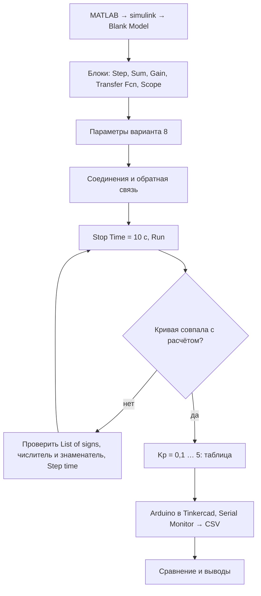
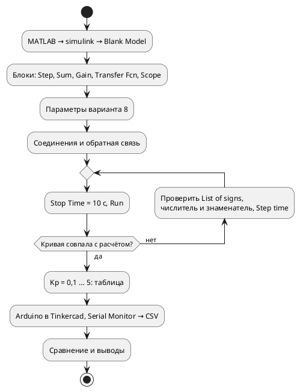
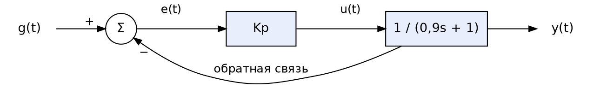

<!-- Собрано из apps/playground/examples/36-lab13-simulink.md основного репозитория Spiridus (scripts/build-public-docs.mjs) — правьте там. -->

<!-- раздел: Моделирование | теги: тау, simulink, modelica, п-регулятор, передаточная функция, обратная связь, arduino, tinkercad, сервопривод, лабораторная работа, переходный процесс -->
# Лабораторная № 13 в Spiridus: П-регулятор в Simulink и на Arduino

Как выполнить в документе Spiridus лабораторную «Моделирование и управление в Simulink и на
Arduino»: каждый этап методички — своим блоком, на примере варианта 8 (задание 68°, $K = 1$,
$T = 0{,}9$ с).

> **Simulink заменён Modelica.** Simulink — часть MATLAB, ему нужна лицензия MathWorks, и в
> Spiridus его нет. Поэтому для расчётов Simulink заменён Modelica: ту же схему из тех же блоков
> считает OpenModelica в песочнице (MCP-инструмент `modelica_run`). Действия в самом Simulink
> описаны по шагам — их студент повторяет у себя в MATLAB, а снимки Scope для отчёта делает сам.

| Этап методички | Чем в Spiridus | Другие блоки (свёрнуты под основным) |
|---|---|---|
| порядок работы | `mermaid` | `plantuml` — диаграмма активности |
| структурная схема системы (рис. 1) | `tikz` | `dot` |
| модель на рабочем поле Simulink (рис. 3) | `tikz` — блоки с их названиями | `d2` |
| моделирование и окно Scope (рис. 4, 5) | `modelica` — расчёт вместо Simulink | `echarts` и `tikz` (pgfplots) — графики по формуле |
| формулы и таблицы | Markdown и формулы $\LaTeX$ | — |
| программа Arduino и Serial Monitor (рис. 7) | `python` с запуском — тот же цикл, что в скетче | — |
| таблица эксперимента (Excel) | `python` — считает её сам, `echarts` — графики | — |
| совмещённый график Simulink и Arduino (рис. 9) | `echarts` | `tikz` (pgfplots) |
| П против ПИ и ПИД (сверх методички) | `modelica` | — |

Когда подходят две-три библиотеки: Mermaid, Graphviz, D2 и ECharts рисуются сразу, на
странице; TikZ — настоящий TeX, лучше всего для печатного отчёта; PlantUML рисует сервер
(инструмент `plantuml_run`), он строже к нотации UML.

## Порядок работы



<details>
<summary>То же на PlantUML — диаграмма активности</summary>



</details>

## Вариант 8 и формулы

Объект — привод первого порядка, запаздывание по методичке принимаем нулевым:

$$W_о(s) = \frac{K}{Ts+1} = \frac{1}{0{,}9s+1}, \qquad W_р(s) = K_p .$$

Замкнутая система с единичной отрицательной обратной связью — снова первого порядка:

$$W_з(s) = \frac{W_р W_о}{1 + W_р W_о} = \frac{K_p}{0{,}9s + 1 + K_p} = \frac{K_з}{T_з s + 1}, \qquad K_з = \frac{K_p}{1+K_p}, \quad T_з = \frac{0{,}9}{1+K_p}.$$

На скачок $g = 68°$ в момент $t_0 = 1$ с (`Step time` = 1):

$$y(t) = 68\,\frac{K_p}{1+K_p}\left(1 - e^{-(t-1)/T_з}\right), \quad t \ge 1;\qquad \varepsilon = \frac{68}{1+K_p};\qquad t_п = T_з \ln 20 \approx 3T_з .$$

Статическая ошибка не исчезает ни при каком $K_p$: в установившемся режиме объект без
интегратора требует управления $u = y_{уст}$, а П-регулятор даёт его только из ошибки,
$u = K_p \varepsilon$, — значит, ошибка нужна, чтобы держать выход.

## Часть А. Схема и модель

Структурная схема системы:

```tikz
\begin{tikzpicture}[>=Stealth, thick,
  blk/.style={draw, fill=blue!6, minimum height=1.1cm, minimum width=1.7cm, align=center},
  sum/.style={draw, circle, minimum size=0.75cm, inner sep=0pt}]
  \node[sum] (s) at (0,0) {};
  \draw[thin] (s.north west) -- (s.south east) (s.north east) -- (s.south west);
  \fill (s.center) -- (s.south west) arc[start angle=225, end angle=315, radius=0.375cm] -- cycle;
  \node[blk] (r) at (2.9,0) {$K_p$};
  \node[blk] (o) at (6.3,0) {$\dfrac{1}{0{,}9s+1}$};
  \coordinate (b) at (8.5,0);
  \draw[->] (-2.1,0) -- node[above]{$g(t)$} (s.west);
  \draw[->] (s.east) -- node[above]{$e(t)$} (r.west);
  \draw[->] (r.east) -- node[above]{$u(t)$} (o.west);
  \draw[->] (o.east) -- (9.9,0) node[pos=0.82, above]{$y(t)$};
  \fill (b) circle (2.2pt);
  \draw[->] (b) -- (8.5,-1.7) -- (0,-1.7) -- (s.south);
  \node at (-0.62,0.38) {$+$};
  \node at (0.4,-0.72) {$-$};
  \node[font=\small] at (2.9,-0.95) {П-регулятор};
  \node[font=\small] at (6.3,-1.1) {объект};
  \node[font=\small] at (4.3,-2.05) {отрицательная обратная связь};
\end{tikzpicture}
```

<details>
<summary>То же на Graphviz</summary>



</details>

Так выглядит собранная модель на рабочем поле Simulink: блок `Scope` с двумя входами
показывает и задание, и выход.

```tikz
\usetikzlibrary{shapes.geometric}
\begin{tikzpicture}[>={Latex[length=2mm]}, font=\sffamily\small, line width=0.7pt,
  sb/.style={draw, fill=white, minimum width=1cm, minimum height=1cm},
  nm/.style={font=\sffamily\footnotesize}]
  \node[sb] (step) at (0,0) {};
  \draw (-0.3,-0.25) -- (0,-0.25) -- (0,0.25) -- (0.3,0.25);
  \node[nm, below=2pt of step] {Step};
  \node[draw, circle, minimum size=0.6cm, inner sep=0pt] (sum) at (2.1,0) {};
  \node[font=\sffamily\scriptsize] at (1.62,0.2) {+};
  \node[font=\sffamily\scriptsize] at (2.32,-0.5) {$-$};
  \node[nm, above=2pt of sum] {Sum};
  \node[draw, fill=white, isosceles triangle, minimum height=1cm, minimum width=0.95cm, inner sep=1pt] (gain) at (3.9,0) {\scriptsize Kp};
  \node[nm, below=2pt of gain] {Gain};
  \node[sb, minimum width=1.7cm, minimum height=1.1cm] (tf) at (6.3,0) {$\frac{1}{0.9s+1}$};
  \node[nm, below=2pt of tf] {Transfer Fcn};
  \node[sb, minimum width=0.9cm, minimum height=0.9cm] (sc) at (9.7,0.45) {};
  \draw[fill=black!5] (9.42,0.3) rectangle (9.98,0.66);
  \node[nm, below=2pt of sc] {Scope};
  \draw[->] (step.east) -- (sum.west);
  \fill (1.0,0) circle (1.6pt);
  \draw[->] (1.0,0) -- (1.0,1.35) -- (8.8,1.35) -- (8.8,0.65) -- (9.25,0.65);
  \draw[->] (sum.east) -- (gain.west);
  \draw[->] (gain.east) -- (tf.west);
  \fill (8.1,0) circle (1.6pt);
  \draw[->] (tf.east) -- (8.1,0) -- (8.1,0.25) -- (9.25,0.25);
  \draw[->] (8.1,0) -- (8.1,-1.5) -- (2.1,-1.5) -- (sum.south);
\end{tikzpicture}
```

<details>
<summary>То же на D2</summary>

```d2
direction: down
classes: {
  blk: { style: { fill: "#ffffff"; stroke: "#1f2937"; font: mono } }
}
step: "Step\n68 при t = 1" { class: blk }
sum: "Sum\n|+-" { class: blk; shape: circle }
gain: "Gain\nKp" { class: blk }
tf: "Transfer Fcn\n1/(0.9s+1)" { class: blk }
scope: "Scope\n2 входа" { class: blk }
step -> sum: "+"
sum -> gain: e
gain -> tf: u
tf -> scope: y
step -> scope: g
tf -> sum: "−" { style.stroke-dash: 3 }
```

</details>

<details>
<summary>Шаги в Simulink с параметрами варианта 8</summary>

1. `MATLAB` → в командной строке `simulink` → `Blank Model`; сохранить как `lab13_model.slx`.
2. `Library Browser` → `Simulink` → `Sources` → `Step`: `Step time` = 1, `Initial value` = 0,
   `Final value` = 68.
3. `Math Operations` → `Sum`: `List of signs` = `|+-`. Знак `|` — не вход, а пропуск места на
   кружке; без него второй вход окажется не снизу.
4. `Math Operations` → `Gain`: `Gain` = `Kp`, а в командной строке MATLAB — `Kp = 1`. Тогда
   все значения из п. 4.4 перебираются одной строкой: `for Kp = [0.1 0.5 1 2 5], sim('lab13_model'); end`.
5. `Continuous` → `Transfer Fcn`: `Numerator coefficients` = `[1]`, `Denominator coefficients` =
   `[0.9 1]` — коэффициенты по убыванию степени $s$: $0{,}9s + 1$. Частая ошибка — `[1 0.9]`,
   это уже $s + 0{,}9$.
6. `Sinks` → `Scope`; в его настройках `Number of input ports` = 2.
7. Соединения: `Step` → вход «+» `Sum` → `Gain` → `Transfer Fcn` → второй вход `Scope`.
   Ответвление — перетаскивание от готовой линии с нажатым `Ctrl` (или правой кнопкой): от
   выхода `Transfer Fcn` — к входу «−» `Sum`, от выхода `Step` — к первому входу `Scope`.
8. `Modeling` → `Model Settings`: `Stop time` = 10; решатель — по умолчанию (`auto`, ode45).
   Для гладкой кривой — `Max step size` = 0.01.
9. `Run`, двойной щелчок по `Scope`, кнопка автомасштаба.

</details>

## Часть А. Расчёт вместо Simulink: Modelica

Та же схема в Modelica, блок к блоку: `Step` — `Sources.Step`, `Sum` с `|+-` — `Math.Feedback`,
`Gain` — `Math.Gain`, `Transfer Fcn` — `Continuous.TransferFunction` с теми же числителем
`{1}` и знаменателем `{0.9, 1}`. Пять контуров с разными $K_p$ — это пять запусков Simulink из
п. 4.4 сразу. Графики под моделью — то, что должен показать `Scope`: «▶» проигрывает процесс,
курсор показывает значения.

```modelica
// result: artifact:be5c8d4534d8dd27/result.csv
// plot: g.y, y01.y, y05.y, y1.y, y2.y, y5.y
// plot: u01.y, u05.y, u1.y, u2.y, u5.y
model Lab13Var8 "ЛР13, вариант 8: Step 68 при t = 1 с, объект 1/(0.9s+1), П-регулятор Kp = 0,1; 0,5; 1; 2; 5"
  import Modelica.Blocks;
  // Step: Step time = 1, Initial value = 0, Final value = 68
  Blocks.Sources.Step g(height = 68, offset = 0, startTime = 1);
  // Sum с List of signs |+- : e = g - y
  Blocks.Math.Feedback e01, e05, e1, e2, e5;
  // Gain: Kp
  Blocks.Math.Gain u01(k = 0.1), u05(k = 0.5), u1(k = 1), u2(k = 2), u5(k = 5);
  // Transfer Fcn: Numerator [1], Denominator [0.9 1]
  Blocks.Continuous.TransferFunction y01(b = {1}, a = {0.9, 1});
  Blocks.Continuous.TransferFunction y05(b = {1}, a = {0.9, 1});
  Blocks.Continuous.TransferFunction y1(b = {1}, a = {0.9, 1});
  Blocks.Continuous.TransferFunction y2(b = {1}, a = {0.9, 1});
  Blocks.Continuous.TransferFunction y5(b = {1}, a = {0.9, 1});
equation
  connect(g.y, e01.u1); connect(e01.y, u01.u); connect(u01.y, y01.u); connect(y01.y, e01.u2);
  connect(g.y, e05.u1); connect(e05.y, u05.u); connect(u05.y, y05.u); connect(y05.y, e05.u2);
  connect(g.y, e1.u1);  connect(e1.y, u1.u);   connect(u1.y, y1.u);   connect(y1.y, e1.u2);
  connect(g.y, e2.u1);  connect(e2.y, u2.u);   connect(u2.y, y2.u);   connect(y2.y, e2.u2);
  connect(g.y, e5.u1);  connect(e5.y, u5.u);   connect(u5.y, y5.u);   connect(y5.y, e5.u2);
  annotation(experiment(StopTime = 10));
end Lab13Var8;
```

Нижний график — управление $u(t)$: в момент скачка оно равно $K_p \cdot 68$, при $K_p = 5$ это
340 — для сервопривода с углом 0–180° такое уже за пределом, на Arduino оно упрётся в ограничение.

<details>
<summary>Те же кривые по формуле: ECharts (живой график) и pgfplots (для печати)</summary>

ECharts — по точкам формулы с шагом 0,1 с; наведение показывает значения всех кривых сразу:

```echarts
{"width":620,"height":340,"animation":false,"tooltip":{"trigger":"axis"},"legend":{"top":0},"grid":{"left":56,"right":20,"top":44,"bottom":46},"xAxis":{"type":"value","name":"t, с","nameLocation":"middle","nameGap":28,"axisLabel":{"formatter":"plain"},"min":0,"max":10},"yAxis":{"type":"value","name":"y, °","nameLocation":"middle","nameGap":36,"axisLabel":{"formatter":"plain"},"min":0,"max":75},"series":[{"name":"g(t)","type":"line","step":"end","showSymbol":false,"lineStyle":{"type":"dashed","color":"#111"},"itemStyle":{"color":"#111"},"data":[[0.0,0],[0.1,0],[0.2,0],[0.3,0],[0.4,0],[0.5,0],[0.6,0],[0.7,0],[0.8,0],[0.9,0],[1.0,68],[1.1,68],[1.2,68],[1.3,68],[1.4,68],[1.5,68],[1.6,68],[1.7,68],[1.8,68],[1.9,68],[2.0,68],[2.1,68],[2.2,68],[2.3,68],[2.4,68],[2.5,68],[2.6,68],[2.7,68],[2.8,68],[2.9,68],[3.0,68],[3.1,68],[3.2,68],[3.3,68],[3.4,68],[3.5,68],[3.6,68],[3.7,68],[3.8,68],[3.9,68],[4.0,68],[4.1,68],[4.2,68],[4.3,68],[4.4,68],[4.5,68],[4.6,68],[4.7,68],[4.8,68],[4.9,68],[5.0,68],[5.1,68],[5.2,68],[5.3,68],[5.4,68],[5.5,68],[5.6,68],[5.7,68],[5.8,68],[5.9,68],[6.0,68],[6.1,68],[6.2,68],[6.3,68],[6.4,68],[6.5,68],[6.6,68],[6.7,68],[6.8,68],[6.9,68],[7.0,68],[7.1,68],[7.2,68],[7.3,68],[7.4,68],[7.5,68],[7.6,68],[7.7,68],[7.8,68],[7.9,68],[8.0,68],[8.1,68],[8.2,68],[8.3,68],[8.4,68],[8.5,68],[8.6,68],[8.7,68],[8.8,68],[8.9,68],[9.0,68],[9.1,68],[9.2,68],[9.3,68],[9.4,68],[9.5,68],[9.6,68],[9.7,68],[9.8,68],[9.9,68],[10.0,68]]},{"name":"Kp = 0,1","type":"line","showSymbol":false,"smooth":false,"lineStyle":{"color":"#d97706","width":2},"itemStyle":{"color":"#d97706"},"data":[[0.0,0],[0.1,0],[0.2,0],[0.3,0],[0.4,0],[0.5,0],[0.6,0],[0.7,0],[0.8,0],[0.9,0],[1.0,0.0],[1.1,0.71],[1.2,1.34],[1.3,1.9],[1.4,2.39],[1.5,2.83],[1.6,3.21],[1.7,3.55],[1.8,3.86],[1.9,4.12],[2.0,4.36],[2.1,4.57],[2.2,4.76],[2.3,4.92],[2.4,5.06],[2.5,5.19],[2.6,5.31],[2.7,5.41],[2.8,5.5],[2.9,5.58],[3.0,5.65],[3.1,5.71],[3.2,5.76],[3.3,5.81],[3.4,5.85],[3.5,5.89],[3.6,5.92],[3.7,5.95],[3.8,5.98],[3.9,6.0],[4.0,6.02],[4.1,6.04],[4.2,6.06],[4.3,6.07],[4.4,6.08],[4.5,6.1],[4.6,6.11],[4.7,6.11],[4.8,6.12],[4.9,6.13],[5.0,6.14],[5.1,6.14],[5.2,6.15],[5.3,6.15],[5.4,6.15],[5.5,6.16],[5.6,6.16],[5.7,6.16],[5.8,6.16],[5.9,6.17],[6.0,6.17],[6.1,6.17],[6.2,6.17],[6.3,6.17],[6.4,6.17],[6.5,6.17],[6.6,6.18],[6.7,6.18],[6.8,6.18],[6.9,6.18],[7.0,6.18],[7.1,6.18],[7.2,6.18],[7.3,6.18],[7.4,6.18],[7.5,6.18],[7.6,6.18],[7.7,6.18],[7.8,6.18],[7.9,6.18],[8.0,6.18],[8.1,6.18],[8.2,6.18],[8.3,6.18],[8.4,6.18],[8.5,6.18],[8.6,6.18],[8.7,6.18],[8.8,6.18],[8.9,6.18],[9.0,6.18],[9.1,6.18],[9.2,6.18],[9.3,6.18],[9.4,6.18],[9.5,6.18],[9.6,6.18],[9.7,6.18],[9.8,6.18],[9.9,6.18],[10.0,6.18]]},{"name":"Kp = 0,5","type":"line","showSymbol":false,"smooth":false,"lineStyle":{"color":"#0d9488","width":2},"itemStyle":{"color":"#0d9488"},"data":[[0.0,0],[0.1,0],[0.2,0],[0.3,0],[0.4,0],[0.5,0],[0.6,0],[0.7,0],[0.8,0],[0.9,0],[1.0,0.0],[1.1,3.48],[1.2,6.43],[1.3,8.92],[1.4,11.03],[1.5,12.82],[1.6,14.33],[1.7,15.61],[1.8,16.69],[1.9,17.61],[2.0,18.39],[2.1,19.04],[2.2,19.6],[2.3,20.07],[2.4,20.47],[2.5,20.81],[2.6,21.09],[2.7,21.33],[2.8,21.54],[2.9,21.71],[3.0,21.86],[3.1,21.98],[3.2,22.09],[3.3,22.18],[3.4,22.25],[3.5,22.32],[3.6,22.37],[3.7,22.41],[3.8,22.45],[3.9,22.49],[4.0,22.51],[4.1,22.54],[4.2,22.56],[4.3,22.57],[4.4,22.59],[4.5,22.6],[4.6,22.61],[4.7,22.62],[4.8,22.63],[4.9,22.63],[5.0,22.64],[5.1,22.64],[5.2,22.65],[5.3,22.65],[5.4,22.65],[5.5,22.65],[5.6,22.66],[5.7,22.66],[5.8,22.66],[5.9,22.66],[6.0,22.66],[6.1,22.66],[6.2,22.66],[6.3,22.66],[6.4,22.66],[6.5,22.66],[6.6,22.66],[6.7,22.66],[6.8,22.67],[6.9,22.67],[7.0,22.67],[7.1,22.67],[7.2,22.67],[7.3,22.67],[7.4,22.67],[7.5,22.67],[7.6,22.67],[7.7,22.67],[7.8,22.67],[7.9,22.67],[8.0,22.67],[8.1,22.67],[8.2,22.67],[8.3,22.67],[8.4,22.67],[8.5,22.67],[8.6,22.67],[8.7,22.67],[8.8,22.67],[8.9,22.67],[9.0,22.67],[9.1,22.67],[9.2,22.67],[9.3,22.67],[9.4,22.67],[9.5,22.67],[9.6,22.67],[9.7,22.67],[9.8,22.67],[9.9,22.67],[10.0,22.67]]},{"name":"Kp = 1","type":"line","showSymbol":false,"smooth":false,"lineStyle":{"color":"#2563eb","width":2},"itemStyle":{"color":"#2563eb"},"data":[[0.0,0],[0.1,0],[0.2,0],[0.3,0],[0.4,0],[0.5,0],[0.6,0],[0.7,0],[0.8,0],[0.9,0],[1.0,0.0],[1.1,6.77],[1.2,12.2],[1.3,16.54],[1.4,20.02],[1.5,22.81],[1.6,25.04],[1.7,26.82],[1.8,28.25],[1.9,29.4],[2.0,30.32],[2.1,31.05],[2.2,31.64],[2.3,32.11],[2.4,32.49],[2.5,32.79],[2.6,33.03],[2.7,33.22],[2.8,33.38],[2.9,33.5],[3.0,33.6],[3.1,33.68],[3.2,33.74],[3.3,33.8],[3.4,33.84],[3.5,33.87],[3.6,33.89],[3.7,33.92],[3.8,33.93],[3.9,33.95],[4.0,33.96],[4.1,33.97],[4.2,33.97],[4.3,33.98],[4.4,33.98],[4.5,33.99],[4.6,33.99],[4.7,33.99],[4.8,33.99],[4.9,33.99],[5.0,34.0],[5.1,34.0],[5.2,34.0],[5.3,34.0],[5.4,34.0],[5.5,34.0],[5.6,34.0],[5.7,34.0],[5.8,34.0],[5.9,34.0],[6.0,34.0],[6.1,34.0],[6.2,34.0],[6.3,34.0],[6.4,34.0],[6.5,34.0],[6.6,34.0],[6.7,34.0],[6.8,34.0],[6.9,34.0],[7.0,34.0],[7.1,34.0],[7.2,34.0],[7.3,34.0],[7.4,34.0],[7.5,34.0],[7.6,34.0],[7.7,34.0],[7.8,34.0],[7.9,34.0],[8.0,34.0],[8.1,34.0],[8.2,34.0],[8.3,34.0],[8.4,34.0],[8.5,34.0],[8.6,34.0],[8.7,34.0],[8.8,34.0],[8.9,34.0],[9.0,34.0],[9.1,34.0],[9.2,34.0],[9.3,34.0],[9.4,34.0],[9.5,34.0],[9.6,34.0],[9.7,34.0],[9.8,34.0],[9.9,34.0],[10.0,34.0]]},{"name":"Kp = 2","type":"line","showSymbol":false,"smooth":false,"lineStyle":{"color":"#7c3aed","width":2},"itemStyle":{"color":"#7c3aed"},"data":[[0.0,0],[0.1,0],[0.2,0],[0.3,0],[0.4,0],[0.5,0],[0.6,0],[0.7,0],[0.8,0],[0.9,0],[1.0,0.0],[1.1,12.85],[1.2,22.06],[1.3,28.66],[1.4,33.38],[1.5,36.77],[1.6,39.2],[1.7,40.94],[1.8,42.18],[1.9,43.08],[2.0,43.72],[2.1,44.17],[2.2,44.5],[2.3,44.74],[2.4,44.91],[2.5,45.03],[2.6,45.11],[2.7,45.18],[2.8,45.22],[2.9,45.25],[3.0,45.28],[3.1,45.29],[3.2,45.3],[3.3,45.31],[3.4,45.32],[3.5,45.32],[3.6,45.33],[3.7,45.33],[3.8,45.33],[3.9,45.33],[4.0,45.33],[4.1,45.33],[4.2,45.33],[4.3,45.33],[4.4,45.33],[4.5,45.33],[4.6,45.33],[4.7,45.33],[4.8,45.33],[4.9,45.33],[5.0,45.33],[5.1,45.33],[5.2,45.33],[5.3,45.33],[5.4,45.33],[5.5,45.33],[5.6,45.33],[5.7,45.33],[5.8,45.33],[5.9,45.33],[6.0,45.33],[6.1,45.33],[6.2,45.33],[6.3,45.33],[6.4,45.33],[6.5,45.33],[6.6,45.33],[6.7,45.33],[6.8,45.33],[6.9,45.33],[7.0,45.33],[7.1,45.33],[7.2,45.33],[7.3,45.33],[7.4,45.33],[7.5,45.33],[7.6,45.33],[7.7,45.33],[7.8,45.33],[7.9,45.33],[8.0,45.33],[8.1,45.33],[8.2,45.33],[8.3,45.33],[8.4,45.33],[8.5,45.33],[8.6,45.33],[8.7,45.33],[8.8,45.33],[8.9,45.33],[9.0,45.33],[9.1,45.33],[9.2,45.33],[9.3,45.33],[9.4,45.33],[9.5,45.33],[9.6,45.33],[9.7,45.33],[9.8,45.33],[9.9,45.33],[10.0,45.33]]},{"name":"Kp = 5","type":"line","showSymbol":false,"smooth":false,"lineStyle":{"color":"#dc2626","width":2},"itemStyle":{"color":"#dc2626"},"data":[[0.0,0],[0.1,0],[0.2,0],[0.3,0],[0.4,0],[0.5,0],[0.6,0],[0.7,0],[0.8,0],[0.9,0],[1.0,0.0],[1.1,27.57],[1.2,41.73],[1.3,49.0],[1.4,52.73],[1.5,54.65],[1.6,55.63],[1.7,56.13],[1.8,56.39],[1.9,56.53],[2.0,56.59],[2.1,56.63],[2.2,56.65],[2.3,56.66],[2.4,56.66],[2.5,56.66],[2.6,56.67],[2.7,56.67],[2.8,56.67],[2.9,56.67],[3.0,56.67],[3.1,56.67],[3.2,56.67],[3.3,56.67],[3.4,56.67],[3.5,56.67],[3.6,56.67],[3.7,56.67],[3.8,56.67],[3.9,56.67],[4.0,56.67],[4.1,56.67],[4.2,56.67],[4.3,56.67],[4.4,56.67],[4.5,56.67],[4.6,56.67],[4.7,56.67],[4.8,56.67],[4.9,56.67],[5.0,56.67],[5.1,56.67],[5.2,56.67],[5.3,56.67],[5.4,56.67],[5.5,56.67],[5.6,56.67],[5.7,56.67],[5.8,56.67],[5.9,56.67],[6.0,56.67],[6.1,56.67],[6.2,56.67],[6.3,56.67],[6.4,56.67],[6.5,56.67],[6.6,56.67],[6.7,56.67],[6.8,56.67],[6.9,56.67],[7.0,56.67],[7.1,56.67],[7.2,56.67],[7.3,56.67],[7.4,56.67],[7.5,56.67],[7.6,56.67],[7.7,56.67],[7.8,56.67],[7.9,56.67],[8.0,56.67],[8.1,56.67],[8.2,56.67],[8.3,56.67],[8.4,56.67],[8.5,56.67],[8.6,56.67],[8.7,56.67],[8.8,56.67],[8.9,56.67],[9.0,56.67],[9.1,56.67],[9.2,56.67],[9.3,56.67],[9.4,56.67],[9.5,56.67],[9.6,56.67],[9.7,56.67],[9.8,56.67],[9.9,56.67],[10.0,56.67]]}]}
```

pgfplots строит кривые прямо по формуле — удобно для печатного отчёта:

```tikz
\begin{tikzpicture}
  \begin{axis}[width=13cm, height=7cm, xmin=0, xmax=10, ymin=0, ymax=75,
      xlabel={$t$, с}, ylabel={$y$, °}, grid=major, grid style={gray!25},
      legend pos=outer north east, legend style={font=\small}, samples=120, domain=1:10]
    \addplot[black, dashed, thick, domain=0:10] {x < 1 ? 0 : 68};
    \addlegendentry{$g(t)$}
    \foreach \k/\c in {0.1/orange, 0.5/teal, 1/blue, 2/violet, 5/red} {
      \edef\temp{\noexpand\addplot[\c, thick] {68*\k/(1+\k)*(1-exp(-(x-1)*(1+\k)/0.9))};
        \noexpand\addlegendentry{$K_p = \k$}}
      \temp
    }
  \end{axis}
\end{tikzpicture}
```

</details>

Результаты для отчёта — по формулам выше; расчёт Modelica совпадает с ними до 0,0001°:

| $K_p$ | $y_{уст}$, ° | $\varepsilon$, ° | $\varepsilon$, % | $T_з$, с | $t_п$ после скачка, с | $t_п$ по оси времени, с |
|---|---|---|---|---|---|---|
| 0,1 | 6,18 | 61,82 | 90,9 | 0,818 | 2,45 | 3,45 |
| 0,5 | 22,67 | 45,33 | 66,7 | 0,600 | 1,80 | 2,80 |
| 1 | 34,00 | 34,00 | 50,0 | 0,450 | 1,35 | 2,35 |
| 2 | 45,33 | 22,67 | 33,3 | 0,300 | 0,90 | 1,90 |
| 5 | 56,67 | 11,33 | 16,7 | 0,150 | 0,45 | 1,45 |

С ростом $K_p$ процесс быстрее и ошибка меньше, но перерегулирования нет ни при каком $K_p$:
замкнутая система первого порядка не колеблется.

## Часть Б. Arduino: программа и Serial Monitor

Tinkercad в документ не встраивается, но программа из п. 5.2 — это цикл из пяти строк, и его
можно выполнить прямо здесь: тот же расчёт, тот же вывод в формате CSV, что в Serial Monitor.
Кнопка «▶ Запустить» — под кодом.

```python
# Цикл loop() из п. 5.2 методички: такт delay(100) = 0,1 с
SETPOINT = 68     # вариант 8: Final value блока Step
KP = 1.0          # лучший Kp из части А
current = 0.0

print("time_s,setpoint,current_angle,error")
for n in range(31):                      # 3 с — до установления
    error = SETPOINT - current
    u = KP * error
    current = current + u * 0.1          # строка скетча: currentAngle + u * 0.1
    current = min(180, max(0, current))  # ограничения сервопривода 0…180°
    print(f"{n * 0.1:.1f},{SETPOINT},{current:.2f},{error:.2f}")
```

Таблица эксперимента с разными $K_p$ (файл Excel к методичке) считается так же. Её значения
получаются законом `angle += Kp·error` без множителя 0,1, тактом 100 мс и критерием
установления 2 % — программа ниже воспроизводит все такты и максимумы таблицы.

```python
SETPOINT = 68

def run(kp, steps=100):
    a, seq = 0.0, []
    for _ in range(steps):
        a = min(180, max(0, a + kp * (SETPOINT - a)))
        seq.append(a)
    return seq

def settle(seq, tol=0.02):
    """Первый такт, после которого |ошибка| не больше 2 % навсегда."""
    for i in range(len(seq)):
        if all(abs(SETPOINT - x) <= tol * SETPOINT for x in seq[i:]):
            return i + 1
    return None

print("Kp   | установление, мс (такты) | макс., ° | перерег., % | режим")
for kp in (0.1, 0.3, 0.5, 0.8, 1.2, 2, 3):
    seq = run(kp)
    n, top = settle(seq), max(seq)
    over = max(0.0, (top - SETPOINT) / SETPOINT * 100)
    if n is None:
        mode = "колебания не затухают"
    elif over > 0:
        mode = "затухающие колебания"
    else:
        mode = "медленный" if n > 10 else "оптимальный"
    t = "–" if n is None else f"{n * 100} ({n})"
    print(f"{kp:<4} | {t:>24} | {top:8.1f} | {over:11.1f} | {mode}")
```

Переходные процессы этой таблицы (легенда включает и выключает кривые):

```echarts
{"width":620,"height":340,"animation":false,"tooltip":{"trigger":"axis"},"legend":{"top":0},"grid":{"left":56,"right":20,"top":44,"bottom":46},"xAxis":{"type":"value","name":"такт (100 мс)","nameLocation":"middle","nameGap":28,"axisLabel":{"formatter":"plain"},"min":0,"max":30},"yAxis":{"type":"value","name":"угол, °","nameLocation":"middle","nameGap":36,"axisLabel":{"formatter":"plain"},"min":0,"max":180,"interval":30},"series":[{"name":"задание","type":"line","showSymbol":false,"lineStyle":{"type":"dashed","color":"#111"},"itemStyle":{"color":"#111"},"data":[[0,68],[1,68],[2,68],[3,68],[4,68],[5,68],[6,68],[7,68],[8,68],[9,68],[10,68],[11,68],[12,68],[13,68],[14,68],[15,68],[16,68],[17,68],[18,68],[19,68],[20,68],[21,68],[22,68],[23,68],[24,68],[25,68],[26,68],[27,68],[28,68],[29,68],[30,68]]},{"name":"Kp = 0,1","type":"line","step":"end","symbolSize":4,"lineStyle":{"color":"#d97706","width":1.6},"itemStyle":{"color":"#d97706"},"data":[[0,0],[1,6.8],[2,12.92],[3,18.43],[4,23.39],[5,27.85],[6,31.86],[7,35.48],[8,38.73],[9,41.66],[10,44.29],[11,46.66],[12,48.79],[13,50.72],[14,52.44],[15,54.0],[16,55.4],[17,56.66],[18,57.79],[19,58.81],[20,59.73],[21,60.56],[22,61.3],[23,61.97],[24,62.58],[25,63.12],[26,63.61],[27,64.05],[28,64.44],[29,64.8],[30,65.12]]},{"name":"Kp = 0,3","type":"line","step":"end","symbolSize":4,"lineStyle":{"color":"#ca8a04","width":1.6},"itemStyle":{"color":"#ca8a04"},"data":[[0,0],[1,20.4],[2,34.68],[3,44.68],[4,51.67],[5,56.57],[6,60.0],[7,62.4],[8,64.08],[9,65.26],[10,66.08],[11,66.66],[12,67.06],[13,67.34],[14,67.54],[15,67.68],[16,67.77],[17,67.84],[18,67.89],[19,67.92],[20,67.95],[21,67.96],[22,67.97],[23,67.98],[24,67.99],[25,67.99],[26,67.99],[27,68.0],[28,68.0],[29,68.0],[30,68.0]]},{"name":"Kp = 0,5","type":"line","step":"end","symbolSize":4,"lineStyle":{"color":"#0d9488","width":1.6},"itemStyle":{"color":"#0d9488"},"data":[[0,0],[1,34.0],[2,51.0],[3,59.5],[4,63.75],[5,65.88],[6,66.94],[7,67.47],[8,67.73],[9,67.87],[10,67.93],[11,67.97],[12,67.98],[13,67.99],[14,68.0],[15,68.0],[16,68.0],[17,68.0],[18,68.0],[19,68.0],[20,68.0],[21,68.0],[22,68.0],[23,68.0],[24,68.0],[25,68.0],[26,68.0],[27,68.0],[28,68.0],[29,68.0],[30,68.0]]},{"name":"Kp = 0,8","type":"line","step":"end","symbolSize":4,"lineStyle":{"color":"#2563eb","width":1.6},"itemStyle":{"color":"#2563eb"},"data":[[0,0],[1,54.4],[2,65.28],[3,67.46],[4,67.89],[5,67.98],[6,68.0],[7,68.0],[8,68.0],[9,68.0],[10,68.0],[11,68.0],[12,68.0],[13,68.0],[14,68.0],[15,68.0],[16,68.0],[17,68.0],[18,68.0],[19,68.0],[20,68.0],[21,68.0],[22,68.0],[23,68.0],[24,68.0],[25,68.0],[26,68.0],[27,68.0],[28,68.0],[29,68.0],[30,68.0]]},{"name":"Kp = 1,2","type":"line","step":"end","symbolSize":4,"lineStyle":{"color":"#7c3aed","width":1.6},"itemStyle":{"color":"#7c3aed"},"data":[[0,0],[1,81.6],[2,65.28],[3,68.54],[4,67.89],[5,68.02],[6,68.0],[7,68.0],[8,68.0],[9,68.0],[10,68.0],[11,68.0],[12,68.0],[13,68.0],[14,68.0],[15,68.0],[16,68.0],[17,68.0],[18,68.0],[19,68.0],[20,68.0],[21,68.0],[22,68.0],[23,68.0],[24,68.0],[25,68.0],[26,68.0],[27,68.0],[28,68.0],[29,68.0],[30,68.0]]},{"name":"Kp = 2","type":"line","step":"end","symbolSize":4,"lineStyle":{"color":"#db2777","width":1.6},"itemStyle":{"color":"#db2777"},"data":[[0,0],[1,136.0],[2,0],[3,136],[4,0],[5,136],[6,0],[7,136],[8,0],[9,136],[10,0],[11,136],[12,0],[13,136],[14,0],[15,136],[16,0],[17,136],[18,0],[19,136],[20,0],[21,136],[22,0],[23,136],[24,0],[25,136],[26,0],[27,136],[28,0],[29,136],[30,0]]},{"name":"Kp = 3","type":"line","step":"end","symbolSize":4,"lineStyle":{"color":"#dc2626","width":1.6},"itemStyle":{"color":"#dc2626"},"data":[[0,0],[1,180],[2,0],[3,180],[4,0],[5,180],[6,0],[7,180],[8,0],[9,180],[10,0],[11,180],[12,0],[13,180],[14,0],[15,180],[16,0],[17,180],[18,0],[19,180],[20,0],[21,180],[22,0],[23,180],[24,0],[25,180],[26,0],[27,180],[28,0],[29,180],[30,0]]}]}
```

При $K_p < 1$ угол подходит к 68° монотонно, при $K_p = 1$ — за один такт, при $1 < K_p < 2$ —
с затухающими колебаниями, при $K_p = 2$ колебания 0 ↔ 136° не затухают, при $K_p = 3$ система
неустойчива и держится только на ограничениях 0 и 180°. Это свойство дискретного цикла
$a_{n+1} = a_n + K_p(g - a_n)$: ошибка каждый такт умножается на $1 - K_p$.

## Часть В. Сравнение Simulink и Arduino

```echarts
{"width":620,"height":340,"animation":false,"tooltip":{"trigger":"axis"},"legend":{"top":0},"grid":{"left":56,"right":20,"top":44,"bottom":46},"xAxis":{"type":"value","name":"t, с","nameLocation":"middle","nameGap":28,"axisLabel":{"formatter":"plain"},"min":0,"max":6},"yAxis":{"type":"value","name":"угол, °","nameLocation":"middle","nameGap":36,"axisLabel":{"formatter":"plain"},"min":0,"max":75},"series":[{"name":"задание (Step)","type":"line","step":"end","showSymbol":false,"lineStyle":{"type":"dashed","color":"#111"},"itemStyle":{"color":"#111"},"data":[[0.0,0],[0.05,0],[0.1,0],[0.15,0],[0.2,0],[0.25,0],[0.3,0],[0.35,0],[0.4,0],[0.45,0],[0.5,0],[0.55,0],[0.6,0],[0.65,0],[0.7,0],[0.75,0],[0.8,0],[0.85,0],[0.9,0],[0.95,0],[1.0,68],[1.05,68],[1.1,68],[1.15,68],[1.2,68],[1.25,68],[1.3,68],[1.35,68],[1.4,68],[1.45,68],[1.5,68],[1.55,68],[1.6,68],[1.65,68],[1.7,68],[1.75,68],[1.8,68],[1.85,68],[1.9,68],[1.95,68],[2.0,68],[2.05,68],[2.1,68],[2.15,68],[2.2,68],[2.25,68],[2.3,68],[2.35,68],[2.4,68],[2.45,68],[2.5,68],[2.55,68],[2.6,68],[2.65,68],[2.7,68],[2.75,68],[2.8,68],[2.85,68],[2.9,68],[2.95,68],[3.0,68],[3.05,68],[3.1,68],[3.15,68],[3.2,68],[3.25,68],[3.3,68],[3.35,68],[3.4,68],[3.45,68],[3.5,68],[3.55,68],[3.6,68],[3.65,68],[3.7,68],[3.75,68],[3.8,68],[3.85,68],[3.9,68],[3.95,68],[4.0,68],[4.05,68],[4.1,68],[4.15,68],[4.2,68],[4.25,68],[4.3,68],[4.35,68],[4.4,68],[4.45,68],[4.5,68],[4.55,68],[4.6,68],[4.65,68],[4.7,68],[4.75,68],[4.8,68],[4.85,68],[4.9,68],[4.95,68],[5.0,68],[5.05,68],[5.1,68],[5.15,68],[5.2,68],[5.25,68],[5.3,68],[5.35,68],[5.4,68],[5.45,68],[5.5,68],[5.55,68],[5.6,68],[5.65,68],[5.7,68],[5.75,68],[5.8,68],[5.85,68],[5.9,68],[5.95,68],[6.0,68]]},{"name":"Simulink: 1/(0,9s+1)","type":"line","showSymbol":false,"lineStyle":{"color":"#2563eb","width":3},"itemStyle":{"color":"#2563eb"},"data":[[0.0,0],[0.05,0],[0.1,0],[0.15,0],[0.2,0],[0.25,0],[0.3,0],[0.35,0],[0.4,0],[0.45,0],[0.5,0],[0.55,0],[0.6,0],[0.65,0],[0.7,0],[0.75,0],[0.8,0],[0.85,0],[0.9,0],[0.95,0],[1.0,0.0],[1.05,3.58],[1.1,6.77],[1.15,9.64],[1.2,12.2],[1.25,14.49],[1.3,16.54],[1.35,18.38],[1.4,20.02],[1.45,21.49],[1.5,22.81],[1.55,23.98],[1.6,25.04],[1.65,25.98],[1.7,26.82],[1.75,27.58],[1.8,28.25],[1.85,28.86],[1.9,29.4],[1.95,29.88],[2.0,30.32],[2.05,30.7],[2.1,31.05],[2.15,31.36],[2.2,31.64],[2.25,31.89],[2.3,32.11],[2.35,32.31],[2.4,32.49],[2.45,32.64],[2.5,32.79],[2.55,32.91],[2.6,33.03],[2.65,33.13],[2.7,33.22],[2.75,33.3],[2.8,33.38],[2.85,33.44],[2.9,33.5],[2.95,33.55],[3.0,33.6],[3.05,33.64],[3.1,33.68],[3.15,33.71],[3.2,33.74],[3.25,33.77],[3.3,33.8],[3.35,33.82],[3.4,33.84],[3.45,33.85],[3.5,33.87],[3.55,33.88],[3.6,33.89],[3.65,33.91],[3.7,33.92],[3.75,33.92],[3.8,33.93],[3.85,33.94],[3.9,33.95],[3.95,33.95],[4.0,33.96],[4.05,33.96],[4.1,33.97],[4.15,33.97],[4.2,33.97],[4.25,33.98],[4.3,33.98],[4.35,33.98],[4.4,33.98],[4.45,33.98],[4.5,33.99],[4.55,33.99],[4.6,33.99],[4.65,33.99],[4.7,33.99],[4.75,33.99],[4.8,33.99],[4.85,33.99],[4.9,33.99],[4.95,33.99],[5.0,34.0],[5.05,34.0],[5.1,34.0],[5.15,34.0],[5.2,34.0],[5.25,34.0],[5.3,34.0],[5.35,34.0],[5.4,34.0],[5.45,34.0],[5.5,34.0],[5.55,34.0],[5.6,34.0],[5.65,34.0],[5.7,34.0],[5.75,34.0],[5.8,34.0],[5.85,34.0],[5.9,34.0],[5.95,34.0],[6.0,34.0]]},{"name":"Arduino, такт 0,1 с","type":"scatter","symbolSize":5,"itemStyle":{"color":"#ea580c"},"data":[[0.0,6.8],[0.1,12.92],[0.2,18.43],[0.3,23.39],[0.4,27.85],[0.5,31.86],[0.6,35.48],[0.7,38.73],[0.8,41.66],[0.9,44.29],[1.0,46.66],[1.1,48.79],[1.2,50.72],[1.3,52.44],[1.4,54.0],[1.5,55.4],[1.6,56.66],[1.7,57.79],[1.8,58.81],[1.9,59.73],[2.0,60.56],[2.1,61.3],[2.2,61.97],[2.3,62.58],[2.4,63.12],[2.5,63.61],[2.6,64.05],[2.7,64.44],[2.8,64.8],[2.9,65.12],[3.0,65.41],[3.1,65.67],[3.2,65.9],[3.3,66.11],[3.4,66.3],[3.5,66.47],[3.6,66.62],[3.7,66.76],[3.8,66.88],[3.9,66.99],[4.0,67.1],[4.1,67.19],[4.2,67.27],[4.3,67.34],[4.4,67.41],[4.5,67.47],[4.6,67.52],[4.7,67.57],[4.8,67.61],[4.9,67.65],[5.0,67.68],[5.1,67.72],[5.2,67.74],[5.3,67.77],[5.4,67.79],[5.5,67.81],[5.6,67.83],[5.7,67.85],[5.8,67.86],[5.9,67.88],[6.0,67.89]]},{"name":"интегратор Kp/(s+Kp)","type":"line","showSymbol":false,"lineStyle":{"color":"#6b7280","type":"dashed"},"itemStyle":{"color":"#6b7280"},"data":[[0.0,0.0],[0.05,3.32],[0.1,6.47],[0.15,9.47],[0.2,12.33],[0.25,15.04],[0.3,17.62],[0.35,20.08],[0.4,22.42],[0.45,24.64],[0.5,26.76],[0.55,28.77],[0.6,30.68],[0.65,32.5],[0.7,34.23],[0.75,35.88],[0.8,37.45],[0.85,38.94],[0.9,40.35],[0.95,41.7],[1.0,42.98],[1.05,44.2],[1.1,45.36],[1.15,46.47],[1.2,47.52],[1.25,48.52],[1.3,49.47],[1.35,50.37],[1.4,51.23],[1.45,52.05],[1.5,52.83],[1.55,53.57],[1.6,54.27],[1.65,54.94],[1.7,55.58],[1.75,56.18],[1.8,56.76],[1.85,57.31],[1.9,57.83],[1.95,58.33],[2.0,58.8],[2.05,59.25],[2.1,59.67],[2.15,60.08],[2.2,60.47],[2.25,60.83],[2.3,61.18],[2.35,61.51],[2.4,61.83],[2.45,62.13],[2.5,62.42],[2.55,62.69],[2.6,62.95],[2.65,63.2],[2.7,63.43],[2.75,63.65],[2.8,63.86],[2.85,64.07],[2.9,64.26],[2.95,64.44],[3.0,64.61],[3.05,64.78],[3.1,64.94],[3.15,65.09],[3.2,65.23],[3.25,65.36],[3.3,65.49],[3.35,65.61],[3.4,65.73],[3.45,65.84],[3.5,65.95],[3.55,66.05],[3.6,66.14],[3.65,66.23],[3.7,66.32],[3.75,66.4],[3.8,66.48],[3.85,66.55],[3.9,66.62],[3.95,66.69],[4.0,66.75],[4.05,66.82],[4.1,66.87],[4.15,66.93],[4.2,66.98],[4.25,67.03],[4.3,67.08],[4.35,67.12],[4.4,67.17],[4.45,67.21],[4.5,67.24],[4.55,67.28],[4.6,67.32],[4.65,67.35],[4.7,67.38],[4.75,67.41],[4.8,67.44],[4.85,67.47],[4.9,67.49],[4.95,67.52],[5.0,67.54],[5.05,67.56],[5.1,67.59],[5.15,67.61],[5.2,67.62],[5.25,67.64],[5.3,67.66],[5.35,67.68],[5.4,67.69],[5.45,67.71],[5.5,67.72],[5.55,67.74],[5.6,67.75],[5.65,67.76],[5.7,67.77],[5.75,67.78],[5.8,67.79],[5.85,67.8],[5.9,67.81],[5.95,67.82],[6.0,67.83]]}]}
```

<details>
<summary>То же на pgfplots</summary>

```tikz
\begin{tikzpicture}
  \begin{axis}[width=13cm, height=6.5cm, xmin=0, xmax=6, ymin=0, ymax=75,
      xlabel={$t$, с}, ylabel={угол, °}, grid=major, grid style={gray!25},
      legend pos=south east, legend style={font=\small}]
    \addplot[black, dashed, thick, domain=0:6, samples=61] {x < 1 ? 0 : 68};
    \addlegendentry{задание (Step)}
    \addplot[blue, very thick, domain=1:6, samples=100] {34*(1-exp(-(x-1)/0.45))};
    \addlegendentry{Simulink, $\frac{1}{0{,}9s+1}$}
    \addplot[orange, only marks, mark size=1.2pt, samples at={0,0.1,...,5.9}] {68*(1-0.9^(10*x+1))};
    \addlegendentry{Arduino, такт 0,1 с}
    \addplot[gray, densely dashed, domain=0:6, samples=100] {68*(1-exp(-x))};
    \addlegendentry{интегратор $\frac{K_p}{s+K_p}$}
  \end{axis}
\end{tikzpicture}
```

</details>

Arduino выходит на 68°, а Simulink — на 34°. Причина не в дискретности: в скетче объектом
служит строка `currentAngle = currentAngle + u * 0.1` — это интегратор $\frac{1}{s}$, а не
$\frac{K}{Ts+1}$ варианта; $K$ и $T$ в программе не участвуют вовсе. У интегратора статической
ошибки нет, и цикл Arduino почти совпадает с непрерывной моделью $\frac{K_p}{s+K_p}$ (пунктир).
Вторая разница — время: `Step` подаёт задание при $t = 1$ с, а программа начинает сразу.

Таблица 1 для варианта 8, $K_p = 1$:

| Показатель | Simulink (Modelica) | Arduino |
|---|---|---|
| установившееся значение, ° | 34 | 68 |
| время установления 5 %, с | 2,35 (1,35 после скачка) | 2,9 (29 тактов) |
| перерегулирование, % | 0 | 0 |

## Запаздывание: откуда берётся перерегулирование

Перерегулирование, о котором говорит п. 4.4, появляется только с запаздыванием $\tau \ne 0$
(блок `Transport Delay` между `Gain` и `Transfer Fcn`; в Modelica — `Nonlinear.FixedDelay`).
Контур теряет устойчивость, когда сдвиг фазы на частоте $\omega$ доходит до $-180°$ при
единичном усилении:

$$\operatorname{arctg}(T\omega) + \tau\omega = \pi, \qquad K_{кр} = \sqrt{1 + (T\omega)^2}.$$

Для $T = 0{,}9$ с и $\tau = 0{,}5$ с это $\omega \approx 3{,}72$ рад/с и $K_{кр} \approx 3{,}5$.
При $K_p = 2$ выход перелетает до 68,2° при установившихся 45,3° — перерегулирование 50 %;
при $K_p = 5$ колебания растут без предела.

```modelica
// result: artifact:cc6368cbd41b934b/result.csv
// plot: g.y, y2.y
// plot: y5.y
model Lab13Var8Delay "Вариант 8 с запаздыванием 0,5 с (Transport Delay): Kp = 2 и Kp = 5, критический Kp ~ 3,5"
  import Modelica.Blocks;
  Blocks.Sources.Step g(height = 68, startTime = 1);
  Blocks.Math.Feedback e2, e5;
  Blocks.Math.Gain u2(k = 2), u5(k = 5);
  Blocks.Nonlinear.FixedDelay d2(delayTime = 0.5), d5(delayTime = 0.5);
  Blocks.Continuous.TransferFunction y2(b = {1}, a = {0.9, 1});
  Blocks.Continuous.TransferFunction y5(b = {1}, a = {0.9, 1});
equation
  connect(g.y, e2.u1); connect(e2.y, u2.u); connect(u2.y, d2.u); connect(d2.y, y2.u); connect(y2.y, e2.u2);
  connect(g.y, e5.u1); connect(e5.y, u5.u); connect(u5.y, d5.u); connect(d5.y, y5.u); connect(y5.y, e5.u2);
  annotation(experiment(StopTime = 10));
end Lab13Var8Delay;
```

<details>
<summary>Что в методичке и таблице расходится с расчётом</summary>

- П. 4.4 ждёт перерегулирования при росте $K_p$, но на объекте $\frac{K}{Ts+1}$ без запаздывания
  его нет — это видно и на рис. 5 методички. Оно появляется только с $\tau \ne 0$ (раздел выше).
- Расхождение Simulink и Arduino на рис. 9 (90° против 45°) объясняется не дискретностью и
  нелинейностью, а другим объектом: в скетче — интегратор, в Simulink — $\frac{K}{Ts+1}$.
- На рис. 5 кривые $K_p = 1$ и $K_p = 2$ выходят примерно на 42,5° и 61,5°, а по формуле
  $90 \frac{K_p}{1+K_p}$ должно быть 45° и 60°.
- В таблице эксперимента в столбце «Перерегулирование, %» у $K_p$ = 1,2; 2; 3 стоит 68 — это
  задание, а не процент. По расчёту — 20 %, 100 % и 165 %; при $K_p$ = 2 и 3 процесс не
  затухает, время установления не определено.
- Скетч Arduino написан с множителем 0,1 (`u * 0.1`), а таблица эксперимента посчитана без него:
  с множителем те же $K_p$ дали бы процессы в 10 раз медленнее.

</details>

## П против ПИ и ПИД

В лабораторной регулятор — только П: блок `Gain`, $u = K_p e$. Это одна из трёх составляющих
ПИД-регулятора:

$$u(t) = K_p\,e(t) + \frac{K_p}{T_i}\int_0^t e\,dt + K_p T_d\,\frac{de}{dt}.$$

| Составляющая | Что даёт |
|---|---|
| П — $K_p e$ | быстрее реакция и меньше ошибка, но ошибка не уходит в ноль |
| И — $\frac{K_p}{T_i}\int e\,dt$ | убирает статическую ошибку: копит её, пока она не станет нулём |
| Д — $K_p T_d \frac{de}{dt}$ | гасит колебания: реагирует на скорость изменения ошибки |

### Без запаздывания: П против ПИ

$K_p = 2$, у ПИ $T_i = 0{,}9$ с — равна постоянной времени объекта. Тогда интегратор регулятора
сокращает полюс объекта: $W_{раз} = \frac{K_p}{T_i s}$, и замкнутая система
$\frac{1}{0{,}45s + 1}$ выходит ровно на 68° без перерегулирования. П-регулятор с тем же $K_p$
останавливается на 45,3°.

```modelica
// result: artifact:2851de9d36795848/result.csv
// plot: g.y, yP.y, yPI.y
// plot: p.y, pi.y
model Lab13Var8PI "Вариант 8, Kp = 2: П-регулятор и ПИ-регулятор с Ti = T = 0,9 с"
  import Modelica.Blocks;
  Blocks.Sources.Step g(height = 68, startTime = 1);
  Blocks.Math.Feedback eP, ePI;
  Blocks.Math.Gain p(k = 2);
  // PID Controller (Simulink) в режиме PI: P = 2, I = P/Ti = 2/0,9
  Blocks.Continuous.PI pi(k = 2, T = 0.9, initType = Blocks.Types.Init.InitialState, x_start = 0);
  Blocks.Continuous.TransferFunction yP(b = {1}, a = {0.9, 1});
  Blocks.Continuous.TransferFunction yPI(b = {1}, a = {0.9, 1});
equation
  connect(g.y, eP.u1);  connect(eP.y, p.u);   connect(p.y, yP.u);   connect(yP.y, eP.u2);
  connect(g.y, ePI.u1); connect(ePI.y, pi.u); connect(pi.y, yPI.u); connect(yPI.y, ePI.u2);
  annotation(experiment(StopTime = 10));
end Lab13Var8PI;
```

На нижнем графике видно, как работает И-составляющая: у П-регулятора управление падает вместе
с ошибкой, у ПИ — остаётся на 68, ровно столько, сколько нужно объекту, чтобы держать 68° при
нулевой ошибке.

### С запаздыванием 0,5 с: П, ПИ и ПИД

Объект из теории методички — с запаздыванием, $\frac{1}{0{,}9s+1}e^{-0{,}5s}$. Коэффициенты по
правилу Зиглера — Никольса берутся из $K_{кр} \approx 3{,}5$ и периода колебаний на границе
устойчивости $P_{кр} = 2\pi/\omega \approx 1{,}69$ с (раздел «Запаздывание»): П — $K_p = 0{,}5K_{кр}$;
ПИ — $0{,}45K_{кр}$, $T_i = P_{кр}/1{,}2$; ПИД — $0{,}6K_{кр}$, $T_i = P_{кр}/2$, $T_d = P_{кр}/8$.
Четвёртый контур — ПИД с более мягкой настройкой.

```modelica
// result: artifact:1a8fdd634414a723/result.csv
// plot: g.y, yP.y, yPI.y, yPID.y, ySoft.y
// plot: p.y, pi.y
// plot: pid.y, soft.y
model Lab13Var8PID "Вариант 8 с запаздыванием 0,5 с: П, ПИ и ПИД по Зиглеру - Никольсу и ПИД с мягкой настройкой"
  import Modelica.Blocks;
  Blocks.Sources.Step g(height = 68, startTime = 1);
  Blocks.Math.Feedback eP, ePI, ePID, eSoft;
  // Зиглер - Никольс от Kкр = 3,5 и Pкр = 1,69 с
  // П: Kp = 0,5 Kкр
  Blocks.Math.Gain p(k = 1.75);
  // ПИ: Kp = 0,45 Kкр, Ti = Pкр / 1,2
  Blocks.Continuous.PI pi(k = 1.57, T = 1.41, initType = Blocks.Types.Init.InitialState, x_start = 0);
  // ПИД: Kp = 0,6 Kкр, Ti = Pкр / 2, Td = Pкр / 8; Nd = 10 - фильтр производной
  Blocks.Continuous.PID pid(k = 2.1, Ti = 0.84, Td = 0.21, Nd = 10, initType = Blocks.Types.Init.InitialState, xi_start = 0, xd_start = 0);
  // ПИД мягче: Ti = T объекта, меньше Kp
  Blocks.Continuous.PID soft(k = 1.2, Ti = 0.9, Td = 0.2, Nd = 10, initType = Blocks.Types.Init.InitialState, xi_start = 0, xd_start = 0);
  Blocks.Nonlinear.FixedDelay dP(delayTime = 0.5), dPI(delayTime = 0.5), dPID(delayTime = 0.5), dSoft(delayTime = 0.5);
  Blocks.Continuous.TransferFunction yP(b = {1}, a = {0.9, 1});
  Blocks.Continuous.TransferFunction yPI(b = {1}, a = {0.9, 1});
  Blocks.Continuous.TransferFunction yPID(b = {1}, a = {0.9, 1});
  Blocks.Continuous.TransferFunction ySoft(b = {1}, a = {0.9, 1});
equation
  connect(g.y, eP.u1);    connect(eP.y, p.u);       connect(p.y, dP.u);       connect(dP.y, yP.u);       connect(yP.y, eP.u2);
  connect(g.y, ePI.u1);   connect(ePI.y, pi.u);     connect(pi.y, dPI.u);     connect(dPI.y, yPI.u);     connect(yPI.y, ePI.u2);
  connect(g.y, ePID.u1);  connect(ePID.y, pid.u);   connect(pid.y, dPID.u);   connect(dPID.y, yPID.u);   connect(yPID.y, ePID.u2);
  connect(g.y, eSoft.u1); connect(eSoft.y, soft.u); connect(soft.y, dSoft.u); connect(dSoft.y, ySoft.u); connect(ySoft.y, eSoft.u2);
  annotation(experiment(StopTime = 10));
end Lab13Var8PID;
```

| Регулятор | $K_p$ | $T_i$, с | $T_d$, с | установившееся, ° | перерегулирование, % | $t_п$ 5 % после скачка, с | пик управления |
|---|---|---|---|---|---|---|---|
| П, Зиглер — Никольс | 1,75 | — | — | 43,3 | 40 | 3,4 | 119 |
| ПИ, Зиглер — Никольс | 1,57 | 1,41 | — | 68 | 16 | 3,3 | 145 |
| ПИД, Зиглер — Никольс | 2,1 | 0,84 | 0,21 | 68 | 50 | 2,6 | 1571 |
| ПИД, мягкая настройка | 1,2 | 0,9 | 0,2 | 68 | 3 | 1,7 | 898 |

- П с запаздыванием и колеблется, и не доходит до задания.
- ПИ доходит до 68°: интеграл убирает ошибку.
- ПИД по Зиглеру — Никольсу самый быстрый из настроек по правилу, но правило рассчитано на
  затухание колебаний вчетверо за период и даёт перерегулирование 50 % — это отправная точка, а
  не готовая настройка.
- ПИД с $T_i$, равной постоянной времени объекта, и меньшим $K_p$ быстрее всех и почти без
  перерегулирования: Д-составляющая гасит колебания, которые даёт запаздывание.
- Пик управления у ПИД в момент скачка (нижний график) — «удар производной»: производная от ступеньки задания
  огромна, её ограничивает только фильтр $N_d$. Лечится дифференцированием не ошибки, а выхода
  объекта: в Simulink — блок `PID Controller (2DOF)` с весом `c` = 0, в Modelica — `LimPID` с
  `wd = 0`. Сервопривод такой пик всё равно не исполнит — его угол ограничен 0–180°.

В Simulink регуляторы — блок `Continuous` → `PID Controller`: `Controller` = `PI` или `PID`,
форма `Parallel`. Его параметры — из $K_p$, $T_i$, $T_d$ и фильтра $N_d$ модели:

| | `P` = $K_p$ | `I` = $K_p/T_i$ | `D` = $K_p T_d$ | `N` = $N_d/T_d$ |
|---|---|---|---|---|
| ПИ без запаздывания | 2 | 2,222 | 0 | — |
| ПИ, Зиглер — Никольс | 1,57 | 1,113 | 0 | — |
| ПИД, Зиглер — Никольс | 2,1 | 2,5 | 0,441 | 47,6 |
| ПИД, мягкая настройка | 1,2 | 1,333 | 0,24 | 50 |

На Arduino ПИ-регулятор — две строки к циклу из п. 5.2: интеграл ошибки за такт и его вклад в
управление.

```cpp
float integral = 0;
const float Ti = 0.9;                 // с

// в loop(), такт delay(100) = 0,1 с:
float error = setpoint - currentAngle;
integral += error * 0.1;              // интеграл ошибки
float u = Kp * error + Kp / Ti * integral;
```

Когда угол упирается в 0 или 180°, интеграл стоит не наращивать: иначе он копится, пока привод
стоит в упоре, и потом даёт большое перерегулирование (насыщение интегратора).
