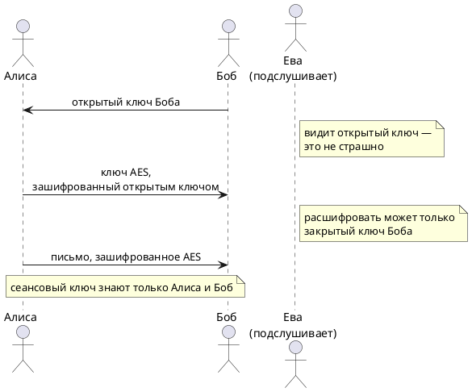

<!-- Собрано автоматически из документов-примеров Spiridus — правки в основном репозитории Spiridus. -->

<!-- раздел: Школа | теги: квантовые вычисления, кубит, сфера блоха, суперпозиция, запутанность, интерференция, криптография, шифрование, rsa, aes, алгоритм шора, алгоритм гровера, постквантовая криптография, bb84, информатика, физика, 10 класс, 11 класс -->
# Почему квантовый компьютер угрожает обычному шифрованию

*Для 10–11 класса: информатика, физика, математика. Время чтения — 25 минут.*

Каждый раз, когда вы открываете сайт по `https`, пишете в мессенджер или платите картой,
данные шифруются. Шифрование опирается на задачи, которые обычному компьютеру решать
непосильно долго. Квантовый компьютер решает некоторые из них несравнимо быстрее — и это
угроза. Разберёмся, какая именно и что с ней делают.

> **Важно не перепутать.** Угрожает шифрованию **квантовый компьютер**. А **квантовое
> шифрование** (квантовое распределение ключей) — наоборот, один из способов защиты: о нём в
> конце статьи.

## 1. Два вида шифрования

**Симметричное** (AES, «Кузнечик»): у отправителя и получателя один и тот же секретный ключ. Оно
быстрое, им шифруют сами данные. Трудность — как договориться о ключе, если канал прослушивают.

**С открытым ключом** (RSA, Диффи — Хеллман, эллиптические кривые): у каждого два ключа —
открытый, который можно показать всем, и закрытый, который хранят в секрете. Им договариваются
о симметричном ключе и ставят электронные подписи.



Вся защита держится на том, что из открытого ключа **нельзя за разумное время вычислить**
закрытый.

## 2. На чём держится RSA

Перемножить два простых числа легко: $61 \cdot 53 = 3233$. А вот по числу $3233$ найти его
множители — задача потруднее. Для чисел из 617 десятичных цифр (RSA-2048) она становится
непосильной: лучший известный обычный алгоритм — **решето числового поля** — тратит
примерно $\exp\left(1{,}92\,(\ln N)^{1/3}(\ln\ln N)^{2/3}\right)$ операций.

Квантовый **алгоритм Шора** (1994) раскладывает число за число операций, растущее примерно как
куб длины числа в битах. Сравним — по вертикали порядок числа операций (степень десятки):

```echarts
{
  "title": {"text": "Сколько операций нужно, чтобы разложить ключ RSA", "left": "center", "textStyle": {"fontSize": 14}},
  "tooltip": {"trigger": "axis"},
  "legend": {"bottom": 0, "data": ["Обычный компьютер (решето)", "Квантовый (Шор)"]},
  "grid": {"left": 60, "right": 20, "top": 50, "bottom": 70},
  "xAxis": {"type": "category", "name": "длина ключа, бит", "nameLocation": "middle", "nameGap": 28, "data": ["256", "512", "1024", "2048", "3072", "4096"]},
  "yAxis": {"type": "value", "name": "степень десятки: 10ˣ операций", "nameLocation": "middle", "nameGap": 36, "max": 50},
  "series": [
    {"name": "Обычный компьютер (решето)", "type": "line", "data": [14.0, 19.2, 26.1, 35.2, 41.8, 47.1], "label": {"show": true, "position": "top"}, "lineStyle": {"width": 3}},
    {"name": "Квантовый (Шор)", "type": "line", "data": [7.2, 8.1, 9.0, 9.9, 10.5, 10.8], "label": {"show": true, "position": "bottom"}, "lineStyle": {"width": 3}}
  ]
}
```

Для RSA-2048 это $10^{35}$ операций против примерно $10^{10}$. Самый быстрый суперкомпьютер делает
около $10^{18}$ операций в секунду — ему понадобились бы миллиарды лет. Квантовому — часы или
дни. (Это оценки порядка величины: у квантового компьютера каждая логическая операция на деле
стоит тысяч физических, чтобы исправлять ошибки.)

## 3. Как работает квантовый компьютер

### Бит и кубит

Обычный бит — это 0 или 1. **Кубит** может быть в **суперпозиции**:
$\ket{\psi} = \alpha\ket{0} + \beta\ket{1}$, где $\alpha$ и $\beta$ — **амплитуды** (комплексные
числа), $|\alpha|^2 + |\beta|^2 = 1$. При измерении кубит выдаёт 0 с вероятностью $|\alpha|^2$ и 1 —
с вероятностью $|\beta|^2$, а суперпозиция разрушается. Состояние одного кубита удобно рисовать
точкой на **сфере Блоха**: полюса — $\ket{0}$ и $\ket{1}$, экватор — равные смеси:

```tikz
\begin{tikzpicture}[scale=2.1, >=Stealth]
  \shade[ball color=blue!10, opacity=0.5] (0,0) circle (1);
  \draw (0,0) circle (1);
  \draw[dashed, gray] (1,0) arc (0:180:1 and 0.3);
  \draw[gray] (-1,0) arc (180:360:1 and 0.3);
  \draw[->] (0,0) -- (0,1.3) node[above] {$\ket{0}$};
  \draw[->] (0,0) -- (0,-1.3) node[below] {$\ket{1}$};
  \draw[->] (0,0) -- (1.35,0) node[right] {$\ket{+} = \tfrac{1}{\sqrt2}(\ket{0}+\ket{1})$};
  \draw[->, very thick, red!70!black] (0,0) -- (0.6,0.6) node[above right] {$\ket{\psi}$};
  \draw[dashed, red!70!black] (0.6,0.6) -- (0.6,-0.2);
  \draw (0,0.4) arc (90:45:0.4);
  \node at (0.2,0.55) {$\theta$};
\end{tikzpicture}
```

Угол $\theta$ задаёт вероятности: $\ket{\psi} = \cos\frac{\theta}{2}\ket{0} + e^{i\varphi}\sin\frac{\theta}{2}\ket{1}$.
Вентиль — поворот этой точки: например, **Адамар** $H$ переводит $\ket{0}$ с полюса на экватор, в
$\ket{+}$.

### Много кубитов — экспоненциально много амплитуд

У $n$ кубитов $2^n$ амплитуд — по одной на каждую строку из нулей и единиц. Три вентиля $H$ дают
суперпозицию всех восьми трёхбитных чисел сразу:

```tikz
\begin{quantikz}
\lstick{$\ket{0}$} & \gate{H} & \meter{} \\
\lstick{$\ket{0}$} & \gate{H} & \meter{} \\
\lstick{$\ket{0}$} & \gate{H} & \meter{}
\end{quantikz}
```

```echarts
{
  "title": {"text": "После H на трёх кубитах: каждое из 8 чисел с вероятностью 1/8", "left": "center", "textStyle": {"fontSize": 13}},
  "grid": {"left": 60, "right": 20, "top": 45, "bottom": 40},
  "xAxis": {"type": "category", "name": "результат", "nameLocation": "middle", "nameGap": 26, "data": ["000", "001", "010", "011", "100", "101", "110", "111"]},
  "yAxis": {"type": "value", "max": 0.25, "name": "вероятность", "nameLocation": "middle", "nameGap": 42},
  "series": [{"type": "bar", "data": [0.125, 0.125, 0.125, 0.125, 0.125, 0.125, 0.125, 0.125], "label": {"show": true, "position": "top"}}]
}
```

| Кубитов | Амплитуд $2^n$ | Чтобы хранить их на обычном компьютере |
|---|---|---|
| 10 | 1 024 | 16 КБ |
| 30 | ≈ 10⁹ | 16 ГБ — хороший ноутбук |
| 50 | ≈ 10¹⁵ | 16 ПБ — больше памяти крупнейших суперкомпьютеров |
| 300 | ≈ 10⁹⁰ | невозможно: во Вселенной ~10⁸⁰ атомов |

Но прочитать все амплитуды нельзя: измерение даёт **одно** случайное число. Вся сила квантового
алгоритма — устроить так, чтобы перед измерением **правильный ответ** набрал большую амплитуду.

### Интерференция: амплитуды складываются со знаком

Амплитуды бывают отрицательными и, как волны, гасят друг друга. Два вентиля Адамара подряд
возвращают кубит в $\ket{0}$: после первого $H$ амплитуды $\ket{0}$ и $\ket{1}$ равны
$\tfrac{1}{\sqrt2}$, а после второго вклады в $\ket{1}$ — $+\tfrac12$ и $-\tfrac12$ — взаимно
уничтожаются, вклады в $\ket{0}$ складываются в 1:

```tikz
\begin{quantikz}
\lstick{$\ket{0}$} & \gate{H} & \gate{H} & \meter{} & \rstick{всегда 0}
\end{quantikz}
```

```echarts
{
  "title": {"text": "Амплитуды по шагам: |1⟩ гасится интерференцией", "left": "center", "textStyle": {"fontSize": 13}},
  "legend": {"bottom": 0, "data": ["амплитуда |0⟩", "амплитуда |1⟩"]},
  "grid": {"left": 50, "right": 20, "top": 45, "bottom": 60},
  "xAxis": {"type": "category", "data": ["начало", "после H", "после H·H"]},
  "yAxis": {"type": "value", "min": 0, "max": 1.2},
  "series": [
    {"name": "амплитуда |0⟩", "type": "bar", "data": [1, 0.71, 1], "label": {"show": true, "position": "top"}},
    {"name": "амплитуда |1⟩", "type": "bar", "data": [0, 0.71, 0], "label": {"show": true, "position": "top"}}
  ]
}
```

Именно так работают алгоритмы Шора и Гровера: неправильные ответы гасят друг друга,
правильные усиливаются.

### Запутанность

Два кубита могут быть **запутаны**: их состояние нельзя описать по отдельности. Адамар и CNOT
дают состояние Белла $\tfrac{1}{\sqrt2}(\ket{00} + \ket{11})$: каждый кубит по отдельности
случайный, но результаты **всегда совпадают**, как бы далеко кубиты ни разнесли.

```tikz
\begin{quantikz}
\lstick{$\ket{0}$} & \gate{H} & \ctrl{1} & \meter{} \\
\lstick{$\ket{0}$} &          & \targ{}  & \meter{}
\end{quantikz}
```

```echarts
{
  "title": {"text": "Состояние Белла: только 00 или 11", "left": "center", "textStyle": {"fontSize": 13}},
  "grid": {"left": 60, "right": 20, "top": 45, "bottom": 40},
  "xAxis": {"type": "category", "name": "результат", "nameLocation": "middle", "nameGap": 26, "data": ["00", "01", "10", "11"]},
  "yAxis": {"type": "value", "max": 0.7, "name": "вероятность", "nameLocation": "middle", "nameGap": 42},
  "series": [{"type": "bar", "data": [0.5, 0, 0, 0.5], "label": {"show": true, "position": "top"}}]
}
```

### Из чего делают кубиты

| Технология | Кубит — это | Кто строит | Особенность |
|---|---|---|---|
| Сверхпроводящие схемы | ток в кольце из сверхпроводника | Google, IBM | охлаждение до ~0,01 К, быстрые вентили |
| Ионы в ловушках | уровни энергии иона | Quantinuum, IonQ | точные вентили, но медленнее |
| Нейтральные атомы | атомы в «оптических пинцетах» | QuEra, Atom Computing | сотни кубитов в одной решётке |
| Фотоны | поляризация или путь фотона | PsiQuantum, Xanadu | при комнатной температуре, трудно запутывать |

В России в 2024 году показали 50-кубитные прототипы на ионах и на нейтральных атомах. Главная
трудность у всех — **ошибки**: кубит теряет состояние от малейшего шума (декогеренция), поэтому
один надёжный «логический» кубит собирают из многих физических.

## 4. Как Шор раскладывает число: поиск периода

Идея Шора: разложение на множители сводится к поиску **периода** последовательности
$a^x \bmod N$. Возьмём $N = 15$ и $a = 7$:

```echarts
{
  "title": {"text": "7ˣ mod 15 повторяется через 4 шага", "left": "center", "textStyle": {"fontSize": 14}},
  "grid": {"left": 50, "right": 20, "top": 50, "bottom": 40},
  "xAxis": {"type": "category", "name": "x", "nameLocation": "middle", "nameGap": 26, "data": ["0", "1", "2", "3", "4", "5", "6", "7", "8"]},
  "yAxis": {"type": "value", "name": "7ˣ mod 15", "nameLocation": "middle", "nameGap": 30, "max": 16},
  "series": [{"type": "line", "data": [1, 7, 4, 13, 1, 7, 4, 13, 1], "symbolSize": 8, "label": {"show": true, "position": "top", "distance": 8}}]
}
```

Период $r = 4$. Дальше — обычная арифметика: $7^{r/2} = 49$, и
$\text{НОД}(49 - 1, 15) = 3$, $\text{НОД}(49 + 1, 15) = 5$. Получили $15 = 3 \cdot 5$.

Обычный компьютер ищет период, перебирая $x$ один за другим, а для 2048-битного числа период
может быть огромным. Квантовый компьютер вычисляет $a^x \bmod N$ **сразу для всех $x$** в
суперпозиции, а затем **квантовое преобразование Фурье** заставляет амплитуды
интерферировать так, что измерение почти наверняка даёт число, связанное с периодом:

```tikz
\begin{quantikz}
\lstick{$\ket{0}^{\otimes n}$} & \gate{H^{\otimes n}} & \gate[2]{U_f:\ \ket{x}\ket{y} \to \ket{x}\ket{y \cdot a^x \bmod N}} & \gate{\mathrm{QFT}^{\dagger}} & \meter{} \\
\lstick{$\ket{1}$} & & & & 
\end{quantikz}
```

Адамар $H^{\otimes n}$ создаёт суперпозицию всех $x$, вентиль $U_f$ вычисляет функцию, обратное
преобразование Фурье выделяет период, измерение даёт ответ.

## 5. А симметричное шифрование?

Для AES квантовый компьютер даёт **алгоритм Гровера**: перебор $2^k$ ключей занимает около
$2^{k/2}$ шагов. Это не взлом, а «ослабление вдвое» по длине ключа — лечится длинным ключом.

| Шифр | Что лежит в основе | Обычный компьютер | Квантовый компьютер | Что делать |
|---|---|---|---|---|
| RSA-2048 | разложение на множители | ~$10^{35}$ операций — безопасно | Шор: взлом за часы–дни | заменить |
| Эллиптические кривые (ECDSA, ГОСТ Р 34.10) | дискретный логарифм | безопасно | Шор: взлом | заменить |
| AES-128 | перебор ключа | $2^{128}$ — безопасно | Гровер: $2^{64}$ — мало | AES-256 |
| AES-256, «Кузнечик» | перебор ключа | $2^{256}$ | Гровер: $2^{128}$ — безопасно | оставить |

## 6. Угроза уже сейчас: «собери сейчас — расшифруй потом»

Достаточно больших квантовых компьютеров ещё нет. Но перехваченные **сегодня** зашифрованные
данные можно сохранить и расшифровать **через 10–15 лет**, когда компьютер появится. Для
медицинских, государственных и банковских тайн, которые важны десятилетиями, это угроза уже
сейчас.

```plantuml
' result: artifact:b5ba05a96d9bcda0/diagram.svg
' build: plantuml-1.2026.9-asl
@startuml
skinparam defaultFontName Arial
skinparam shadowing false
start
:Сегодня: злоумышленник записывает
зашифрованный трафик;
:Хранит годами —
диски дешёвые;
:Появился квантовый компьютер
с миллионами кубитов; <<#fde2e2>>
:Алгоритм Шора вычисляет закрытый ключ
из записанного обмена ключами;
:Расшифрованы старые переписка,
медкарты, документы; <<#fde2e2>>
stop
@enduml
```

## 7. Сколько кубитов нужно и сколько есть

Кубиты ошибаются, поэтому один надёжный «логический» кубит собирают из сотен–тысяч
физических. Оценки для взлома RSA-2048 и самые крупные построенные машины:

```echarts
{
  "title": {"text": "Физические кубиты: есть и нужно", "subtext": "логарифмическая шкала", "left": "center", "textStyle": {"fontSize": 14}},
  "tooltip": {"trigger": "axis"},
  "grid": {"left": 150, "right": 70, "top": 60, "bottom": 30},
  "yAxis": {"type": "category", "inverse": true, "axisLabel": {"fontSize": 11},
    "data": ["Google Sycamore, 2019", "IBM Eagle, 2021", "IBM Osprey, 2022", "IBM Condor, 2023", "Google Willow, 2024", "Нужно (оценка 2025)", "Нужно (оценка 2019)"]},
  "xAxis": {"type": "log", "min": 10, "max": 100000000, "axisLabel": {"show": false}},
  "series": [{"type": "bar", "barWidth": "60%", "label": {"show": true, "position": "right", "fontSize": 11, "formatter": "ru"},
    "data": [53, 127, 433, 1121, 105,
      {"value": 1000000, "itemStyle": {"color": "#c0392b"}},
      {"value": 20000000, "itemStyle": {"color": "#c0392b"}}]}]
}
```

В 2019 году К. Гидни и М. Экеро оценили взлом RSA-2048 примерно в 20 млн физических кубитов и 8
часов работы; в 2025 году Гидни снизил оценку до менее чем миллиона кубитов — примерно за неделю.
Разрыв с сегодняшними машинами — в тысячу раз, но он сокращается с двух сторон: машины растут,
алгоритмы дешевеют.

## 8. Как защищаются

**Постквантовая криптография** — новые алгоритмы с открытым ключом, основанные на задачах,
которые не решаются ни Шором, ни другими известными квантовыми алгоритмами: на решётках, хеш-функциях,
кодах. В 2024 году Национальный институт стандартов США (NIST) утвердил первые стандарты: ML-KEM
(бывший Kyber) — для обмена ключами, ML-DSA (Dilithium) и SLH-DSA (SPHINCS+) — для подписей. Свои
постквантовые алгоритмы разрабатывают и в России. Браузеры и мессенджеры уже переходят на
**гибридный** обмен ключами: классический плюс постквантовый — чтобы взломщику пришлось вскрыть
оба.

**Квантовое распределение ключей** (протокол BB84, 1984) — это и есть «квантовое шифрование».
Ключ передают одиночными фотонами в случайно выбранных базисах. Законы квантовой механики
запрещают измерить состояние, не изменив его, — поэтому подслушивание оставляет следы, и
Алиса с Бобом это замечают:

```plantuml
' result: artifact:ddd32c9638f0871a/diagram.svg
' build: plantuml-1.2026.9-asl
@startuml
skinparam defaultFontName Arial
skinparam shadowing false
start
:Алиса: случайные биты
и случайные базисы + или ×;
:Фотоны по линии;
if (Ева измеряет фотоны?) then
  :Да: часть фотонов
  меняет состояние;
endif
:Боб измеряет
в случайных базисах;
:Сверяют базисы
по открытому каналу;
if (Ошибок в проверочных битах больше 11 %?) then
  :Да: подслушивали —
  ключ выбросить; <<#fde2e2>>
else
  :Нет: ключ годен; <<#e2f5e2>>
endif
stop
@enduml
```

Ограничение BB84 — нужна оптическая линия (оптоволокно или спутник) и особое оборудование,
поэтому для интернета в целом главный путь — постквантовые алгоритмы.

## Главное

- Квантовый компьютер **ломает шифрование с открытым ключом** (RSA, эллиптические кривые) алгоритмом
  Шора и **ослабляет симметричное** (AES) алгоритмом Гровера.
- Больших квантовых компьютеров пока нет, но данные, перехваченные сегодня, могут расшифровать
  завтра.
- Защита: постквантовые алгоритмы (уже стандартизованы), длинные симметричные ключи (AES-256) и
  квантовое распределение ключей там, где есть линия.

<details>
<summary>Проверьте себя</summary>

1. Почему открытый ключ можно показывать всем, а закрытый — нет?
2. Найдите период последовательности $2^x \bmod 15$ и разложите 15 на множители способом Шора.
   *(Ответ: период 4, $2^2 = 4$, $\text{НОД}(3, 15) = 3$, $\text{НОД}(5, 15) = 5$.)*
3. Почему для AES достаточно удвоить длину ключа, а RSA приходится заменять целиком?
4. Как в протоколе BB84 Алиса и Боб узнают, что их подслушивали?

</details>
